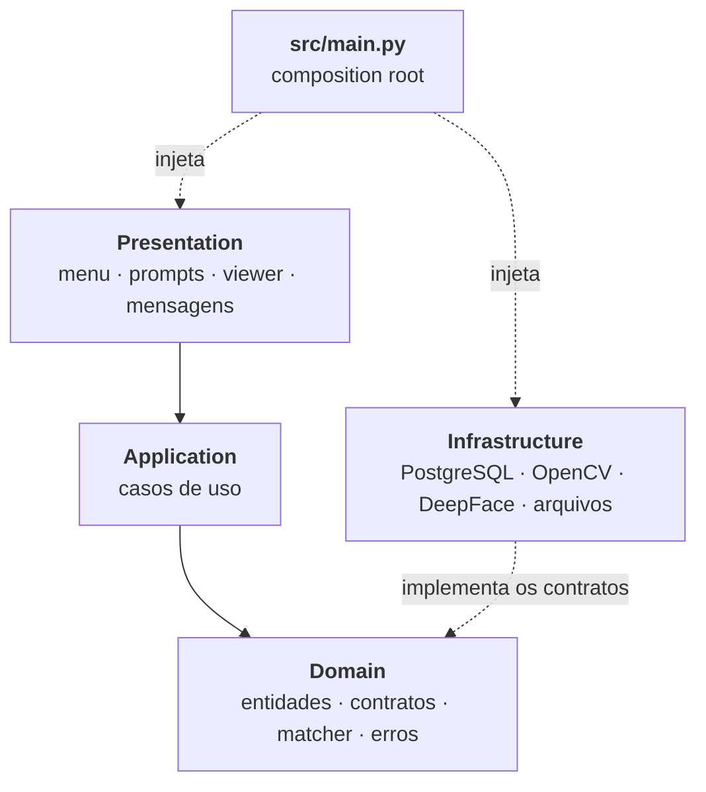
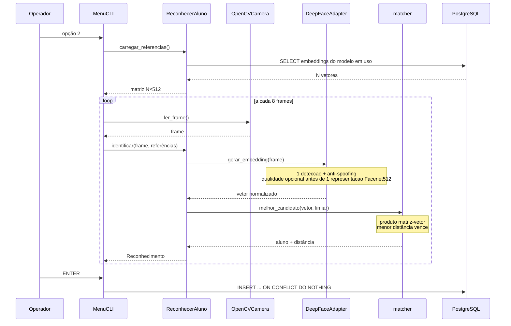
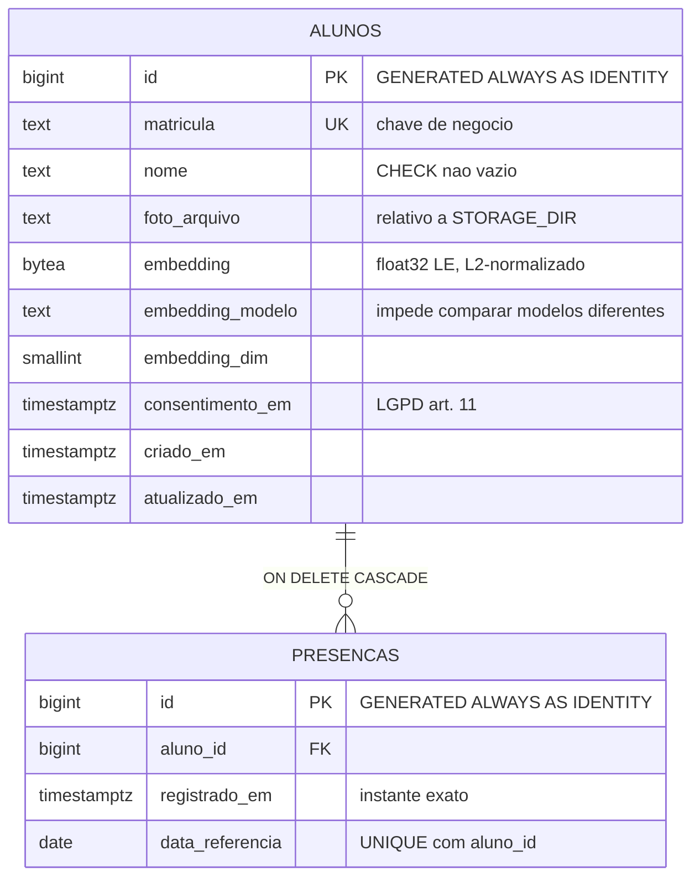
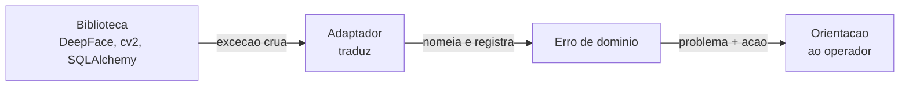

# Arquitetura

Projeto acadêmico da disciplina de Inteligência Artificial da Fatec:
reconhecimento facial para controle de presença de alunos.

| | |
|---|---|
| **Estado** | Fases 1–9 concluídas; 18 de 18 problemas do baseline fechados |
| **Entrada** | `python -m src.main` |
| **Código** | ~2.400 linhas em 30 módulos |
| **Testes** | 611 unitários aprovados em 13/10/2026; última suíte completa histórica: 597 (Etapa 4) |
| **Ponto de partida** | [`docs/baseline-arquitetura.md`](docs/baseline-arquitetura.md) — o protótipo de 364 linhas num arquivo só |

Decisões e trade-offs em [`docs/adr/`](docs/adr/). Plano e histórico da
refatoração em [`REFACTORING_PLAN.md`](REFACTORING_PLAN.md).

---

## 1. Visão geral

O sistema cadastra alunos a partir do rosto e registra presença
reconhecendo-os pela webcam. É uma aplicação CLI local, monousuário, com
PostgreSQL como banco oficial.

O que ele faz, em uma frase por operação:

| Operação | O que acontece |
|---|---|
| **Cadastrar** | Colhe consentimento, valida uma captura e persiste o mesmo recorte usado no embedding |
| **Reconhecer** | Uma inferência por ciclo, comparada por distância cosseno contra todos os cadastrados |
| **Registrar presença** | `INSERT ... ON CONFLICT DO NOTHING` — a regra "uma por dia" é do banco |
| **Listar / consultar** | Alunos com situação de embedding; presenças do dia com horário de chegada |
| **Excluir** | Remove linha, embedding, imagem e presenças (cascade) |

---

## 2. Camadas

Quatro camadas, dependências apontando sempre para dentro.



`src/main.py` é o **único** módulo que conhece implementações concretas.
Todo o resto conversa por `Protocol`s — e os testes unitários rodam sem
webcam, sem OpenCV e sem TensorFlow instalados. A suíte completa inclui
testes de integração/BDD dependentes do PostgreSQL; os totais atuais e o
escopo verificado estão em `docs/ML-ETAPA-5-RESULTADO.md`.

### Invariantes, verificáveis por comando

```bash
# o domínio e a aplicação não conhecem bibliotecas de infraestrutura
grep -rn "import cv2\|from deepface\|sqlalchemy" src/domain/ src/application/   # vazio

# DeepFace vive num arquivo só
grep -rln "from deepface" src/                           # 1 arquivo

# a aplicação não usa SQLite nem cria schema
grep -rn "sqlite3\|CREATE TABLE" src/                    # vazio

# print() é para falar com o operador, não para diagnosticar
grep -rn "^\s*print(" src/ | grep -v presentation | grep -v main.py   # vazio
```

---

## 3. Estrutura

```text
src/
├── main.py                      composition root e entrada
│
├── config/
│   ├── settings.py              pydantic-settings; falha no boot sem DATABASE_URL
│   └── logging.py               logging estruturado, sem PII
│
├── domain/                      núcleo puro — só numpy como dependência externa
│   ├── entities/
│   │   ├── aluno.py             dataclass
│   │   └── face_embedding.py    vetor L2-normalizado + modelo + dimensão
│   ├── repositories/            contratos de persistência
│   ├── services/
│   │   ├── matcher.py           escolha do melhor candidato (regra pura)
│   │   ├── face_recognition.py  contrato do reconhecimento
│   │   ├── camera_provider.py   contrato da fonte de imagem
│   │   └── image_storage.py     contrato do armazenamento
│   └── errors.py                erros nomeados do domínio
│
├── application/use_cases/
│   ├── cadastrar_aluno.py       consentimento → rosto → embedding → persistência
│   ├── reconhecer_aluno.py      1 inferência + comparação vetorizada
│   ├── registrar_presenca.py    delega a unicidade ao banco
│   ├── excluir_aluno.py         direito à eliminação
│   ├── expurgar_presencas.py    política de retenção
│   └── consultar.py             listagens para o operador
│
├── presentation/cli/
│   ├── menu.py                  laço do menu e laços de vídeo
│   ├── prompts.py               entrada do operador (leitor injetável)
│   ├── viewer.py                janela OpenCV
│   ├── confianca.py             distância → porcentagem legível
│   ├── mensagens.py             erro de domínio → orientação acionável
│   └── teclas.py                constantes, sem cv2
│
└── infrastructure/
    ├── database/                engine, sessão transacional, modelos ORM
    ├── repositories/            PostgreSQL — todo o SQL do sistema
    ├── camera/opencv_camera.py  captura (cv2)
    ├── storage/                 imagens em disco (cv2)
    └── face_recognition/
        └── deepface_adapter.py  único importador de deepface
```

---

## 4. Fluxo de reconhecimento

O ganho central da refatoração está aqui: o embedding de referência é
calculado **uma vez, no cadastro**.



Com `FACE_QUALITY_ENABLED=true`, as medidas de tamanho, iluminação e
nitidez são avaliadas depois da face única e do anti-spoofing, antes da
representação. No cadastro, `preparar_cadastro` usa o mesmo recorte para
gravar a imagem e gerar o embedding, evitando uma segunda detecção. Uma
recusa não persiste imagem ou embedding e permite outra captura sem repetir
identificação e consentimento. No reconhecimento, a recusa limpa o candidato
imediatamente; a câmera continua aberta e ENTER não registra presença nesse
ciclo.

### Custo, medido

`python -m scripts.benchmark_matcher`, vetores de 512 dimensões:

| Alunos | Comparação | Ciclos/s |
|---:|---:|---:|
| 10 | 0,0051 ms | 197.566 |
| 50 | 0,0064 ms | 155.409 |
| 200 | 0,0142 ms | 70.628 |
| 1000 | 0,1378 ms | 7.259 |

O desenho anterior fazia até `2N` comparações com inferência facial por
ciclo. Com 200 alunos isso eram 400; hoje cada ciclo faz uma detecção e uma
representação, seguidas da comparação vetorizada em frações de milissegundo.

---

## 5. Modelo de dados



### As regras que viraram constraint

| Regra | Como é garantida |
|---|---|
| Uma presença por aluno por dia | `UNIQUE (aluno_id, data_referencia)` |
| Matrícula não se repete | `UNIQUE (matricula)` |
| Presença sempre tem aluno | `FOREIGN KEY` — sempre ativa no PostgreSQL |
| Excluir aluno leva as presenças | `ON DELETE CASCADE` |
| Nome e matrícula não vazios | `CHECK (length(btrim(...)) > 0)` |
| Embedding sem modelo é inutilizável | `CHECK` de coerência dos três campos |

Nenhuma dessas regras depende de a aplicação lembrar de aplicá-las. O
protótipo fazia `SELECT`-depois-`INSERT` para a regra do dia — sujeito a
corrida e, sobre os dados legados, **cego**: o formato de data gravado fazia
`date()` retornar `NULL` em 39 de 39 linhas.

### Por que `data_referencia` é coluna, e não expressão

`(registrado_em AT TIME ZONE 'America/Sao_Paulo')::date` é `STABLE`, não
`IMMUTABLE`. O PostgreSQL recusa isso em coluna gerada e em índice. O "dia"
é decidido pela aplicação, em `APP_TIMEZONE`, e persistido.

---

## 6. Stack

| Componente | Versão | Papel |
|---|---|---|
| Python | 3.12 / 3.13 | Piso: numpy 2.5.3. Teto: TensorFlow |
| PostgreSQL | 18 | Banco oficial |
| SQLAlchemy | 2.0.52 | ORM, confinado a `infrastructure/` |
| Alembic | 1.19.2 | Migrations versionadas |
| psycopg | 3.3.5 | Driver |
| pydantic-settings | 2.15.0 | Configuração validada |
| numpy | 2.5.3 | Comparação vetorizada (dependência do domínio) |
| DeepFace | 0.0.92 | Detecção, embedding e anti-spoofing |
| TensorFlow + tf-keras | 2.21.0 | Backend do Facenet512 |
| PyTorch | 2.14.0 | Backend do anti-spoofing (MiniFASNet) |
| OpenCV | 4.13.0.92 | Câmera e janela |

O DeepFace declara só `tensorflow>=1.9.0` e não declara `torch`. Ambos são
fixados aqui: sem isso, cada máquina resolvia uma combinação diferente — e
foi assim que o `tf-keras` faltante só apareceu na primeira execução real.

---

## 7. Configuração

Tudo por ambiente. `DATABASE_URL` não tem default: a aplicação **falha no
boot** se ela faltar, em vez de apontar silenciosamente para o banco errado.

| Variável | Padrão | Observação |
|---|---|---|
| `DATABASE_URL` | — | Obrigatória |
| `APP_TIMEZONE` | `America/Sao_Paulo` | Define o "dia" da presença |
| `LOG_LEVEL` | `INFO` | |
| `CAMERA_INDEX` | `0` | |
| `CAMERA_LARGURA` / `CAMERA_ALTURA` | `1280` / `720` | Recorte maior melhora embedding e anti-spoofing |
| `CAMERA_BACKEND` | `auto` | DirectShow no Windows — **27 s → 0,8 s** |
| `FACE_MODEL` | `Facenet512` | Trocar exige backfill |
| `FACE_DETECTOR` | `opencv` | |
| `FACE_THRESHOLD` | `0.30` | Ainda não calibrado — ver ADR-004 |
| `FACE_ANTI_SPOOFING` | `true` | |
| `FACE_QUALITY_ENABLED` | `false` | Opt-in; mantém a política de aceitação anterior por padrão |
| `FACE_QUALITY_MIN_FACE_PX` | `80` | Menor dimensão da face informada pelo detector |
| `FACE_QUALITY_MIN_BRIGHTNESS` / `FACE_QUALITY_MAX_BRIGHTNESS` | `40` / `215` | Faixa fechada da média de luminância, escala 0–255 |
| `FACE_QUALITY_MIN_SHARPNESS` | `100` | Variância mínima do Laplaciano discreto |
| `STORAGE_DIR` | `./storage/faces` | Fora do Git |
| `RETENCAO_PRESENCAS_DIAS` | `1825` | 5 anos; `0` desliga |

Os limites de qualidade são heurísticas iniciais sem calibração biométrica.
A média de luminância não caracteriza toda contraluz, e ruído pode elevar a
medida de nitidez. A validação usa somente imagens sintéticas e demonstra
comportamento do software, sem medir acurácia em reconhecimento facial.

---

## 8. Tratamento de erros

Cada falha tem nome próprio e mensagem que **diz o que fazer**.



| Erro | Mensagem |
|---|---|
| `NenhumRostoDetectado` | Aproxime-se, olhe para a lente, verifique a iluminação |
| `MultiplosRostosDetectados` | Peça que as outras pessoas saiam do enquadramento |
| `RostoMuitoPequeno` | Aproxime-se da câmera e tente novamente |
| `IluminacaoInsuficiente` | Melhore a iluminação frontal e tente novamente |
| `IluminacaoExcessiva` | Reduza a luz direta e tente novamente |
| `RostoSemNitidez` | Fique parado, ajuste o foco e tente novamente |
| `QualidadeCapturaInsuficiente` | Ajuste o enquadramento e tente novamente |
| `PossivelFraude` | Se está ao vivo, o modelo errou: melhore a iluminação e a resolução |
| `ModeloIndisponivel` | Verifique a instalação — **mais a causa original anexada** |
| `CameraIndisponivel` | Feche outros programas e ajuste `CAMERA_INDEX` |
| `AlunoJaCadastrado` / `AlunoNaoEncontrado` | Confira na listagem |

O protótipo transformava tudo isso em `except Exception: continue` e exibia
"Rosto nao reconhecido" — indistinguível de TensorFlow quebrado. Um teste
varre as subclasses de `ErroDeDominio` e falha se alguém adicionar um erro
sem mensagem.

---

## 9. Segurança e dados pessoais

Política completa em [`docs/lgpd.md`](docs/lgpd.md).

| Controle | Estado |
|---|---|
| Consentimento antes da câmera | Implementado; `consentiu` sem default no caso de uso |
| Exclusão completa | Linha + embedding + imagem + presenças |
| Retenção configurável | Script de expurgo, dry-run por padrão |
| Menor privilégio no banco | `escola_app` só DML; DDL exclusivo das migrations |
| Logs sem PII | Aluno por id interno; coberto por teste |
| Anti-spoofing | Implementado; **eficácia pendente de validação** |
| Criptografia em repouso | Não implementada — limite declarado |
| Autenticação de operador | Não implementada — sistema local monousuário |

---

## 10. Testes

```text
tests/
├── unit/          domínio, casos de uso, CLI, adaptadores — com dublês
├── integration/   PostgreSQL real: schema, constraints, repositories, ETL
└── features/      24 cenários BDD em Gherkin (pytest-bdd)
```

A suíte roda **sem OpenCV e sem TensorFlow**. Os módulos que dependem deles
são testados injetando dublês em `sys.modules` — o que cobre a lógica que é
nossa (liberar a câmera no `finally`, sanitizar nomes de arquivo, traduzir
erros) sem exigir hardware.

`requirements-dev.txt` não inclui essas bibliotecas de propósito: se um
teste passar a exigi-las, o CI quebra, e essa quebra é o aviso de que uma
fronteira vazou.

### CI

`.github/workflows/ci.yml`: lint → tipos → migrations sobem e descem →
`alembic check` → testes com piso de 80% de cobertura → verificação de que
nenhum arquivo sensível foi versionado.

---

## 11. O que não foi feito, e por quê

Declarado por honestidade. Nada aqui é omissão silenciosa.

| Item | Situação |
|---|---|
| **Calibração do `FACE_THRESHOLD`** | Calibração 1:1 medida no LFW (Etapa 1): candidato 0,4282 para FAR ≤ 0,1%. **Não adotado**: falta a avaliação 1:N e a validação na webcam da sala. O valor em uso continua 0,30. Ver [ADR-004](docs/adr/ADR-004-limiar-de-reconhecimento.md) e [`docs/ML-ETAPA-1-RESULTADO.md`](docs/ML-ETAPA-1-RESULTADO.md) |
| **Eficácia do anti-spoofing** | Recusou pessoa ao vivo em contraluz com 86–96% de confiança. Falta testar em iluminação frontal e contra foto impressa |
| **Comparação com `DeepFace.verify()`** | A equivalência de decisão sobre imagens reais não foi medida |
| **API HTTP** | Não há consumidor. As camadas permitem adicionar sem tocar nos casos de uso |
| **`pgvector`** | Desnecessário nesta escala — ver [ADR-002](docs/adr/ADR-002-armazenamento-de-embeddings.md) |
| **Threading da inferência** | A causa do travamento era `2N` inferências, não falta de paralelismo |
| **Criptografia, autenticação, auditoria** | Fora do escopo de um sistema local monousuário — ver `docs/lgpd.md` |

---

## 12. Decisões arquiteturais

| ADR | Assunto |
|---|---|
| [ADR-001](docs/adr/ADR-001-migracao-postgresql.md) | SQLite → PostgreSQL; SQLAlchemy + Alembic; redesenho do schema |
| [ADR-002](docs/adr/ADR-002-armazenamento-de-embeddings.md) | `BYTEA` + NumPy; por que **não** `pgvector` |
| [ADR-003](docs/adr/ADR-003-limpeza-do-historico.md) | Remoção do banco legado do histórico do Git |
| [ADR-004](docs/adr/ADR-004-limiar-de-reconhecimento.md) | Limiar por teto de FAR, e por que não EER |
