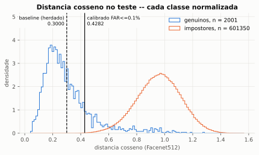
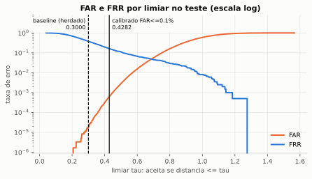

# FaceDiff — Reconhecimento Facial para Controle de Presença

Projeto acadêmico da disciplina de Inteligência Artificial da Fatec (não é um
TCC). O FaceDiff registra a presença dos alunos por reconhecimento facial: o
aluno abre um link no celular, informa a matrícula e olha para a câmera; o
servidor confirma que o rosto é o mesmo do cadastro e grava a presença.

- **Interface web (principal):** FastAPI e uma SPA em JavaScript puro. O
  professor gerencia turmas, aulas, links, cadastros e revisões; o aluno usa a
  câmera do navegador, sem instalar nada.
- **CLI:** menu de terminal com webcam local, herdado do protótipo, que faz
  identificação 1:N na turma selecionada.
- **Implantação:** máquina virtual Ubuntu na Azure, com Docker Compose e HTTPS
  (Caddy + Let's Encrypt), usada pela equipe nos testes e na apresentação.

Os testes automatizados usam dados sintéticos: provam que o software faz o que
promete, não a acurácia biométrica. O que foi e o que não foi medido está em
[Resultados e limites](#resultados-e-limites).

---

## Como funciona

```text
Professor                         Aluno (navegador)                Worker facial
─────────                         ─────────────────                ─────────────
cria turma e link de cadastro ──► abre link, aceita o termo,
                                  envia 3 fotos guiadas ─────────► detecção, qualidade,
                                  (frente / virada / frente)       anti-spoofing, pose
                                                                   e embeddings
aprova ou rejeita o cadastro  ◄─────────────────────────────────── referências pendentes
cria aula e link de presença  ──► informa a matrícula, cumpre
                                  o desafio e envia as fotos ────► verificação 1:1:
                                                                   mediana de 3 distâncias
                                                                   cosseno ≤ 0,30
consulta presenças, revisa,   ◄─────────────────────────────────── presença registrada
exporta CSV                                                        ou recusa explicada
```

**Cadastro.** O aluno abre o link da turma, informa nome e matrícula e aceita o
termo de consentimento; só então a câmera liga. Ele envia três fotos guiadas,
e o worker confere se há um único rosto, qualidade, anti-spoofing, pose e se
as três fotos são da mesma pessoa. O cadastro só passa a valer depois que o
professor o aprova: a câmera confirma o rosto, mas não a identidade civil.

**Presença.** O professor cria a aula (com início e fim) e gera o link. O aluno
digita a matrícula e cumpre um desafio de três etapas: olhar de frente, virar
para o lado sorteado e voltar de frente. Cada etapa passa pelas mesmas
checagens do cadastro e compara o rosto com as três referências do aluno. São
até três tentativas por aula; depois disso, o aluno pode pedir revisão, e o
professor decide com justificativa registrada.

**Recusas.** Problemas que o aluno corrige sozinho (pose, luz, nitidez, rosto
não encontrado) devolvem a mesma etapa com uma dica, até o prazo. Na presença,
identidade não confirmada e anti-spoofing encerram a tentativa; no cadastro, a
recusa do anti-spoofing reabre a coleta, porque o professor ainda aprova.

**Professor e administração.** O administrador cria as contas de professor;
cada professor vê só as próprias turmas. O painel mostra totais e presenças
por aula, exporta CSV por período ou por aula e lista revisões pendentes. As
fotos e os embeddings nunca aparecem na interface.

---

## Inteligência artificial

| Etapa | Modelo | Onde roda | Papel |
|---|---|---|---|
| Detecção | Haar Cascade (OpenCV) | Worker | Encontra o rosto e recorta |
| Qualidade | Heurísticas | Worker | Tamanho mínimo (80 px), brilho e nitidez (variância do Laplaciano) |
| Anti-spoofing | MiniFASNet (PyTorch, via DeepFace) | Worker | Recusa foto impressa e tela |
| Pose | MediaPipe Face Landmarker | Worker (decide) e navegador (guia, WASM) | Confere frente/esquerda/direita e conta rostos |
| Embedding | FaceNet512 pré-treinado (TensorFlow, via DeepFace) | Worker | Transforma o rosto em um vetor de 512 números |
| Decisão | Distância cosseno | Worker | Web: verificação 1:1; CLI: identificação 1:N |

**Nenhum modelo foi treinado pelo projeto.** O FaceNet512 é usado apenas em
inferência; treinar um modelo facial exigiria milhões de rostos autorizados.
O aprendizado de máquina do projeto está na calibração do limiar e nos
experimentos descritos em [Resultados e limites](#resultados-e-limites).

### Decisão de identidade

Rostos da mesma pessoa geram embeddings próximos. A distância usada é
`1 − similaridade cosseno` entre vetores normalizados: 0 é idêntico, e quanto
maior, mais diferentes. Na web, o aluno declara quem é pela matrícula, e o
worker calcula a distância da foto até cada uma das três referências do
cadastro. A presença é aceita se a **mediana** das três distâncias for no
máximo **0,30**:

- o mínimo seria permissivo demais (bastaria uma referência parecida);
- a média sofre com uma referência ruim;
- a mediana tolera uma foto ruim no cadastro.

Comparar 1:1 com a matrícula declarada evita que o erro cresça com o tamanho da
turma, como ocorre na identificação 1:N. Na web, o limiar
(`LIMIAR_VERIFICACAO` em `src/domain/services/verificacao_identidade.py`) e o
anti-spoofing são fixos no código; não há variável que os desligue.

### Prova de vida

1. **Anti-spoofing:** o MiniFASNet classifica a textura do recorte como rosto
   real ou apresentação (foto, tela).
2. **Desafio de pose:** o lado da virada é sorteado no servidor, e a pose de
   cada etapa é conferida pelo MediaPipe no worker. O MediaPipe do navegador só
   orienta o enquadramento e dispara a captura; a decisão é sempre do servidor.
3. **Prazos e nonce:** cada desafio tem prazo e identificador emitidos pelo
   servidor (HMAC), o que impede reenviar capturas antigas.

### Iluminação e flash frontal

O guia do navegador mede o brilho do rosto antes de capturar. Abaixo de 80 (em
0–255), ele mostra a dica de luz e acende o **flash frontal**: a tela fica
branca por um segundo antes da foto, iluminando o rosto. O flash também liga
depois de recusas por rosto escuro, rosto não encontrado, rostos a mais ou
anti-spoofing. Ele não altera o limiar nem a decisão.

No worker, uma foto borrada e escura (brilho abaixo de
`WEB_FACE_QUALITY_DIM_BRIGHTNESS`) é tratada como falta de luz, não como
desfoque. Quando o Haar enxerga rostos a mais (falsos positivos no fundo) e o
MediaPipe confirma um único rosto, o worker usa o maior.

---

## Resultados e limites

### Calibração do limiar (verificação 1:1 no LFW)

A Etapa 1 mediu a verificação 1:1 na base pública LFW, com divisão por
identidade (60/20/20), limiar escolhido na validação e teste aberto uma única
vez: 336 identidades, 1.099 imagens, 2.001 pares genuínos e 601.350 pares
impostores. O anti-spoofing ficou desligado nessa medição, e cerca de 11,8% das
imagens falharam na extração.

| Limiar | FAR (aceita a pessoa errada) | FRR (recusa a pessoa certa) |
|---|---|---|
| **0,30 (em uso)** | ~0,0018% | ~38,03% |
| 0,428 (candidato para FAR ≤ 0,1%) | ~0,063% | ~16,39% |

AUC ~0,983. O limiar 0,30 é conservador: quase nunca aceita a pessoa errada,
mas recusa muitas fotos genuínas do LFW. Na aplicação, as três referências, a
mediana e a repetição de etapas compensam parte disso. O candidato 0,428 **não
foi adotado**: a mudança exige medição com dados representativos da sala de aula.





### Outros experimentos de ML

Implementados e testados **apenas com vetores sintéticos**, sem métricas
biométricas:

- **Supervisionado:** limiar calibrado, regressão logística, Gaussian Naive
  Bayes e árvore de decisão sobre a distância cosseno.
- **Identificação aberta 1:N:** galerias de conhecidos e desconhecidos,
  FPIR/FNIR, top-1, 1 ou 3 referências por identidade e bootstrap.
- **Não supervisionado:** DBSCAN (cosseno) e K-Means, com Silhouette, ARI/NMI e
  PCA.
- **Benchmark de matching:** matriz NumPy vetorizada contra um laço Python, com
  galerias sintéticas de 10 a 1.000 vetores (`scripts.benchmark_matcher`).

### O que não foi medido

- Acurácia em sala de aula e identificação 1:N com pessoas reais.
- Eficácia do anti-spoofing contra ataques (APCER/BPCER). Sabe-se que ele dá
  falso positivo em contraluz.
- Desempenho por subgrupo (tom de pele, gênero, idade).
- Os números do LFW vêm de outro domínio e de um teste já consultado; não são
  métrica operacional.

Além do uso histórico do LFW na Etapa 1, o projeto não usa datasets externos de
rostos nem reutiliza imagens dos alunos cadastrados para avaliação. FEI, DFW,
CelebA e Olivetti foram considerados; a decisão foi não importar novos
datasets faciais.

---

## Arquitetura

```text
Presentation   src/presentation/cli, src/presentation/web (FastAPI + SPA)
     ↓
Application    src/application/use_cases, src/application/services
     ↓
Domain         src/domain/entities, src/domain/repositories, src/domain/services
     ↑
Infrastructure src/infrastructure/{database,repositories,face_recognition,
               camera,storage,workers,backup}
```

O domínio não importa `DeepFace`, `cv2`, MediaPipe nem SQLAlchemy. Ele declara
protocolos (`FaceRecognitionProvider`, repositórios, armazenamento, câmera,
desafio de captura), e a infraestrutura os implementa. Os casos de uso recebem
as dependências prontas; por isso a lógica de negócio é testada sem webcam,
banco ou modelo, e o modelo pode ser trocado sem mexer nas regras.

| Camada | Conteúdo principal |
|---|---|
| `presentation/cli` | Menus, prompts, viewer OpenCV, overlay de landmarks e captura automática |
| `presentation/web` | `app.py` (fábrica, CSP, assets), `routes/` (auth, cadastros, gestão, links, presenças, operações), `rate_limit.py`, `schemas.py`, `static/` (módulos ES sem build) e `templates/index.html` |
| `application/use_cases` | Cadastro, reconhecimento e presença da CLI; cadastro web, aprovação, links, sessões, tentativas, revisão, exportação CSV, contas e turmas |
| `application/services` | `FilaFacial` (fila PostgreSQL limitada), `WorkerFacial` (processamento serial) e orquestração de backup |
| `domain/services` | `matcher` (1:N vetorizado), `verificacao_identidade` (1:1), desafio de captura, autorização, qualidade, consistência temporal e captura automática |
| `infrastructure/face_recognition` | `DeepFaceAdapter` (FaceNet512, detector, anti-spoofing), `DesafioMovimentoAdapter` (pose via MediaPipe em subprocesso) e processadores de jobs web |
| `infrastructure/repositories` | Repositórios `Postgres*`; o SQL fica somente aqui |
| `infrastructure/storage` | Referências privadas, capturas temporárias e imagens legadas |
| `infrastructure/workers`, `backup` | Lock de instância única, gate de manutenção, healthcheck, `pg_dump`/restore e rclone |
| `config` | `settings.py` (CLI) e `web_settings.py` (variáveis `WEB_*`), validados com Pydantic |

Pontos de entrada:

- `src/main.py`: CLI.
- `src/web_main.py`: fábrica ASGI `create_web_app`, servida pelo Uvicorn.
- `src/face_worker_main.py`: worker facial que consome a fila.

**API e worker separados.** A API não carrega modelos: grava cada captura em
armazenamento temporário privado (tmpfs) e enfileira um job no próprio
PostgreSQL, com reserva, prazo e limite de fila (acima dele, responde 503 com
`Retry-After`). Um único worker processa os jobs em série e confirma o
resultado em transação. Assim, o site continua respondendo enquanto o modelo
roda, e não é preciso um serviço extra de fila. O MediaPipe roda num
subprocesso isolado, porque traz outro fornecedor de `cv2`.

**Fluxo CLI.**

```text
Cadastro:   frame → detecção → anti-spoofing → embedding → PostgreSQL
Presença:   frame → detecção → anti-spoofing → embedding → matcher 1:N → registro
```

### Decisões técnicas

- **PostgreSQL com SQLAlchemy 2 e Alembic**, no lugar do SQLite do protótipo:
  concorrência, constraints, papéis com menor privilégio e migrations
  revisáveis (`0001`–`0011`). A aplicação nunca cria tabelas sozinha.
- **Embeddings em `BYTEA` (float32 little-endian)**, gravados com o nome do
  modelo e a dimensão. Comparar vetores de modelos diferentes levanta erro em
  vez de identificar a pessoa errada em silêncio.
- **Limiar por teto de FAR:** o critério é quanto de aceitação indevida o
  sistema tolera. O 0,30 continua em uso até haver calibração com dados
  representativos.
- **Recorte do rosto guardado junto do embedding**, para permitir recalcular os
  vetores se o modelo mudar.

---

## Segurança e privacidade

Dado biométrico é dado pessoal sensível (LGPD, art. 5º, II). O projeto aplica
os controles abaixo, mas **não declara conformidade integral**; isso depende
de análise da instituição.

**Coleta e finalidade.**

- O termo de consentimento é exibido antes de a câmera ligar; o aceite e a
  versão do termo ficam registrados com cada referência.
- A única finalidade é o registro de presença.
- `WEB_RETENTION_DAYS` define a retenção dos dados web, e `WEB_PURPOSE_END_AT`
  define o fim da finalidade do cadastro.

**O que é guardado.**

- **Cadastro:** três recortes do rosto (PNG) num volume privado, fora da raiz
  HTTP e com nomes aleatórios, além dos embeddings no PostgreSQL. O quadro
  inteiro da câmera não é guardado.
- **Presença:** as fotos ficam só na área temporária em memória (tmpfs) e são
  apagadas depois do processamento.
- **Professor:** vê alunos, estados e horários, nunca fotos ou embeddings.

**Exclusão.** A exclusão global de um aluno remove referências, embeddings,
vínculos e arquivos e registra quem excluiu e quando. Um registro à parte,
encadeado por hash e só com o id, reaplica as exclusões se um backup antigo for
restaurado.

**Contas.**

- Senhas em Argon2id.
- O cookie de sessão é `Secure`, `HttpOnly` e `SameSite=Lax`, vale até 8 h e
  expira após 30 min sem uso; o banco guarda só o hash.
- Mutações exigem token CSRF e origem conferida.
- Cinco falhas de login em 15 min bloqueiam a conta ou o IP.
- O primeiro admin só é criado por comando local.

**Rotas públicas.** Os limites por link e por IP guardam apenas HMAC; usuário e
IP não ficam gravados.

**Logs.** Identificam o aluno só pelo id interno. Nunca registram imagem,
embedding, nome ou matrícula, e um teste cobre essa regra.

**Infraestrutura.**

- Só o Caddy publica as portas 80/443; API e banco ficam em rede interna, e o
  worker não tem rota de saída.
- A aplicação conecta com um papel só de DML (`facediff_app`); o DDL fica com
  o papel das migrations.
- Os segredos são arquivos `0400` fora do repositório.

**No Git.** `*.db`, `/fotos/`, `/storage/`, `.env`, `/models/*.task`,
`/avaliacao/` e os ambientes virtuais estão no `.gitignore`. O banco SQLite do
protótipo, que ligava o nome real de uma pessoa a 39 registros de presença, foi
removido de todo o histórico em 2026-09-07:

```bash
git rev-list --all --objects | grep escola.db   # não deve retornar nada
```

**Limites conhecidos.**

- A aplicação não cifra os dados em repouso; eles dependem do disco e do
  controle de acesso.
- O sistema não verifica a localização do aluno: o link vale só no horário da
  aula e pode ser revogado.
- O anti-spoofing não foi validado contra ataques.

---

## Requisitos

- **Python 3.12 ou 3.13.** O TensorFlow publica wheels até 3.13, e o
  `numpy==2.5.3` só a partir de 3.12.
- **Docker** (ou PostgreSQL 16+ local).
- **Webcam** para a CLI; navegador com câmera para a interface web.

---

## Instalação

```powershell
# 1. Configuração — o .env real nunca vai para o Git
copy .env.example .env
py -3.12 -c "import secrets; print(secrets.token_urlsafe(48))"   # valor de WEB_SECRET_KEY
notepad .env
```

No `.env`, uma variável por linha:

- `POSTGRES_PASSWORD`: use só letras e números, para não precisar codificar a
  senha nas URLs;
- a mesma senha em `DATABASE_URL` (`localhost:5433`, usada fora do Docker) e
  em `WEB_DATABASE_URL` (`db:5432`, a rede interna do compose, igual no
  Windows e no Linux);
- `WEB_SECRET_KEY`: o valor gerado acima;
- `WEB_LOCAL_DEEPFACE_WEIGHTS_HOST_DIR`: pasta dos pesos, preenchida por
  `scripts.baixar_modelos` (ver [Primeira vez: modelos](#primeira-vez-modelos)).

```powershell
# 2. Banco (porta 5433, para não colidir com um PostgreSQL nativo)
docker compose up -d db

# 3. Schema — a aplicação nunca cria tabelas, só migrations.
#    Ambiente leve, só para o Alembic, sem TensorFlow (versões do requirements.txt):
py -3.12 -m venv .venv-migrations
.venv-migrations\Scripts\python.exe -m pip install alembic==1.19.2 SQLAlchemy==2.0.52 "psycopg[binary]==3.3.5" pydantic-settings==2.15.0 tzdata
.venv-migrations\Scripts\python.exe -m alembic upgrade head
```

O `tzdata` é necessário no Windows, que não traz a base de fusos usada por
`APP_TIMEZONE`. Para usar a CLI, instale o ambiente completo, que também roda
o `alembic`. Ele baixa TensorFlow e PyTorch: ~500 MB e alguns minutos.

```powershell
py -3.12 -m venv .venv-app
.venv-app\Scripts\activate
python -m pip install --upgrade pip
pip install -r requirements.txt
```

| Arquivo | Para quê |
|---|---|
| `requirements.txt` | CLI completa: DeepFace, TensorFlow, PyTorch, OpenCV, SQLAlchemy, Alembic |
| `requirements-web.txt` | API web leve: FastAPI, Uvicorn, Pydantic, SQLAlchemy, sem modelos |
| `requirements-ml.txt` | Worker facial |
| `requirements-landmarks.txt` / `-linux.txt` | MediaPipe em ambiente isolado (outro fornecedor de `cv2`) |
| `requirements-dev.txt` | Testes, Ruff e mypy |
| `requirements-experimentos.txt` | Scripts de experimentos de ML |

---

## Executar a interface web

O caminho suportado é o perfil `web` do Docker Compose, que sobe banco, API e
worker com os mesmos volumes temporários. Faça antes a [instalação](#instalação)
(`.env`, banco e schema).

### Primeira vez: modelos

Os modelos ficam fora do Git, e o worker não acessa a internet. Baixe-os antes
do primeiro build; sem o `face_landmarker.task`, o build falha com
`"/models/face_landmarker.task": not found`.

```powershell
py -3.12 -m scripts.baixar_modelos
```

O script usa só a biblioteca padrão e baixa ~103 MB das URLs oficiais (as
mesmas que o DeepFace e o MediaPipe usam), conferindo o SHA-256 fixado de cada
arquivo:

- `models/face_landmarker.task` (MediaPipe Face Landmarker, float16, versão 1,
  Apache 2.0): copiado para a imagem no build;
- pesos do FaceNet512 e do anti-spoofing em `~/.deepface/weights`: montados no
  worker somente para leitura e usados também pela CLI.

Ele também grava no `.env`, se existir, `WEB_LOCAL_DEEPFACE_WEIGHTS_HOST_DIR`
com a pasta dos pesos deste computador. Arquivos já presentes e íntegros não
são baixados de novo, então rodar outra vez é seguro.

### Subir

```powershell
docker compose --profile web up -d --build   # o primeiro build demora
docker compose --profile web ps              # aguarde os 3 serviços healthy
Invoke-RestMethod http://127.0.0.1:8000/health/ready

# primeira vez: conta administrativa (usuário e senha pedidos no prompt)
docker compose exec web python -m scripts.criar_admin_web
```

Abra `http://127.0.0.1:8000` e entre com o administrador; contas de professor
são criadas pela tela de administração. A câmera do navegador só funciona em
`localhost` ou HTTPS. O worker demora a ficar `healthy` porque carrega os
modelos. Nas próximas vezes, com o Docker Desktop aberto,
`docker compose --profile web up -d` basta; use `--build` só depois de mudar
código.

Para parar sem perder dados, use
`docker compose --profile web stop web face-worker`. Não use `down -v`. Depois
de mudar só código da API ou do frontend, reconstrua apenas `web`:
`docker compose --profile web up -d --build web`.

No Windows com Docker Desktop, limite a VM do WSL2 em
`%USERPROFILE%\.wslconfig` (por exemplo `memory=4GB` e
`autoMemoryReclaim=dropCache`): o build e o TensorFlow do worker consomem
bastante memória, e sem limite o WSL pode esgotar a RAM do Windows.

---

## Executar a CLI

```powershell
python -m src.main
```

```text
Menu principal:                     Menu de turma ativa:
1 - Criar turma                     1 - Cadastrar aluno novo
2 - Listar e selecionar turma       2 - Vincular matrícula existente
3 - Histórico de turmas excluídas   3 - Listar alunos da turma
4 - Administração global            4 - Reconhecer e registrar presença
5 - Sair                            5 - Consultar presenças
                                    6 - Remover vínculo
                                    7 - Atualizar matéria/período
                                    8 - Excluir turma
                                    9 - Voltar
```

- **Cadastro:** sem o aceite do termo de consentimento, a câmera nem liga. No
  modo automático, mantenha um rosto visível durante a sequência; ESC cancela.
- **Reconhecimento:** opera só na turma selecionada. A presença é registrada
  após 5 s de observações válidas, pelo menos três análises e uma
  reidentificação final da mesma pessoa. O percentual exibido deriva da
  distância ao limiar; **não é probabilidade nem foi calibrado**.
- `FACE_AUTO_CAPTURE_ENABLED=false` volta ao modo manual (ESPAÇO captura,
  ENTER registra, ESC sai).
- Um aluno tem matrícula única e pode estar em várias turmas; a presença é
  única por turma, aluno e dia.
- Excluir turma é lógico e preserva o histórico. A exclusão global de um
  aluno, com imagem, embedding e presenças, fica na administração e exige
  confirmação.

Na primeira execução, o modelo é carregado antes de a câmera abrir, e os pesos
do DeepFace são baixados nesse momento.

---

## Configuração

Tudo vem do `.env` ou do ambiente. As variáveis obrigatórias não têm default:
a aplicação falha no boot em vez de apontar silenciosamente para o banco
errado. A lista completa está no `.env.example`.

### CLI e núcleo de reconhecimento

| Variável | Padrão | Para quê |
|---|---|---|
| `DATABASE_URL` | — | **Obrigatória** |
| `APP_TIMEZONE` | `America/Sao_Paulo` | Define o "dia" da presença |
| `LOG_LEVEL` | `INFO` | |
| `CAMERA_INDEX` | `0` | |
| `CAMERA_LARGURA` / `CAMERA_ALTURA` | `1280` / `720` | Recorte maior melhora embedding e anti-spoofing |
| `CAMERA_BACKEND` | `auto` | DirectShow no Windows; ver *Problemas conhecidos* |
| `FACE_MODEL` | `Facenet512` | Trocar exige backfill |
| `FACE_DETECTOR` | `opencv` | |
| `FACE_THRESHOLD` | `0.30` | Limiar da CLI; ver [Resultados e limites](#resultados-e-limites) |
| `FACE_ANTI_SPOOFING` | `true` | Recusa foto impressa e tela |
| `FACE_AUTO_CAPTURE_ENABLED` | `true` | `false` recupera ESPAÇO/ENTER |
| `FACE_AUTO_CAPTURE_WAIT_SECONDS` | `5.0` | Duração mínima da sequência válida |
| `FACE_AUTO_CAPTURE_SAMPLE_SECONDS` | `0.5` | Intervalo mínimo entre análises |
| `FACE_AUTO_CAPTURE_MAX_AGE_SECONDS` | `2.0` | Idade máxima das observações |
| `FACE_LANDMARKS_ENABLED` | `false` | Landmarks na prévia de cadastro da CLI |
| `FACE_LANDMARKS_MODEL_PATH` | `models/face_landmarker.task` | Bundle local |
| `FACE_LANDMARKS_PYTHON_PATH` | `.venv-landmarks/Scripts/python.exe` | Interpretador isolado do MediaPipe |
| `FACE_QUALITY_ENABLED` | `false` | Checagens heurísticas de nitidez, luz e tamanho (opt-in) |
| `FACE_TEMPORAL_ENABLED` | `false` | Sequência consistente antes de ENTER no modo manual (opt-in) |
| `FACE_AMBIGUITY_ENABLED` | `false` | Recusa identidades próximas; exige `FACE_AMBIGUITY_MIN_MARGIN` |
| `STORAGE_DIR` | `./storage/faces` | Fora do Git |
| `RETENCAO_PRESENCAS_DIAS` | `1825` | 5 anos; `0` desliga o expurgo |

Os limites de qualidade, temporais e de ambiguidade são parâmetros de
engenharia, sem calibração biométrica, e não alteram o limiar nem o
anti-spoofing.

### Interface web

| Variável | Padrão | Para quê |
|---|---|---|
| `WEB_DATABASE_URL` | — | **Obrigatória** |
| `WEB_SECRET_KEY` | — | **Obrigatória**; assina sessões e credenciais |
| `WEB_RETENTION_DAYS` | — | **Obrigatória**; retenção dos dados web, em dias |
| `WEB_PURPOSE_END_AT` | — | Fim da finalidade do tratamento; obrigatória em produção |
| `WEB_PUBLIC_ORIGIN` | `http://127.0.0.1:8000` no Compose | Endereço aberto no navegador (validação de origem e CSRF) |
| `WEB_TRUSTED_PROXY_CIDRS` | vazio | Proxies cujo `X-Forwarded-For` é aceito |
| `WEB_JOB_QUEUE_WAITING_LIMIT` | `30` | Jobs aguardando na fila facial |
| `WEB_PRESENCE_START_LIMIT_PER_WINDOW` | `60` | Inícios de presença por link e IP a cada 15 min |
| `WEB_PRESENCE_CAPTURE_LIMIT_PER_WINDOW` | `300` | Capturas de presença por link e IP a cada 15 min |
| `WEB_PUBLIC_REGISTRATION_CONTEXT_LIMIT_PER_MINUTE` | `40` | Acessos públicos ao cadastro por minuto |
| `WEB_CAPTURE_MAX_BYTES_PER_CAPTURE` | `2 MiB` | Tamanho máximo de cada frame |
| `WEB_CAPTURE_STORAGE_QUOTA_BYTES` | `300 MiB` | Quota temporária; precisa ser ≥ 3 × máximo × (fila + 1) |
| `WEB_FACE_QUALITY_MIN_FACE_PX` | `80` | Menor lado aceito do rosto, em pixels |
| `WEB_FACE_QUALITY_MIN_BRIGHTNESS` / `MAX_BRIGHTNESS` | `40` / `215` | Faixa de brilho médio do rosto (0–255) |
| `WEB_FACE_QUALITY_MIN_SHARPNESS` | `100` | Nitidez mínima (variância do Laplaciano) |
| `WEB_FACE_QUALITY_DIM_BRIGHTNESS` | `80` | Abaixo disso, foto borrada conta como falta de luz |

Os limites comportam uma turma inteira atrás do mesmo IP (Wi-Fi do campus):
20 alunos × 3 tentativas × 3 etapas = 180 capturas. Para o auditório da
apresentação, a VM usou `WEB_FACE_QUALITY_MIN_BRIGHTNESS=25` e
`WEB_FACE_QUALITY_MIN_SHARPNESS=30`. O worker registra em log as medidas de
cada captura (tamanho, brilho e nitidez), e a API registra se o navegador usou
o flash: é por esses valores que se calibra. Os demais parâmetros estão em
`src/config/web_settings.py`.

---

## Deploy

A implantação usa `deploy/web/`: Docker Compose com `caddy`, `app`,
`face-worker`, `postgres`, `backup` e o comando `migrate`, imagens-base fixadas
por digest e `WEB_IMAGE_TAG` igual ao commit implantado (nunca `latest`).

A VM da apresentação é uma Azure Standard D2as_v4 (2 vCPU, 8 GB) com Ubuntu
24.04. O NSG libera SSH só para o IP administrativo e as portas 80/443 para
todos. O domínio usa o rótulo DNS gratuito da Azure
(`<rótulo>.<região>.cloudapp.azure.com`), e o Caddy obtém o certificado da
Let's Encrypt.

### Preparar o host

Com Docker Engine e Compose v2 instalados e o repositório em
`/opt/facediff/current`:

```sh
cd /opt/facediff/current
sudo bash deploy/web/preparar_vps.sh --dominio facediff.exemplo.com --email voce@exemplo.com
```

O script:

- cria `/etc/facediff/web-deploy.env` a partir de `deploy/web/.env.example`,
  com `WEB_IMAGE_TAG`, `WEB_DOMAIN` e `CADDY_ACME_EMAIL`;
- gera os oito segredos em `/etc/facediff/secrets` (modo `0400`, sem
  sobrescrever os existentes);
- baixa e confere os modelos em `/srv/facediff/models`;
- instala o tmpfs `/run/facediff` (1 GiB, `noexec`, perdido no reboot) para
  capturas e manutenção.

Pode ser executado de novo, por exemplo após um `git pull`, para atualizar o
`WEB_IMAGE_TAG`.

### Subir a stack

```sh
cd /opt/facediff/current/deploy/web
ENV=/etc/facediff/web-deploy.env
sudo docker compose --env-file $ENV build postgres app face-worker migrate backup caddy
sudo docker compose --env-file $ENV up -d postgres                       # cria só os papéis
sudo docker compose --env-file $ENV --profile admin run --rm --no-deps migrate
sudo docker compose --env-file $ENV up -d app face-worker
sudo docker compose --env-file $ENV run --rm --no-deps -it app python -m scripts.criar_admin_web
sudo docker compose --env-file $ENV up -d caddy
```

A API expõe `/health/live` (processo) e `/health/ready` (banco). O worker só
fica `healthy` depois de carregar os modelos e confirmar o lock exclusivo no
PostgreSQL. Migrations nunca rodam no `up`; são sempre o comando explícito
`migrate`, com o papel migrador.

### Atualizar

Rode `git pull` no checkout e execute `preparar_vps.sh` de novo para atualizar
o `WEB_IMAGE_TAG`. Depois, faça `build app face-worker migrate`, rode
`migrate` se houver migration nova e termine com `up -d`. Prefira atualizar com
a fila ociosa: reiniciar o worker invalida os jobs em andamento.

Recriar o container apaga o log do worker. Se precisar dele, salve antes com
`docker compose logs face-worker > arquivo.log`.

Para voltar à versão anterior: reconstrua com o `WEB_IMAGE_TAG` do commit
anterior, preservando volumes. Não use `down -v` nem downgrade Alembic
automático.

### Backup

`scripts.web_backup` gera um `pg_dump` cifrado com rclone crypt, e
`scripts.web_restore_check` prova a restauração num destino descartável. O
ciclo completo (dump cifrado e restauração) foi validado num ambiente local
descartável. Na VM da apresentação, o timer diário
(`ops/systemd/facediff-web-backup.*.example`) **não foi ativado**. Guarde fora
da VM uma cópia do `rclone.conf`: sem ela, o backup não pode ser restaurado.

---

## Operação

### Migrations

```bash
alembic upgrade head            # aplica
alembic downgrade -1            # desfaz a última
alembic check                   # acusa divergência entre modelos e banco
alembic revision --autogenerate -m "descricao"
```

As revisões vão de `0001` a `0011`. Toda revisão implementa `downgrade()`, e
o autogenerate é só ponto de partida: revise à mão, porque ele não emite
`CHECK` nem `IDENTITY` de forma confiável. A URL vem de `DATABASE_URL` (ou
`ALEMBIC_DATABASE_URL`).

### Trocar de modelo de reconhecimento

Vetores de modelos diferentes **não são comparáveis**. O modelo fica gravado
junto do vetor, e uma divergência levanta erro em vez de identificar a pessoa
errada em silêncio. Depois de mudar `FACE_MODEL`:

```bash
python -m scripts.backfill_embeddings            # simula
python -m scripts.backfill_embeddings --apply    # efetiva
```

### Retenção

```bash
python -m scripts.expurgar_presencas            # CLI: simula
python -m scripts.expurgar_presencas --apply    # CLI: efetiva
```

A retenção vale para o histórico de presença, nunca para o cadastro. Na web, a
retenção é feita por `scripts.web_retencao`.

### Menor privilégio no banco

A aplicação não deve conectar com o dono do banco:

```bash
psql -U escola -d escola \
     -v senha="'SENHA_DA_APLICACAO'" \
     -f scripts/sql/criar_usuario_aplicacao.sql
```

Aponte o `DATABASE_URL` da aplicação para `escola_app` e use o dono apenas no
`alembic upgrade`. No deploy web, os papéis `facediff_app` e
`facediff_migrator` são criados por `deploy/web/postgres-init/`.

### Importar um banco SQLite legado

```bash
python -m scripts.import_legacy_sqlite --sqlite caminho/escola.db          # simula
python -m scripts.import_legacy_sqlite --sqlite caminho/escola.db --apply  # efetiva
```

Abre a origem somente para leitura, roda em transação única, é idempotente e
grava em `storage/etl/` um relatório com toda linha rejeitada e o motivo.

---

## Desenvolvimento

```bash
pip install -r requirements-dev.txt

pytest tests/unit                        # unitários, sem PostgreSQL
pytest --cov=src --cov-report=term       # suíte com cobertura
node --test tests/e2e/web/frontend.test.mjs   # módulos do frontend
ruff check .                             # lint
mypy                                     # tipos
```

```text
tests/
├── unit/          domínio, casos de uso, CLI, rotas web, adaptadores (com dublês)
├── integration/   PostgreSQL real: schema, constraints, repositories, migrations
├── features/      cenários BDD em Gherkin (pytest-bdd)
└── e2e/web/       testes Node dos módulos ES do frontend
```

`requirements-dev.txt` não inclui OpenCV nem DeepFace: a suíte roda com
dublês injetados em `sys.modules`. Se um teste passar a exigir esses pacotes,
uma fronteira vazou.

Os testes de integração PostgreSQL são destrutivos: podem truncar tabelas. Eles
não leem o `.env` e só rodam com opt-in explícito. Por exemplo, os de turmas
exigem:

```powershell
$env:FACE_TURMAS_TEST_DB_AUTORIZACAO = "AUTORIZO_DESTRUIR_BANCO_DESCARTAVEL_TASK_008"
$env:FACE_TURMAS_TEST_DATABASE_URL = "postgresql+psycopg://.../escola_test"
$env:FACE_TURMAS_MIGRATION_DATABASE_URL = "postgresql+psycopg://.../escola_migration_test"
```

Cada banco também precisa de um `COMMENT ON DATABASE` marcando-o como
descartável; o texto exigido está no topo de cada módulo de integração (por
exemplo, `tests/conftest.py`). Sem isso, os testes são ignorados, e um skip não
conta como validação.

### CI

`.github/workflows/ci.yml` roda a cada push e PR: Ruff, mypy, migrations
(sobem e descem), `alembic check`, testes com piso de 80% de cobertura e uma
verificação de que nenhum arquivo sensível foi versionado.

### Avaliação do modelo (≠ teste de software)

Teste de software verifica se o pipeline faz o que promete; avaliação de
modelo mede se ele **acerta**.

```bash
python -m scripts.evaluate_model --dataset avaliacao/datasets/<nome> --validar-divisao
python -m scripts.evaluate_model --dataset avaliacao/datasets/<nome>
python -m scripts.calibrar_limiar --dataset avaliacao/datasets/lfw
```

A calibração divide por identidade, escolhe o limiar na validação e abre o
teste uma única vez; ela **não** altera o `FACE_THRESHOLD`. A estrutura
esperada do dataset está no docstring de `scripts/evaluate_model.py`.
`avaliacao/` é ignorado pelo Git. **Nunca use imagens dos alunos cadastrados.**

---

## Problemas conhecidos

### `ImportError: Keras cannot be imported`

O DeepFace liga `TF_USE_LEGACY_KERAS=1`, e desde o TensorFlow 2.16 o
`tf.keras` legado vive num pacote separado. O `requirements.txt` fixa
`tf-keras==2.21.0`; se instalou antes, rode `pip install tf-keras==2.21.0`.

### `You must install torch ... to use face anti spoofing`

O anti-spoofing roda em PyTorch. Já está no `requirements.txt`
(`torch==2.14.0`).

### Cadastro recusado com "apresentação de foto", mas você está ao vivo

Falso positivo do MiniFASNet. Na ordem de eficácia:

1. **Iluminação:** luz forte atrás de você é a causa mais comum.
2. **Resolução:** aumente `CAMERA_LARGURA` e `CAMERA_ALTURA`.
3. **Aproxime o rosto** da câmera.
4. `FACE_DETECTOR=retinaface` recorta melhor que o Haar, mas é mais lento.

Mantenha `FACE_ANTI_SPOOFING=true`. O número no log é a confiança da classe
escolhida: "96%" num frame recusado significa 96% de confiança de fraude.

### A interface web fica em "Carregando a interface…"

O navegador guardou um módulo JavaScript antigo. Os assets são servidos com
`Cache-Control: no-cache`, e `index.html` versiona os imports com `?v=`. Ao
mudar um módulo do frontend, troque o `?v=` em `index.html` e nos imports
afetados em `app.mjs`.

### A câmera da CLI demora para abrir

No Windows, o Media Foundation leva ~27 s para abrir e ajustar a resolução; o
DirectShow, ~0,8 s. `CAMERA_BACKEND=auto` já escolhe DirectShow. Se a câmera
não funcionar com ele, use `CAMERA_BACKEND=msmf`.

### Mensagens do TensorFlow no start

`oneDNN custom operations are on...` é informativo. Para silenciar:
`$env:TF_ENABLE_ONEDNN_OPTS = "0"` e `$env:TF_CPP_MIN_LOG_LEVEL = "2"`.

### A primeira execução parece travada

O DeepFace está baixando os pesos do Facenet512 (~90 MB) e, no primeiro
cadastro, os do anti-spoofing (~4 MB).

---

## Limitações e próximos passos

- Medir a acurácia em condições de sala de aula, com voluntários e autorização
  institucional, e só então rever o limiar 0,30.
- Avaliar o anti-spoofing contra ataques reais (foto, tela, vídeo) e o
  desempenho por subgrupo.
- Verificar a presença física (por exemplo, rede do campus ou código exibido
  em sala).
- Escalar além de uma turma por vez: mais workers, GPU e fila distribuída.
- Ativar o backup diário e a cópia externa cifrada antes de uso real.
