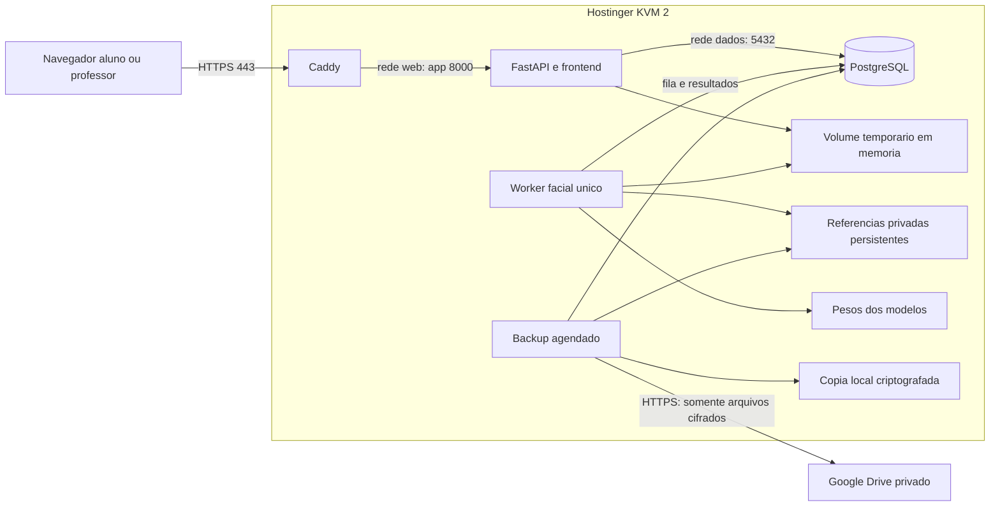

# FaceDiff web — arquitetura e operação na Hostinger KVM 2

Data: 20/10/2026. **Desenho da operação futura; infraestrutura de produção não existe.**
Requisitos e classificação C/R/V no [planejamento principal](PLANEJAMENTO-FUTURO-PRESENCA-WEB.md).
Deploy e operação dependem de autorização futura. A task019A validou somente
containers, banco e volumes locais descartáveis; os procedimentos de hospedagem
abaixo não foram executados. Não conectar Google Drive nem acessar dados reais.

Estado do código em 18/10/2026: as tasks 009–016 fornecem fundação, autenticação,
referências, fila/worker, verificação 1:1, cadastro/aprovação, presença por
sessão e gestão/revisão/CSV via API. As migrations `0006` a `0010` foram
validadas em PostgreSQL descartável. Em 19/10/2026, `0006–0011` também foram
aplicadas em sequência ao banco local `escola`, que estava na revisão `0005`;
`alembic check` confirmou `0011`. Os fluxos de cadastro, presença e gestão foram
exercitados com API e dados sintéticos; dois testes PostgreSQL task016 provaram
o schema, a concorrência transacional revisão/worker e a recusa de downgrade
com revisão persistida. tmpfs compartilhado de produção, validação com
pessoas, inspeção visual/E2E da interface e deploy continuam pendentes. A tarefa
020 já implementou parcialmente os templates e fluxos web; consulte seu
[resultado](../tasks/020-web-interface-final/RESULTADO.md). O
armazenamento privado recebe a raiz por injeção; em Windows, a conta de serviço
precisa de ACL exclusiva. Nenhum root de produção foi configurado.

A task012 valida o contrato técnico da fila, não a capacidade da VPS. A task013
acrescenta desafio servidor de frente/virada/retorno e verificação 1:1 com três
referências; limiar e geometria de pose são heurísticas sem calibração. O processo
worker serializa execução por lock local e lock advisory de sessão, invalida jobs
ativos no reinício e aceita resultado somente sob lease/prazo válido. O smoke
com pesos locais ocorreu em Windows com entrada sintética; não prova desempenho
ou inferência operacional em Linux. Veja [runtime web](FACEDIFF-WEB-RUNTIME.md)
e [resultado 012](../tasks/012-web-worker-fila/RESULTADO.md).
Veja também o [resultado 013](../tasks/013-web-desafio-verificacao-1a1/RESULTADO.md).

Em 19/10/2026, a task018 acrescentou artefatos revisáveis de deploy em
`deploy/web`: Compose, imagens separadas para API/worker, Caddy, secrets por
arquivo, migração manual e backup one-shot. A task019A construiu e executou
esses targets localmente com projeto e volumes descartáveis, validou o Caddy,
healthchecks, migrations e persistência após recriação. Isso não é deploy: DNS,
firewall, KVM2, Drive e operação real continuam pendentes. Consulte o
[runbook de deploy](../deploy/web/README.md), o
[resultado 018](../tasks/018-web-infraestrutura-compose/RESULTADO.md) e o
[resultado 019A](../tasks/019a-fechamento-backend/RESULTADO.md).

A task016 adiciona operações administrativas por turma, correção manual de
presença versionada e auditada, revisão solicitada pelo bearer de uma sessão,
painel agregado e CSV seguro. A declaração de identidade conferida é uma ação
auditável de operador, não uma conclusão biométrica. O contrato HTTP e a
limitação de limpeza após exclusão global estão em
[FACEDIFF-WEB-GESTAO.md](FACEDIFF-WEB-GESTAO.md); a migration 0011 foi aplicada
em `escola` e exercitada no banco descartável. Não houve upgrade em ambiente
remoto, deploy ou validação com pessoas.

## 1. Topologia proposta

Uma VPS x86_64: 2 vCPU, 8 GB RAM, 100 GB NVMe, Ubuntu Server 24.04 LTS.
Docker Compose coordena Caddy, aplicação, worker facial e PostgreSQL. Worker é
processo isolado da mesma aplicação, não microsserviço público. Sem Redis,
Celery, Kubernetes, banco externo ou segundo provedor de hospedagem.



| Serviço proposto | Rede e portas | Estado persistente e permissões |
|---|---|---|
| `caddy` | Publica TCP 80/443; 80 redireciona HTTPS e atende ACME; rede `web` | Volumes próprios de certificados/configuração; sem fotos, banco ou segredos de backup |
| `app` | `web` e `dados`; porta interna 8000, não publicada | Frontend/API; sessão por request; lê/escreve banco DML; sem modelos carregados nem exposição de fotos |
| `face-worker` | `dados`; nenhuma porta publicada | Uma unidade de trabalho por vez; modelos em memória; acesso somente ao material biométrico necessário |
| `postgres` | `dados` interna; 5432 sem publicação no host | Volume exclusivo `pgdata`; credencial DML distinta da credencial de migrations |
| `backup` | Execução agendada, acesso mínimo ao banco/arquivos; saída HTTPS para Drive | Diretório local cifrado e segredos privados; sem porta de entrada |

Host: SSH TCP 22 com chave e acesso administrativo restrito; nunca publicar
5432/8000 nem Docker socket. Caddy é a única entrada web. Verificar regras
Docker e firewall efetivas, não presumir que UFW bloqueia toda porta publicada.
Rede de dados interna; backup precisa rede de saída separada. Pesos são
preparados antes da demonstração, evitando download em cada requisição.

Recomendação de volumes/diretórios: `pgdata`, `referencias` privado com nomes
UUID relativos, `modelos`, `caddy_data`, `caddy_config`, `backups_cifrados`.
Capturas de verificação e staging ficam em filesystem temporário em memória,
compartilhado apenas por app/worker, com tamanho máximo e limpeza por tentativa.
Um tmpfs separado em cada contêiner NÃO é volume compartilhado: usar montagem
tmpfs no host e bind restrito em ambos, ou transporte local equivalente validado.
Impedir swap não cifrada e core dumps contendo frames; temporários não entram
em backups. Se RAM não comportar os limites medidos, revisar limites/armazenamento
efêmero cifrado, sem passar silenciosamente a persistência permanente.

API não precisa ler referências para servir páginas; worker grava os recortes
e embeddings. Operações administrativas de exportação/remoção biométrica usam
canal restrito próprio. Caddy não recebe montagem de `referencias` nem rota
estática correspondente. Frontend e API na mesma origem simplificam cookies,
HTTPS e autorização.

### Fila simples com PostgreSQL

Recomendação: tabela pequena de trabalhos ligados a tentativa/solicitação,
payload apenas IDs/caminhos temporários, sem bytes em logs. Worker único busca
trabalho FIFO usando transação/claim e lease; uma inferência ativa e no máximo
dez trabalhos aguardando. Capacidade e reserva verificadas atomicamente no
banco, compartilhadas entre cadastro e presença. Três capturas de cadastro são
processadas sequencialmente como um trabalho limitado, sem paralelizar modelos.

Contar/reservar capacidade antes de aceitar upload custoso; reserva expira e
entra no limite de dez. Não ocupar uma inferência enquanto espera câmera.
Fila cheia responde 503 com orientação e Retry-After; rate limit responde 429.
Retentativa de transporte com mesma chave consulta o estado existente. Cadastro
e presença compartilham limites de bytes, frames, duração e decodificação.

Tentativas mantêm estado no banco, mas mídia transitória não é durável. Após
reinício, jobs sem mídia ou com lease abandonada terminam como falha técnica;
não confirmar nem reprocessar automaticamente uma tentativa consumida. Um
watchdog pode encerrar/reiniciar worker travado antes de liberar nova inferência.
Timeout HTTP não pode liberar o slot enquanto o modelo continua executando.
Resultado tardio deve conferir versão/lease e estado terminal antes de persistir.

Essa fila reaproveita o PostgreSQL já necessário e torna quota/idempotência
transacionais. Fila só em memória seria menor, mas perderia estado em reinícios;
broker dedicado adicionaria operação desnecessária à escala acadêmica.

## 2. Compatibilidade e recursos

O repositório fixa `deepface==0.0.92`, `retina-face==0.0.18`,
`tensorflow==2.21.0`, `tf-keras==2.21.0`, `torch==2.14.0`, `numpy==2.5.3` e
`opencv-python==4.13.0.92`; landmarks isolados usam MediaPipe 0.10.35 e OpenCV
contrib. A task009 instalou a stack completa em Ubuntu 24.04/Python 3.12.3:
`pip check` e imports nativos de OpenCV, NumPy, PyTorch CPU, TensorFlow, DeepFace
e RetinaFace passaram com apenas `opencv-python` como fornecedor de `cv2`.
OpenCV exigiu bibliotecas de runtime do sistema, incluindo `libxcb1`; a API web
isolada não importa nem instala OpenCV. Inferência com pesos, worker, desempenho
e fluxo completo permanecem para gates posteriores. Consulte o
[runtime e matriz da task009](FACEDIFF-WEB-RUNTIME.md).

Prova técnica futura, primeiro sem dados reais:

- Python 3.12 como candidato inicial; resolver wheels CPU x86_64 e compatibilidade
  real NumPy/TensorFlow/tf-keras/PyTorch no Ubuntu escolhido, registrar lock/image
  digest. Não instalar CUDA ou GPU na VPS por padrão.
- Validar OpenCV sem display, câmera local ou X11. Avaliar pacote headless em
  imagem web dedicada, sem instalar simultaneamente várias distribuições de cv2
  nem alterar dependências da CLI sem necessidade.
- Para a stack CPU Linux, confirmar bibliotecas nativas, permissões dos volumes,
  cache e origem/licença dos pesos; registrar hashes e evitar segredos no build.
- Preservar isolamento do MediaPipe se houver conflito de dependências; usar
  caminho Linux configurável, IPC local limitado e timeout. A decisão de usar
  esse backend para pose depende de prova técnica, não do overlay existente.
- Carregar modelos somente no worker; preaquecer FaceNet512 e MiniFASNet e
  validar saúde separadamente. API responde gestão mesmo se biometria estiver
  indisponível, mas não cria confirmação de presença.

Benchmark futuro na KVM 2: cold start, warm start, RSS/PSS e pico dos processos,
memória dos contêineres e host, CPU, swap/OOM, espaço de pesos/volumes, latência
por fase e total p50/p95, profundidade/espera da fila e taxa de erro. Testar
carga escalonada (1, 2, 5, 10 e acima da capacidade de admissão), não anunciá-la
como capacidade suportada. Usar tráfego sintético/fakes para engenharia; medir
inferência real apenas com material autorizado e protocolo específico.

Definir timeout de upload, espera e inferência com resultados medidos, mantendo
separados do prazo de envio da tentativa. Reservar margem para SO/PostgreSQL/API
e limitar threads dos backends de ML; dois vCPU não equivalem a duas inferências
seguras. Sem número de usuários simultâneos garantido antes dessas medições.

## 3. Autenticação, autorização e segurança

Recomendações para primeira versão:

- Senhas com hash Argon2id e parâmetros medidos; nunca criptografia reversível.
  Sessão opaca armazenada no servidor, cookie Secure/HttpOnly/SameSite, rotação
  no login e revogação no logout/reset. Proposta de expiração: 30 minutos de
  inatividade e 8 horas absolutas; ajustar em task com testes explícitos.
- CSRF nas mutações autenticadas por cookie, validação de Origin e HTTPS,
  nenhuma mutação via GET. Senhas temporárias de uso único, expiração curta e
  troca obrigatória; admin também autenticado com menor privilégio.
- Credenciais e chaves em arquivos privados montados somente no serviço que
  precisa; fora de Git/imagem/logs, permissões restritas e cópia de recuperação
  separada. Compose secrets em arquivo não cifra sozinho o disco do host.
- Tokens de link aleatórios com pelo menos 256 bits; guardar hash, finalidade,
  escopo, validade e revogação. Não tokens sequenciais baseados na matrícula.
- Evitar token em query e logs; proposta de link com fragmento trocado por
  credencial efêmera por POST, removendo-o do histórico visível. Redigir logs
  do proxy/API, Referrer-Policy no-referrer, Cache-Control no-store em páginas
  sensíveis e sem analytics/scripts terceiros na captura.
- Rate limit por conta/IP/link/tentativa com contadores consistentes; erro de
  login ou matrícula genérico; não divulgar existência de aluno global. Verificar
  acesso ao consultar status de tentativa, revisão e download de CSV.
- Limites de tamanho, pixels, frames e duração antes de ML; validar conteúdo
  decodificado, orientação e canais, recusar arquivos corrompidos, nomes/path
  traversal e formatos não previstos. UUID de arquivo não é autorização.
- App/worker não root, filesystem de imagem somente leitura onde viável,
  dependências/imagens fixadas, ausência de docker.sock, segredos mínimos.
- Auditoria append-only para usuário DML comum; alteração administrativa fica
  registrada. Não prometer inviolabilidade contra administrador da própria VPS.

## 4. Privacidade e retenção

O uso acadêmico não dispensa os controles pertinentes. Biometria vinculada à
identidade é dado sensível; documentar base aplicável, finalidade, transparência,
direitos e encerramento. A ciência/autorização dos integrantes deve ser registrada
antes da coleta. Não afirmar aprovação institucional nem adequação jurídica
completa apenas por existir termo. Referência: [LGPD, arts. 4, 5, 11, 16 e 18](https://planalto.gov.br/ccivil_03/_ato2015-2018/2018/lei/l13709compilado.htm).

Definir responsável/controlador e contato, aviso versionado, alternativa manual
acessível, finalidade exclusiva da demonstração e quem pode aprovar acesso.
Hostinger/Google e localização efetiva dos dados devem constar do inventário;
avaliar termos, operadores/suboperadores e eventual transferência internacional.
Sem reaproveitar cadastro para treinamento/calibração por presunção. Se houver
participantes menores, resolver requisitos institucionais específicos antes.

| Categoria | Retenção proposta |
|---|---|
| Capturas de verificação e frames do desafio | Só durante tentativa/processamento; apagar ao concluir/falhar/expirar; rotina limpa órfãos; nunca em backup |
| Cadastro incompleto | Temporário, TTL curto ligado à tentativa, sem retenção indefinida |
| Solicitação pendente | Até decisão ou menor prazo entre 7 dias da submissão e encerramento; rejeição limpa fotos/embeddings provisórios |
| Referências aprovadas, cadastros, vínculos | Até data final da finalidade de aproximadamente 10 dias, salvo preservação específica autorizada |
| Presenças, revisões e auditoria | Mesma finalidade; exportação autorizada e eventual retenção excepcional documentadas por categoria |
| Backups locais/Drive | Proposta: três gerações diárias completas; cópia pré-apresentação incluída no limite; nunca ultrapassar prazo final autorizado |
| Logs operacionais | Proposta: até 3 dias, com rotação/tamanho limitado e eliminação no encerramento |

Data final explícita prevalece sobre TTL: convite de 7 dias emitido no dia 9
não prorroga a operação nem a retenção. O default atual de cinco anos não deve
ser herdado pela web. Restringir professores a metadados; acesso administrativo
biométrico excepcional, auditado e com finalidade. Fotos em repouso exigem
controle de filesystem; avaliar criptografia do volume/host e documentar seu
alcance, sem presumir que NVMe ou HTTPS cifram o disco.

Excluir registro não anonimiza automaticamente foto residual, embedding ou
backup. Reconciliar arquivos órfãos, dados temporários, revisões, logs e cópias.
Backups podem reintroduzir dados apagados: manter instrução de exclusão fora da
geração restaurada e reaplicá-la antes de reabrir o serviço. Essa instrução
também tem retenção mínima, sem guardar biometria.

## 5. Duas cópias de backup

**Confirmado:** diário, manual antes da apresentação, restauração documentada
antes de dados reais. Nenhuma integração com Drive foi realizada.

### Procedimento futuro recomendado

1. Agendamento por timer do host chama serviço de backup, sem socket Docker
   montado na aplicação. Lock impede duas execuções concorrentes.
2. Entrar brevemente em modo de manutenção de escrita, aguardar transações/jobs
   em andamento, bloquear aprovação, troca de referência, exclusão e presença
   enquanto compõe o ponto consistente. Informar indisponibilidade temporária;
   agendar fora de janela de aula. Não deixar esse bloqueio preso após erro.
3. Fazer dump lógico PostgreSQL em formato custom com ferramenta compatível.
   Copiar arquivos de referência autorizados e manifesto de IDs relativos,
   tamanhos/hashes, revisão Alembic e versão/digest da aplicação. Não copiar
   `pgdata` em execução como se fosse backup lógico.
4. Usar staging privado temporário para dump/arquivo/manifesto; estimar capacidade
   antes e abortar com erro se insuficiente. Sem capturas de presença, cookies,
   dumps de memória, logs sensíveis ou credenciais dentro do pacote.
5. Cifrar conteúdo e nomes com `rclone crypt` sobre destino local privado.
   Verificar integridade contra staging com `cryptcheck`; limpar staging em
   sucesso/falha e liberar manutenção ao concluir a cópia local consistente.
6. Copiar automaticamente os bytes JÁ cifrados da cópia local para pasta privada
   dedicada no Drive. A cópia local cifrada continua independente do upload.
   Upload usa nome de geração único; só marcar completa após sucesso e verificação.
7. Verificar cópia cifrada local versus Drive com checksums disponíveis; quando
   não disponíveis, comparar por download. Fazer também restauração de amostra
   usando remote crypt apontado à cópia externa. Não usar `rclone check` direto
   entre plaintext e crypt; usar `cryptcheck` nessa comparação.
8. Registrar somente resultado, geração opaca, tamanho e duração. Falha externa
   gera alerta no painel/admin, não marca backup completo. Tentar novamente
   dentro de limites, preservando a última geração íntegra.
9. Limpeza automática por geração e prazo, sem `sync` cego que propague exclusões.
   Aplicar data final autorizada mesmo em falha de upload; se não houver backup
   válido, registrar incidente, não reter biometria indefinidamente em silêncio.

O diretório local está na mesma VPS da produção e não protege contra perda da
VPS. A segunda cópia protege desse cenário, mas precisa das chaves independentes.
Guardar senha/salt crypt e configuração de recuperação em cofre do administrador
fora da VPS/backup. `rclone obscure` não substitui criptografia de segredo.
Criptografia do backup não resolve comprometimento da VPS em funcionamento.

### Autenticação futura no Drive

Recomendar cliente OAuth próprio e conta/pasta dedicada. Solicitar inicialmente
escopo `drive.file`, que alcança os arquivos criados pelo cliente; validar
criação/listagem/restauração/limpeza com esse escopo. Pasta configurada por ID
não limita sozinha as permissões OAuth. Se o escopo mínimo falhar, analisar
alternativa com o usuário antes de ampliar acesso. Não usar delegação de domínio
ou credenciais de uma conta pessoal inteira sem necessidade.

Token de renovação e configuração cifrada fora do repositório/logs; conta com
proteção forte. Validar validade do consentimento OAuth e refresh token ao
longo dos 10 dias, especialmente cliente em modo de teste. Admin autoriza em
navegador próprio apenas na implantação futura. Nenhum login solicitado agora.

Fontes técnicas: [rclone crypt](https://rclone.org/crypt/),
[cryptcheck](https://rclone.org/commands/rclone_cryptcheck/) e
[Drive/scopes](https://rclone.org/drive/). O desenho das duas cópias é recomendação
do projeto, não configuração fornecida pronta pelo provedor.

### Ferramentas da tarefa 017

O workspace contém `scripts.web_backup`, `scripts.web_restore_check` e
`scripts.web_retencao`, adaptadores PostgreSQL/rclone, registro externo de
exclusões e exemplos de timer systemd. O timer só executa o backup local; se
`WEB_BACKUP_EXTERNAL_RAW_REMOTE` estiver configurado, o mesmo comando tenta
transportar os bytes cifrados e verifica a cópia externa. Uma falha de transporte
mantém o backup local completo e deixa o transporte sem estado de sucesso. O
retry usa `--transportar <geracao>`. A limpeza da retenção remove a cópia externa
antes da local; um destino externo que não corresponda ao configurado é recusado.

A configuração de rclone exige `filename_encryption=standard` e
`directory_name_encryption=false` para que `rclone copy` possa copiar os bytes
cifrados no backend raw. A [documentação oficial do rclone](https://rclone.org/crypt/)
esclarece que, nesse modo, nomes de arquivo são cifrados e a estrutura de
diretórios fica visível. Por isso o snapshot 017 achata referências em arquivos
com nomes aleatórios; a associação ao caminho privado original fica apenas no
`MANIFEST.json` cifrado. O backend ainda pode observar a geração opaca, número,
tamanho aproximado e horários dos arquivos. Não considerar esses metadados
ocultos. A cópia externa continua pendente de configuração/autorização OAuth e
teste real de recuperação.

Antes de operar, configure fora do repositório o `WEB_BACKUP_PG_SERVICE_FILE`,
`WEB_BACKUP_PG_SERVICE`, `WEB_BACKUP_RCLONE_CONFIG`,
`WEB_BACKUP_LOCAL_CRYPT_REMOTE`, `WEB_BACKUP_EXTERNAL_RAW_REMOTE`,
`WEB_BACKUP_STATE_DIR`, `WEB_BACKUP_STAGING_DIR`,
`WEB_BACKUP_TRANSPORT_STAGING_DIR`, `WEB_MAINTENANCE_DIR`,
`WEB_BACKUP_EXCLUSIONS_FILE`, `WEB_REFERENCE_STORAGE_DIR` e os diretórios de
captura/restore em volumes absolutos, privados e distintos. O arquivo de
configuração rclone guarda material suficiente para recuperar a chave; restrinja
permissões ou use proteção por senha do próprio rclone e mantenha cópia de
recuperação separada da VPS. Nunca passe senhas em argumentos de linha de comando.

Execução manual:

```powershell
python -m scripts.web_backup --mode manual_pre_apresentacao
python -m scripts.web_backup --transportar <geracao>
python -m scripts.web_restore_check --geracao <geracao> --confirmacao RESTAURAR-TASK017-<banco_descartavel>
python -m scripts.web_retencao
python -m scripts.web_retencao --apply --confirm-environment <ambiente> --confirm-target <alvo_exibido_no_dry_run>
```

O ensaio de restore exige `FACE_WEB_RESTORE_DATABASE_URL` apontando para um
PostgreSQL local marcado explicitamente como descartável e um volume de
referências vazio com marcador `.task017-disposable`. O `--apply` de retenção
exige conferir o dry-run imediatamente antes de repetir os valores exatos de
ambiente e alvo. Não executar esses comandos contra `escola`, produção ou dados
operacionais. O roundtrip com `rclone`/`pg_restore` só é considerado validado
depois de executar a integração opt-in em banco e volume descartáveis.

### Ensaio de restauração

Antes de dados reais: criar dados sintéticos, gerar ambas as cópias, retirar a
origem do ensaio e restaurar especificamente do Drive em ambiente isolado.
Recuperar chaves separadas, verificar manifesto/hashes, restaurar dump e fotos,
checar FKs, contagens e referências, aplicar lista de exclusões, invalidar
sessões/tokens restaurados e conferir aplicação. Registrar comandos efetivos,
tempos e resultado, sem segredos. Apagar ambiente do ensaio conforme política.

Objetivo proposto de recuperação: perda máxima de até um dia desde o último
backup válido (RPO), reduzida pelo backup pré-apresentação. RTO será medido no
ensaio; não prometer retomada imediata. Backup manual adicional antes de mudanças
futuras de schema, sempre sob autorização da respectiva tarefa.

## 6. Contratação e implantação futura

Oferta verificada pelo usuário no carrinho em 17/10/2026: primeiro mês R$ 70,99,
renovação R$ 108,99/mês, domínio anunciado grátis por um ano, impostos/WHOIS R$ 0
nesse carrinho. Backup diário adicional de R$ 32,99 estava desmarcado e não será
contratado automaticamente. Para 10 dias, prever o primeiro mês integral,
mais domínio se não elegível e eventuais custos de armazenamento externo.
Não tratar o preço promocional como garantia futura.

Antes do deploy: confirmar que domínio gratuito vale para contratação de um
mês, extensão elegível, titularidade, DNS e renovação. Se não incluído, usar
subdomínio de domínio já controlado com autorização, ou contratar domínio
separado após aprovação do custo. Não depender de IP HTTP para câmera móvel.
Não provisionar Render/Neon como fallback automático.

Checklist para futura tarefa autorizada:

1. Confirmar oferta, localização, prazo final, renovação, domínio e termos de
   snapshots; provisionar VPS só após autorização específica.
2. Atualizar Ubuntu, criar usuário administrativo, chave SSH/firewall, sincronizar
   relógio, registrar acesso de recuperação e instalar Docker/Compose suportados.
3. Preparar diretórios/volumes, segredos e rede; fixar versões das imagens.
   PostgreSQL com credenciais separadas, pool pequeno e sem porta pública.
4. Fazer backup/ensaio e executar migrations revisadas explicitamente, nunca
   automaticamente no boot. Base demonstrativa vazia é preferível.
5. Subir serviços, provisionar administrador de uso inicial, preaquecer modelos,
   conferir health/readiness e ausência de dados sensíveis nos logs.
6. Configurar DNS e Caddy, certificados e redirecionamento. Persistir dados ACME;
   validar HTTPS em celular/notebook e renovação sem expor backend.
7. Autorizar e configurar backup externo, ensaiar restauração, monitorar disco,
   CPU/RAM, falhas, filas e expiração; completar ensaio da apresentação.
8. Só abrir cadastro real após aviso/autorizações e gates do roadmap.

Caddy requer domínio corretamente apontado e conectividade para desafios TLS;
ver [HTTPS quick-start](https://caddyserver.com/docs/quick-starts/https).
O projeto conserva responsabilidade por administração, banco e backups.

### Backups e snapshots da Hostinger

O provedor documenta backups/restauração de VPS em seu
[guia oficial](https://www.hostinger.com/support/1583232-how-to-back-up-or-restore-a-vps-at-hostinger/).
Confirmar no plano contratado frequência, retenção, snapshots automáticos,
possibilidade de desativação/remoção, regiões e prazo após cancelamento.
Não presumir que desmarcar backup diário elimina cópias semanais ou internas.
Registrar protocolo de solicitação ao provedor para cópias fora do controle
direto. Não prometer eliminação física imediata de SSD ou backup interno.

## 7. Apresentação e contingência

- Antes: registrar autorização dos integrantes, cadastrar três referências,
  professor aprovar por identidade conhecida, vincular turmas e preparar sessões.
  Ensaiar Chrome/Android, Safari/iOS e navegadores de notebook realmente usados,
  permissões, orientação da imagem, iluminação, troca de câmera e rede móvel.
- Na apresentação: prioridade ao link de presença; mostrar aluno/sessão, captura,
  resultado persistido, polling e CSV. Cadastro novo pode ser demonstrado sem
  atalhos: coleta autorizada, pendência e aprovação real do professor.
- Fazer backup manual antes, conferir modelos aquecidos, HTTPS, relógio, espaço,
  chaves de recuperação, fila vazia e conectividade.
- Internet local falha: tentar rede móvel previamente ensaiada. Câmera falha:
  outro dispositivo autorizado ou revisão manual auditada, sem inventar sucesso
  biométrico. Limitação de movimento: fluxo acessível de revisão.
- VPS indisponível: não confirmar presença nem enviar dados para endpoint
  alternativo improvisado. Demonstrar fluxo com dados sintéticos em ambiente
  local preparado ou material explicativo sem biometria real; declarar modo
  demonstrativo. CLI local não reproduz automaticamente as garantias web.
- Registro manual offline, se necessário e autorizado, fica identificado como
  contingência e só entra depois como correção auditada; não retrodatá-lo como
  verificação biométrica. A contingência não desliga antispoofing.

## 8. Encerramento após a demonstração

1. Bloquear novos links/coletas na data final e encerrar acesso público; exportar
   somente relatórios/dados com autorização expressa, com responsável e prazo.
2. Inventariar banco, fotos, pendências, temporários, logs, dumps, máquinas do
   grupo, downloads CSV e backups externos. Parar timers antes de apagar para
   impedir nova cópia de dados em processo de eliminação.
3. Executar procedimento de exclusão revisado, com lista de alvos e evidência
   sem conteúdo sensível. Limpar banco/arquivos e ambas as cópias quando não
   houver retenção autorizada. Não usar exclusão lógica como prova de eliminação.
4. No Drive, incluir lixeira/revisões e cópias fora da pasta prevista; pedir ao
   titular/admin remoção do que não for acessível pelo escopo OAuth. Registrar
   limites/prazos do serviço e verificar ausência antes de revogar credencial.
5. Remover snapshots controláveis, solicitar tratamento das cópias da Hostinger
   e registrar datas/protocolos/pendências de expiração. Se houver obrigação de
   guarda, restringir acesso e definir prazo, em vez de declarar tudo eliminado.
6. Revogar tokens OAuth, sessões, convites, credenciais de banco/SSH e segredos
   que não precisem ser preservados para material autorizado. Chaves de backup
   preservado seguem custódia separada; não destruí-las antes de decidir guarda.
7. Desligar/cancelar VPS e impedir renovação indesejada; conferir cobrança final.
   Revisar separadamente domínio e sua renovação. Desligar a VM não equivale a
   cancelar contrato nem eliminar volumes/backups.
8. Produzir termo de encerramento com categorias eliminadas/preservadas,
   autorização, responsável, data e limitações do provedor; sem biometria.
