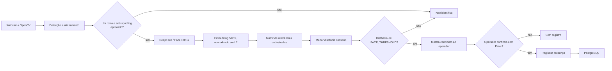
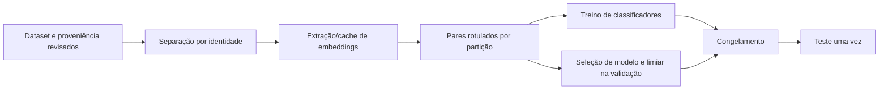
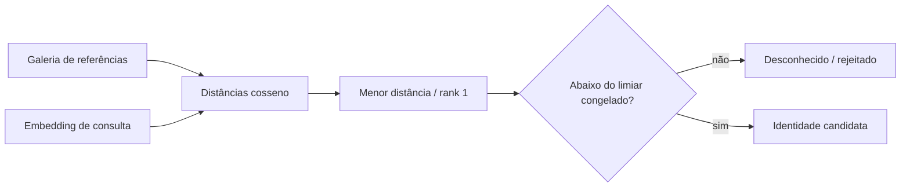
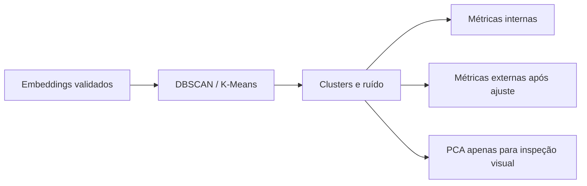

# Consolidação acadêmica de Machine Learning

**Projeto:** reconhecimento facial experimental para apoio ao controle de presença acadêmica da Fatec
**Data desta consolidação:** 10/10/2026
**Escopo:** consolidar implementação, evidências, resultados históricos e limitações das Etapas 0–4. Esta etapa não executa experimentos biométricos nem muda o reconhecimento operacional.

## 1. Introdução

O projeto é uma aplicação local em Python que permite cadastrar uma referência facial e registrar presença após o operador confirmar o reconhecimento. A motivação é estudar uma forma de automatizar a conferência de presença, preservando uma decisão humana explícita antes de gravar o registro.

O sistema extrai um vetor numérico (embedding) de cada rosto e compara o vetor de uma consulta com os vetores cadastrados. Isso é inferência de um modelo pré-treinado. As Etapas 0–4 construíram e documentaram infraestrutura experimental para avaliar limiares, classificadores, identificação aberta e agrupamento. Elas não treinaram nem ajustaram os pesos do FaceNet512.

## 2. Objetivos

**Objetivo geral:** consolidar o estudo de Machine Learning aplicado a embeddings faciais e documentar, com distinção explícita entre código e evidência empírica, o que pode ser reproduzido e o que permanece pendente.

**Objetivos específicos:**

- descrever a arquitetura efetivamente presente no repositório;
- explicar a extração e comparação de embeddings FaceNet512;
- registrar os protocolos supervisionados 1:1 e open-set 1:N implementados;
- registrar o pipeline não supervisionado DBSCAN/K-Means;
- preservar os resultados históricos da Etapa 1 com seu escopo e limitações;
- registrar as verificações de software executadas nesta consolidação;
- oferecer matriz de rastreabilidade, comparação de métodos, guia de reprodução e material de apresentação.

## 3. Fundamentação técnica

**Inteligência Artificial (IA)** é o campo amplo que estuda sistemas que executam tarefas associadas à percepção, inferência ou decisão. **Machine Learning (ML)** é uma família de métodos que ajusta regras ou parâmetros a partir de dados. **Deep Learning** usa redes neurais com múltiplas camadas; no projeto, a rede FaceNet512 é pré-treinada e usada para inferência. **Visão computacional** trata da análise de imagens, incluindo detecção e representação de rostos.

Um **embedding** representa uma imagem por um vetor em um espaço numérico. A hipótese de uso é que imagens da mesma pessoa tenham vetores próximos e identidades diferentes tendam a ficar mais distantes. Essa hipótese deve ser medida no domínio e na população relevantes; a forma vetorial por si só não demonstra precisão.

No **aprendizado supervisionado**, exemplos recebem rótulos e o método aprende uma regra para prever esses rótulos. Na Etapa 1, pares de imagens foram rotulados como genuínos (mesma identidade) ou impostores (identidades diferentes), e a validação escolheu um limiar. Na Etapa 2, regressão logística, Gaussian Naive Bayes e árvores de decisão foram implementados para a mesma tarefa binária. Apenas a calibração da Etapa 1 foi executada com imagens biométricas reais.

No **aprendizado não supervisionado**, o ajuste não recebe rótulos de identidade. DBSCAN e K-Means foram implementados para agrupar embeddings. Rótulos, se um experimento autorizado vier a ocorrer, são usados depois do agrupamento para métricas externas. Nenhuma etapa implementa aprendizado por reforço.

FaceNet foi apresentado como um método que mapeia imagens faciais para um espaço euclidiano compacto, adequado a verificação, reconhecimento e agrupamento; o artigo original usa aprendizado métrico com triplas durante o treinamento. Neste projeto, esse treinamento pertence ao modelo pré-treinado, não às Etapas 0–4 ([Schroff et al., CVPR 2015](https://openaccess.thecvf.com/content_cvpr_2015/html/Schroff_FaceNet_A_Unified_2015_CVPR_paper.html)).

## 4. Arquitetura operacional observada

A aplicação tem camadas de apresentação, aplicação, domínio e infraestrutura. `src/main.py` monta os componentes concretos. Casos de uso dependem de contratos do domínio; os adaptadores de câmera, DeepFace, armazenamento e PostgreSQL implementam esses contratos.

O fluxo real do reconhecimento é:

O adaptador operacional (`src/infrastructure/face_recognition/deepface_adapter.py`) centraliza detecção, alinhamento, verificação anti-spoofing e geração do embedding. Ele exige exatamente um rosto por imagem. Com `anti_spoofing=True`, o DeepFace executa o detector de apresentação baseado em MiniFASNet; se `is_real` for falso, a captura é recusada. A pontuação do modelo se refere à classe escolhida, não é automaticamente uma probabilidade calibrada de que o rosto seja real. A configuração operacional o habilita por padrão. O projeto registra recusa de pessoa real em contraluz e não mediu a eficácia contra ataques. Falhas de modelo são distinguidas de “nenhum rosto” ou “múltiplos rostos”. O adaptador não decide a identidade.

`FaceEmbedding` (`src/domain/entities/face_embedding.py`) converte o vetor para `float32` little-endian, exige valores finitos e norma não nula, e normaliza em L2. `MatrizDeReferencia` e `ReconhecerAluno` (`src/domain/services/matcher.py`, `src/application/use_cases/reconhecer_aluno.py`) calculam, de forma vetorizada, `1 − produto escalar` para selecionar o candidato de menor distância. Modelos ou dimensões incompatíveis são recusados. O limite operacional continua em `FACE_THRESHOLD=0.30` (`src/config/settings.py`).

Depois da identificação, a interface aguarda confirmação do operador. `RegistrarPresenca` delega ao repositório a persistência da presença; o PostgreSQL garante a unicidade diária. Portanto, identificação e gravação são partes separadas do fluxo.

## 5. FaceNet512 e distância cosseno

FaceNet512 é o nome do modelo pré-treinado configurado na aplicação e gera um vetor de 512 dimensões. O adaptador faz inferência sobre um recorte facial detectado e alinhado. O projeto normaliza cada vetor em L2 para que a similaridade cosseno seja o produto escalar; a distância usada é `1 − similaridade`. Vetores compatíveis e normalizados têm distância zero quando iguais; valores maiores indicam menor similaridade.

**Inferência** aplica pesos existentes a uma entrada para produzir um embedding. **Treinamento** ajusta pesos ou parâmetros a partir de exemplos. Nas Etapas 0–4, os pesos do FaceNet512 não foram atualizados. O ajuste supervisionado executado na Etapa 1 escolheu somente um limiar; os classificadores das Etapas 2 e os algoritmos das Etapas 3–4 operam em características/embeddings derivados.

## 6. Etapa 0 — infraestrutura experimental

O relatório da Etapa 0 descreve separação de identidades 60/20/20 com seed, teste lacrado por API, contagem de falhas de extração, proteção de `avaliacao/` e cobertura de métricas. O teste de divisão sintética reportou 12 identidades × 3 arquivos, particionadas em 8/2/2 identidades sem interseção. A saída demonstra a infraestrutura de software, não um dataset biométrico.

Na execução histórica daquela etapa, o relatório registra 322 testes aprovados e 92,67% de cobertura. Nenhum dataset foi baixado e nenhuma métrica biométrica foi medida. O código experimental foi separado do fluxo operacional.

## 7. Etapa 1 — calibração supervisionada 1:1

**Verificação 1:1** decide se dois vetores pertencem à mesma identidade. Um par genuíno contém imagens da mesma pessoa; um par impostor contém identidades diferentes. Para limiar `τ`, a regra aceita se `distância ≤ τ`.

- **FAR** (*False Acceptance Rate*): fração de pares impostores aceitos.
- **FRR** (*False Rejection Rate*): fração de pares genuínos rejeitados.
- **ROC** mostra a relação entre taxa de verdadeiros positivos e FAR ao variar o limiar.
- **AUC** resume a área sob a ROC e independe da escolha de um ponto de operação.
- **EER** é o ponto aproximado em que FAR e FRR se igualam; é uma referência, não necessariamente um critério operacional.

O relatório registra que a divisão foi por identidade, com seed 42, e que os pares foram formados dentro de cada subconjunto. No teste histórico havia 336 identidades, 1.099 imagens, 2.001 pares genuínos e 601.350 pares impostores. O teste foi consultado uma vez para os limiares congelados. Os pares são dependentes porque uma imagem participa de várias comparações; os intervalos reportados usaram reamostragem por identidade.

| Regra no teste histórico LFW | Limiar | FAR (IC 95% reportado) | FRR (IC 95% reportado) |
|---|---:|---:|---:|
| Baseline histórico | 0,3000 | 0,0018% (0–0,005%) | 38,03% (32,59–43,95%) |
| Candidato calibrado na validação para FAR ≤ 0,1% | 0,42817932706540435 | 0,063% (0,042–0,090%) | 16,39% (12,40–20,99%) |

O relatório também registra AUC 0,9830 e EER aproximado de 4,80% em limiar próximo a 0,6848 (grade histórica de 200 pontos). A mudança de limiar reduz FRR e aumenta FAR; não é uma melhora gratuita. O valor 0,42817932706540435 é candidato para verificação 1:1, não foi adotado em produção e não deve ser transferido automaticamente para identificação 1:N.

O LFW utilizado era a versão original não alinhada, com 13.233 imagens e 5.749 identidades. Após seleção e extração, 5.663 de 6.420 imagens foram processadas; 162 foram rejeitadas por ausência de rosto e 595 por múltiplos rostos. A taxa reportada de falha de extração foi 11,8%; as métricas faciais se condicionam a embeddings extraídos com sucesso.

Há uma ressalva de governança: o relatório da Etapa 1 descreve a publicação do LFW para pesquisa sem licença formal; os relatórios das Etapas 2–4 não localizaram autorização específica do projeto para novos usos e mantiveram o gate fechado. O uso histórico documentado não é apresentado aqui como autorização para nova execução. O holdout da Etapa 1 já foi observado e não é um teste intocado para os trabalhos posteriores.

## 8. Etapa 2 — classificadores supervisionados

A unidade de decisão continua sendo um par 1:1, com uma característica inicial: distância cosseno. A infraestrutura implementa:

| Modelo | Implementação | Situação empírica |
|---|---|---|
| M0 | Regra histórica `distância ≤ 0.30` | Baseline 1:1 medido na Etapa 1; nenhum novo resultado na Etapa 2 |
| M1 | Limiar histórico calibrado na Etapa 1 | Referência disponível; não recalibrado com teste |
| M2 | `LogisticRegression` | Código e testes sintéticos; sem treino biométrico real |
| M3 | `GaussianNB` | Código e testes sintéticos; sem treino biométrico real |
| M4 | `DecisionTreeClassifier`, profundidades pequenas | Código e testes sintéticos; sem treino biométrico real |

A regressão logística ajusta uma fronteira monotônica sobre uma variável escalar. A probabilidade de classe depende da prevalência e do balanceamento de pares e não equivale automaticamente à probabilidade real de identidade. Gaussian Naive Bayes modela distribuições condicionais por classe, hipótese que precisa ser verificada. Uma árvore rasa torna explícito um corte de distância; profundidade maior pode ajustar detalhes e sobreajustar. O relatório da Etapa 2 afirma que nenhum array biométrico foi aberto, nenhum classificador foi treinado com LFW e não foram produzidas métricas nem gráficos reais.

## 9. Etapa 3 — identificação open-set 1:N

Identificação 1:N recebe uma consulta e a compara com uma galeria de identidades cadastradas. Escolhe o candidato mais próximo e rejeita se não satisfizer o limiar. Ao contrário da verificação 1:1, o sistema precisa considerar identidades conhecidas, desconhecidos ausentes da galeria, trocas entre identidades e crescimento do risco conforme o tamanho da galeria.

- **FPIR**: fração de consultas desconhecidas incorretamente aceitas como uma identidade da galeria.
- **FNIR**: fração de consultas conhecidas que não são corretamente identificadas no rank 1 e aceitas sob o limiar; decompõe-se em rejeição e troca de identidade.
- **Top-1 accuracy**: candidato correto em primeiro lugar, independentemente do limiar, com denominador explicitado.
- **Rejeição correta de desconhecido**: desconhecido recusado sem atribuição a identidade da galeria.

O pipeline experimental implementa galerias, consultas conhecidas/desconhecidas, tamanhos de galeria, uma ou três referências por identidade e estratégias de menor distância ou centroide normalizado. Limiares candidatos T0 (0,30), T1 (0,42817932706540435, derivado de 1:1) e T2 (selecionado na validação 1:N) são tratados como estratégias distintas. T2 não foi estimado em biometria real. A Etapa 3 não abriu LFW, não gerou gráficos nem resultados biométricos.

## 10. Etapa 4 — aprendizado não supervisionado

DBSCAN agrupa pontos por densidade sem exigir antecipadamente o número de clusters e marca como ruído amostras que não pertencem aos agrupamentos. A implementação usa distância cosseno sobre embeddings L2-normalizados e escolhe `eps` e `min_samples` por diagnósticos internos, sem identidade verdadeira. K-Means é o baseline comparativo: exige `n_clusters`, usa centroides e não oferece classe explícita de ruído.

As métricas externas implementadas são ARI, NMI, homogeneity, completeness e V-measure. As internas incluem silhouette, Davies–Bouldin e Calinski–Harabasz quando há distribuição válida de clusters. Para DBSCAN, o relatório acompanha ruído e cobertura, e não trata automaticamente `-1` como uma identidade nas métricas cobertas. PCA serve apenas para visualização em dimensão reduzida; não prova a separabilidade no espaço original.

O relatório confirma DBSCAN/K-Means implementados e 22 testes focais aprovados na etapa, sem experimento biométrico real ou gráfico real. A revisão de qualidade da Etapa 4 registrou 597 testes na suíte completa, Ruff aprovado e mypy em 67 arquivos. Esses números são históricos da Etapa 4; nesta consolidação a suíte completa não foi reexecutada, pois contém testes que usam PostgreSQL.

## 11. Resultados consolidados e evidências

| Etapa | Implementação documentada | Evidência de software | Métrica biométrica real |
|---|---|---|---|
| 0 | Divisão, proteção, cache e contagem de falhas | Testes sintéticos; 322 aprovados no registro histórico | Nenhuma |
| 1 | Calibração de limiar 1:1 | Pipeline executado e reportado; testes de software | Sim, LFW histórico; ver tabela §7 |
| 2 | M0–M4, seleção e avaliação | Testes sintéticos; 528 aprovados no registro histórico | Nenhuma; sem treino real de M2–M4 |
| 3 | Galeria open-set, FPIR/FNIR, estratégias | Testes sintéticos; 575 aprovados no registro histórico | Nenhuma |
| 4 | DBSCAN, K-Means, seleção interna e métricas | 22 focais; 597 suíte completa no registro histórico | Nenhuma |
| 5 | Consolidação documental | 518 unitários, Ruff e mypy executados nesta etapa | Não aplicável; nenhum experimento executado |

Os totais históricos são snapshots dos relatórios, em momentos e escopos diferentes; não devem ser somados. O número atual confirmado nesta etapa refere-se somente a `tests/unit`, não à suíte completa.

## 12. Limitações

- As Etapas 2–4 não têm avaliação biométrica real; testes de software aprovados demonstram comportamento de código, não acurácia facial.
- O resultado da Etapa 1 é de verificação 1:1 no LFW e não mede identificação em uma sala com N alunos.
- A Etapa 1 desligou anti-spoofing por usar fotografias. A taxa de erro apresentada não mede MiniFASNet nem captura por webcam.
- O LFW difere do ambiente Fatec e pode conter pessoas presentes no pré-treinamento do modelo; a sobreposição não foi verificada.
- A Etapa 1 usou um holdout já consultado; uma nova seed no mesmo dataset não o transforma em teste intocado.
- A validação estatística fica limitada por dependência entre pares, número de identidades, número de consultas e composição da galeria.
- Nenhum resultado garante precisão operacional, desempenho em subgrupos, resistência a ataques ou validade jurídica.
- Na Etapa 5 não foi executada a suíte completa, pois os testes de integração/BDD podem acessar PostgreSQL. Esta etapa também não acessou `avaliacao/`, imagens, embeddings, webcam ou credenciais.

## 13. Trabalhos futuros

1. Obter autorização legítima e revisão institucional para uma fonte de pesquisa adequada, distinta do holdout histórico, ou aprovar um piloto com voluntários e consentimento específico.
2. Congelar protocolo, população, unidade estatística e limiares antes de abrir um teste final independente.
3. Avaliar em domínio de webcam Fatec: iluminação, pose, distância, oclusão, diversidade de câmeras e condições demográficas, com participação voluntária aprovada.
4. Planejar protocolo separado de anti-spoofing, incluindo ataques e condições de captura, antes de afirmar eficácia.
5. Se os resultados sustentarem a hipótese, desenhar a Etapa 3 operacional de forma separada, com critério FPIR/FNIR aprovado, análise de riscos e autorização explícita para integração.

## Referências e documentos relacionados

- [Relatório da Etapa 0](ML-ETAPA-0-RESULTADO.md), [Etapa 1](ML-ETAPA-1-RESULTADO.md), [Etapa 2](ML-ETAPA-2-RESULTADO.md), [Etapa 3](ML-ETAPA-3-RESULTADO.md), [Etapa 4](ML-ETAPA-4-RESULTADO.md).
- [Auditoria de aprendizagem de ML](ML-LEARNING-AUDIT.md), [protocolo experimental](ML-EXPERIMENT-SETUP.md), [ADR-004](adr/ADR-004-limiar-de-reconhecimento.md), [privacidade e dados pessoais](lgpd.md).
- [FaceNet, artigo original](https://openaccess.thecvf.com/content_cvpr_2015/html/Schroff_FaceNet_A_Unified_2015_CVPR_paper.html).
- [Datasheet do LFW](https://www.microsoft.com/en-us/research/wp-content/uploads/2019/01/1803.09010.pdf).
- [Lei Geral de Proteção de Dados, texto compilado oficial](https://planalto.gov.br/ccivil_03/_ato2015-2018/2018/lei/l13709compilado.htm).
