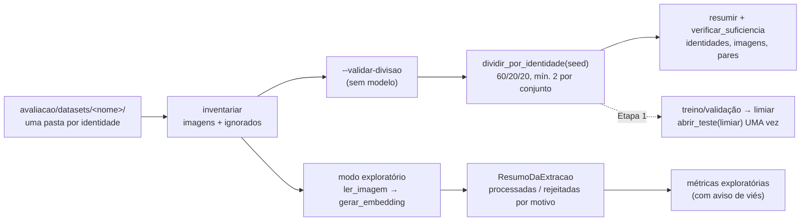

# Etapa 0 — Preparação, segurança e confiabilidade da avaliação de ML

- **Data:** 2026-10-10
- **Base:** `main` em `d313d28`, com `docs/ML-LEARNING-AUDIT.md` (auditoria anterior, ainda não commitada)
- **Status:** **Concluída**, com pendências declaradas (§10)
- **Commits:** nenhum — alterações deixadas no working tree para revisão

---

## 1. Resumo executivo

A Etapa 0 tornou a infraestrutura de avaliação **segura e confiável antes de
qualquer calibração**, sem tocar no comportamento da aplicação (`src/` não foi
alterado):

- **Dados protegidos:** `/avaliacao/`, imagens, vídeos e caches de vetores
  passaram a ser ignorados pelo Git, e o CI reprova os mesmos padrões. Índice
  e histórico verificados: **nenhum dado biométrico versionado**.
- **Falhas contadas:** `scripts/evaluate_model.py` não descarta mais imagens em
  silêncio. Cada imagem termina como processada ou rejeitada, com um de seis
  motivos; exceção inesperada aborta com o caminho da imagem.
- **Divisão por identidade:** novo módulo `scripts/divisao_por_identidade.py`
  divide em treino/validação/teste com seed, sem sobreposição, com checagem
  de suficiência e **teste lacrado** (uma abertura, com o limiar congelado).
- **Avaliação A × B e LGPD documentadas:** `docs/ML-EXPERIMENT-SETUP.md`.
- **Testes:** 38 novos; suíte completa com **322 aprovados**, cobertura total
  de **92,67%** (piso do CI: 80%).

Nenhuma calibração, treino ou métrica de modelo foi executada. Nenhum dataset
foi baixado.

---

## 2. Problemas identificados antes da implementação

| Lacuna | Problema | Confirmação no estado atual |
|---|---|---|
| G4 | Limiar sugerido e erro medidos sobre os mesmos pares | `evaluate_model.py` (versão de `d313d28`): `relatar` usa os mesmos arrays para `far_frr` e `limiar_para_far_maximo` |
| G5 | Falhas de extração descartadas com `except Exception` + `print` | Mesmo arquivo, `carregar_embeddings`: nenhuma contagem, nenhum motivo |
| G5 (achado novo) | Erro de leitura seria contado como falha de modelo | O DeepFace recusa caminho não-ASCII e arquivo ilegível com `ValueError` (`deepface/commons/image_utils.py:94-100`); o adaptador traduz isso para `ModeloIndisponivel` |
| G6 | Avaliação roda com `anti_spoofing=False`; produção com `True` | Confirmado; nada documentava a diferença de escopo |
| G10 | `avaliacao/` (caminho sugerido na documentação) não ignorado | `git check-ignore avaliacao/...` → não ignorado |
| G11 | Consentimento limita a biometria à presença | `menu.py:179-183`, `docs/lgpd.md` §2 |

**Varredura de dados sensíveis:** `git ls-files` e `git log --all --name-only`
filtrados por imagens, vídeos, `.npy/.npz/.pkl`, `.db/.sqlite`, `.env`,
`storage/`, `fotos/` e `avaliacao/` → **nada encontrado**, nem no índice nem
no histórico. (O `escola.db` legado já havia sido removido do histórico —
ADR-003.)

---

## 3. Correções realizadas

1. **`.gitignore`:** `/avaliacao/` inteiro; rede de segurança para
   `*.jpg *.jpeg *.png *.bmp *.webp *.heic *.tif *.tiff`, `*.mp4 *.avi *.mov`,
   `*.npz *.pkl *.pickle` (o `*.npy` já existia). Imagens globais são
   coerentes com a política anterior: o CI já reprovava `.jpg`/`.png`
   rastreados.
2. **CI:** o passo "Nenhum dado sensível versionado" passou a cobrir os mesmos
   padrões (inclusive `^avaliacao/`); cobertura medida também para os dois
   módulos de avaliação.
3. **Extração com contabilidade** (`extrair_embeddings`): recebidas,
   processadas, rejeitadas por motivo, detalhe por arquivo, identidades
   avaliadas e aviso de amostra menor.
4. **Leitura própria da imagem** (`ler_imagem`): `np.fromfile` +
   `cv2.imdecode` antes do modelo — separa erro de leitura de falha de
   inferência e aceita caminhos com acento.
5. **Modelo carregado antes da extração** (`preaquecer`): falha de carga
   encerra o script com código 2, em vez de virar N falhas por imagem.
6. **Modo `--validar-divisao [--seed N]`:** inventário, divisão, contagens
   por conjunto, verificação de sobreposição e de suficiência — **sem modelo,
   sem banco, sem métricas**.
7. **Modo exploratório preservado**, agora com aviso explícito de viés e de
   ausência de prova de vida.

---

## 4. Arquivos criados e modificados

| Arquivo | Tipo | Mudança |
|---|---|---|
| `scripts/divisao_por_identidade.py` | novo | Divisão por identidade, `Divisao` com teste lacrado, `resumir`, `verificar_suficiencia` |
| `scripts/evaluate_model.py` | modificado | Inventário, leitura própria, extração contabilizada, `--validar-divisao`, avisos. `montar_pares` e `relatar` mantidos |
| `tests/unit/test_divisao_por_identidade.py` | novo | 19 testes |
| `tests/unit/test_evaluate_model.py` | novo | 19 testes |
| `.gitignore` | modificado | Datasets, imagens, vídeos e caches |
| `.github/workflows/ci.yml` | modificado | Checagem de sensíveis ampliada; cobertura dos novos módulos |
| `docs/ML-EXPERIMENT-SETUP.md` | novo | Guia: estrutura, comandos, A × B, falhas, divisão, LGPD |
| `docs/ML-ETAPA-0-RESULTADO.md` | novo | Este relatório |
| `docs/ML-LEARNING-AUDIT.md` | modificado | Nota no cabeçalho e nova §17; texto original preservado |
| `docs/adr/ADR-004-limiar-de-reconhecimento.md` | modificado | Nota de atualização: modo atual é exploratório; calibração na Etapa 1 |
| `docs/lgpd.md` | modificado | §2: experimentos não usam alunos cadastrados |
| `README.md` | modificado | Seção de avaliação: novos comandos e link para o guia |

**Não modificados:** todo o `src/` (domínio, aplicação, adaptador, matcher,
settings), `scripts/metricas.py`, `requirements*.txt`, migrations, banco,
termo de consentimento, `FACE_THRESHOLD`, `FACE_ANTI_SPOOFING`.

---

## 5. Estrutura experimental preparada

| Capacidade | Disponível agora | Etapa 1 |
|---|---|---|
| Inventário com arquivos ignorados contados | ✔ | |
| Divisão por identidade, seed, assinatura | ✔ | |
| Contagem potencial de pares por conjunto | ✔ | |
| Extração com falhas classificadas | ✔ | |
| Contagem **efetiva** (pós-extração) por conjunto | API pronta (`resumir` aceita contagens efetivas) | Ligar ao fluxo |
| Escolha de limiar em treino/validação, teste uma vez | API pronta (`abrir_teste`) | Implementar |
| Cache de embeddings em `avaliacao/cache/` | Diretório previsto e ignorado | Implementar |

---

## 6. Estratégia de proteção dos dados

| Camada | Medida |
|---|---|
| Localização | Todo dado experimental sob `avaliacao/` (ignorado inteiro) |
| Rede de segurança | Imagens, vídeos e caches de vetores ignorados em qualquer diretório |
| Verificação contínua | CI reprova esses padrões se rastreados, inclusive via `git add -f` |
| Testes | Somente dados sintéticos (bytes em `tmp_path`), dublês de adaptador e de OpenCV |
| Fontes | Alunos cadastrados proibidos; dataset público com termos verificados; voluntários com consentimento específico |
| Retenção e descarte | Até a apresentação; apagar `avaliacao/` inteiro, inclusive `cache/` (`ML-EXPERIMENT-SETUP.md` §7) |

Verificação executada (`git check-ignore`):

| Caminho | Resultado |
|---|---|
| `avaliacao/datasets/lfw/pessoa-1/foto-a.jpg` | ignorado |
| `avaliacao/resultados/rel.txt`, `avaliacao/cache/emb.npy` | ignorados |
| `docs/x.png`, `gravacao.mp4`, `cache.pkl` | ignorados |
| `src/infrastructure/storage/local_image_storage.py`, `scripts/evaluate_model.py`, `docs/ML-LEARNING-AUDIT.md`, `.env.example` | **rastreáveis** (como devem ser) |
| `git ls-files -ci --exclude-standard` (rastreado e agora ignorado) | vazio |

---

## 7. Estratégia de separação dos datasets

- Ordenação das identidades → `random.Random(seed).shuffle` → corte
  60/20/20, mínimo de 2 identidades por conjunto (6 no total).
- Divisão **antes** dos pares; `Divisao` recusa sobreposição na construção
  (`VazamentoDeIdentidade`).
- Cada conjunto precisa de pares genuínos e impostores
  (`DadosInsuficientes`), senão nada é reportado.
- Teste lacrado: `abrir_teste(limiar_congelado)` libera as identidades uma
  vez; a segunda chamada levanta `UsoIndevidoDoTeste`. `resumir` conta o
  teste sem abri-lo.
- Reprodução: `Assinatura da divisao` (SHA-256 truncado das três listas).

Execução real sobre dataset **sintético** (12 identidades × 3 arquivos,
seed 42): treino 8 identidades / 24 imagens / 24 genuínos / 252 impostores;
validação e teste 2 / 6 / 6 / 9 cada; sobreposição nenhuma; assinatura
`0d4d2b2afcffae69`.

---

## 8. Tratamento de falhas

| Motivo | Exceção | Verificado em teste | Verificado em execução real |
|---|---|---|---|
| erro de leitura | `OSError`, `ImagemIlegivel` | ✔ (vazio, inexistente, não decodificável, acento) | ✔ 38/38 arquivos sintéticos não-imagem; caminho `José/` lido e recusado só no decode |
| sem rosto detectado | `NenhumRostoDetectado` | ✔ | ✔ 4/4 imagens de ruído geradas pelo OpenCV, com DeepFace real |
| multiplos rostos | `MultiplosRostosDetectados` | ✔ | — |
| falha de inferencia | `ModeloIndisponivel` | ✔ | — |
| embedding invalido | `EmbeddingInvalido` | ✔ | — |
| recusada pela prova de vida | `PossivelFraude` | ✔ | — (prova de vida desligada na Avaliação A) |
| inesperada | qualquer outra | ✔ aborta com `__notes__` contendo a imagem | — |

Execuções reais com o `.venv-app` (DeepFace 0.0.92, pesos **já presentes** em
`~/.deepface/weights/`, nenhum download): ambas terminaram com código 2,
"Identidades avaliadas: 0" e **nenhuma métrica impressa**. Os dados usados
foram bytes arbitrários e ruído aleatório: nenhum rosto, nenhum dado
biométrico.

---

## 9. Testes executados e resultados

| Comando | Resultado |
|---|---|
| `ruff check .` | All checks passed |
| `mypy` | Success: no issues found in 55 source files |
| `pytest tests/unit/test_divisao_por_identidade.py tests/unit/test_evaluate_model.py tests/unit/test_metricas.py` | 54 aprovados (19 + 19 novos + 16 de métricas, inalterados) |
| `pytest --cov=src --cov=scripts.metricas --cov=scripts.divisao_por_identidade --cov=scripts.evaluate_model --cov-fail-under=80` | **322 aprovados**; cobertura total **92,67%**; `divisao_por_identidade.py` 99%, `evaluate_model.py` 95%, `metricas.py` 100% |

**Incidente de ambiente, não regressão:** na **primeira** execução da suíte
completa, 54 testes dependentes de banco (45 de `tests/integration/`, 9 BDD de
banco/presença) falharam com `psycopg.errors.ConnectionTimeout` contra o
PostgreSQL de teste em `localhost:5433`. Sem nenhuma mudança de código, a
integração isolada passou (55 testes) e a suíte completa passou inteira nas
duas execuções seguintes. Os arquivos afetados não importam nada do que esta
etapa alterou. Conclusão: indisponibilidade transitória do banco local.

A suíte tinha 284 testes antes desta etapa (322 − 38 novos). O
`ARCHITECTURE.md` ainda cita 281 — número anterior a esta etapa, não
atualizado aqui.

---

## 10. Pendências e limitações

| Item | Situação |
|---|---|
| G4 | Infraestrutura pronta; **o limiar continua não calibrado** e o modo exploratório continua disponível (com aviso) |
| Avaliação B (anti-spoofing) | Só documentada. Sem dataset de ataques, não há como medir APCER/BPCER |
| Contagem efetiva por conjunto após a extração | API pronta, não ligada ao CLI — entra no fluxo da Etapa 1 |
| Divisão não estratificada | Uma seed pode deixar um conjunto sem pares genuínos se o dataset tiver muitas identidades com 1 imagem; o script recusa com `DadosInsuficientes`, não corrige. Recomendação: usar identidades com 2+ imagens, **não** trocar a seed até "dar certo" |
| Reprodutibilidade | Garantida na mesma versão do Python (assinatura denuncia divergência) |
| Extensões em maiúsculas no Linux | `.gitignore` depende de `core.ignorecase`; o CI cobre com `grep -i` |
| Lacre do teste | Proteção de API, não criptográfica |
| Dataset público | Nenhum baixado; termos de uso ainda **não verificados** |
| `docs/ML-LEARNING-AUDIT.md` | Continua não commitado, como os demais arquivos desta etapa |

---

## 11. Critérios de aceite

| Critério | Atendido? | Evidência |
|---|---|---|
| Diretórios experimentais sensíveis protegidos | **Sim** | §6; CI ampliado |
| Falhas de extração contabilizadas e classificadas | **Sim** | §8; 6 motivos + abortar no inesperado |
| Separação por identidade implementada e testada | **Sim** | 19 testes; execução real §7 |
| Sem vazamento de identidades entre conjuntos | **Sim** | Construtor recusa; teste com 30 seeds |
| Teste protegido contra uso indevido na calibração | **Sim** (no nível de API) | `abrir_teste` único, com limiar congelado; `resumir` não abre |
| Distinção reconhecimento × anti-spoofing documentada | **Sim** | `ML-EXPERIMENT-SETUP.md` §4 |
| Restrições de privacidade e consentimento documentadas | **Sim** | `ML-EXPERIMENT-SETUP.md` §7; `lgpd.md` §2 |
| Testes relevantes aprovados | **Sim** | 322/322 |
| Documentação de preparação experimental atualizada | **Sim** | Guia novo, README, ADR-004, auditoria §17 |
| Nenhum comportamento operacional alterado | **Sim** | `git status`: nenhum arquivo de `src/` modificado; `FACE_THRESHOLD` e prova de vida intocados |

---

## 12. Preparação para a Etapa 1

A Etapa 1 (calibração supervisionada do limiar) **não foi iniciada**. Para
começá-la, falta:

1. **Decisão de negócio:** o teto de FAR (ADR-004 oferece 0%, 0,1%, 1% e 5%).
   Sem ele, não há critério para congelar o limiar.
2. **Dados:** escolher o dataset público, **verificar e registrar os termos de
   uso**, baixá-lo para `avaliacao/datasets/` e rodar `--validar-divisao`
   primeiro.
3. **Implementação prevista:** extrair embeddings (com cache em
   `avaliacao/cache/`) → `dividir_por_identidade` → `resumir` com contagens
   efetivas → escolher o limiar com `limiar_para_far_maximo` em treino e
   confirmá-lo na validação → `abrir_teste(limiar)` → FAR, FRR e matriz de
   confusão uma única vez → comparar com o 0.30 herdado → atualizar o ADR-004
   com números medidos.
4. **Revisão desta etapa** e o commit das alterações, a critério dos
   responsáveis.
