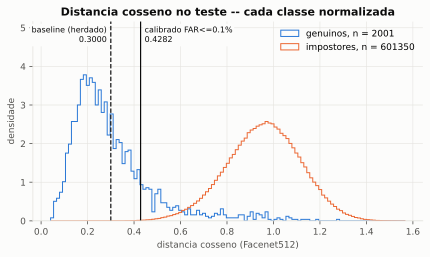
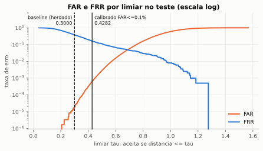
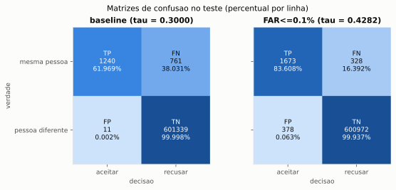
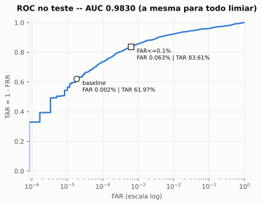
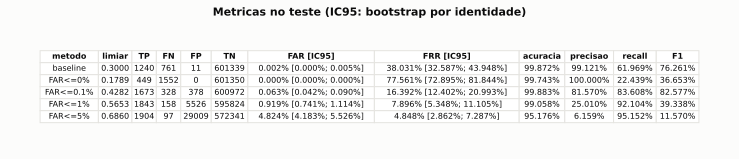

# Etapa 1 — Calibração supervisionada do limiar de reconhecimento (S1)

- **Data:** 2026-10-10
- **Base:** `main` em `0495dea`, mais as alterações desta etapa (não commitadas)
- **Status:** **experimento executado.** O limiar calibrado é um **candidato**; a adoção em produção depende da avaliação 1:N (Etapa 3). Ver §17
- **Escopo:** verificação facial **1:1**, sem prova de vida (Avaliação A), em dataset público. Não mede a operação 1:N da sala de aula

> **Regra de honestidade.** Todo número deste documento vem de
> `avaliacao/resultados/etapa1/resultado.json`, gerado por
> `python -m scripts.calibrar_limiar --dataset avaliacao/datasets/lfw`. O
> arquivo fica fora do Git, mas é reproduzível byte a byte (§15). Exemplos
> aritméticos que não são medição estão marcados como **ilustrativos**.

## Situação de cada parte

| Item | Situação |
|---|---|
| Pipeline de calibração (`scripts/calibrar_limiar.py`) | **Implementado e executado** |
| Gráficos (`scripts/graficos_calibracao.py`) | **Implementado e executado** |
| Métricas exatas (`scripts/metricas.py`) | **Implementado e executado** |
| Limiar calibrado, matriz de confusão, FAR, FRR, ROC/AUC, EER | **Medidos** no teste do LFW (§9–§11) |
| FPIR para 40 alunos (§13) | **Ilustrativo**: aproximação aritmética, não medição |
| Avaliação 1:N, webcam da sala, prova de vida | **Pendente** (Etapa 3 e Avaliação B) |
| Alteração do `FACE_THRESHOLD` | **Não feita**, de propósito (§17) |

---

## 1. Resumo executivo

O limiar `FACE_THRESHOLD = 0.30` foi herdado do DeepFace (lacuna G1). Esta
etapa o tratou como o parâmetro de um classificador binário e o **aprendeu
com pares rotulados** do LFW, com divisão por identidade (60/20/20), escolha
na validação e uma única abertura do teste.

Resultado no teste (336 pessoas que não participaram da escolha):

| Método | Limiar | FAR (IC95) | FRR (IC95) |
|---|---|---|---|
| Baseline herdado | 0,3000 | 0,0018% (0,000%–0,005%) | **38,0%** (32,6%–43,9%) |
| **Calibrado, FAR ≤ 0,1%** | **0,4282** | 0,063% (0,042%–0,090%) | **16,4%** (12,4%–21,0%) |

- **O teto foi respeitado em identidades nunca vistas.** O FAR do teste foi
  0,063%, e o limite superior do IC (0,090%) ficou abaixo de 0,1%.
- **Diferença em relação ao baseline (IC95 pareado):**
  - FRR: entre −25,1 e −18,4 pontos percentuais.
  - FAR: entre +0,040 e +0,088 pontos percentuais.
  - As duas diferenças excluem zero.
- **É uma troca, não uma melhora gratuita.** O baseline é cerca de 50 vezes
  mais restritivo que o teto de 0,1%. Ele "desperdiça" o orçamento de falsa
  aceitação e recusa 38% dos genuínos. O limiar calibrado gasta esse
  orçamento para recuperar cerca de 22 pontos de FRR.
- **A AUC é 0,9830 para todos os métodos.** Escolher outro limiar não muda
  a separação entre as classes.

Não houve vazamento: com os rótulos embaralhados, a AUC cai para 0,494.

## 2. Objetivo do experimento

Transformar o limiar de "herança da biblioteca" em parâmetro **aprendido com
dados rotulados**, pelo critério do ADR-004 (teto de FAR), e comparar esse
limiar com o 0,30 herdado no **mesmo** teste independente. Isso fecha as
lacunas G1 (limiar não calibrado), G2 (nenhuma avaliação executada) e G4
(limiar e erro nos mesmos pares) de `docs/ML-LEARNING-AUDIT.md`. O
comportamento operacional da aplicação não foi alterado.

## 3. Fundamentação: por que isto é aprendizado supervisionado

A decisão do sistema é uma regra de uma característica:

```text
ŷ = 1 (mesma pessoa)        se  d(e₁, e₂) ≤ τ
ŷ = 0 (pessoas diferentes)  caso contrário
```

Essa regra é uma **árvore de decisão de profundidade 1** (*decision stump*)
sobre a distância cosseno. Com pares **rotulados** (1 = genuíno,
0 = impostor), estimar `τ` é treinar esse classificador. O critério de
ajuste não é a acurácia (que trataria falso positivo e falso negativo como
igualmente caros), mas o do ADR-004: o **maior** `τ` cujo FAR não passa de
um teto. Isso minimiza o FRR sob a restrição. O corte fica no ponto médio
entre duas distâncias observadas consecutivas, como numa árvore de decisão.

**O que não foi treinado:** os pesos do Facenet512. O modelo só gera os
vetores. O "modelo" aprendido aqui tem **um parâmetro**.

**Papel de cada conjunto** (uma particularidade do S1, declarada em vez de
escondida):

- **Validação:** escolhe o `τ`. Este é o único ajuste.
- **Treino:** não entra na escolha. Num classificador de um parâmetro, com
  um critério de negócio fixo (o teto de FAR), não existe hiperparâmetro.
  Um "ajuste no treino + seleção na validação" seria uma etapa inventada.
  O `τ` estimado no treino aparece só como **análise de estabilidade**: o
  mesmo critério aplicado a outras pessoas (§8). Os pares de treino ficam
  salvos para a Etapa 2, que terá parâmetros a ajustar.
- **Teste:** aberto **uma vez**, depois de congelados todos os limiares
  comparados.

## 4. Dataset e limitações

| Item | Valor |
|---|---|
| Dataset | **LFW** (*Labeled Faces in the Wild*), versão original (não alinhada) |
| Origem | Espelho do scikit-learn (`ndownloader.figshare.com/files/5976018`). O site oficial estava fora do ar |
| Integridade | SHA-256 `055f7d9c…d536c0`, idêntico ao publicado pelo scikit-learn |
| Conteúdo | 13.233 imagens de 5.749 pessoas |
| Termos | Sem licença formal. Publicado pelos autores para **pesquisa em verificação facial**, com pedido de citação (Huang et al., 2007). Uso acadêmico, não comercial |
| Armazenamento | `avaliacao/datasets/lfw/`, ignorado pelo Git. A pasta Documentos não é sincronizada pelo OneDrive (verificado) |
| Alunos cadastrados | **Não usados**: nenhuma imagem nem embedding do PostgreSQL |

**Seleção** (antes de qualquer divisão):

- **Identidades:** só as que têm 2+ imagens únicas, 1.680 no total. Ficaram
  fora 4.069 pessoas com uma só imagem.
- **Duplicatas exatas** (mesmo conteúdo, por SHA-256): **2**, ambas entre
  identidades diferentes. Foram removidas, mantida a primeira ocorrência em
  ordem alfabética.
- **Teto de 10 imagens por identidade**, sorteadas com a seed: 2.744 imagens
  ficaram fora. Sem o teto, uma pessoa com 530 fotos geraria mais pares
  genuínos que centenas de outras juntas.
- **Imagens selecionadas:** 6.420.

**Limitações do dataset:**

- **Mudança de domínio.** São fotos de imprensa de 2002–2004, não a webcam
  da sala, com outra iluminação, outro ângulo e outra resolução.
- **Possível sobreposição com o treino do Facenet512.** O LFW é composto de
  celebridades. O modelo do DeepFace deriva de pesos treinados no VGGFace2,
  também de celebridades. Pessoas em comum tornariam o resultado otimista.
  A sobreposição **não foi verificada**: os pesos não vêm com a lista de
  identidades.
- **Rótulos com erros conhecidos.** O LFW tem alguns poucos rótulos errados,
  documentados pela comunidade. Eles não foram corrigidos.
- **Diversidade.** Os próprios autores alertam que vários grupos
  demográficos estão sub-representados. O resultado não vale por subgrupo.

## 5. Configuração do Facenet512

Mesma configuração da aplicação (`src/config/settings.py`), exceto a prova
de vida:

| Parâmetro | Valor |
|---|---|
| Modelo | `Facenet512` (Inception-ResNet-v1, vetor de 512 dimensões). Pesos `facenet512_weights.h5` já presentes; nenhum download |
| Detector | `opencv` (Haar Cascade), `enforce_detection=True`, `align=True` |
| Regra de rosto | **Exatamente um** rosto por imagem. 0 ou 2+ rostos → rejeitada e contada |
| Embedding | `DeepFaceAdapter.gerar_embedding`: recorte alinhado → `represent(detector_backend="skip")` |
| Normalização | L2 (`FaceEmbedding.de_valores`) |
| Distância | Cosseno, `1 − ⟨a, b⟩`, a mesma conta do `matcher` |
| Prova de vida | **Desligada** (Avaliação A): o dataset é feito de fotografias |
| Versões | DeepFace 0.0.92 · TensorFlow 2.21.0 · tf-keras 2.21.0 · OpenCV 4.13.0.92 · NumPy 2.5.3 · Python 3.12.0rc2 |
| Compatibilidade | Cache com chave `6a41c6be3515b893` = hash de modelo, detector, versões, alinhamento, prova de vida, normalização e versão do script. Vetores de configurações diferentes ficam em arquivos diferentes e nunca são comparados |

**Extração** (cada imagem processada **uma vez**; os pares reaproveitam o
vetor):

| Recebidas | Processadas | Sem rosto | Múltiplos rostos | Taxa de falha |
|---|---|---|---|---|
| 6.420 | 5.663 | 162 | 595 | **11,8%** |

As 595 rejeições por múltiplos rostos têm uma causa típica: fotos de
imprensa com outras pessoas ao fundo, que o Haar também detecta. A regra de
produção "exatamente um rosto" as recusa. Doze identidades perderam todas as
imagens e saíram da avaliação; 1.668 permaneceram.

## 6. Estratégia de separação dos dados

1. **Divisão por identidade antes dos pares.** As identidades são ordenadas,
   embaralhadas com `random.Random(42)` e cortadas em 60/20/20
   (`scripts/divisao_por_identidade.py`, da Etapa 0). Nenhuma pessoa aparece
   em dois conjuntos: o construtor recusa sobreposição.
2. **Pares só dentro do conjunto.** Genuínos são todos os pares de imagens
   da mesma pessoa. Impostores são os pares de pessoas diferentes,
   **todos** na validação e no teste. No treino, onde havia 6,1 milhões,
   foi sorteado 1 milhão de forma uniforme e reprodutível. A amostragem
   preserva o FAR esperado e só reduz a resolução.
3. **Teste lacrado.** As identidades de teste só saem por
   `Divisao.abrir_teste(limiares)`, que exige **todos** os limiares
   comparados congelados juntos e recusa uma segunda abertura.
4. **Nada do teste entra na escolha.** `calibrar()` recebe apenas os pares de
   treino e de validação. Um teste automatizado troca todos os vetores do
   teste e verifica que nenhum limiar se move (§16).
5. **Sanidade.** Com os rótulos da validação embaralhados, a AUC foi
   **0,4943**, como esperado (~0,5). Não há sinal de vazamento.

## 7. Distribuição de identidades, imagens e pares

Contagens efetivas, após a extração (seed 42, assinatura `4c7ddc45f322ec3c`):

| Conjunto | Identidades | Imagens | Pares genuínos | Impostores possíveis | Impostores usados | Pares de identidades (impostores) |
|---|---|---|---|---|---|---|
| Treino | 999 | 3.502 | 7.319 | 6.122.932 | 1.000.000 | 357.865 |
| Validação | 333 | 1.062 | 2.052 | 561.339 | 561.339 | 55.278 |
| Teste | 336 | 1.099 | 2.001 | 601.350 | 601.350 | 56.280 |

**Desbalanceamento e consequências:**

- No teste há 1 genuíno para cada ~300 impostores; a prevalência de
  genuínos é 0,33%.
- **FAR e FRR não dependem dessa proporção**, por isso o critério e as
  conclusões usam essas duas taxas.
- **Acurácia, precisão e F1 dependem dela.** No teste, a acurácia de
  qualquer método passa de 95% só porque quase tudo é impostor. Esses
  números aparecem por completude, não servem para comparar métodos e não
  se transferem para a operação, onde a proporção é outra.
- Os pares não são independentes: a mesma imagem participa de muitos pares.
  Por isso os intervalos usam bootstrap **por identidade** (§11).

## 8. Processo de calibração

Para cada teto, `limiar_para_far_maximo` sobre os pares da **validação**:

| Teto de FAR | τ (validação) | FAR val. | FRR val. | τ no treino (análise) | Dados |
|---|---|---|---|---|---|
| 0% | 0,1789 | 0,000% | 82,3% | 0,1194 | sem garantia |
| **0,1%** | **0,4282** | 0,0999% | 15,3% | 0,4226 | mínimo atendido |
| 1% | 0,5653 | 0,9999% | 6,2% | 0,5625 | mínimo atendido |
| 5% | 0,6860 | 4,9998% | 3,5% | 0,6858 | mínimo atendido |

**Leitura da coluna "Dados":**

- **"Mínimo atendido"** é uma heurística, não uma demonstração. Para um teto
  `c`, há pelo menos `3/c` impostores **e** pelo menos `3/c` pares de
  identidades distintas. Com menos que isso, o limiar seria decidido pelos
  1 ou 2 impostores mais extremos. Para 0,1%, o mínimo é 3.000; a
  validação tem 561.339 impostores e 55.278 pares de identidades.
- **"Sem garantia" (teto 0%):** um FAR observado zero não é FAR zero. Esse
  limiar só mostra o custo do extremo: recusa 82% dos genuínos.

**Estabilidade.** Para os tetos de 0,1% a 5%, o mesmo critério aplicado a
999 **outras** pessoas (o treino) produziu `τ` que difere menos de 0,006 do
`τ` da validação. Para o teto 0%, a diferença é de 0,06: o limiar depende só
do impostor mais extremo e é instável, outro motivo para não usá-lo.

**Escolha do principal: FAR ≤ 0,1%.** Ela foi definida no código antes de
abrir o teste (`TETO_PRINCIPAL`). A justificativa vem do ADR-004 (falso
positivo custa mais) e de uma conta **ilustrativa** de 1:N (§13): numa turma
de 40 alunos, 0,1% é, entre os tetos que o ADR-004 oferece, o mais frouxo
que mantém a taxa estimada de falsa identificação em um dígito. **Continua sendo uma proposta**: o teto é
decisão de negócio (ADR-004).

**O baseline na validação:** 0,30 dá FAR 0,0055% e FRR 39,3%. Ele equivale a
um teto implícito cerca de 18 vezes mais rigoroso que 0,1%, que ninguém
escolheu.

Limiares congelados antes de abrir o teste: baseline 0,3000 · FAR≤0% 0,1789 ·
FAR≤0,1% 0,4282 · FAR≤1% 0,5653 · FAR≤5% 0,6860.

## 9. Limiar original × limiar aprendido

| | Baseline (herdado) | Calibrado (FAR ≤ 0,1%) |
|---|---|---|
| Origem | Padrão do DeepFace para (Facenet512, cosseno) | Aprendido na validação do LFW, pelo critério do ADR-004 |
| τ | 0,3000 | 0,4282 |
| FAR no teste | 0,0018% | 0,063% |
| FRR no teste | 38,0% | 16,4% |
| Respeita o teto de 0,1% no teste? | Sim, com folga de ~50× | Sim (IC até 0,090%) |





O histograma explica o resultado. A mediana das distâncias genuínas no teste
é 0,257 e o percentil 90 é 0,513. Com o corte em 0,30, uma parte grande dos
genuínos fica à direita do limiar. Os impostores começam bem depois: a
mediana é 0,961 e o percentil 1 é 0,571. Há espaço para mover o limiar para
a direita antes de a cauda dos impostores começar.

## 10. Matrizes de confusão (teste)

Classe positiva = "mesma pessoa".

| Método | TP | FN | FP | TN |
|---|---|---|---|---|
| Baseline 0,30 | 1.240 | 761 | 11 | 601.339 |
| **FAR ≤ 0,1% (0,4282)** | **1.673** | **328** | **378** | **600.972** |
| FAR ≤ 0% (0,1789) | 449 | 1.552 | 0 | 601.350 |
| FAR ≤ 1% (0,5653) | 1.843 | 158 | 5.526 | 595.824 |
| FAR ≤ 5% (0,6860) | 1.904 | 97 | 29.009 | 572.341 |



## 11. Métricas de desempenho (teste, aberto uma vez)

IC95 por **bootstrap de identidades** com 1.000 réplicas ("subsets
bootstrap", Bolle et al., 2004):

- Cada réplica sorteia pessoas com reposição.
- Uma pessoa sorteada `w` vezes pesa `w` nos seus pares genuínos e
  `w_a · w_b` nos pares impostores com outra pessoa.
- Reamostrar **pares** trataria centenas de milhares de comparações
  correlacionadas como independentes e estreitaria o intervalo
  artificialmente.
- Réplicas descartadas por falta de denominador: 0.

| Método | τ | FAR (IC95) | FRR (IC95) | Acurácia | Precisão | Recall | F1 |
|---|---|---|---|---|---|---|---|
| Baseline | 0,3000 | 0,0018% (0,000–0,005%) | 38,03% (32,59–43,95%) | 99,87% | 99,12% | 61,97% | 76,26% |
| FAR ≤ 0% | 0,1789 | 0,000%¹ | 77,56% (72,89–81,84%) | 99,74% | 100,00% | 22,44% | 36,65% |
| **FAR ≤ 0,1%** | **0,4282** | **0,063% (0,042–0,090%)** | **16,39% (12,40–20,99%)** | 99,88% | 81,57% | 83,61% | 82,58% |
| FAR ≤ 1% | 0,5653 | 0,919% (0,741–1,114%) | 7,90% (5,35–11,10%) | 99,06% | 25,01% | 92,10% | 39,34% |
| FAR ≤ 5% | 0,6860 | 4,824% (4,183–5,526%) | 4,85% (2,86–7,29%) | 95,18% | 6,16% | 95,15% | 11,57% |

¹ Nenhum impostor aceito. O IC do bootstrap degenera em [0; 0]. Pela regra
do três, com n = 56.280 pares de identidades (um n efetivo conservador), o
FAR verdadeiro fica abaixo de ~0,0053%.

**Métricas independentes do limiar** (as mesmas para todos os métodos,
porque a ordenação das distâncias não muda):

- **AUC = 0,9830.**
- **EER ≈ 4,80%**, no limiar 0,6848, numa grade de 200 pontos. Serve só
  como métrica comparativa: o ADR-004 recusa o EER como ponto de operação.





**Diferença para o baseline** (IC95 pareado: as mesmas réplicas para os dois
métodos; condicional aos `τ` congelados):

| Método | ΔFAR | ΔFRR | Papel |
|---|---|---|---|
| **FAR ≤ 0,1%** | **+0,040 a +0,088 p.p.** | **−25,1 a −18,4 p.p.** | **Principal**, definido antes do teste |
| FAR ≤ 1% | +0,74 a +1,11 p.p. | −35,2 a −25,5 p.p. | Exploratório |
| FAR ≤ 5% | +4,18 a +5,52 p.p. | −38,7 a −28,2 p.p. | Exploratório |
| FAR ≤ 0% | −0,005 a 0 p.p. | +35,5 a +43,7 p.p. | Exploratório |

**Veredito, só para a comparação principal:** o FAR aumentou e o FRR
diminuiu; os dois intervalos excluem zero. Os tetos exploratórios não
recebem veredito: seriam comparações múltiplas sem correção.

## 12. Gráficos produzidos

Todos gerados pelo script a partir do experimento executado. Nenhum número
foi digitado à mão. Estão em SVG e contêm só agregados: nenhuma imagem de
rosto, nenhum nome. As cópias ficam em `docs/img/etapa-1/`; os originais, em
`avaliacao/resultados/etapa1/`.

| Arquivo | O que mostra |
|---|---|
| `1-histograma-distancias.svg` | Distâncias genuínas × impostoras no teste, com 0,30 e 0,4282 |
| `2-far-frr-por-limiar.svg` | Comparação visual dos dois limiares sobre as curvas FAR(τ) e FRR(τ) |
| `3-matrizes-de-confusao.svg` | Matrizes do baseline e do calibrado |
| `4-roc.svg` | ROC (FAR em escala log) com os dois pontos de operação |
| `5-tabela-metricas.svg` | Tabela comparativa, com IC |

## 13. Falsos positivos e falsos negativos

Análise descritiva sobre o teste já aberto, com os limiares já congelados.
Nada foi re-escolhido a partir dela.

**Falsos positivos** (impostor aceito, que no sistema seria presença
indevida):

- **Calibrado:** 378 FP, espalhados por **213 pares de pessoas** e 182
  pessoas. Os 10 pares com mais erros somam só 19% dos FP; o pior par tem
  14.
- **Leitura:** os erros **não** se concentram em poucos rótulos trocados ou
  sósias. São a cauda da distribuição de impostores (o percentil 1 começa em
  0,571).
- **Baseline:** 11 FP em 8 pares de pessoas. Com tão poucos eventos, o FAR
  do baseline é a estimativa menos precisa da tabela.

**Falsos negativos** (aluno legítimo recusado, que no sistema obrigaria a
uma nova tentativa):

- **Calibrado:** os 328 FN atingem 93 das 307 identidades que têm pares
  genuínos; a pior identidade tem 19.
- **Baseline:** os 761 FN atingem 168 dessas identidades.
- **Leitura:** a recusa é concentrada. Há pessoas cujas fotos variam muito
  (idade, pose, iluminação, óculos), e o 0,30 recusa mais da metade delas.

**De 1:1 para 1:N (ilustrativo, não medido).** O sistema compara cada rosto
com **todos** os alunos. Supondo comparações independentes, a taxa de falsa
identificação de um não cadastrado seria
`FPIR ≈ 1 − (1 − FAR)^N`:

| Alunos (N) | FAR 0,063% (calibrado) | FAR 0,0018% (baseline) |
|---|---|---|
| 40 | ≈ 2,5% | ≈ 0,07% |

Essa conta ignora a correlação entre comparações, a escolha do candidato
mais próximo e a troca de identidade entre cadastrados. **Só a Etapa 3 mede
isso.** É o principal motivo para **não** adotar o limiar agora.

## 14. Limitações metodológicas

| Limitação | Efeito | Tratamento |
|---|---|---|
| Verificação 1:1, não identificação 1:N | O risco operacional cresce com N | Declarado; avaliação 1:N na Etapa 3 |
| Mudança de domínio (imprensa × webcam) | Números podem não se transferir para a sala | Validar com voluntários (consentimento específico) antes de adotar |
| Prova de vida desligada | O FRR real, com anti-spoofing, será maior | Avaliação B, ainda sem dataset |
| Possível sobreposição LFW × treino do Facenet512 | Resultado otimista | Não verificável com os pesos disponíveis; declarado |
| Pares dependentes | IC ingênuo seria estreito demais | Bootstrap por identidade; regra do três com pares de identidades |
| IC condicional ao τ | Não inclui a variância da escolha do τ | A estabilidade treino × validação (§8) é a evidência complementar |
| Taxa de falha de extração de 11,8% | As métricas valem para as imagens que o pipeline aceita | Falhas contadas por motivo (§5); o FRR não inclui a falha de captura |
| Desbalanceamento (0,33% de genuínos) | Acurácia, precisão e F1 enganosas | Conclusões só em FAR e FRR |
| Teto de 10 imagens por identidade | Muda a mistura de pares | Escolha declarada; reduz a dominância de poucas pessoas |
| Uma única seed | A variabilidade entre divisões não foi medida | Seed pré-definida (42), sem troca para "dar certo"; outras seeds ficam como trabalho futuro |
| Rótulos do LFW com erros raros | Ruído pequeno em FP e FN | Não corrigidos; os FP não se concentram (§13) |
| EER em grade de 200 pontos | Valor aproximado | Usado só para comparação |

## 15. Reprodutibilidade

```bash
# .venv-app (Python 3.12 + DeepFace) com matplotlib
pip install -r requirements-experimentos.txt
python -m scripts.calibrar_limiar --dataset avaliacao/datasets/lfw   # padrões = esta execução
```

A obtenção e a verificação do LFW estão em `docs/ML-EXPERIMENT-SETUP.md` §3.

**Parâmetros:** seed 42; teto principal 0,001; 2 a 10 imagens por
identidade; no máximo 1.000.000 impostores por conjunto; 1.000 réplicas.

**Verificação executada:** a calibração rodou **duas vezes**, em processos
independentes. As duas execuções produziram:

- `resultado.json` **idêntico byte a byte**;
- `pares.npz` com o **mesmo SHA-256**.

Detalhes de rastreabilidade:

- **Extração sem métricas.** Ela rodou antes, sozinha, para preencher o
  cache (21 minutos). Não houve divisão nem cálculo de métrica nessa fase.
- **Migração do cache.** Uma revisão independente do código, feita **antes**
  da abertura do teste, pediu as versões de OpenCV e TensorFlow na chave do
  cache. O cache já extraído foi migrado para a chave nova no **mesmo**
  ambiente. As versões foram lidas do ambiente, não digitadas.
- **Mudanças depois da 1ª abertura do teste:** só de apresentação, sem
  alterar nenhum número:
  - 3 casas decimais nos IC do console;
  - posição dos rótulos dos limiares nos gráficos;
  - eixos das matrizes de confusão.

  Os gráficos foram redesenhados a partir de `resultado.json` e
  `pares.npz`.
- **Versões:** listadas em `resultado.json` → `metadados.versoes`, e
  também no §5.

## 16. Testes automatizados

| Comando | Resultado |
|---|---|
| `ruff check .` | All checks passed |
| `mypy` | Success: no issues found in 57 source files |
| `pytest` com cobertura (como no CI) | **489 aprovados, 2 pulados**. Cobertura total de 93,52%: `calibrar_limiar.py` 95%, `metricas.py` 100% |
| `pytest tests/unit/test_calibrar_limiar.py` no `.venv-app` (com matplotlib) | 53/53. Os 2 pulados acima são os testes de gráfico, que exigem matplotlib |

A suíte tinha 322 testes antes desta etapa. Entraram 169:

- 53 em `test_calibrar_limiar.py`;
- 115 em `test_metricas.py`;
- 1 em `test_divisao_por_identidade.py`.

Nenhum deles usa webcam, PostgreSQL, modelo real ou dataset real. Os
vetores são sintéticos e o adaptador é um dublê.

| Requisito | Teste |
|---|---|
| Separação sem identidades compartilhadas, com seed | `test_divisao_por_identidade.py` (Etapa 0); `test_pares_so_usam_identidades_do_conjunto` |
| Reprodutibilidade | `test_teto_de_imagens_por_identidade_e_reprodutivel`, `test_amostragem_de_impostores_e_reprodutivel_e_mantem_genuinos`, `test_cli_segunda_execucao_reaproveita_o_cache_e_reproduz` |
| Pares genuínos e impostores corretos | `test_pares_genuinos_e_impostores_com_rotulo_correto`, `test_pares_cobrem_todas_as_combinacoes_sem_amostragem` |
| Distância cosseno | `test_distancia_dos_pares_e_a_do_dominio` (bate com `FaceEmbedding.distancia_cosseno`) |
| Classificador com diferentes limiares | `test_classificador_aceita_distancia_igual_ao_limiar`, `test_matriz_muda_com_o_limiar` |
| TP, TN, FP, FN, FAR, FRR | `test_matriz_conta_os_quatro_casos_e_deriva_as_metricas`, testes de `far_frr` |
| Divisão por zero | `test_metricas_sem_denominador_ficam_indefinidas`, `test_f1_e_zero_quando_so_aceita_impostores` |
| Limiar pelo teto de FAR | `test_teto_de_far_e_exato_e_nao_preso_a_uma_grade`, `test_limiar_respeita_o_teto_e_nenhum_maior_respeita` (100 combinações) |
| Teste fora da calibração | `test_dados_de_teste_nao_mudam_o_limiar_escolhido`, `test_teste_e_aberto_uma_vez_com_todos_os_limiares_congelados` |
| Datasets pequenos e nenhum número falso | `test_conjunto_sem_pares_genuinos_nao_abre_o_teste`, `test_teto_principal_inalcancavel_nao_abre_o_teste`, `test_cli_com_dataset_pequeno_nao_imprime_metricas`, `test_veredito_nunca_afirma_diferenca_com_ic_indefinido` |
| Cache compatível | `test_qualquer_mudanca_de_versao_ou_configuracao_muda_o_cache`, `test_cache_com_configuracao_divergente_e_recusado`, `test_cache_recusa_embedding_de_outro_modelo` |
| Comportamento operacional preservado | `test_cli_executa_o_protocolo_e_grava_resultados_sem_nomes` (só escreve em `--saida`/`--cache`); suíte completa verde; nenhum arquivo de `src/` alterado |

**Defeitos encontrados e corrigidos nesta etapa:**

- `limiar_para_far_maximo` devolvia o maior ponto de uma **grade de 200
  passos**, e não o maior limiar. O erro de até ~0,006 no `τ` inflava o
  FRR. A função agora é exata e mantém o mesmo contrato e os 16 testes
  originais.
- `area_sob_a_curva` alocava genuínos × impostores booleanos, cerca de
  3,5 GB com estes pares. Agora usa busca binária.
- O cache renormalizava vetores, e a execução com cache divergia na 8ª casa
  decimal. Agora devolve o vetor bit a bit.
- Achados da revisão independente feita antes da abertura do teste:
  - Nomes de método colidiam para tetos como 0,04% e 0,05%.
  - Um IC indefinido (NaN) era lido como "diferença sustentada".
  - A regra do três usava todos os pares correlacionados, o que prometia um
    limite estreito demais.

## 17. Conclusão acadêmica

- **O limiar deixou de ser herdado e passou a ser aprendido.** Com divisão
  por identidade, escolha na validação e teste único, o *decision stump*
  sobre a distância Facenet512 aprendeu **τ = 0,4282** para FAR ≤ 0,1%.
- **O critério se manteve em pessoas nunca vistas.** No teste, o FAR foi
  0,063%, com IC abaixo do teto.
- **O 0,30 herdado opera num regime extremo** nesta configuração: FAR de
  0,002% ao custo de recusar 38% dos genuínos. É um limiar "seguro" por
  acaso, não por escolha.
- **O ganho é de calibração, não de separação.** A AUC (0,983) não muda com
  o limiar. O que mudou foi o **ponto escolhido** sobre a mesma curva, e
  agora ele é justificável.

**Recomendação para o ADR-004:**

- Registrar 0,4282 como **limiar candidato** para FAR ≤ 0,1%, com esta
  metodologia e as limitações do §14.
- **Não alterar o `FACE_THRESHOLD` agora.** Antes, é preciso:
  1. medir FPIR e FNIR em 1:N (Etapa 3);
  2. validar na webcam da sala com voluntários;
  3. obter a decisão de negócio sobre o teto.

Até lá, o 0,30 continua em uso, sabidamente conservador.

## 18. Preparação para a Etapa 2

Já disponível:

- **Pares rotulados** de treino, validação e teste em
  `avaliacao/resultados/etapa1/pares.npz`, com índices técnicos, distância,
  rótulo e conjunto, sem nomes.
- **Embeddings em cache.** Rodar de novo não exige nova inferência.

Recomendações:

1. **Classificadores sobre `d`:** regressão logística, Naive Bayes gaussiano
   e árvore de decisão.
   - **Treino** nos pares de treino (7.319 genuínos × 1 milhão de
     impostores), com `class_weight` por causa do desbalanceamento.
   - **Ponto de operação** escolhido na validação, pelo mesmo teto
     (FAR ≤ 0,1%), para comparar com o S1 em pé de igualdade.
2. **AUC igual ao S1.** Num modelo monótono em `d`, a AUC será a mesma. O
   ganho esperado é a **probabilidade calibrada** (curva de confiabilidade),
   não a separação.
3. **Mesma divisão (seed 42)**, para comparar com o S1.
   - O teste desta divisão já foi lido uma vez. A Etapa 2 deve congelar
     **todos** os seus modelos e limiares antes de lê-lo de novo, e declarar
     essa reutilização.
   - Alternativa mais estrita: reservar uma nova divisão (outra seed,
     pré-registrada) como teste final.
4. **Nova dependência:** scikit-learn, somente em
   `requirements-experimentos.txt`.

**Não iniciada nesta etapa.**

---

## Referências

- Huang, G. B.; Ramesh, M.; Berg, T.; Learned-Miller, E. *Labeled Faces in the Wild: A Database for Studying Face Recognition in Unconstrained Environments.* UMass Amherst, TR 07-49, 2007.
- Bolle, R. M.; Ratha, N. K.; Pankanti, S. *Error analysis of pattern recognition systems — the subsets bootstrap.* Computer Vision and Image Understanding, 93(1), 2004.
- Schroff, F.; Kalenichenko, D.; Philbin, J. *FaceNet: A Unified Embedding for Face Recognition and Clustering.* CVPR, 2015.
- ISO/IEC 19795-1 — *Biometric performance testing and reporting.*
- Documentos internos: `docs/ML-LEARNING-AUDIT.md`, `docs/ML-ETAPA-0-RESULTADO.md`, `docs/ML-EXPERIMENT-SETUP.md`, `docs/adr/ADR-004-limiar-de-reconhecimento.md`.
