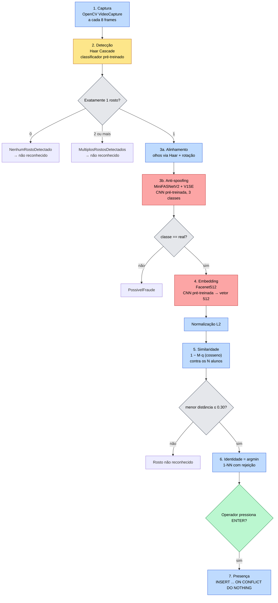
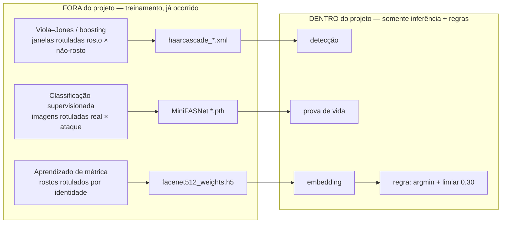
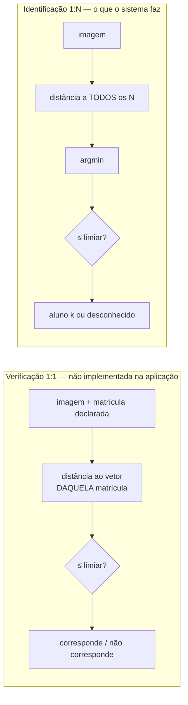
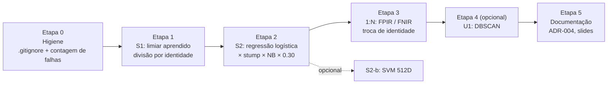

# Auditoria de Aprendizado de Máquina — Classificação do Projeto

- **Data:** 2026-10-10
- **Commit auditado:** `d313d28` (branch `main`)
- **Escopo:** paradigmas de aprendizado (supervisionado, não supervisionado, por reforço) e classificação binária no pipeline de reconhecimento facial
- **Natureza:** somente análise e documentação. Nenhum código, dependência, configuração ou banco foi alterado.
- **Atualizado em 2026-10-10 (Etapa 0):** o texto abaixo é o da auditoria original e foi preservado; o que mudou desde então está na [§17](#17-atualizações-após-a-auditoria).

> **Regra de honestidade deste documento.** Nenhum número de desempenho do
> modelo (acurácia, FAR, FRR, AUC) aparece aqui como resultado, porque
> **nenhuma avaliação do modelo foi executada até hoje** neste projeto. Onde
> há números, eles são (a) contagens do código, (b) constantes lidas do código
> ou da biblioteca, ou (c) exemplos aritméticos explicitamente rotulados como
> ilustrativos. Informações sobre o treinamento original dos modelos vêm de
> fontes externas e estão marcadas como tal.

---

## Sumário

1. [Resumo executivo](#1-resumo-executivo)
2. [Contextualização dos três paradigmas](#2-contextualização-dos-três-paradigmas)
3. [Análise da implementação atual](#3-análise-da-implementação-atual)
4. [Evidências encontradas no código](#4-evidências-encontradas-no-código)
5. [Classificação do projeto](#5-classificação-do-projeto)
6. [Análise do pipeline de reconhecimento facial](#6-análise-do-pipeline-de-reconhecimento-facial)
7. [Classificação Binária no Reconhecimento Facial](#7-classificação-binária-no-reconhecimento-facial)
8. [Lacunas identificadas](#8-lacunas-identificadas)
9. [Propostas de melhoria para cada paradigma](#9-propostas-de-melhoria-para-cada-paradigma)
10. [Comparação de complexidade, benefícios e riscos](#10-comparação-de-complexidade-benefícios-e-riscos)
11. [Plano de evolução recomendado](#11-plano-de-evolução-recomendado)
12. [Estratégia de validação experimental](#12-estratégia-de-validação-experimental)
13. [Recomendação final](#13-recomendação-final)
14. [Conclusão acadêmica](#14-conclusão-acadêmica)
15. [Como explicar o aprendizado de máquina na apresentação](#15-como-explicar-o-aprendizado-de-máquina-na-apresentação)
16. [Referências](#16-referências)
17. [Atualizações após a auditoria](#17-atualizações-após-a-auditoria)

---

## 1. Resumo executivo

**O projeto utiliza Machine Learning — mas não treina nenhum modelo.** Todo o
aprendizado aconteceu antes, fora do projeto, em três modelos pré-treinados que
o sistema apenas executa (inferência):

| Modelo | Tarefa no pipeline | Família | Aprendizado na origem |
|---|---|---|---|
| Haar Cascade (OpenCV) | Detectar rosto e olhos | ML clássico (boosting) | Supervisionado — classificador binário rosto × não-rosto |
| MiniFASNetV2 + MiniFASNetV1SE | Prova de vida (anti-spoofing) | Deep Learning (CNN, PyTorch) | Supervisionado — classificador de 3 classes, reduzido a real × ataque |
| Facenet512 (Inception-ResNet-v1) | Gerar o vetor de 512 dimensões | Deep Learning (CNN, TensorFlow) | Supervisionado por identidade — aprendizado de métrica |

Sobre esses modelos, o código do projeto aplica **regras determinísticas**:
normalização L2, distância cosseno contra todos os alunos cadastrados, escolha
do menor valor (`argmin`) e aceite somente se a distância for `≤ 0.30`.

**Classificação do projeto:**

- **Paradigma que melhor o representa: aprendizado supervisionado**, na forma de
  *deep metric learning* (os embeddings foram aprendidos com rótulos de
  identidade). Em operação, o sistema faz **identificação 1:N por vizinho mais
  próximo com rejeição por limiar**. É uma classificação baseada em instâncias,
  sem ajuste de parâmetros sobre os dados do projeto.
- **Aprendizado não supervisionado: ausente.** Comparar similaridade entre
  vetores não é, por si só, aprendizado não supervisionado.
- **Aprendizado por reforço: ausente e não aplicável.** O problema não tem
  decisões sequenciais nem uma recompensa confiável. **Recomenda-se não
  implementá-lo.**

**Classificação binária.** O pipeline contém quatro decisões binárias
automáticas. Duas são classificadores treinados (Haar: rosto/não-rosto;
MiniFASNet: real/ataque), ambos pré-treinados. A decisão central — *"este
rosto é do aluno mais próximo?"* — é uma **regra de limiar**, com um valor
**herdado da biblioteca** (`0.30`, idêntico ao padrão do DeepFace para
Facenet512/cosseno) e **não calibrado** (ADR-004). O sistema como um todo é
**multiclasse com rejeição** (N alunos + "desconhecido"), não binário.

**Avaliação.** As ferramentas existem e são testadas: `scripts/metricas.py`,
com 16 testes, e `scripts/evaluate_model.py`. Mas **nunca foram executadas
sobre imagens**, então **não existe hoje nenhuma métrica de desempenho do
modelo**. Além disso, o script mede no protocolo 1:1 (pares), enquanto o
sistema opera em 1:N, e ele não separa os pares usados para escolher o limiar
dos pares usados para reportar o erro.

**Recomendação principal**, detalhada nas seções 9–13: um **experimento
offline de classificação binária supervisionada**, feito em duas partes que se
complementam:

1. **Calibrar o limiar** como o parâmetro aprendido de um classificador
   binário (`mesma pessoa` × `pessoas diferentes`). Os pares rotulados vêm de um
   dataset público, divididos **por identidade** em treino, validação e teste.
2. **Treinar uma regressão logística sobre a distância cosseno** e compará-la
   com o limiar puro, usando matriz de confusão, FAR/FRR, ROC/AUC e FPIR para
   1:N. O ganho real esperado é uma **probabilidade calibrada**, que hoje não
   existe. A separação entre as classes não deve melhorar.

**Extensão opcional:** agrupamento com DBSCAN, sem rótulos, avaliado depois
com os rótulos. **Aprendizado por reforço: não implementar.**

**Dois riscos encontrados durante a auditoria:**

- O diretório que a documentação sugere para o dataset de avaliação
  (`./avaliacao/...`) **não está no `.gitignore`** (verificado com
  `git check-ignore`). Seguir o comando documentado pode levar imagens de
  rostos para o Git.
- O termo de consentimento limita o uso da biometria à **"única finalidade de
  controlar a presença"** (`src/presentation/cli/menu.py:179-183`,
  `docs/lgpd.md` §2). Usar os rostos dos alunos cadastrados para treinar ou
  avaliar modelos **extrapola essa finalidade**. Os experimentos devem usar
  dataset público ou voluntários com consentimento específico.

---

## 2. Contextualização dos três paradigmas

### 2.1 Aprendizado supervisionado

Aprende uma função `f: X → Y` a partir de exemplos **rotulados** `(x, y)`. O
treinamento ajusta parâmetros para minimizar o erro entre `f(x)` e `y`. O
modelo é avaliado em exemplos **não vistos** no treino. Exemplos: classificação
(regressão logística, SVM, árvore de decisão, Naive Bayes, KNN) e regressão.

### 2.2 Aprendizado não supervisionado

Descobre estrutura em dados **sem rótulos**: agrupamentos (K-Means, DBSCAN,
aglomerativo), redução de dimensionalidade (PCA), detecção de anomalias. Não
existe "resposta certa" durante o treino. A avaliação usa métricas internas
(silhueta) ou rótulos externos consultados **só depois** do agrupamento.

### 2.3 Aprendizado por reforço

Um **agente** interage com um **ambiente** ao longo do tempo. Em cada
**estado**, escolhe uma **ação**, recebe uma **recompensa** e transita para um
novo estado. O objetivo é aprender uma **política** que maximize a recompensa
acumulada. O aprendizado é por tentativa e erro e exige exploração.

### 2.4 Onde fica o reconhecimento facial moderno

O reconhecimento facial com embeddings é um caso de **aprendizado de métrica
supervisionado** (*deep metric learning*). Uma rede neural é treinada, com
milhões de rostos rotulados por identidade, para mapear rostos num espaço
vetorial em que:

- rostos da **mesma pessoa** fiquem **próximos**;
- rostos de **pessoas diferentes** fiquem **distantes**.

Depois de treinada, a rede reconhece pessoas que **nunca viu no treino**, a
partir de **uma única foto** de cadastro. Na literatura, isso é chamado de
reconhecimento ***one-shot***. O cadastro não ajusta nenhum parâmetro: apenas
**memoriza um exemplo rotulado** (o vetor e o `aluno_id`). O que torna esse
"aprendizado com um exemplo" possível é a métrica aprendida antes.

### 2.5 Vocabulário — distinções obrigatórias

| Termo | Definição | Neste projeto |
|---|---|---|
| **Inteligência Artificial** | Campo amplo de sistemas que executam tarefas associadas à inteligência, com ou sem aprendizado (inclui regras, busca, lógica) | O sistema é uma aplicação de IA (percepção visual + decisão) |
| **Machine Learning** | Subárea da IA em que o comportamento é obtido a partir de dados, e não programado explicitamente | Presente, via três modelos aprendidos a partir de dados |
| **Deep Learning** | ML com redes neurais profundas, que aprendem a própria representação dos dados | Facenet512 e MiniFASNet são deep learning; o Haar Cascade **não** é |
| **Modelo pré-treinado** | Modelo cujos parâmetros foram ajustados por terceiros e são distribuídos prontos | Os três modelos; pesos baixados para `~/.deepface/weights/` |
| **Treinamento** | Processo de ajustar parâmetros a partir de dados rotulados ou não | **Não ocorre no projeto** |
| **Inferência** | Executar um modelo já treinado sobre uma entrada nova | Ocorre a cada cadastro e a cada 8 frames no reconhecimento |
| **Reconhecimento por similaridade** | Comparar o vetor da consulta com vetores de referência por uma distância e decidir por regra | **É o que o `matcher` faz** (`argmin` + limiar) |
| **Classificação supervisionada** | Um classificador **treinado** com exemplos rotulados aprende uma fronteira de decisão; uma nova classe exige retreino | **Não existe treinamento local**; há apenas classificadores pré-treinados (Haar, MiniFASNet) |

> Ausência de treinamento local **não** significa ausência de Machine Learning.
> Significa que o projeto é **consumidor** de modelos aprendidos, o padrão mais
> comum em aplicações reais de visão computacional.

---

## 3. Análise da implementação atual

### 3.1 Método da auditoria

| Atividade | Detalhe |
|---|---|
| Leitura de diretrizes | `CLAUDE.md`, `instructions/00..03`, `ARCHITECTURE.md`, `REFACTORING_PLAN.md`, `docs/baseline-arquitetura.md`, `docs/adr/ADR-002`, `docs/adr/ADR-004`, `docs/lgpd.md`, `docs/apresentacao.md` |
| Leitura do código | `src/` (domínio, aplicação, infraestrutura, CLI), `scripts/` (métricas, avaliação, benchmark, backfill), testes de reconhecimento |
| Inspeção da biblioteca | Código-fonte do `deepface==0.0.92` instalado em `.venv-app/`, para confirmar detector, modelo, anti-spoofing e limiar padrão. Só leitura |
| Busca negativa | `grep` por `sklearn`, `scikit`, `kmeans`, `dbscan`, `cluster`, `svm`, `logistic`, `naive`, `bayes`, `fit(`, `train`, `treino`, `fine-tun`, `reinforce`, `reforç`: **nenhuma ocorrência** em código, requisitos ou testes |
| Execução | `pytest tests/unit/test_matcher.py test_metricas.py test_reconhecer_aluno.py test_face_embedding.py`: **48 testes aprovados**. São testes de software, não avaliação do modelo |
| Não feito | Nenhuma imagem aberta, nenhum acesso ao banco, nenhuma inferência executada, nenhuma dependência instalada |

### 3.2 O que o sistema faz

| Fluxo | Comportamento | Arquivo principal |
|---|---|---|
| **Cadastro** | Consentimento → captura → detecção + anti-spoofing → recorte alinhado → **uma** inferência Facenet512 → vetor L2-normalizado gravado em `alunos.embedding` (BYTEA) | `src/application/use_cases/cadastrar_aluno.py` |
| **Reconhecimento** | Carrega todos os vetores do modelo em uso numa matriz `N × 512`. A cada 8 frames: detecção + anti-spoofing + **uma** inferência Facenet512 → distâncias cosseno contra todos → menor distância → aceita se `≤ FACE_THRESHOLD` | `src/application/use_cases/reconhecer_aluno.py`, `src/domain/services/matcher.py` |
| **Presença** | O operador pressiona ENTER sobre um reconhecimento → `INSERT ... ON CONFLICT DO NOTHING` (uma presença por aluno por dia) | `src/presentation/cli/menu.py`, `src/application/use_cases/registrar_presenca.py` |

### 3.3 Modelos de ML em uso

| Aspecto | Haar Cascade | MiniFASNet (anti-spoofing) | Facenet512 |
|---|---|---|---|
| Tarefa | Localizar rosto e olhos | Distinguir rosto ao vivo de foto ou tela | Converter o rosto num vetor de 512 dimensões |
| Acionamento | `detector_backend="opencv"` (`settings.py:59`) | `anti_spoofing=True` (`settings.py:70`) | `model_name="Facenet512"` (`settings.py:58`) |
| Implementação | `deepface/detectors/OpenCv.py:23-24`: `haarcascade` (rosto) + `haarcascade_eye` (olhos) | `deepface/spoofmodels/FasNet.py:37-45`: dois modelos, `MiniFASNetV2` e `MiniFASNetV1SE` | `deepface/basemodels/Facenet.py:1688-1711`: Inception-ResNet-v1, `dimension=512` |
| Framework | OpenCV (não é rede neural) | PyTorch | TensorFlow / tf-keras |
| Origem dos pesos | XML embarcado no `opencv-python` | Repositório Silent-Face-Anti-Spoofing (Minivision) | `serengil/deepface_models`; arquitetura derivada do repositório de David Sandberg |
| Saída | Caixas delimitadoras + posição dos olhos | Softmax de **3 classes**; `label == 1` → real | Vetor `ℝ^512`, não normalizado (o projeto normaliza) |
| Aprendizado na origem* | Boosting (Viola–Jones) sobre janelas rotuladas rosto/não-rosto | Classificação supervisionada sobre imagens rotuladas real/ataque | Aprendizado supervisionado por identidade (ver nota) |
| Treinado no projeto? | **Não** | **Não** | **Não** |

\* *Informação externa ao repositório, não verificável a partir do código.* O
artigo original do FaceNet (Schroff et al., 2015) treina com *triplet loss*,
formando trios âncora/positivo/negativo a partir de rótulos de identidade. O
`Facenet.py` do DeepFace declara que a arquitetura e os pesos derivam do
repositório de David Sandberg, cuja documentação descreve o modelo de 512
dimensões como treinado sobre o VGGFace2 com perda de classificação de
identidades. Nos dois casos, **a supervisão é a identidade da pessoa**.
Confirme nas fontes primárias antes de citar nos slides.

### 3.4 O que não existe

- Nenhum treinamento, fine-tuning, `fit()`, otimizador, função de perda ou
  época.
- Nenhuma biblioteca de ML clássico (`scikit-learn` ausente de
  `requirements.txt` e `requirements-dev.txt`).
- Nenhum dataset, notebook, curva, matriz de confusão ou resultado de
  avaliação versionado ou documentado.
- Nenhum agrupamento (clustering), redução de dimensionalidade ou detecção de
  anomalias.
- Nenhum agente, recompensa ou política.
- **Uma única imagem e um único embedding por aluno**: colunas
  `alunos.embedding`, `embedding_modelo` e `embedding_dim`
  (`src/infrastructure/database/models.py:64-66`), relação 1:1.

---

## 4. Evidências encontradas no código

| # | Afirmação | Evidência | Trecho / observação |
|---|---|---|---|
| E1 | O DeepFace só é importado no adaptador | `src/infrastructure/face_recognition/deepface_adapter.py:23` | `from deepface import DeepFace`. O domínio não conhece o modelo |
| E2 | Detecção com alinhamento e prova de vida numa chamada só | `deepface_adapter.py:81-87` | `DeepFace.extract_faces(..., enforce_detection=True, align=True, anti_spoofing=self._anti_spoofing)` |
| E3 | Decisão "exatamente um rosto" é regra | `deepface_adapter.py:91-94` | `if not faces` → `NenhumRostoDetectado`; `if len(faces) != 1` → `MultiplosRostosDetectados` |
| E4 | Decisão real × ataque vem de classificador pré-treinado | `deepface_adapter.py:98-109`; `deepface/spoofmodels/FasNet.py:135-141` | `prediction = np.zeros((1, 3))`; soma dos softmax de dois modelos; `is_real = label == 1` |
| E5 | Embedding é **inferência**, não treino | `deepface_adapter.py:136-142` | `DeepFace.represent(img_path=recorte, model_name=..., detector_backend="skip")` |
| E6 | O vetor é L2-normalizado na construção | `src/domain/entities/face_embedding.py:55-68` | `vetor / norma`; rejeita vazio, NaN e norma zero |
| E7 | Comparação é aritmética vetorial | `src/domain/services/matcher.py:96` | `distancias = 1.0 - self._matriz @ consulta.vetor` |
| E8 | Identidade = vizinho mais próximo | `matcher.py:98-99` | `indice = int(np.argmin(distancias))` |
| E9 | Rejeição por limiar (decisão binária) | `matcher.py:101-102` | `if distancia > limiar: return None` |
| E10 | Modelos diferentes nunca são comparados | `matcher.py:55-66, 82-92` | `ModeloIncompativel` |
| E11 | Limiar padrão = 0.30 | `src/config/settings.py:65` | `face_threshold: float = 0.30`, com comentário admitindo herança |
| E12 | 0.30 é exatamente o padrão do DeepFace | `.venv-app/.../deepface/modules/verification.py:377` | `"Facenet512": {"cosine": 0.30, ...}` |
| E13 | Limiar "não calibrado" é decisão documentada | `docs/adr/ADR-004-limiar-de-reconhecimento.md` | "Status: aceito; **valor ainda não calibrado**" |
| E14 | Embedding calculado uma vez, no cadastro | `src/application/use_cases/cadastrar_aluno.py:93-94` | `extrair_face_unica` → `gerar_embedding(face)` |
| E15 | Referências carregadas uma vez por sessão | `src/application/use_cases/reconhecer_aluno.py:46-62` | `listar_referencias(self._modelo)` → `MatrizDeReferencia` |
| E16 | Sem rosto ou com vários rostos → "não reconhecido" | `reconhecer_aluno.py:77-85` | `except NenhumRostoDetectado: return None` |
| E17 | Inferência a cada 8 frames | `src/presentation/cli/menu.py:41, 314-316` | `INTERVALO_DE_COMPARACAO = 8` |
| E18 | Decisão final de registrar é humana | `menu.py:328-329` | `if tecla == ENTER and reconhecido is not None` |
| E19 | A "confiança" exibida não é probabilidade | `src/presentation/cli/confianca.py:6-15, 26-30` | `1 - distancia / limiar`, declarado como não calibrado |
| E20 | Métricas biométricas existem como funções puras | `scripts/metricas.py:40-96` | `far_frr`, `curva`, `eer`, `limiar_para_far_maximo`, `area_sob_a_curva` (Mann-Whitney) |
| E21 | Métricas têm testes | `tests/unit/test_metricas.py` | 16 funções `test_` |
| E22 | O protocolo de avaliação é 1:1, por pares | `scripts/evaluate_model.py:72-89` | Genuínos dentro da pasta; impostores entre pastas |
| E23 | Avaliação sem anti-spoofing | `evaluate_model.py:158-164` | `anti_spoofing=False` |
| E24 | Avaliação descarta falhas sem contabilizá-las | `evaluate_model.py:62-65` | `except Exception as erro: print(...)` — contraria `CLAUDE.md` §11 e não reporta taxa de falha de extração |
| E25 | O limiar é sugerido e o erro reportado sobre os **mesmos** pares | `evaluate_model.py:111-128` | Não há divisão calibração/teste |
| E26 | Um embedding por aluno | `src/infrastructure/database/models.py:64-66` | Colunas na própria tabela `alunos` |
| E27 | A finalidade consentida é só presença | `menu.py:179-183`; `docs/lgpd.md` §2 | "com a unica finalidade de controlar a presenca" |
| E28 | Diretório de avaliação sugerido não é ignorado | `.gitignore` (ignora `/fotos/`, `/storage/`, `*.npy`) | `git check-ignore avaliacao/lfw-subset/pessoa-1/foto-a.jpg` → não ignorado |
| E29 | Nenhuma biblioteca de ML clássico | `requirements.txt`, `requirements-dev.txt` | Sem `scikit-learn` |

---

## 5. Classificação do projeto

### 5.1 Tabela de diagnóstico

| Critério | Situação atual | Evidência no código | Observações |
|---|---|---|---|
| Aprendizado supervisionado | **Parcialmente implementado** | E4, E5, §3.3 | Presente **somente como herança**: os três modelos foram treinados com supervisão por terceiros. O `matcher` usa exemplos rotulados (vetor + `aluno_id`) como um classificador 1-NN, mas sem ajustar nenhum parâmetro. Nenhum treinamento local |
| Aprendizado não supervisionado | **Não implementado** | E29, §3.4 | Sem clustering nem redução de dimensionalidade. A similaridade cosseno é uma medida, não um aprendizado |
| Aprendizado por reforço | **Não aplicável** | §3.4 | Não há decisão sequencial, ambiente com transições nem recompensa confiável (§9.3) |
| Modelo pré-treinado | **Implementado** | E2, E4, E5, E12 | Haar Cascade, MiniFASNet (×2), Facenet512 |
| Treinamento próprio | **Não implementado** | §3.4, E29 | Nem fine-tuning, nem classificador sobre embeddings |
| Inferência | **Implementado** | E5, E14, E17 | Uma inferência Facenet512 por ciclo de reconhecimento, além de detecção e anti-spoofing |
| Classificação de identidades | **Parcialmente implementado** | E7, E8, E9 | Identificação **1:N por vizinho mais próximo com rejeição**. Funciona como classificador de N+1 classes, mas é regra sobre distâncias, não classificador treinado |
| Avaliação de desempenho do modelo | **Parcialmente implementado** | E20–E25, E13 | Ferramentas prontas e testadas; **nunca executadas sobre dados**; nenhuma métrica existe. Protocolo 1:1 apenas; sem divisão calibração/teste |
| Decisão binária aceitar/rejeitar | **Implementado** | E9 | Regra `distância ≤ limiar` |
| Classificador binário treinado localmente | **Não implementado** | E29 | — |
| Classificadores binários pré-treinados no pipeline | **Implementado** | E2, E4 | Haar (rosto/não-rosto), MiniFASNet (real/ataque, a partir de 3 classes) |
| Calibração do limiar por dados | **Não implementado** | E11, E12, E13 | 0.30 = padrão do DeepFace |
| Verificação 1:1 | **Não implementado** (na aplicação) | E22 | Existe só como **protocolo de avaliação** no script |
| Identificação 1:N | **Implementado** | E7–E9, E15 | Varredura exata sobre todos os alunos |
| Avaliação do anti-spoofing | **Não implementado** | `ARCHITECTURE.md` §9 | "Eficácia pendente de validação"; sem APCER/BPCER |

### 5.2 Veredito

> O projeto é uma **aplicação de Machine Learning por inferência**, apoiada em
> modelos de **aprendizado supervisionado** (aprendizado de métrica por
> identidade, mais dois classificadores binários pré-treinados). Sobre esses
> modelos, executa **identificação 1:N por similaridade com rejeição por
> limiar**. Não treina, não agrupa e não aprende por reforço.

---

## 6. Análise do pipeline de reconhecimento facial

### 6.1 Fluxo real (reconhecimento)



Legenda: **amarelo** = ML clássico pré-treinado (inferência); **vermelho** =
deep learning pré-treinado (inferência); **azul** = processamento
determinístico; **cinza** = regra de decisão; **verde** = decisão humana.

### 6.2 Etapa por etapa

| Etapa | Tecnologia | Função | Natureza | Evidência |
|---|---|---|---|---|
| 1. Captura | OpenCV (`cv2.VideoCapture`), 1280×720 | Obter frames da webcam | Determinístico (E/S) | `src/infrastructure/camera/opencv_camera.py`; `settings.py:46-57` |
| 2. Detecção | Haar Cascade (`haarcascade_frontalface_default`) via DeepFace | Encontrar a região do rosto | **Inferência** de classificador binário pré-treinado (janela: rosto × não-rosto) | E2; `OpenCv.py:23` |
| 2b. Contagem | Python | Exigir exatamente um rosto | Regra determinística | E3 |
| 3a. Alinhamento | `haarcascade_eye` + rotação geométrica | Nivelar os olhos para padronizar a entrada | Inferência (achar os olhos) + transformação determinística | `OpenCv.py:24, 77-105`; `align=True` |
| 3b. Anti-spoofing | MiniFASNetV2 + MiniFASNetV1SE (PyTorch) | Recusar foto impressa ou tela | **Inferência** de CNN pré-treinada; regra `label == 1` | E4 |
| 3c. Pré-processamento | DeepFace (`resize` para a entrada do modelo, normalização de pixels) | Adequar o recorte ao modelo | Determinístico | `deepface/modules/representation.py:108-116` |
| 4. Embedding | Facenet512 (Inception-ResNet-v1, TensorFlow) | Gerar o vetor de 512 dimensões | **Inferência** de CNN pré-treinada | E5 |
| 4b. Normalização | NumPy | Vetor de norma 1 | Determinístico | E6 |
| 5. Similaridade | NumPy (`M @ q`) | Distância cosseno contra todos os N | Determinístico | E7 |
| 6. Identificação | `argmin` + limiar | Escolher o mais próximo; rejeitar se acima de 0.30 | **Regra de decisão** (não treinada) | E8, E9 |
| 7. Presença | PostgreSQL (`UNIQUE(aluno_id, data_referencia)`) | Uma presença por dia, após confirmação humana | Determinístico (regra de negócio) | E18; `registrar_presenca.py:16-25` |

**No cadastro**, as etapas 2–4 rodam duas vezes: `extrair_face_unica` sobre o
frame e `gerar_embedding` sobre o recorte (E14). Cada chamada detecta o rosto e
verifica a prova de vida. O efeito disso na qualidade do vetor de referência
não foi medido.

**Custo por ciclo de reconhecimento:** uma inferência Facenet512, duas
inferências MiniFASNet, a detecção Haar e um produto matriz-vetor. A frase
"uma inferência por ciclo" dos documentos de arquitetura se refere ao modelo
de embedding.

### 6.3 Onde o aprendizado aconteceu



---

## 7. Classificação Binária no Reconhecimento Facial

### 7.1 Decisões binárias existentes no sistema

| # | Pergunta binária | Classe positiva | Mecanismo | Treinado? | Evidência |
|---|---|---|---|---|---|
| B1 | Esta janela da imagem contém um rosto? | rosto | Haar Cascade (cascata de classificadores fracos por boosting) | **Sim, pré-treinado** (fora do projeto) | `OpenCv.py:23` |
| B2 | O frame tem exatamente um rosto? | um rosto | Contagem: `len(faces) == 1` | Não — regra | E3 |
| B3 | O rosto é de uma pessoa ao vivo? | real | MiniFASNet: softmax de 3 classes → `label == 1` | **Sim, pré-treinado** (classificador multiclasse reduzido a binário) | E4 |
| B4 | O rosto é do aluno mais próximo? | mesma pessoa (aceitar) | `distância_mínima ≤ 0.30` | **Não — regra com limiar herdado** | E9, E11, E12 |
| B5 | Registrar a presença? | registrar | Operador pressiona ENTER | Não — decisão humana | E18 |
| B6 | É a primeira presença do dia? | inserir | `ON CONFLICT DO NOTHING` | Não — regra de negócio | `registrar_presenca.py` |

**Ponto central para a disciplina:** existem classificadores binários
treinados no pipeline (B1, B3), mas **não foram treinados pelo projeto**. A
decisão que mais importa para o controle de presença (B4) é uma **regra de
decisão sobre uma única característica (a distância)**, com um parâmetro que
ninguém ajustou com dados.

### 7.2 Regra de limiar × classificador treinado

A decisão B4 pode ser escrita como:

```text
ŷ = 1   se   d(q, r_k*) ≤ τ      (aceita: "é o aluno k*")
ŷ = 0   caso contrário           (rejeita: "desconhecido")

onde  k* = argmin_k d(q, r_k)  e  τ = 0.30
```

Em sentido **operacional**, isso **é** uma classificação binária: separa
"mesma pessoa" de "pessoa diferente". Em sentido de **aprendizado de
máquina**, **não é** um classificador treinado, porque o parâmetro `τ` não foi
estimado a partir de dados rotulados deste projeto.

Isso sugere a ponte mais simples para a disciplina. Formalmente, a regra é um
**decision stump** (árvore de decisão de profundidade 1) sobre a
característica `d`. **Se `τ` for estimado a partir de pares rotulados**
(genuíno = 1, impostor = 0), a regra passa a ser, literalmente, **um
classificador binário supervisionado de um parâmetro**. Nenhuma parte da
arquitetura muda: só a origem do número.

### 7.3 Como o sistema lida com falsos positivos e falsos negativos

| Erro | No controle de presença | Mitigações existentes | Medido? |
|---|---|---|---|
| **Falso positivo** (impostor aceito, ou aluno A registrado como B) | Presença indevida num registro oficial; erro silencioso | Escolha do **menor** candidato, não do primeiro (E8); limiar explícito (E11); anti-spoofing (E4); frames com vários rostos recusados (E16); **confirmação humana** por ENTER (E18); rótulo "confiança baixa" quando a confiança fica abaixo de 40% (`confianca.py:23, 51-52`) | **Não** — FAR desconhecido |
| **Falso negativo** (aluno legítimo rejeitado) | O aluno tenta de novo; o laço reavalia a cada 8 frames | Nova tentativa automática; resolução 1280×720 para melhorar o recorte (`settings.py:42-47`) | **Não** — FRR desconhecido |
| **Falsa rejeição pelo anti-spoofing** | Pessoa real recusada como fraude | Documentado em `docs/apresentacao.md` §6 (falha em contraluz) | Só observação qualitativa |

ADR-004 já define o **critério** de escolha do limiar (teto de FAR, porque
falso positivo custa mais que falso negativo). Falta **aplicá-lo** com dados.

### 7.4 Verificação 1:1 × identificação 1:N



**O sistema realiza identificação 1:N em conjunto aberto** (*open-set
identification*). Ninguém informa a matrícula; o sistema procura entre todos
os cadastrados e pode responder "desconhecido". Internamente, a etapa final
equivale a uma verificação 1:1 do **melhor candidato**. Mas o candidato foi
escolhido entre N, e isso muda as estatísticas de erro.

**Identificação multiclasse com rejeição × classificação binária:**

| Aspecto | Classificação binária (verificação 1:1) | Identificação multiclasse com rejeição (1:N) |
|---|---|---|
| Espaço de saída | 2 classes | N + 1 classes (N alunos + desconhecido) |
| Entrada | Par (imagem, identidade declarada) | Imagem |
| Tipos de erro | Falsa aceitação, falsa rejeição | Falsa rejeição de cadastrado; falsa aceitação de não cadastrado; **troca de identidade** (A reconhecido como B) |
| Métricas padrão | FAR, FRR, ROC, EER | FPIR (taxa de identificação falso-positiva), FNIR (taxa de identificação falso-negativa), taxa de acerto em top-1 |
| Efeito de N | Nenhum | O risco de falsa aceitação **cresce com N** |

**Por que isso importa para a avaliação.** O `evaluate_model.py` mede FAR no
protocolo 1:1 (E22). Em 1:N, um não cadastrado é comparado com **todos** os N
alunos. Se as comparações fossem independentes, a chance de ao menos uma passar
no limiar seria aproximadamente:

```text
FPIR ≈ 1 − (1 − FAR)^N  ≈  N · FAR   (para FAR pequeno)
```

*Exemplo aritmético ilustrativo, não medição:* com 40 alunos e FAR 1:1 de
0,1%, a FPIR seria da ordem de 1 − 0,999^40 ≈ 3,9%. A aproximação ignora a
correlação entre comparações. Só uma avaliação 1:N direta, com identidades não
cadastradas, mede o valor real.

Um modo 1:1 (operador digita a matrícula, câmera confirma) teria FAR
independente de N, mas pioraria a experiência e não é o caso de uso
documentado. Fica registrado como alternativa, não como recomendação.

### 7.5 Algoritmos de classificação binária: aplicabilidade

Há duas formas de usar um classificador sobre os embeddings, e a escolha entre
elas determina tudo o que vem depois:

| Formulação | Entrada | Rótulo | Viável hoje? |
|---|---|---|---|
| **F1 — Identificação multiclasse** | Embedding de 512 dimensões de uma imagem | `aluno_id` (N classes) | **Não**: há **uma** imagem por aluno (E26). Não se treina um classificador com um exemplo por classe; com k = 1, o KNN **é** o matcher atual. Exigiria várias imagens por aluno e retreino a cada cadastro, além de rejeitar desconhecidos por fora |
| **F2 — Verificação binária sobre pares** | Característica do par `(e₁, e₂)`: a distância cosseno (1 dimensão) ou `|e₁ − e₂|` e `e₁ ⊙ e₂` (512 dimensões) | 1 = mesma pessoa; 0 = pessoas diferentes | **Sim, offline**: o número de pares cresce quadraticamente com o de imagens; os rótulos saem da organização por pastas; funciona para pessoas nunca vistas (novos alunos) |

> **Fato matemático decisivo para F2 com uma única característica.** Qualquer
> classificador que seja uma **transformação monótona** da distância
> (regressão logística sobre `d`, decision stump sobre `d`) produz **a mesma
> ordenação**, logo a **mesma curva ROC e a mesma AUC** do limiar puro. Esses
> modelos não separam melhor as classes. O que agregam é (a) um limiar
> **aprendido** com critério explícito e (b) uma **probabilidade calibrada**.
> Separar melhor exige mais características (F2 com 512 dimensões) ou retreinar
> o modelo de embedding, o que está fora do escopo.

#### 7.5.1 Naive Bayes

| Aspecto | Análise |
|---|---|
| Como funcionaria | Modelo **generativo**: estima `P(d | genuíno)` e `P(d | impostor)` (por exemplo, duas gaussianas sobre a distância) e decide pela maior probabilidade a posteriori com uma probabilidade a priori `P(genuíno)` |
| Entrada | F2-1D: distância cosseno. F2-512D: `|e₁ − e₂|` por dimensão |
| Rótulos | Par genuíno (1) / impostor (0) |
| Usa Facenet512? | Sim, indiretamente (distância entre vetores Facenet512) |
| Vantagens | Muito didático: o histograma das duas distribuições **é** o modelo; treina instantaneamente; dá probabilidade |
| Limitações | Com uma característica, a hipótese "naive" de independência perde o sentido (é só Bayes gaussiano). Distâncias em [0, 2] tendem a ser assimétricas, não gaussianas. A probabilidade a priori dos pares é **artificial** (impostores ≫ genuínos) e precisa refletir a operação. Em 512 dimensões, a independência entre dimensões é falsa, porque os embeddings são distribuídos e correlacionados |
| Complexidade | Baixa |
| Faz sentido? | **Como comparação didática em 1D, sim.** Como modelo principal, não |

#### 7.5.2 Regressão Logística

| Aspecto | Análise |
|---|---|
| Como funcionaria | `P(mesma pessoa | d) = σ(w·d + b)`. Aprende `w` e `b` por máxima verossimilhança. O limiar operacional sai de um teto de FAR na validação (ADR-004), não do 0,5 padrão |
| Entrada | F2-1D: distância cosseno (recomendado). F2-512D: `|e₁ − e₂|` (opcional, com regularização) |
| Rótulos | Par genuíno (1) / impostor (0) |
| Usa Facenet512? | Sim |
| Vantagens | Interpretável (dois parâmetros); devolve **probabilidade calibrada**, o que corrigiria a "confiança" que hoje é só uma escala linear (E19); equivale à calibração de Platt; robusta com poucos dados em 1D |
| Limitações | Em 1D não muda a AUC (transformação monótona). Classes desbalanceadas exigem `class_weight` ou reamostragem. Em 512 dimensões há risco de sobreajuste com poucas identidades |
| Complexidade | Baixa |
| Faz sentido? | **Sim — é a escolha recomendada** para o experimento |

#### 7.5.3 Support Vector Machines (SVM)

| Aspecto | Análise |
|---|---|
| Como funcionaria | Hiperplano de margem máxima separando pares genuínos de impostores. Em 1D, degenera num limiar. Em 512 dimensões, sobre `|e₁ − e₂|`, aprende **um peso por dimensão**: uma forma leve de aprendizado de métrica sobre o Facenet512 |
| Entrada | F2-512D: `|e₁ − e₂|` (ou concatenado com `e₁ ⊙ e₂`) |
| Rótulos | Par genuíno (1) / impostor (0) |
| Usa Facenet512? | Sim |
| Vantagens | Única opção desta lista com **potencial real** de separar melhor que a distância cosseno, porque aprende uma métrica ponderada. Um kernel linear basta |
| Limitações | Não devolve probabilidade nativamente (exige calibração extra). Sensível ao hiperparâmetro `C`. Com poucas identidades, o ganho tende a ser sobreajuste. Exige validação cruzada **agrupada por identidade**. Um kernel RBF não se justifica |
| Complexidade | Média |
| Faz sentido? | **Como experimento comparativo opcional**, depois da regressão logística |

#### 7.5.4 Árvore de Decisão

| Aspecto | Análise |
|---|---|
| Como funcionaria | Particiona o espaço com cortes paralelos aos eixos. **Com profundidade 1 sobre `d`, é exatamente a regra atual** (um decision stump) |
| Entrada | F2-1D: distância. Sobre embeddings de 512 dimensões: inadequada |
| Rótulos | Par genuíno (1) / impostor (0) |
| Usa Facenet512? | Sim, via distância |
| Vantagens | Ponte didática perfeita: "o nosso limiar é uma árvore de profundidade 1; treiná-la é calibrar o limiar" |
| Limitações | O critério de divisão (Gini ou entropia) trata FP e FN como igualmente caros, o que contraria ADR-004; corrige-se com `class_weight` ou escolhendo o corte por teto de FAR. Profundidade maior sobre uma característica gera vários limiares, não monótonos, que sobreajustam. Sobre vetores densos de 512 dimensões, cortes paralelos aos eixos não capturam a geometria do embedding |
| Complexidade | Baixa |
| Faz sentido? | **Só como decision stump didático.** Não como modelo de produção |

#### 7.5.5 Resumo comparativo

| Algoritmo | Formulação adequada | Melhora a separação? | Dá probabilidade? | Complexidade | Recomendação |
|---|---|---|---|---|---|
| Naive Bayes (gaussiano) | F2-1D | Não (praticamente) | Sim | Baixa | Comparação didática |
| **Regressão logística** | **F2-1D** | Não (melhora a calibração) | **Sim** | Baixa | **Principal** |
| SVM linear | F2-512D | **Possivelmente** | Só com calibração | Média | Opcional |
| Árvore de decisão (stump) | F2-1D | Não | Não (diretamente) | Baixa | Ponte didática |

### 7.6 Experimento proposto: classificador binário treinado

**Objetivo:** demonstrar aprendizado supervisionado real (treino, validação e
teste) num problema binário, comparando o classificador treinado com o método
atual (limiar fixo de 0.30).

**Protocolo:**

1. **Dados.** Dataset público organizado por pessoa (por exemplo, um
   subconjunto do LFW com pessoas que tenham 5 ou mais imagens), além de um
   pequeno conjunto local de **voluntários com consentimento específico** para
   pesquisa, capturado na webcam real. **Nunca** os alunos cadastrados (E27).
2. **Embeddings.** Uma inferência Facenet512 por imagem, reutilizando
   `DeepFaceAdapter.gerar_embedding`. Contabilizar as imagens recusadas (taxa
   de falha de extração), em vez de descartá-las em silêncio (E24). Cache
   local em `.npy`, já ignorado pelo Git.
3. **Divisão por identidade**, antes de formar qualquer par. Por exemplo, 60%
   das pessoas para treino, 20% para validação e 20% para teste. Uma pessoa
   aparece em **um único** subconjunto. Assim se simula o caso real: o sistema
   precisa funcionar para alunos que não existiam quando o limiar foi
   calibrado.
4. **Pares.** Dentro de cada subconjunto: genuínos (mesma pasta) e impostores
   (pastas diferentes). Rótulo 1 ou 0.
5. **Características.** `x = d_cos(e₁, e₂)` para o modelo principal;
   `x = |e₁ − e₂|` para o SVM opcional.
6. **Treino** no subconjunto de treino: regressão logística (e, para
   comparação, decision stump e Naive Bayes gaussiano sobre `d`).
7. **Validação:** escolher o limiar operacional de cada modelo pelo **teto de
   FAR** (ADR-004) e escolher entre os modelos. Para hiperparâmetros, usar
   validação cruzada agrupada por identidade.
8. **Teste, uma única vez:** matriz de confusão, FAR, FRR, precisão, recall,
   F1, ROC/AUC. Comparar contra o **baseline**: limiar fixo de 0.30, sem
   treino.
9. **Teste 1:N (complementar):** cadastrar uma imagem por pessoa de parte das
   identidades de teste e usar as demais identidades como **não cadastradas**.
   Medir FNIR, FPIR e taxa de troca de identidade com o próprio `matcher`.

Esboço, **não implementado e não executado**, apenas para tornar o protocolo
concreto:

```python
# ESBOÇO — não executado. Bibliotecas: numpy + scikit-learn (dependência
# só do experimento, fora da aplicação e do domínio).
from sklearn.linear_model import LogisticRegression

pessoas_treino, pessoas_val, pessoas_teste = dividir_por_identidade(por_pessoa, seed=42)

X_tr, y_tr = pares(pessoas_treino)          # x = distância cosseno; y ∈ {0, 1}
modelo = LogisticRegression(class_weight="balanced").fit(X_tr, y_tr)

X_val, y_val = pares(pessoas_val)
limiar_prob = maior_limiar_com_far_maximo(modelo.predict_proba(X_val)[:, 1], y_val, far_max=0.001)

X_te, y_te = pares(pessoas_teste)           # usado UMA vez
relatar(y_te, modelo.predict_proba(X_te)[:, 1] >= limiar_prob)   # vs. baseline: X_te <= 0.30
```

### 7.7 Avaliação da classificação binária

**Convenção:** classe positiva = **"mesma pessoa" (aceitar)**.

| | Previsto: aceitar | Previsto: rejeitar |
|---|---|---|
| **Real: mesma pessoa** | **TP** — aluno reconhecido corretamente | **FN** — aluno legítimo recusado |
| **Real: pessoa diferente** | **FP** — impostor aceito (**presença indevida**) | **TN** — impostor recusado |

| Métrica | Fórmula | Interpretação no controle de presença | Cuidado |
|---|---|---|---|
| **Acurácia** | (TP+TN) / total | Fração de decisões corretas | **Enganosa com desbalanceamento** (ver exemplo abaixo) |
| **Precisão** | TP / (TP+FP) | Das presenças aceitas, quantas eram da pessoa certa | Depende da prevalência. A proporção de pares no dataset é artificial e não reflete a operação |
| **Recall (TPR)** | TP / (TP+FN) = 1 − FRR | Dos alunos presentes, quantos o sistema aceita | — |
| **F1** | 2·P·R / (P+R) | Equilíbrio entre precisão e recall | Ignora TN; depende da prevalência; trata FP e FN como igualmente caros |
| **FAR** (= FPR) | FP / (FP+TN) | Taxa de impostores aceitos. **O erro crítico** (ADR-004) | Não depende da prevalência. Reportar com intervalo |
| **FRR** (= FNR) | FN / (FN+TP) | Taxa de alunos legítimos recusados. Custa uma nova tentativa | Não depende da prevalência |
| **ROC / AUC** | TPR × FPR para todos os limiares | Compara modelos **independentemente do limiar**. AUC = P(genuíno mais próximo que impostor) | Mesma AUC para qualquer transformação monótona de `d` (§7.5) |
| **EER** | Ponto onde FAR = FRR | Comparação entre modelos | Não serve como ponto de operação (ADR-004) |

*Exemplo aritmético ilustrativo do desbalanceamento:* 20 pessoas com 5 imagens
cada geram 20 × C(5,2) = **200** pares genuínos e C(20,2) × 5 × 5 = **4.750**
impostores. Um "classificador" que rejeita tudo teria acurácia de
4.750 / 4.950 ≈ **96%**, com FRR de 100%. Por isso o relatório principal deve
usar **FAR, FRR, ROC e a matriz de confusão**, não a acurácia.

**Ponto de operação:** fixar um teto de FAR (decisão de negócio, ADR-004) e
reportar o FRR resultante. Exemplo de enunciado: *"com FAR ≤ 0,1% no teste,
FRR = X%"*, em que X só existirá depois de executar o experimento.

**Métricas para 1:N:** FPIR (não cadastrado aceito como alguém), FNIR
(cadastrado não reconhecido) e **taxa de troca de identidade** (cadastrado
reconhecido como outro aluno), o pior erro para o registro oficial. A matriz
de confusão vira (N+1)×(N+1).

### 7.8 Respostas — classificação binária

| # | Pergunta | Resposta |
|---|---|---|
| 1 | O projeto realiza decisões binárias? | **Sim, seis** (§7.1). Quatro automáticas (rosto?, um rosto?, real?, mesma pessoa?), uma humana (registrar?) e uma de negócio (primeira do dia?) |
| 2 | Essas decisões são modelos treinados ou regras? | **As duas coisas.** B1 (Haar) e B3 (MiniFASNet) são classificadores **pré-treinados**. B4 — a decisão "é este aluno" — é **regra de limiar** com valor herdado da biblioteca, **não treinada** |
| 3 | O projeto pode ser caracterizado como um sistema de classificação binária? | **Não como um todo.** É um sistema de **identificação multiclasse em conjunto aberto** (N + 1 saídas). Contém classificações binárias como **componentes** (portões do pipeline) |
| 4 | Qual a diferença para a identificação usada hoje? | A binária responde "mesma pessoa?" para um par, com 2 saídas e 2 tipos de erro. A identificação responde "quem é?" entre N, com N + 1 saídas, 3 tipos de erro (inclusive a troca de identidade) e risco que **cresce com N** |
| 5 | Qual dos quatro algoritmos é mais adequado ao experimento? | **Regressão logística sobre a distância cosseno**: interpretável, robusta com poucos dados e a única das quatro que entrega **probabilidade calibrada** de forma nativa |
| 6 | Vale a pena implementar um classificador binário treinado? | **Sim, como experimento offline.** Calibra um limiar hoje herdado (fecha a pendência do ADR-004), dá significado à "confiança" exibida e demonstra treino/validação/teste. **Não** se deve esperar ganho de separação em 1D; ganho de separação só com SVM sobre 512 dimensões, e ainda sem garantia |
| 7 | Qual a abordagem mais simples para demonstrar classificação binária? | Mostrar que **o limiar atual é um decision stump** e **treiná-lo**: histograma das distâncias genuínas × impostoras, limiar aprendido por teto de FAR no treino/validação, matriz de confusão no teste, comparado ao 0.30 herdado. Usa quase só o que já existe em `scripts/metricas.py` |

---

## 8. Lacunas identificadas

| ID | Lacuna | Impacto | Evidência |
|---|---|---|---|
| G1 | O limiar 0.30 é herdado do DeepFace, não calibrado | A decisão mais importante do sistema não tem justificativa empírica | E11, E12, E13 |
| G2 | Nenhuma avaliação do modelo foi executada | Não há FAR, FRR, AUC nem matriz de confusão para apresentar | E20–E25; `REFACTORING_PLAN.md:493` |
| G3 | A avaliação mede em 1:1; o sistema opera em 1:N | O FAR medido subestima o risco operacional, que cresce com N | E22; §7.4 |
| G4 | Limiar sugerido e erro reportado sobre os mesmos pares | Viés otimista: o limiar é ajustado e avaliado nos mesmos dados | E25 |
| G5 | Falhas de extração descartadas com `except Exception`, sem contagem | Taxa de falha de extração não reportada; amostra enviesada; viola `CLAUDE.md` §11 | E24 |
| G6 | Avaliação roda sem anti-spoofing | O FRR do sistema real (com prova de vida) será maior que o medido | E23 |
| G7 | Um único embedding por aluno | Inviabiliza classificador por identidade; referência sensível à pose e à iluminação do momento do cadastro | E26 |
| G8 | "Confiança" não é probabilidade | O operador pode interpretar 80% como "80% de certeza" | E19 |
| G9 | Anti-spoofing sem avaliação (APCER/BPCER) | Eficácia contra foto ou tela desconhecida; falsas rejeições em contraluz observadas | `ARCHITECTURE.md` §9; `docs/apresentacao.md` §6 |
| G10 | Diretório de dataset sugerido não está no `.gitignore` | **Risco de versionar biometria** ao seguir o comando documentado | E28 |
| G11 | A finalidade consentida impede reaproveitar os rostos dos alunos para treino | Os experimentos precisam de outra fonte de dados | E27 |
| G12 | Nenhum componente não supervisionado ou de treinamento local | O projeto não demonstra, por si, um ciclo treino → avaliação | §3.4 |

---

## 9. Propostas de melhoria para cada paradigma

Princípio de todas as propostas: **experimentos offline em `scripts/`**, sem
tocar no domínio nem nos casos de uso. A aplicação continua igual; muda o que
se sabe sobre ela. A única integração eventual em produção (o limiar
calibrado) já é uma configuração existente (`FACE_THRESHOLD`).

### 9.1 Aprendizado supervisionado

#### S1 — Calibração supervisionada do limiar (decision stump treinado)

| Campo | Descrição |
|---|---|
| **Objetivo** | Transformar o limiar de "herança da biblioteca" em **parâmetro aprendido** a partir de dados rotulados |
| **Problema que resolve** | G1, G2, G4; fecha a pendência do ADR-004 |
| **Funcionamento técnico** | Divisão por identidade → pares genuínos e impostores → `limiar_para_far_maximo` (já existe) **no conjunto de calibração** → FAR, FRR e matriz de confusão **no teste**. É treinar um classificador `1[d ≤ τ]` |
| **Bibliotecas / algoritmos** | NumPy + `scripts/metricas.py` (existente). Nenhuma dependência nova |
| **Dados necessários** | Dataset público por pessoa (≥ 10 pessoas com ≥ 2 imagens; idealmente dezenas de pessoas com ≥ 5 imagens) e, se possível, voluntários com consentimento específico |
| **Necessita treinamento?** | Sim, de **um** parâmetro (`τ`) |
| **Complexidade** | **Baixa** — alterar `evaluate_model.py` para dividir por identidade e contar falhas |
| **Impacto na arquitetura** | Nenhum em `src/`; só `scripts/`. Resultado aplicado via `.env` (`FACE_THRESHOLD`) |
| **Demonstração** | Histograma das distâncias genuínas × impostoras, com o 0.30 herdado e o `τ` aprendido marcados; matriz de confusão no teste |
| **Validação do aprendizado** | O `τ` aprendido deve respeitar o teto de FAR **no teste**, que não foi usado na escolha. Teste de sanidade: com rótulos embaralhados, a AUC deve cair para ~0,5 |

#### S2 — Regressão logística sobre a distância (verificação binária com probabilidade)

| Campo | Descrição |
|---|---|
| **Objetivo** | Treinar um classificador binário clássico da disciplina e obter `P(mesma pessoa | d)` |
| **Problema que resolve** | G8 (confiança sem significado); demonstra o ciclo treino/validação/teste; permite comparar com S1, Naive Bayes e decision stump nos mesmos dados |
| **Funcionamento técnico** | Mesmos pares de S1. `LogisticRegression(class_weight="balanced")` sobre `d`. Limiar de probabilidade escolhido por teto de FAR na validação. Opcional: SVM linear sobre `|e₁ − e₂|` com `C` por `GroupKFold` |
| **Bibliotecas / algoritmos** | `scikit-learn` (regressão logística, `GaussianNB`, `DecisionTreeClassifier(max_depth=1)`, `LinearSVC`, `roc_curve`, `confusion_matrix`). **Dependência só do experimento**, num arquivo de requisitos separado; fora da aplicação e do domínio. `matplotlib` opcional, para os gráficos |
| **Dados necessários** | Os de S1 |
| **Necessita treinamento?** | Sim (2 parâmetros na regressão logística; 512 + 1 no SVM) |
| **Complexidade** | **Baixa** (regressão logística 1D) / **Média** (SVM 512D) |
| **Impacto na arquitetura** | Nenhum em `src/`. Integração futura opcional: os dois coeficientes da regressão podem virar configuração e alimentar `confianca.py` com uma probabilidade real. Decisão separada, depois do experimento |
| **Demonstração** | Curva sigmoide `P × d` sobre os pontos rotulados; ROC dos modelos sobrepostas; matriz de confusão do teste lado a lado com o baseline 0.30 |
| **Validação do aprendizado** | Desempenho medido em **identidades nunca vistas**; curva de confiabilidade (probabilidade prevista × frequência observada); rótulos embaralhados → AUC ≈ 0,5; esperado: AUC da regressão 1D **igual** à da distância pura, o que confirma que o ganho é a calibração |

#### S3 — Identificação multiclasse com classificador (KNN, SVM, regressão logística)

| Campo | Descrição |
|---|---|
| **Objetivo** | Avaliar se um classificador treinado por identidade supera o vizinho mais próximo atual |
| **Problema que resolve** | Responde academicamente se vale treinar com os alunos. Hipótese a testar: com bons embeddings, centroide ou 1-NN tendem a competir com classificadores treinados; o experimento confirma ou refuta |
| **Funcionamento técnico** | Várias imagens por pessoa; divisão **por imagem dentro de cada identidade** (cadastro × consulta), separando sessões de captura quando possível. Comparar 1-NN (atual), centroide por pessoa, KNN (k > 1), SVM linear e regressão logística multinomial. Rejeição de desconhecidos por limiar de probabilidade ou margem, avaliada com identidades fora do cadastro |
| **Bibliotecas / algoritmos** | `scikit-learn` |
| **Dados necessários** | ≥ 5 imagens por pessoa, de preferência com variação de pose e iluminação; dataset público |
| **Necessita treinamento?** | Sim; **retreino a cada cadastro** se fosse para produção |
| **Complexidade** | **Média** (offline) / **Alta** (produção: migration 1:N de embeddings, retreino, versionamento do modelo) |
| **Impacto na arquitetura** | Offline: nenhum. Produção: nova tabela de embeddings, um serviço de treino e um artefato de modelo versionado. **Não recomendado para produção** |
| **Demonstração** | Tabela de acerto top-1 / FNIR / FPIR por método; matriz de confusão (N+1)×(N+1) num subconjunto pequeno |
| **Validação do aprendizado** | Comparar com o baseline 1-NN sem treino; curva de aprendizado (desempenho × nº de imagens por pessoa) |

> Melhoria de produção relacionada e mais barata que S3: **várias imagens de
> cadastro por aluno, comparadas pelo centroide** (classificador por centroide
> mais próximo; o "treino" é uma média). Reduz a sensibilidade a um único
> cadastro ruim (G7), mas exige migration e mudança no cadastro. Só faz
> sentido se S3 mostrar ganho.

### 9.2 Aprendizado não supervisionado

#### U1 — Agrupamento de embeddings com DBSCAN, sem rótulos

| Campo | Descrição |
|---|---|
| **Objetivo** | Demonstrar que o espaço de embeddings tem **estrutura descobrível sem rótulos**: rostos da mesma pessoa formam grupos |
| **Problema que resolve** | G12. Mostra o paradigma não supervisionado de forma honesta e mostra por que os embeddings funcionam |
| **Funcionamento técnico** | Embeddings de um dataset público → `DBSCAN(metric="cosine", eps≈τ calibrado, min_samples=2..3)` **sem rótulos**. Depois, os rótulos verdadeiros são usados **só para avaliar**. Contraste: K-Means com k = nº real de pessoas (k informado por "oráculo"). Para vetores L2-normalizados, `‖a − b‖² = 2·d_cos(a, b)`, então o K-Means euclidiano opera na mesma geometria. Alternativa equivalente em espírito: `AgglomerativeClustering(distance_threshold=τ)` |
| **Bibliotecas / algoritmos** | `scikit-learn` (`DBSCAN`, `KMeans`, `adjusted_rand_score`, `normalized_mutual_info_score`, `homogeneity_completeness_v_measure`) |
| **Dados necessários** | Os mesmos de S1/S2 |
| **Necessita treinamento?** | Não no sentido supervisionado; o agrupamento é o "ajuste" |
| **Complexidade** | **Baixa a média** |
| **Impacto na arquitetura** | Nenhum (offline) |
| **Demonstração** | Projeção 2D (PCA) dos embeddings colorida pelo grupo encontrado e, ao lado, pela identidade real; tabela ARI/NMI; fração de pontos marcados como ruído |
| **Validação do aprendizado** | ARI e NMI bem acima do agrupamento aleatório (≈ 0); sensibilidade ao `eps`; DBSCAN **sem saber k** × K-Means **sabendo k** |

**Agrupamento automático de rostos desconhecidos em produção?**
Tecnicamente possível: guardar os vetores de rostos não reconhecidos e
agrupá-los. **Não recomendado.** Exigiria armazenar biometria de pessoas que
**não consentiram** (visitantes, não cadastrados), o que contraria o modelo de
consentimento prévio (`docs/lgpd.md`, E27). Fica restrito ao experimento
offline com dados públicos.

#### U2 — Auditoria de colisões entre referências cadastradas (variante operacional)

| Campo | Descrição |
|---|---|
| **Objetivo** | Detectar pares de alunos cadastrados cujos vetores estejam a menos de `τ` um do outro: possível **cadastro duplicado** (mesma pessoa com duas matrículas) ou **sósias**, que alimentam a troca de identidade |
| **Funcionamento técnico** | Matriz de distâncias `N × N` entre as referências (o mesmo produto matricial do `matcher`); componentes conexos com aresta `d ≤ τ` (equivale a agrupamento por ligação simples). Relatório só com IDs e distâncias, **sem imagens** |
| **Bibliotecas** | NumPy (existente) |
| **Complexidade** | Baixa |
| **Impacto** | Novo script em `scripts/`; leitura do banco |
| **Ressalva** | Processa biometria dos alunos para **garantir a integridade do registro de presença**, o que é defensável dentro da finalidade, mas **deve ser validado com o responsável pela LGPD** antes de rodar sobre dados reais. Do ponto de vista estritamente acadêmico, é análise de similaridade, não aprendizado não supervisionado completo |

### 9.3 Aprendizado por reforço — avaliação crítica

**Tentativa de mapeamento**, para mostrar por que não se encaixa:

| Elemento de RL | Candidato no projeto | Problema |
|---|---|---|
| Estado | Distância mínima, margem para o 2º candidato, pontuação do anti-spoofing | Não há **transição**: a decisão de um frame não altera o estado seguinte |
| Ação | Aceitar / rejeitar / pedir nova captura | Uma decisão de um passo → é, no máximo, um *contextual bandit*, não um MDP |
| Recompensa | Operador pressiona ENTER (+1) / não pressiona (0) | **Enviesada e censurada**: só há feedback para casos aceitos; um falso positivo confirmado por engano vira recompensa positiva; não existe o rótulo verdadeiro "era um impostor" |
| Política | Limiar adaptativo | A política ótima para esse problema **é um limiar**, e um limiar se estima melhor com **dados rotulados** (S1) do que por tentativa e erro |
| Exploração | Aceitar ou rejeitar de propósito casos incertos para aprender | **Inaceitável**: explorar significa registrar presença errada, de propósito, num registro oficial |

Riscos adicionais: um limiar que se ajusta sozinho é **superfície de ataque**
(confirmações repetidas deslocam a fronteira, o que equivale a envenenamento de
dados), destrói a **auditabilidade** exigida pelo ADR-004 (o limiar é uma
decisão de negócio documentada) e não teria dados suficientes num ambiente de
sala de aula.

> **Recomendação explícita: NÃO implementar aprendizado por reforço.** Não há
> caso de uso legítimo no escopo do projeto. Implementá-lo só para "cobrir os
> três paradigmas" seria artificial, aumentaria o risco do registro oficial e
> enfraqueceria a defesa acadêmica. **Saber dizer por que não usar RL é, por si
> só, um resultado da análise.**

---

## 10. Comparação de complexidade, benefícios e riscos

| Proposta | Paradigma | Complexidade | Benefício acadêmico | Benefício prático | Riscos | Recomendação |
|---|---|---|---|---|---|---|
| **S1** Calibração do limiar | Supervisionado / binário | **Baixa** | Alto: treino, validação e teste com dados reais | **Alto**: fecha o ADR-004; limiar justificável | Dataset público ≠ condições da sala (mudança de domínio); possível sobreposição de identidades com o treino do modelo | **Fazer** |
| **S2** Regressão logística 1D | Supervisionado / binário | **Baixa** | **Alto**: algoritmo da disciplina, matriz de confusão, ROC | Médio: probabilidade calibrada para a "confiança" | Expectativa errada de ganho de AUC; nova dependência (`scikit-learn`) | **Fazer** |
| S2-b SVM linear 512D | Supervisionado / binário | Média | Médio–alto: aprendizado de métrica leve | Incerto | Sobreajuste com poucas identidades | Opcional |
| S3 Identificação multiclasse | Supervisionado / multiclasse | Média (offline) / Alta (produção) | Médio | Baixo a incerto | Escopo; biometria dos alunos (LGPD) se feito com dados reais | Só offline, se sobrar tempo |
| **U1** DBSCAN | Não supervisionado | Baixa–média | **Alto**: paradigma demonstrado com honestidade | Baixo | Interpretar ARI e NMI com poucos dados | **Opcional recomendado** |
| U2 Colisões | Similaridade / agrupamento simples | Baixa | Baixo–médio | Médio: detecta duplicidade | Uso de biometria real (validar com LGPD) | Opcional |
| RL | Reforço | Alta | Negativo (artificial) | Negativo | Exploração = presença errada; ataque; auditabilidade | **Não fazer** |

---

## 11. Plano de evolução recomendado



| Etapa | Entregável | Arquivos | Critério de pronto | Complexidade |
|---|---|---|---|---|
| **0 — Higiene (pré-requisito)** | `avaliacao/` (e/ou extensões de imagem fora de `src/`) no `.gitignore`; `evaluate_model.py` contando imagens recusadas por tipo de erro de domínio, sem `except Exception` | `.gitignore`, `scripts/evaluate_model.py` | `git check-ignore avaliacao/...` confirma; teste unitário da contagem | Baixa |
| **1 — Limiar aprendido (S1)** | Divisão por identidade com semente fixa; limiar escolhido na calibração; FAR, FRR e matriz de confusão no teste; atualização do ADR-004 com os números **medidos** | `scripts/evaluate_model.py`, `scripts/metricas.py` (+ testes), `docs/adr/ADR-004-*` | Relatório reproduzível; nenhuma pessoa em dois subconjuntos (verificado por teste) | Baixa |
| **2 — Classificador binário (S2)** | Regressão logística, decision stump e Naive Bayes sobre `d`, comparados ao 0.30; ROC sobrepostas; curva de confiabilidade | novo `scripts/experimento_classificacao_binaria.py`; requisitos de experimento separados | Resultados no teste usado uma vez; teste de sanidade com rótulos embaralhados | Baixa |
| **3 — Avaliação 1:N** | FPIR, FNIR e troca de identidade usando o próprio `MatrizDeReferencia` | script de avaliação | Identidades "não cadastradas" separadas de verdade | Baixa–média |
| **4 — Não supervisionado (U1, opcional)** | DBSCAN × K-Means; ARI/NMI; projeção PCA | novo script de experimento | Métricas reportadas com o `eps` justificado | Baixa–média |
| **5 — Documentação** | Seção de resultados neste documento; slides (§15) | `docs/` | Nenhum número sem origem rastreável | Baixa |

**Fora do plano, de propósito:** aprendizado por reforço; fine-tuning do
Facenet512 (exigiria GPU, muitos dados e quebraria a comparabilidade dos
embeddings gravados); classificador multiclasse em produção.

---

## 12. Estratégia de validação experimental

### 12.1 Fontes de dados e privacidade

| Fonte | Uso | Cuidados |
|---|---|---|
| Dataset público por identidade (por exemplo, LFW: 13.233 imagens de 5.749 pessoas, das quais 1.680 têm duas ou mais imagens, segundo os autores) | S1, S2, S3, U1 | Baixar sob demanda; **nunca versionar**; respeitar os termos de uso; lembrar que são dados biométricos de pessoas reais. **Sobreposição de identidades** com os dados de treino do modelo pré-treinado (celebridades) pode tornar o resultado **otimista** |
| Voluntários locais (webcam e sala reais) | Validar em condições de operação (mudança de domínio) | **Consentimento específico para pesquisa**, separado do consentimento de presença; exclusão ao fim do experimento |
| Alunos cadastrados | **Não usar** | Finalidade consentida é só presença (E27) |

### 12.2 Divisões e prevenção de vazamento

| Risco de vazamento | Prevenção |
|---|---|
| A mesma pessoa no treino e no teste (verificação) | **Dividir por identidade antes de formar pares** |
| A mesma imagem em vários pares | Validação cruzada **agrupada** (`GroupKFold` por identidade) |
| Escolher limiar ou modelo olhando o teste | Limiar e modelo escolhidos na **validação**; teste usado **uma vez** |
| Fotos quase idênticas (mesma sessão) entre cadastro e consulta (identificação) | Separar por sessão de captura quando o dataset permitir |
| Embeddings gerados com configuração diferente da produção | Mesmo `FACE_MODEL` e `FACE_DETECTOR` da aplicação; registrar versão do DeepFace e hash do relatório |
| Anti-spoofing desligado na avaliação (E23) | Declarar no relatório; medir separadamente o FRR com prova de vida ligada, em voluntários |

### 12.3 Métricas a reportar

- **Verificação (1:1):** contagem de pares; matriz de confusão no ponto de
  operação; FAR e FRR; ROC e AUC; EER, só para comparação; limiar para tetos
  de FAR de 0%, 0,1%, 1% e 5% (já implementado).
- **Identificação (1:N):** FNIR, FPIR, taxa de troca de identidade e acerto
  top-1.
- **Captura:** taxa de falha de extração (imagens sem rosto ou com vários
  rostos), hoje não contabilizada (G5).
- **Calibração (S2):** curva de confiabilidade.
- **Anti-spoofing (se houver tempo):** APCER e BPCER (ISO/IEC 30107-3) com
  fotos impressas e telas de voluntários.

### 12.4 Limitações de conjuntos pequenos

- **Regra do três:** se nenhum falso aceite aparecer em `n` comparações
  impostoras, o limite superior de 95% para o FAR é cerca de `3/n`. Com 1.000
  pares impostores, "FAR = 0%" significa apenas "FAR provavelmente < 0,3%".
- Pares **não são independentes** (cada imagem participa de muitos). Para
  intervalos de confiança, usar **bootstrap por identidade**.
- Poucas identidades → o limiar estimado tem variância alta; reportar o
  intervalo, não só o ponto.
- A AUC perto de 1,0 num dataset público **não** garante o mesmo na sala de
  aula (mudança de domínio: iluminação, webcam, ângulo).

### 12.5 Como validar que houve aprendizado

1. **Baseline explícito:** limiar 0.30 sem treino, comparado no **mesmo**
   conjunto de teste.
2. **Generalização:** métricas em **identidades nunca vistas**.
3. **Rótulos embaralhados:** treinar com `y` permutado → AUC ≈ 0,5. Se não
   cair, há vazamento.
4. **Curva de aprendizado:** desempenho × nº de identidades no treino; a
   variância do limiar deve diminuir.
5. **Reprodutibilidade:** semente fixa, comando único, versão das
   dependências registrada.

### 12.6 Modelo de relatório de resultados (a preencher)

| Método | Treinado? | Limiar / ponto de operação | FAR (teste) | FRR (teste) | AUC (teste) | Observação |
|---|---|---|---|---|---|---|
| Limiar herdado 0.30 | Não | 0.30 | *a medir* | *a medir* | *a medir* | Baseline |
| Decision stump (S1) | Sim (1 parâmetro) | teto de FAR = … | *a medir* | *a medir* | = baseline | — |
| Regressão logística 1D (S2) | Sim (2 parâmetros) | teto de FAR = … | *a medir* | *a medir* | = baseline | + probabilidade |
| Naive Bayes 1D | Sim | teto de FAR = … | *a medir* | *a medir* | *a medir* | — |
| SVM linear 512D (opcional) | Sim | teto de FAR = … | *a medir* | *a medir* | *a medir* | — |

---

## 13. Recomendação final

| # | Pergunta | Resposta objetiva |
|---|---|---|
| 1 | O projeto utiliza Machine Learning? | **Sim.** Três modelos aprendidos a partir de dados (Haar Cascade, MiniFASNet, Facenet512), executados em inferência a cada cadastro e a cada ciclo de reconhecimento |
| 2 | Qual paradigma melhor representa a tecnologia? | **Aprendizado supervisionado**: os embeddings vêm de aprendizado de métrica supervisionado por identidade, e os classificadores de rosto e de prova de vida também são supervisionados. Em operação, o sistema faz **identificação 1:N por vizinho mais próximo com rejeição por limiar** (reconhecimento *one-shot*) |
| 3 | Treina modelo próprio ou só usa pré-treinados? | **Só pré-treinados.** Nenhum treinamento ou fine-tuning existe no código |
| 4 | É necessário treinar um modelo próprio para caracterizar uma aplicação de ML? | **Não.** Usar modelos aprendidos como extratores de características e decidir sobre o espaço que eles aprenderam é o padrão da indústria. O que falta ao projeto não é treino: é **avaliação empírica** |
| 5 | Melhoria mais simples e relevante para a disciplina? | **S1 — calibrar o limiar com dados rotulados e divisão por identidade.** Reaproveita `metricas.py` e `evaluate_model.py`, fecha o ADR-004 e transforma o limiar num parâmetro **aprendido** |
| 6 | Melhoria mais interessante para demonstrar aprendizado supervisionado? | **S2 — regressão logística sobre a distância**, comparada a decision stump, Naive Bayes e ao 0.30 herdado: treino, validação, teste, matriz de confusão, ROC e probabilidade calibrada |
| 7 | Vale implementar aprendizado não supervisionado? | **Sim, como experimento offline opcional (U1, DBSCAN)**, com avaliação externa por ARI/NMI. **Não** em produção sobre rostos desconhecidos (LGPD) |
| 8 | Faz sentido implementar aprendizado por reforço? | **Não.** Sem decisão sequencial, sem recompensa confiável, com exploração inaceitável e risco de manipulação do limiar |
| 9 | Melhor equilíbrio entre qualidade acadêmica, complexidade e tempo? | **Etapa 0 + S1 + S2 + avaliação 1:N** como núcleo; **U1** se houver tempo; **RL descartado com justificativa** |

### Recomendação principal

> **Executar um experimento offline de classificação binária supervisionada
> sobre a distância entre embeddings Facenet512.** O limiar aprendido (decision
> stump) e a regressão logística são treinados em identidades de treino,
> escolhidos por teto de FAR na validação e avaliados uma única vez em
> identidades de teste, contra o limiar herdado de 0.30. O experimento se
> completa com a medição em 1:N.

**Justificativa técnica:**

1. **Ataca a maior fraqueza real do projeto:** a decisão central (G1) não tem
   base empírica, e não há nenhuma métrica do modelo (G2).
2. **Reaproveita o que existe:** `scripts/metricas.py` (16 testes) e o
   protocolo de pares de `evaluate_model.py`. O núcleo de S1 não precisa de
   dependência nova.
3. **Cobre o conteúdo da disciplina** com rigor: rótulos, treino, validação,
   teste, matriz de confusão, FP/FN, ROC; regressão logística, Naive Bayes e
   árvore de decisão comparados no mesmo problema.
4. **Impacto zero na arquitetura:** domínio e casos de uso intactos. O
   resultado entra pela configuração que já existe (`FACE_THRESHOLD`).
5. **É honesto sobre os limites:** prevê de antemão que a regressão
   logística em 1D não muda a AUC. Esse é um ponto que a banca valoriza
   quando o grupo o antecipa.

---

## 14. Conclusão acadêmica

O sistema de controle de presença é uma **aplicação de Machine Learning por
inferência**. Sua capacidade de reconhecer alunos vem de modelos treinados por
**aprendizado supervisionado** fora do projeto: um detector clássico treinado
por boosting, uma rede de prova de vida e, principalmente, uma rede de
**aprendizado de métrica** (Facenet512). Essa rede organiza rostos num espaço
em que a distância expressa identidade. Por causa desse espaço aprendido, o
sistema reconhece um aluno a partir de **uma única** imagem de cadastro, sem
retreino: um caso de reconhecimento *one-shot*, implementado como
**vizinho mais próximo com rejeição por limiar**.

A auditoria encontrou o que o projeto **não** faz: não treina, não agrupa e
não aprende por reforço. Encontrou também a lacuna que importa: a decisão
binária central ("é este aluno?") usa um limiar **herdado** e **nunca medido**.
O caminho de maior valor acadêmico e menor custo não é acrescentar paradigmas,
mas **transformar essa decisão num classificador binário supervisionado,
treinado e avaliado com protocolo correto**. O não supervisionado entra como
complemento opcional e honesto. O aprendizado por reforço é descartado com
justificativa técnica, e não forçado.

---

## 15. Como explicar o aprendizado de máquina na apresentação

### 15.1 Roteiro sugerido (~3 minutos)

1. **"Onde está a IA?"** — mostrar o diagrama da §6.1 com as cores: amarelo e
   vermelho são modelos aprendidos; azul é código nosso, determinístico.
   > "Usamos três modelos aprendidos. Nenhum foi treinado por nós — e isso é
   > uma escolha, não uma lacuna: treinar um modelo facial exige milhões de
   > rostos rotulados."
2. **"Que tipo de aprendizado?"** — §6.3.
   > "O Facenet512 foi treinado com aprendizado supervisionado: os rótulos
   > eram as identidades. Ele aprendeu uma métrica — a mesma pessoa fica
   > perto, pessoas diferentes ficam longe. Por isso reconhecemos um aluno com
   > uma foto só, sem retreinar: é reconhecimento one-shot."
3. **"Como decidimos?"** — mostrar `matcher.py:96-102`.
   > "Uma multiplicação de matriz, o menor valor e um limiar. É vizinho mais
   > próximo com rejeição. Isso é similaridade, não classificação treinada."
4. **"Onde entra a classificação binária?"** — §7.1 e §7.2.
   > "O limiar é um decision stump: uma árvore de profundidade 1. O valor
   > 0.30 veio da biblioteca. Calibrá-lo com pares rotulados transforma essa
   > regra num classificador binário treinado."
5. **"E os outros paradigmas?"**
   > "Não supervisionado: dá para demonstrar agrupando os embeddings sem
   > rótulos. Por reforço: não faz sentido aqui — explorar significaria
   > registrar presença errada de propósito."

Se o experimento já tiver sido executado, inserir entre os passos 4 e 5 o
histograma genuíno × impostor, a matriz de confusão e a ROC. **Somente** com
números medidos.

### 15.2 Frases a evitar

| Evite | Diga |
|---|---|
| "O sistema aprende cada aluno novo" | "O cadastro memoriza um exemplo; o aprendizado aconteceu antes, no modelo" |
| "Usamos aprendizado não supervisionado, porque não rotulamos nada" | "Não há rótulos no nosso código porque não treinamos; o modelo foi treinado com rótulos" |
| "A confiança de 85% é a probabilidade de ser o aluno" | "É uma escala linear de distância ao limiar, não uma probabilidade" (E19) |
| "Nosso modelo tem 99% de acurácia" | Nenhum número sem medição própria. Números da literatura são de outro dataset e outro protocolo |
| "O limiar 0.30 foi otimizado" | "0.30 é o padrão da biblioteca; o critério de calibração está no ADR-004" |

### 15.3 Perguntas prováveis da banca

| Pergunta | Resposta curta |
|---|---|
| "Então vocês não fizeram ML?" | "Fizemos uma aplicação de ML: escolher, integrar, avaliar e operar modelos com segurança. Treinar não é o único trabalho de ML; avaliar é o que mais falta na prática" |
| "Por que não treinaram um classificador com os alunos?" | "Uma foto por aluno não sustenta um classificador; um novo aluno exigiria retreino; e o consentimento cobre só presença" |
| "Por que não usaram RL?" | "Não há decisão sequencial nem recompensa confiável, e explorar significaria aceitar impostores de propósito" |
| "Como sabem que o limiar é bom?" | Antes do experimento: "Não sabemos; está declarado no ADR-004". Depois: os números medidos, com o intervalo |
| "Qual a diferença entre verificação e identificação?" | §7.4: 1:1 tem dois erros; 1:N tem três, e o risco de falsa aceitação cresce com o número de alunos |

---

## 16. Referências

*Fontes externas ao repositório. Confirme versão e conteúdo antes de citá-las
nos slides.*

- Schroff, F.; Kalenichenko, D.; Philbin, J. **FaceNet: A Unified Embedding for Face Recognition and Clustering.** CVPR, 2015.
- Viola, P.; Jones, M. **Rapid Object Detection using a Boosted Cascade of Simple Features.** CVPR, 2001.
- Sandberg, D. **facenet** — implementação em TensorFlow; origem da arquitetura e dos pesos usados pelo DeepFace (`deepface/basemodels/Facenet.py:74-80`).
- Minivision AI. **Silent-Face-Anti-Spoofing** — origem dos pesos MiniFASNet (`deepface/spoofmodels/FasNet.py:2, 37-45`).
- Serengil, S. I.; Ozpinar, A. **LightFace / DeepFace** — biblioteca usada (`deepface==0.0.92`).
- Huang, G. B. et al. **Labeled Faces in the Wild: A Database for Studying Face Recognition in Unconstrained Environments.** UMass Amherst, 2007.
- **ISO/IEC 19795-1** — Biometric performance testing and reporting (FAR, FRR, FPIR, FNIR).
- **ISO/IEC 30107-3** — Biometric presentation attack detection: testing and reporting (APCER, BPCER).

Documentos internos relacionados: `ARCHITECTURE.md`, `docs/adr/ADR-002-armazenamento-de-embeddings.md`,
`docs/adr/ADR-004-limiar-de-reconhecimento.md`, `docs/lgpd.md`,
`docs/apresentacao.md`, `docs/baseline-arquitetura.md` §7.

---

## 17. Atualizações após a auditoria

As evidências E1–E29 referem-se ao commit `d313d28`; números de linha de
`scripts/evaluate_model.py` citados acima não valem mais depois da Etapa 0.

### 2026-10-10 — Etapa 0 (preparação e segurança)

Detalhes: `docs/ML-ETAPA-0-RESULTADO.md`. Guia de uso:
`docs/ML-EXPERIMENT-SETUP.md`.

| Lacuna | Estado após a Etapa 0 | Onde |
|---|---|---|
| G4 — limiar e erro sobre os mesmos pares | **Infraestrutura pronta, calibração pendente.** Divisão por identidade com seed, sem sobreposição e com teste lacrado; o modo sem divisão se declara exploratório | `scripts/divisao_por_identidade.py`; `evaluate_model.py --validar-divisao` |
| G5 — falhas descartadas sem contagem | **Resolvida.** Toda imagem recebida vira processada ou rejeitada com motivo; exceção inesperada aborta com o caminho da imagem | `evaluate_model.py` (`extrair_embeddings`, `ler_imagem`) |
| G6 — avaliação sem prova de vida | **Documentada, não resolvida.** Avaliação A (reconhecimento) separada da B (anti-spoofing); B segue sem dataset e sem medição | `docs/ML-EXPERIMENT-SETUP.md` §4 |
| G10 — `avaliacao/` fora do `.gitignore` | **Resolvida.** `/avaliacao/`, imagens, vídeos e caches ignorados; CI reprova os mesmos padrões | `.gitignore`; `.github/workflows/ci.yml` |
| G11 — finalidade do consentimento | **Documentada.** Fontes permitidas, armazenamento, retenção e descarte; termo de consentimento inalterado | `docs/ML-EXPERIMENT-SETUP.md` §7; `docs/lgpd.md` §2 |

Continuam abertas: G1, G2, G3, G7, G8, G9, G12. Nenhuma métrica do modelo foi
medida até esta data.

### 2026-10-10 — Etapa 1 (S1: calibração supervisionada do limiar)

Detalhes: `docs/ML-ETAPA-1-RESULTADO.md`. Primeiras métricas **medidas** do
modelo: LFW, verificação 1:1, sem prova de vida.

| Lacuna | Estado após a Etapa 1 | Onde |
|---|---|---|
| G1 — limiar herdado | **Calibrado como candidato, não adotado.** τ = 0,4282 para FAR ≤ 0,1%, escolhido na validação. No teste: FAR 0,063% e FRR 16,4%, contra FAR 0,0018% e FRR 38,0% do 0,30. O `FACE_THRESHOLD` não mudou | `scripts/calibrar_limiar.py`; ADR-004 |
| G2 — nenhuma avaliação | **Resolvida para 1:1.** Matriz de confusão, FAR/FRR com IC por bootstrap de identidades, ROC/AUC (0,983) e EER | `docs/ML-ETAPA-1-RESULTADO.md` §10–§11 |
| G4 — limiar e erro nos mesmos pares | **Resolvida.** Escolha na validação; teste aberto uma vez, com todos os limiares congelados | `scripts/divisao_por_identidade.py` (`abrir_teste`) |
| G3 — 1:1 × 1:N | **Aberta.** A FPIR estimada é só ilustrativa | Etapa 3 |

`scripts/metricas.py` também mudou: `limiar_para_far_maximo` agora é exato
(antes devolvia o maior ponto de uma grade de 200 passos), e
`area_sob_a_curva` passou a usar busca binária. O contrato e os testes
originais foram mantidos.

Continuam abertas: G3, G7, G8, G9, G12. G1 está pendente de adoção.
