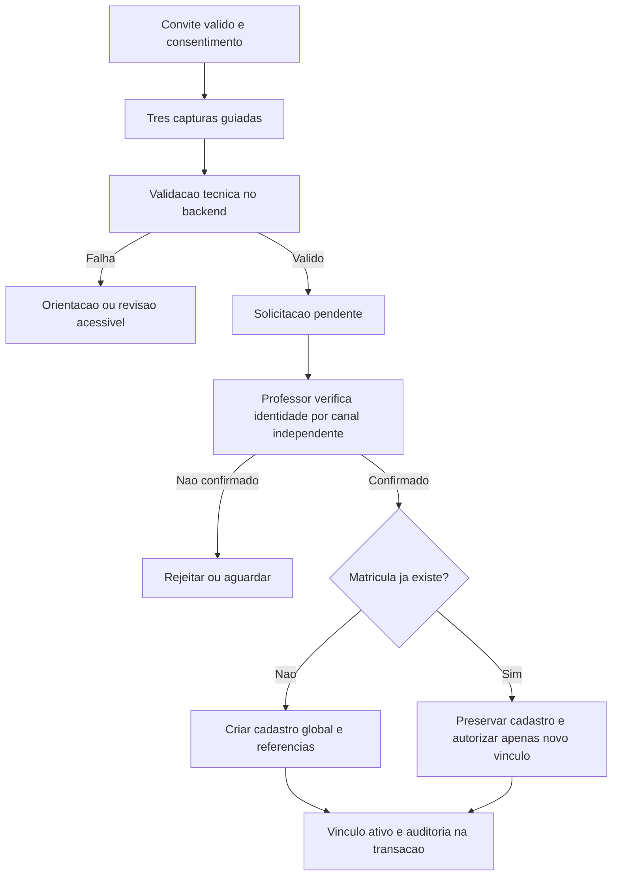
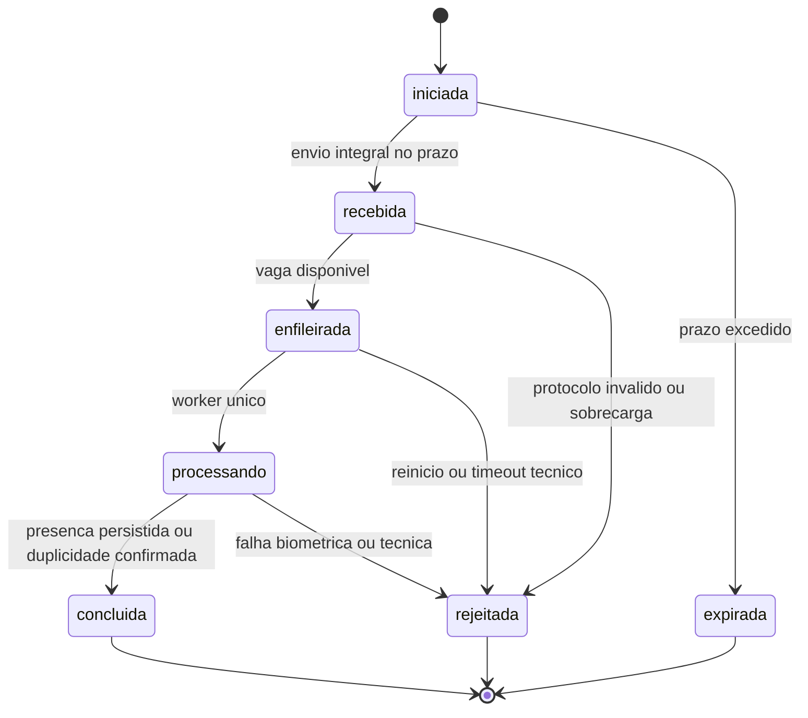
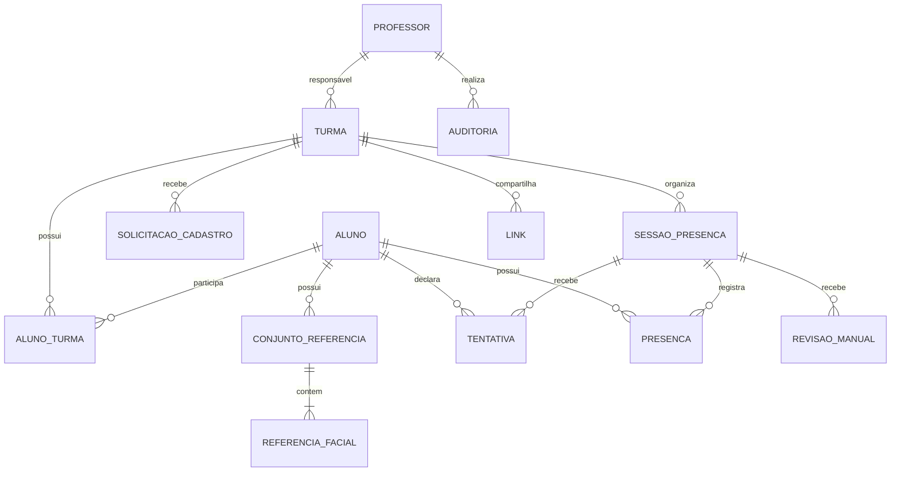

# Planejamento futuro — verificação de presença pela web

## FaceDiff: consolidação de 17/10/2026

**Status: planejamento consolidado; as tarefas 009, 011 e 012 foram
implementadas no workspace e a 010 foi publicada na `main`; implantação web não
executada.** Este
documento substitui as propostas conflitantes das versões anteriores. A revisão
`0006` e `0007` das tasks 011/012 foram validadas em banco PostgreSQL descartável,
sem aplicação ao banco local `escola`. O worker/fila da 012 está implementado;
convites, rotas de submissão, handlers de cadastro/presença e interface continuam
pendentes. A stack ML foi instalada e importada em Ubuntu 24.04/Python 3.12.3;
os pesos locais foram carregados em smoke sintético Windows; validação integrada
Linux e medição de capacidade seguem pendentes.

Documentos complementares:

- [Arquitetura, segurança e operação na KVM 2](FACEDIFF-WEB-ARQUITETURA-OPERACAO.md).
- [Roadmap, testes e critérios de aceite](FACEDIFF-WEB-ROADMAP.md).
- [Arquitetura atual](../ARCHITECTURE.md), [turmas atuais](TURMAS.md) e
  [evidências históricas](ESTADO-ATUAL-E-EVIDENCIAS.md).

## 1. Resumo executivo

FaceDiff é um projeto de disciplina de Inteligência Artificial da Fatec,
não um TCC. A futura aplicação web permitirá cadastro facial autorizado e
verificação remota de presença por link, pelo navegador de celular, notebook
ou desktop. O professor administra suas turmas, aprova cadastros e acompanha
presenças; o aluno usa a câmera do próprio dispositivo. Não haverá exigência
de localização física, GPS, Wi-Fi institucional nem videoconferência.

Hospedagem definitiva: uma Hostinger KVM 2, disponível 24/7 por aproximadamente
10 dias, incluindo preparação e apresentação. Frontend, API, processamento
facial e PostgreSQL ficam na mesma VPS. O Drive será somente destino de backup
criptografado. A disponibilidade 24/7 é o objetivo operacional; uma única VPS
é ponto único de falha, sem promessa de alta disponibilidade.

A apresentação prioriza presença e usa integrantes do próprio grupo, com
ciência e autorização documentadas. Cadastro ao vivo é permitido com os mesmos
controles. Os antigos números de 30 links e 50 imagens são estimativas de
volume, não de concorrência; três referências e desafios com vários frames
podem aumentar significativamente o número de imagens processadas.

## 2. Matriz de decisões

**Ordem atualizada pelo usuário:** implementar e testar todas as funcionalidades
do backend antes da interface. Pacotes009–019 cobrem fundação, APIs, modelos,
gestão, operação e validação integrada. A interface completa fica exclusivamente
na020, condicionada ao gate de backend aprovado na019. Testes móveis e E2E de
câmera ocorrem na020 após construção da interface. Ver [tasks](../tasks/README.md)
e [roadmap](FACEDIFF-WEB-ROADMAP.md); a antiga ordem W01–W12 foi substituída.

Legenda: **C** = confirmado pelo usuário; **R** = recomendação técnica deste
planejamento; **V** = validação necessária antes de liberar a etapa indicada.

| Tema | Estado | Decisão |
|---|---|---|
| Infraestrutura | C | KVM 2: 2 vCPU, 8 GB RAM, 100 GB NVMe; Ubuntu Server 24.04 LTS, Compose, Caddy, PostgreSQL local |
| Duração | C | Aproximadamente 10 dias 24/7; contratar um mês, não supor cobrança diária |
| Domínio | C/V | Hostinger se elegível para oferta de um mês; verificar antes do deploy; alternativa no documento operacional |
| Web | R | FastAPI como camada de apresentação adicional, frontend simples na mesma origem; preservar domínio/aplicação existentes |
| Professor | C | Usuário/senha; exatamente um responsável por turma; administrador inicial seguro; recuperação administrativa sem e-mail |
| Painel | C | Polling a cada 15 segundos; CRUD, CSV e correção justificada/auditada |
| Aluno | C | Matrícula global única; vínculo N:N com turmas; sem login próprio na primeira versão |
| Turma | C | Matéria e período obrigatórios: matutino, diurno ou noturno |
| Cadastro | C | Link de turma por 7 dias, revogável; três capturas guiadas; aprovação humana antes de habilitar |
| Matrícula existente | C | Nunca substituir cadastro pelo link; verificar identidade e autorizar novo vínculo explicitamente |
| Biometria | C | FaceNet512, embeddings no PostgreSQL, fotos privadas; atualização autorizada/auditada; professor não vê biometria |
| Presença | C | Matrícula informada, verificação 1:1, link compartilhado por turma/sessão, unicidade aluno/sessão |
| Horário | C | Início no servidor dentro da janela; envio completo até 2 minutos após encerramento para tentativa já iniciada |
| Falhas | C | Até três tentativas por aluno/sessão; depois revisão manual justificada, nunca aprovação automática por falha |
| Captura recente | C/V | Desafio curto de movimento com participação do backend + antispoofing; validar acessibilidade e limites |
| Comparação de três referências | R/V | Mediana das três distâncias cosseno <= 0,30; política versionada, validar antes do uso real |
| Modelos e fila | C/R | Uma inferência por vez; fila simples; limite inicial recomendado de 10 aguardando |
| Timeout/capacidade | V | Medir na KVM 2 antes de definir timeout e capacidade anunciada |
| Retenção | C/R | Uso por cerca de 10 dias; data de encerramento explícita; apagar o que não tiver preservação autorizada |
| Backup | C/R | Diário + manual pré-apresentação; duas cópias criptografadas, local e Drive; rclone crypt recomendado |
| Demonstração | C/V | Integrantes autorizados, ensaio prévio; ciência não equivale a autorização para pesquisa ou calibração |

Recomendações permitem decompor futuras tarefas; não devem aparecer como
implementações já existentes. Pendências específicas estão no roadmap.

## 3. Inspeção do repositório e reaproveitamento

Análise estática em 17/10/2026, partindo de `02611f3` em `main`. Foram lidos
AGENTS.md, CLAUDE.md, instruções de orquestração/arquitetura, planejamento
anterior, arquitetura, privacidade, dependências e módulos abaixo. Nenhum banco,
arquivo biométrico, segredo ou ambiente de produção foi acessado.

| Evidência atual | Reutilização e adaptação futura |
|---|---|
| `src/main.py`, `src/presentation/cli/` | Composition root e CLI local; criar entrada web separada, sem instanciar câmera ou janela OpenCV na VPS |
| `src/domain/entities/face_embedding.py`, `services/matcher.py` | Normalização, serialização, coerência de modelo/dimensão e distância cosseno; novo verificador 1:1 explícito |
| `src/infrastructure/face_recognition/deepface_adapter.py` | Extração de face única, alinhamento, embeddings, rejeição por antispoofing e qualidade optativa; adaptar execução controlada/headless |
| `src/application/use_cases/cadastrar_aluno.py` | Validação de nome/matrícula, consentimento, preparação e compensação de arquivo; hoje grava uma referência e ativa vínculo diretamente, incompatível com aprovação pendente |
| `src/application/use_cases/reconhecer_aluno.py` | Atual identificação 1:N e galeria mutável por turma; não compartilhar essa instância entre requisições web nem usar busca global como fallback |
| `src/application/use_cases/registrar_presenca.py` | Regra atual por dia; novo caso de uso por sessão e transação idempotente |
| `src/application/use_cases/gerenciar_turmas.py` e repositórios PostgreSQL | Validações de matéria/período, vínculo N:N, turma ativa e exclusão lógica; acrescentar proprietário, autorização e auditoria |
| `src/infrastructure/database/models.py` | Matrícula UK, embedding único em aluno, FK de vínculo e `uq_presencas_turma_aluno_dia`; requer expansão deliberada do schema |
| `src/infrastructure/repositories/postgres_presenca_repository.py` | Bloqueios de turma/vínculo e `ON CONFLICT`; adaptar para sessão e evitar competição com correções manuais |
| `src/infrastructure/storage/local_image_storage.py` | Nomes relativos, gravação/remoção; acrescentar permissões, referências versionadas e limpeza reconciliada |
| `src/domain/services/captura_automatica.py`, `consistencia_temporal.py`, `qualidade_captura.py` | Regras puras e testes como base; relógio local e estabilidade não comprovam captura recente remota |
| `src/presentation/cli/captura_automatica.py` | Orquestra câmera/janela local; UX precisa de implementação no navegador |
| `mediapipe_landmarks.py`, worker/protocolo e `facial_landmarks.py` | Landmarks visuais opcionais em processo isolado; não existe validação de desafio de movimento pronta |
| `requirements.txt`, `requirements-landmarks.txt`, `requirements-web.txt`, `pyproject.toml` | Python 3.12/3.13 declarado; DeepFace/TensorFlow/tf-keras/PyTorch/NumPy/OpenCV; MediaPipe isolado; FastAPI fica separado em `requirements-web.txt` e `requirements-dev.txt` |
| `tests/unit/`, `tests/integration/`, `tests/features/` | Reutilizar fakes e testes de regras; integração só em banco descartável autorizado |

Observações concretas para futuras tarefas:

- O caminho padrão do Python de landmarks em `settings.py` usa
  `.venv-landmarks/Scripts/python.exe`; configurar caminho Linux no futuro.
- O worker atual desliga saída de matrizes de transformação facial. Overlay
  de pontos não implementa pose nem prova de vida por desafio.
- `preaquecer()` carrega FaceNet, mas não comprova aquecimento de MiniFASNet.
- O adaptador usa `face.get("is_real", True)`: ausência de evidência pode ser
  aceita hoje. A versão web deve falhar de forma fechada se a validação exigida
  faltar, sem desligar antispoofing para contornar erro.
- Há logging de exceção externa no adaptador: revisar mensagens antes de
  exposição pública para impedir conteúdo de requisição/segredos em logs.
- `ExcluirAluno` e cascatas atuais podem apagar histórico; não expor diretamente
  exclusão global ao professor de uma única turma.

### Framework recomendado

FastAPI + Uvicorn é recomendado porque a base já separa casos de uso,
repositórios e adaptadores Python, e utiliza configuração Pydantic. Criar
adaptadores HTTP tipados e injeção explícita, mantendo as regras fora das rotas.
Frontend inicial com HTML/CSS/JavaScript e templates simples evita uma segunda
stack de build sem necessidade demonstrada. Flask seria possível, mas não há
aplicação Flask existente a preservar; Django imporia mais convenções e ORM
paralelo ao SQLAlchemy existente. Isso é uma adição web, não reescrita da CLI.

Fixação de versões e compatibilidade são trabalho da primeira tarefa técnica.
Não instalar nada nesta consolidação. Consultar a
[documentação de implantação FastAPI](https://fastapi.tiangolo.com/deployment/docker/).

## 4. Professores, administração e autorização

- Administrador inicial provisionado por comando explícito, executado no
  ambiente autorizado, com senha recebida de modo seguro, sem senha padrão,
  segredo em argumentos/logs ou bootstrap público permanente.
- Admin cria/desativa professores e redefine senha após verificar identidade;
  credencial temporária deve expirar e exigir troca; invalidar sessões antigas.
- Turma possui um professor responsável. Transferência de responsabilidade é
  administrativa e auditada. Toda consulta/mutação/exportação verifica dono no
  servidor, inclusive ao final de processamento assíncrono.
- Professor gerencia matéria/período e alunos de suas turmas; desvincular não
  exclui o aluno de outras turmas. Alterações de dados globais que afetam outras
  turmas e exclusão global passam pelo administrador, com justificativa.
- Atualização de biometria pode ser solicitada por professor responsável ou
  admin; nova coleta autorizada e aprovação administrativa substituem um
  conjunto versionado, nunca uma imagem enviada livremente ao CRUD comum.
- Professor vê nome, matrícula, estados, justificativas e resultados necessários,
  não fotos, embeddings ou links de download biométrico. Admin autorizado tem
  acesso excepcional auditado; contas técnicas acessam apenas o necessário.

## 5. Cadastro por link e três referências

1. Professor autenticado gera convite de cadastro para sua turma ativa. Token
   aleatório de alta entropia, finalidade cadastro, criado/expira em 7 dias,
   revogável; convite pode receber várias solicitações enquanto válido.
2. Aluno informa nome/matrícula. Exibir aviso e coletar autorização específica
   antes de enviar biometria; permissão da câmera não é consentimento LGPD.
3. Após permissão, orientar três capturas automáticas: frontal e pequenas
   variações confortáveis. Backend exige uma face, qualidade e antispoofing em
   cada captura; valida coerência de identidade entre elas antes de ativar.
4. Processar as referências e registrar solicitação pendente. Solicitação não
   é cadastro ativo, não reserva definitivamente matrícula nem permite presença.
   Reenvio idempotente não cria três conjuntos diferentes.
5. Professor confirma identidade por procedimento independente: encontro
   presencial com o integrante conhecido ou conferência por canal institucional
   previamente conhecido e registro institucional autorizado. Não basta declarar
   matrícula, olhar status biométrico ou aprovar automaticamente.
6. Registrar método, responsável, data e justificativa da aprovação; não copiar
   documentos pessoais. Aprovar atomicamente cadastro/vínculo/auditoria após
   revalidar turma, dono, consentimento e unicidade global.

Professor não vê fotos armazenadas para aprovar. Se não puder confirmar a
identidade pelo procedimento independente, rejeita ou mantém pendente até
resolução; não contorna o requisito para a demonstração.

**Matrícula existente:** não revelar nome, turma ou biometria global ao portador
do link. A solicitação fica separada, sem sobrescrever o aluno. As três capturas
da solicitação não viram novas referências globais; eventual comparação com
referências existentes é sinal auxiliar, nunca autorização suficiente. Após
decisão, apagar o material provisório que não tiver finalidade de retenção.
Se houver divergência, revisão administrativa e confirmação independente.
Corrida entre duas aprovações: matrícula UK decide; a segunda aprovação deve
ser reavaliada como vínculo existente, nunca mesclar silenciosamente cadastros.

Estados da solicitação: `em_coleta`, `em_validacao`, `pendente_aprovacao`,
`aprovada`, `rejeitada`, `cancelada`, `expirada`. Recomendação: material incompleto
é temporário; pendências expiram no menor prazo entre 7 dias da submissão e o
encerramento operacional. Expiração natural do link impede novas submissões,
mas não apaga solicitação já recebida. Revogação bloqueia coletas não submetidas;
propor invalidar também pendências ligadas ao convite, registrando auditoria.

## 6. Presença por sessão: contrato de execução

Professor cria sessão com turma, início e fim; link compartilhado tem finalidade
presença e só vale para aquela sessão. Matrícula identifica a referência a
verificar, não autentica por si só. Antes da tentativa, validar vínculo ativo,
cadastro aprovado e referências compatíveis sem enumerar cadastros publicamente.

1. Com janela aberta, servidor cria tentativa vinculada a aluno/sessão e a uma
   credencial efêmera do navegador; emite desafio imprevisível.
2. Navegador pede câmera, orienta movimento curto e captura automaticamente.
3. Envia sequência limitada e ordenada de frames e identificadores do desafio.
   Landmarks do cliente e timestamps do cliente não são evidência confiável.
4. Servidor recebe todo o corpo no prazo, valida protocolo e admite na fila.
5. Worker verifica desafio, continuidade de uma face, qualidade, antispoofing
   e identidade 1:1. Referências de outras matrículas não participam da decisão.
6. Transação final revalida sessão não revogada, turma, vínculo, referência ativa,
   autorização e estado da tentativa; insere presença única aluno/sessão.
7. Só depois do commit retorna confirmação. Falha de commit não é presença.
   Painel consulta resultados a cada 15 segundos; interface mostra última
   atualização e falhas de conexão, sem requisições sobrepostas.

### Janela e relógio

Recomendação de bordas: `inicio <= inicio_tentativa < fim`. Recepção integral
deve ocorrer até `prazo_envio` inclusive; `prazo_envio` nunca excede `fim + 120s`.
Recomendação para validade curta: validade de tentativa de 120 segundos desde
a emissão; `prazo_envio = min(inicio_tentativa + 120s, fim + 120s)`. Isso limita
tentativas antigas; os dois minutos após fim são teto, não prorrogação de toda
tentativa vencida. Não criar nova tentativa após `fim`.

Registrar `iniciada_em`, `prazo_envio`, `recebida_em` (corpo integral recebido),
`processamento_iniciado_em` e `concluida_em` no servidor. Abrir upload antes do
prazo e terminá-lo depois não basta. Processamento pode terminar depois do
prazo de envio; timeout de processamento/fila é separado e depende de benchmark.
UTC no banco, apresentação e filtros em `America/Sao_Paulo`.

O servidor consegue comprovar o recebimento dentro do prazo, não o instante
físico de exposição da câmera. Desafio emitido após início, sequência validada
e envio tempestivo são o protocolo adotado para obter evidência de captura
recente, com risco residual declarado. Não usar EXIF/relógio do aluno como prova.

`iniciada/recebida/enfileirada/processando` são estados pendentes; terminais
guardam resultado e motivo. Revogação cancela pendências e impede commit de
resultado tardio. Não reabrir tentativa terminal. A mesma chave idempotente
retorna o resultado existente; payload diferente na mesma tentativa é rejeitado.

### Três tentativas, abuso e revisão

Recomendação: reservar ordinal 1–3 atomicamente por aluno/sessão ao emitir
desafio; permitir somente uma tentativa ativa por par. Falha biométrica,
desafio inválido ou abandono/expiração consomem a tentativa. Câmera recusada
antes de emitir desafio e requisição rejeitada antes da emissão não consomem.
Sobrecarga ou falha exclusivamente do servidor usa motivo técnico; restauração
de quota exige ação administrativa auditada, não retry público ilimitado.

Token compartilhado e matrícula não impedem alguém de tentar consumir a quota
de outra pessoa. Mitigar com limites por link, IP e credencial efêmera, limites
globais, respostas genéricas e recuperação pelo professor; não penalizar toda
uma rede escolar por um único limite agressivo. Não há eliminação desse risco
sem autenticação adicional do aluno. Após três tentativas, oferecer revisão
com justificativa e protocolo de acompanhamento, sem divulgar dados alheios.

Professor pode corrigir/inserir presença manual ou marcá-la como anulada após
revisão. Justificativa obrigatória, identidade verificada por procedimento
independente, ator/antes/depois/horário auditados na mesma transação. Revisão
manual é resultado distinto de validação biométrica. Worker tardio não pode
sobrescrever uma correção; usar versão/bloqueio da presença e pedido de revisão.
Alternativa acessível pode encaminhar revisão antes de esgotar a quota.

## 7. Desafio facial e decisão 1:1

Desafio proposto: pose frontal inicial, movimento leve para direção sorteada
pelo servidor e retorno confortável. Número de etapas, amplitude e duração
dependem da prova técnica e acessibilidade. Indicação visual/textual simples,
sem CAPTCHA, áudio obrigatório ou movimentos amplos.

Backend valida sequência de evidências, ordem, nonce, estado/validade e
continuidade de identidade; não aceitar apenas booleano `desafio_ok` enviado
pelo JavaScript. Recomendação: amostrar poucos frames com limites de tamanho,
emitindo a próxima orientação após recebimento da etapa anterior. Landmarks
calculados no servidor podem validar trajetória; backend de pose ainda requer
prova técnica Linux. Isso não é transmissão de aula nem gravação permanente.

MiniFASNet permanece habilitado no cadastro e presença. Protocolo não protege
absolutamente contra câmera virtual, replay sofisticado, deepfake ou cliente
modificado. Ausência de pontuação/resultado esperado deve impedir aprovação.
Falha técnica ou de movimento gera orientação/revisão, não desativação automática.

Para três referências válidas da mesma pessoa, recomendar **mediana das três
distâncias cosseno <= 0,30** em cada frame de decisão exigido; é uma política
de engenharia proposta, não calibrada. Não usar mínimo entre identidades nem
afirmar melhoria de acurácia. Validar normalização, FaceNet512/512D, versão do
conjunto e coerência das três referências. A política e o threshold usados
ficam versionados nos metadados restritos. Não adotar o limiar experimental
histórico 0,428179... nem ajustar `FACE_THRESHOLD` automaticamente.

## 8. Modelo de dados proposto

Nomes abaixo são propostas para futuras migrations, não tabelas existentes,
exceto `SolicitacaoCadastro`, `ConjuntoReferencia` e `ReferenciaFacial`, criadas
pela revisão `0006` no código. A migration permanece aplicada somente nos testes
descartáveis da tarefa 011.

| Entidade | Campos/regras principais |
|---|---|
| Conta / Professor | id, usuário normalizado UK, hash de senha, papel admin/professor, ativo, troca obrigatória, versão de credencial; Professor referencia conta |
| Turma | id, professor responsável FK obrigatório, matéria, período, excluída_em; um responsável por vez |
| Aluno | id, matrícula UK global preservando zeros, nome, estado, consentimento/versão do aviso; não armazenar senha de aluno |
| AlunoTurma | PK aluno/turma, ativo, datas de vínculo/desvínculo, aprovação que originou vínculo |
| SolicitaçãoCadastro | id, turma, convite, matrícula declarada, nome declarado, estado, finalidade novo/vínculo/atualização, consentimento, expiração, decisão/método/responsável |
| ConjuntoReferencia | id, aluno ou solicitação pendente, versão, estado pendente/ativo/substituído, modelo, política de coleta; no máximo um conjunto ativo por aluno |
| ReferenciaFacial | id, conjunto, ordinal 1–3 UK no conjunto, caminho privado relativo, embedding BYTEA normalizado, dimensão/modelo, criada_em; ativação exige três válidas |
| Link | id, finalidade, hash de token, turma, sessão opcional, emissor, criado/expira/revogado_em; presença exige sessão da mesma turma |
| SessaoPresenca | id, turma, criador, título, início/fim UTC, estado/revogação, versão; início anterior ao fim |
| Tentativa | UUID, aluno, sessão, ordinal UK aluno/sessão/ordinal, estado, desafio/nonce protegido, prazos do servidor, motivo/resultado, referência/política utilizadas, chave idempotente hash |
| Presenca | id, aluno, sessão, status presente/anulada, origem biométrica/manual, horário de evidência/registro, tentativa opcional, versão; UK aluno/sessão |
| RevisaoManual | id, aluno/sessão, motivo, estado, solicitada/decidida_em, professor, justificativa da decisão; no máximo uma aberta por par |
| Auditoria | id, ator/papel, ação, alvo interno, instante, justificativa e antes/depois mínimos; sem imagem/embedding/token/senha |
| SessaoAutenticacao | identificador aleatório com hash persistido, conta, expiração, revogação; separado de SessaoPresenca |

FKs e transações devem impedir sessão de turma diferente, presença sem vínculo
válido no momento da decisão e referências de outra identidade. Constraint
aluno/sessão resolve duplicidade concorrente; validação apenas em Python não basta.

**Evolução compatível:** expandir schema antes de migrar caminhos de leitura.
Não inventar sessões para presenças históricas: manter ramo legado separado,
com `sessao_id` nulo e índices parciais correspondentes; nova web exige sessão.
Substituir a constraint de dia no ramo web, preservando o ramo legado/CLI
até decisão específica de retirada. Cadastros legados com uma referência não
ganham três por duplicação: nova coleta autorizada ou ficam inelegíveis à web.
Turmas legadas exigem responsável atribuído explicitamente antes de exposição.
Usar base de demonstração nova é a recomendação inicial, sem importar dados reais
locais. Migrations e compatibilidade terão revisão própria e banco descartável.

## 9. Relatórios e auditoria

CSV UTF-8 sob autorização do dono da turma, filtros por dia, intervalo inclusivo
ou mês no fuso definido. Campos: turma (identificador legível), matéria, sessão,
data, horário, matrícula, nome, status, indicação de correção manual; preservar
período da turma como coluna adicional já prevista. Separar horário de evidência
do horário da correção no modelo; o CSV deve rotular o horário exibido.

Exportar presenças e anulações registradas; não deduzir faltas sem lista histórica
de alunos esperados na sessão. Escapar CSV e neutralizar fórmulas, sem imagens,
embeddings, tokens, scores biométricos ou justificativas sensíveis. Gerar sob
demanda, sem cópia permanente do relatório no servidor por padrão.

Auditar aprovação, vínculo existente, troca de referência, correção, exclusão,
desvínculo, revogação, redefinição de senha, transferência de turma e acessos
administrativos sensíveis. Auditoria de sucesso deve acompanhar atomicamente a
mutação; separar eventos operacionais de falha. Evitar texto livre com dados
desnecessários. Acesso à auditoria restrito e sujeito à retenção, não eterno.

## 10. Conflitos resolvidos e decisões preservadas

| Planejamento/código anterior | Consolidação |
|---|---|
| Render principal, depois alternativa; Neon mencionado | KVM 2 definitiva. Orçamentos antigos permanecem apenas no histórico Git, não compõem arquitetura ativa |
| Framework em aberto | FastAPI recomendado após inspeção; sem migração da CLI nem troca de ORM |
| Professor/turma e polling indefinidos | Um professor responsável; usuário/senha; polling de 15s |
| Cadastro imediato e uma referência | Solicitação aprovada explicitamente e três referências, com controles para matrícula existente |
| Identificação aberta 1:N | Web passa explicitamente a verificação 1:1; CLI e experimentos 1:N não são reclassificados |
| Presença única no dia | Web única aluno/sessão; legado preservado com estratégia explícita |
| Horário/desafio/retry pendentes | Início dentro da janela, envio com teto fim+120s, desafio curto e três tentativas |
| Retenção operacional histórica de 1825 dias | Não aplicável à demonstração web: finalidade de aproximadamente 10 dias e encerramento documentado |
| `docs/lgpd.md` sugere desligar antispoofing em situação histórica | Não adotado na web; falha exige orientação/revisão, sem presença automática |
| `docs/lgpd.md` diz ausência de compartilhamento | Hostinger e Google processam armazenamento/backup; registrar operadores, contratos e transferência pertinente |
| `CLAUDE.md` diz migration 0004 não aplicada | AGENTS/ARCHITECTURE registram aplicação local; sem consulta ao banco nesta tarefa, não atestar outros ambientes |

Preservados: matrícula UK, N:N, períodos, matéria, CRUD, captura automática após
permissão, consentimento, threshold 0,30, separação arquitetural, proibição de
datasets externos sem autorização e distinção entre testes funcionais,
benchmark computacional e acurácia biométrica. QR Code continua conveniência
opcional; importação em lote não foi adicionada.

## 11. Registro e limites desta consolidação

- 17/10/2026: gerados pacotes009–020 para Luna6High, somente documentação;
  interface movida para a última task por solicitação do usuário, após gate019.

- 17/10/2026: proposta inicial de presença remota, cadastro, CSV e 10 dias.
- 17/10/2026: usuário verificou oferta KVM 2 de um mês e escolheu opção principal.
- 17/10/2026: requisitos completos acima consolidam KVM 2 definitiva, aprovação,
  1:1, três referências, sessão, desafios, auditoria e backup local/Drive.
- Verificações desta tarefa: leitura estática, consulta a documentação oficial,
  revisão de consistência, links locais e diff documental. Não houve teste da
  aplicação, benchmark, autenticação externa, migração ou uso de biometria real.
- 18/10/2026: tarefa 009 adicionou a fábrica FastAPI e configuração exclusiva
  WEB_*, com runtime HTTP separado; testes e smoke HTTP passaram em Ubuntu
  24.04/Python 3.12.3. A stack `requirements.txt` também foi instalada e passou
  em `pip check` e imports de OpenCV/NumPy/PyTorch CPU/TensorFlow/DeepFace/RetinaFace;
  a inferência com pesos continua pendente, sem download automático. Evidências e
  comandos estão em [RESULTADO 009](../tasks/009-web-fundacao-linux/RESULTADO.md).
- 18/10/2026: tarefa 011 adicionou a revisão `0006`, armazenamento privado
  injetável e casos de uso de solicitação, três referências, aprovação,
  atualização e limpeza. Suíte unitária e integração PostgreSQL descartável
  passaram; não há API de convite, worker/fila, inferência ou ativação em runtime.
  Evidências e limitações estão em
  [RESULTADO 011](../tasks/011-web-referencias-cadastro-pendente/RESULTADO.md).
- 18/10/2026: tarefa 012 adicionou a revisão `0007`, fila PostgreSQL com admissão
  atômica e limite 10+1, idempotência, worker serial com lease, storage temporário
  e consulta autenticada de status. Quatro testes PostgreSQL passaram em banco
  descartável; suíte completa, verificações estáticas e smoke dos pesos locais
  passaram no workspace. Ainda faltam handlers/rotas de submissão das tasks
  014/015, tmpfs Linux e medição da VPS. Consulte
  [RESULTADO 012](../tasks/012-web-worker-fila/RESULTADO.md).

Não há pergunta de produto bloqueando o início futuro das tarefas de fundação.
Validações de desafio, Linux e capacidade bloqueiam a liberação biométrica;
domínio, autorização dos participantes, política institucional e restauração
bloqueiam dados reais/deploy. Ver a ordem e os gates no roadmap.
