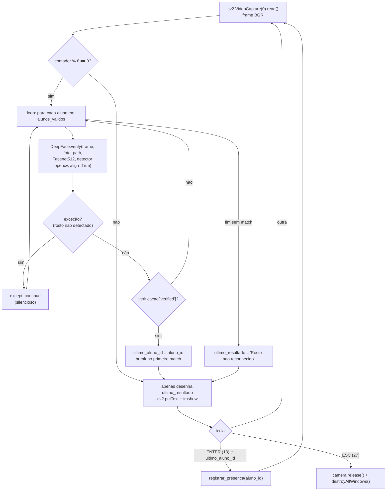
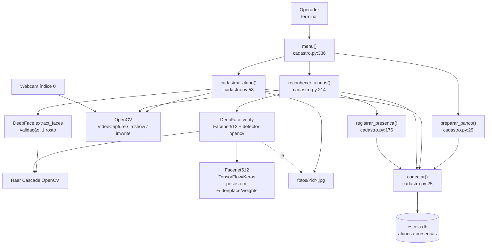
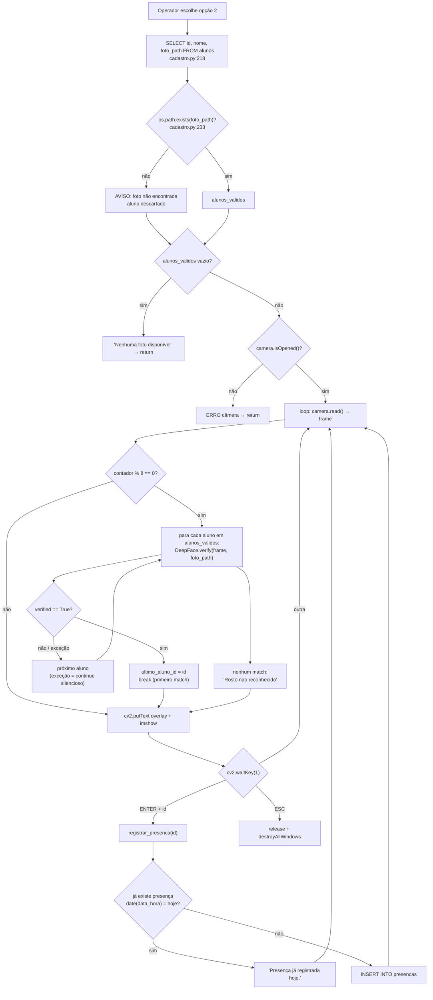
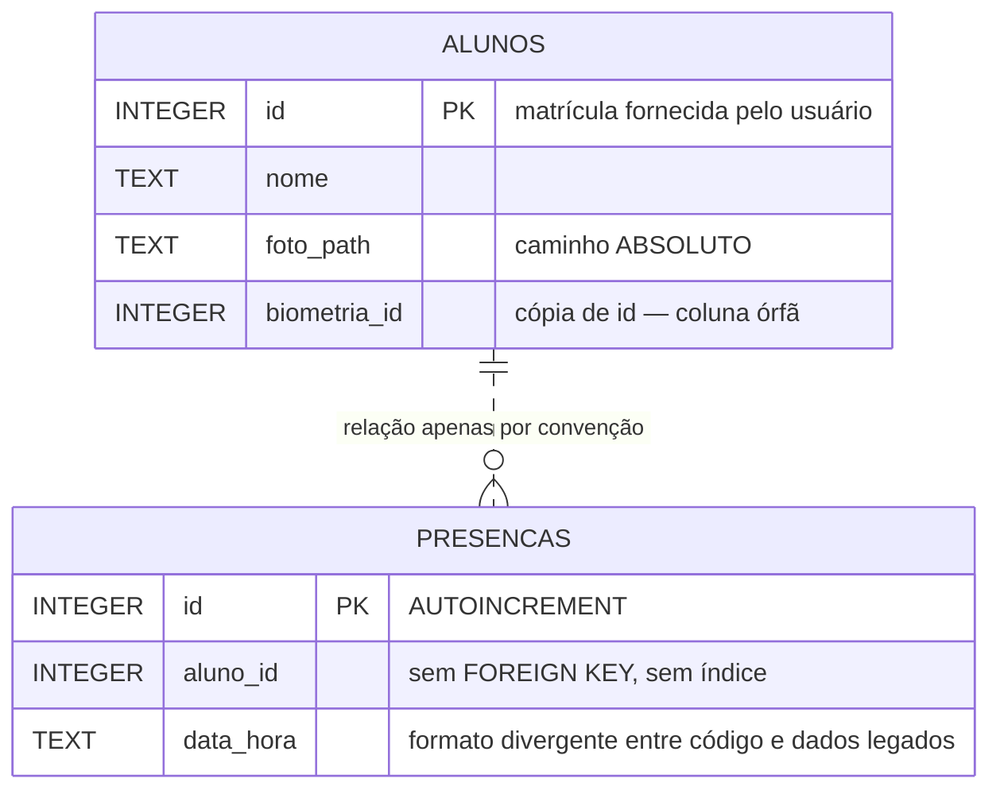

> # ⚠️ DOCUMENTO HISTÓRICO — NÃO DESCREVE O SISTEMA ATUAL
>
> Esta é a auditoria do **protótipo original**, feita em 2026-09-05, antes de
> qualquer refatoração. Ela descreve o `cadastro.py` monolítico, o SQLite e o
> reconhecimento por `DeepFace.verify()` — tudo isso foi substituído.
>
> Está preservada de propósito: é o retrato do ponto de partida, e os
> problemas que ela cataloga (`P1`–`P14`) são referenciados pelo
> `REFACTORING_PLAN.md` e pelos ADRs. Sem ela, o
> que foi feito depois perde a medida.
>
> **Para a arquitetura atual, veja `ARCHITECTURE.md`.**

---

# ARCHITECTURE.md

Documentação da arquitetura **real** do projeto `projeto_reconhecimento_facial`, baseada exclusivamente no código existente.

> Convenções deste documento:
> - **Implementado atualmente** = existe no código.
> - **Recomendação** = sugestão, **não** existe hoje.
> - "Não identificado na implementação atual." = procurado e não encontrado.

---

## 1. Visão Geral

### Objetivo do sistema

Registrar **presença de alunos** por reconhecimento facial, usando a webcam do computador local. O operador cadastra alunos (nome + matrícula + foto de referência) e depois roda um modo de reconhecimento que compara o rosto ao vivo contra as fotos cadastradas; ao reconhecer, o operador confirma e a presença é gravada.

### Problema que resolve

Substituir a chamada manual / lista de presença por identificação biométrica facial, com persistência local em SQLite.

### Fluxo geral

Aplicação **CLI interativa de processo único**. Um menu de terminal (`menu()` em `cadastro.py:336`) dispara dois casos de uso, ambos bloqueantes e com loop de vídeo próprio:

```text
python cadastro.py
      ↓
menu()  →  preparar_banco()  (cria tabelas se não existirem)
      ↓
 ┌────────────────┬─────────────────────┐
 │ opção "1"      │ opção "2"           │
 │ cadastrar_     │ reconhecer_alunos() │
 │ aluno()        │                     │
 └────────────────┴─────────────────────┘
```

### Principais componentes

Todos vivem no **mesmo arquivo** `cadastro.py`:

| Componente | Função/seção | Papel |
|---|---|---|
| Configuração | linhas 10–18 | Caminhos, nome do modelo, nome do detector, criação da pasta `fotos` |
| Camada de banco | `conectar()`, `preparar_banco()` | Conexão SQLite e DDL |
| Cadastro | `cadastrar_aluno()` | Captura de foto de referência + INSERT em `alunos` |
| Reconhecimento | `reconhecer_alunos()` | Loop de câmera + verificação 1:N via DeepFace |
| Presença | `registrar_presenca()` | INSERT em `presencas` com deduplicação diária |
| Interface | `menu()` | Loop de menu no terminal |

### Resumo arquitetural

**Script monolítico de arquivo único, sem camadas formais.** Não há framework web, API, serviços, workers, ORM, injeção de dependência ou separação domínio/infraestrutura. O acesso a banco, a captura de vídeo, a inferência do modelo e a interface de usuário estão entrelaçados dentro das mesmas funções. A "arquitetura" é procedural: funções de topo chamadas por um menu.

---

## 2. Stack Tecnológica

| Tecnologia | Finalidade | Onde é utilizada |
|---|---|---|
| Python 3 (README recomenda 3.10/3.11; `__pycache__` indica execução em 3.13) | Linguagem base | Todo o projeto |
| `opencv-python==4.13.0.92` (`cv2`) | Captura de webcam, exibição de janelas, escrita de texto no frame, gravação de JPG | `cadastro.py` — `cv2.VideoCapture`, `cv2.imshow`, `cv2.putText`, `cv2.imwrite`, `cv2.waitKey` |
| `deepface==0.0.92` | Detecção facial e verificação facial (embeddings + comparação) | `DeepFace.extract_faces()` (`cadastro.py:125`), `DeepFace.verify()` (`cadastro.py:273`) |
| Facenet512 (via DeepFace) | Modelo de embedding facial | Constante `MODELO` (`cadastro.py:15`) |
| Detector `opencv` (Haar Cascade, via DeepFace) | Backend de detecção de rosto | Constante `DETECTOR` (`cadastro.py:16`) |
| `sqlite3` (stdlib) | Persistência relacional local | `conectar()`, `preparar_banco()`, `cadastrar_aluno()`, `reconhecer_alunos()`, `registrar_presenca()` |
| SQLite (arquivo `escola.db`) | Banco de dados | Raiz do projeto |
| `os` (stdlib) | Caminhos e criação de diretórios | `cadastro.py:10–18`, `os.path.exists` em `reconhecer_alunos()` |
| `datetime` (stdlib) | Timestamp da presença | Import local dentro de `registrar_presenca()` (`cadastro.py:177`) |
| `pyserial==3.5` | **Declarado em `requirements.txt` mas nunca importado no código.** Dependência órfã — ver §16 | `requirements.txt` |
| TensorFlow / Keras | Não declarado em `requirements.txt`, mas puxado transitivamente pelo `deepface` (é seu backend de inferência) | Indireto |
| NumPy | Não declarado, mas dependência transitiva de `opencv-python` e `deepface`; frames são `ndarray` | Indireto |

**Não identificados na implementação atual:** framework web, ORM, API HTTP, autenticação, Docker, CI/CD, testes, linters, `pyproject.toml`, `Pipfile`, `poetry.lock`, `Dockerfile`, `.env`/`.env.example`, `.gitignore`, repositório Git, serviços externos, filas, cache.

---

## 3. Estrutura de Diretórios

```text
projeto_reconhecimento_facial/
├── cadastro.py        # Aplicação inteira: config, DB, cadastro, reconhecimento, menu
├── escola.db          # Banco SQLite (dados reais no diretório do projeto)
├── requirements.txt   # 3 dependências pinadas
├── README.md          # Instruções de instalação e uso
├── fotos/             # Fotos de referência (<aluno_id>.jpg) — atualmente VAZIA
└── __pycache__/       # Bytecode (cadastro.cpython-313.pyc)
```

### Responsabilidades

- **`cadastro.py`** — único módulo executável e único ponto de entrada (`if __name__ == "__main__": menu()`, linha 363). Contém 100% da lógica.
- **`escola.db`** — banco SQLite presente no diretório do projeto **com dados reais** (1 aluno, 39 registros de presença). Ver §9 e §18.
- **`fotos/`** — destino das fotos de referência gravadas por `cadastrar_aluno()` (`os.makedirs(..., exist_ok=True)`, linha 18). Está vazia, embora exista 1 aluno no banco — ver §18.
- **`requirements.txt`** — dependências pinadas por versão exata.
- **`README.md`** — instalação (venv Windows), execução e passo a passo de uso.

---

## 4. Arquitetura da Aplicação

### Padrão arquitetural

**Não há padrão arquitetural formal.** O projeto é um **script procedural monolítico de arquivo único**.

Explicitamente **ausentes**: MVC, Clean Architecture, Hexagonal, Layered Architecture, Service Layer, Repository Pattern, event-driven, microsserviços, DI, ORM, DTOs, interfaces/abstrações. Não existe uma única classe no projeto — apenas funções de módulo e constantes globais.

### "Camadas" (implícitas, não isoladas)

O código tem uma separação **apenas visual**, via comentários de banner (`# ==== CONFIGURAÇÃO ====`, `# ==== BANCO DE DADOS ====`, etc.):

| Camada implícita | Funções | Isolamento real |
|---|---|---|
| Configuração | constantes `PROJETO`, `CAMINHO_DB`, `PASTA_FOTOS`, `MODELO`, `DETECTOR` | Global, mutável, sem override externo |
| Persistência | `conectar()`, `preparar_banco()` | Parcial — `conectar()` é reutilizado, mas SQL está espalhado em 4 funções de negócio |
| Domínio/Aplicação | `cadastrar_aluno()`, `reconhecer_alunos()`, `registrar_presenca()` | **Nenhum** — cada função faz UI + I/O de câmera + inferência + SQL |
| Apresentação | `menu()` + `print()`/`input()`/`cv2.imshow` espalhados | **Nenhum** — I/O de terminal dentro das funções de domínio |

### Dependências entre camadas

Fluxo estritamente de cima para baixo, sem inversão:

```text
menu()
 ├──> preparar_banco() ──> conectar() ──> sqlite3
 ├──> cadastrar_aluno() ──> cv2 + DeepFace + conectar()
 └──> reconhecer_alunos() ──> cv2 + DeepFace + conectar()
                              └──> registrar_presenca() ──> conectar()
```

Não há dependências circulares (§16).

### Principais abstrações

`conectar()` é a **única** abstração do projeto — encapsula o caminho do banco. Fora dela, não há abstração sobre câmera, modelo ou repositório de dados. Trocar SQLite, trocar DeepFace ou trocar a fonte de vídeo exigiria editar o corpo das funções de negócio.

---

## 5. Componentes Principais

### 5.1 Menu / Ponto de entrada

- **Arquivo/função:** `cadastro.py` → `menu()` (linha 336)
- **Responsabilidade:** inicializar o esquema do banco e rotear a opção digitada.
- **Entrada:** `input()` do terminal (`"1"`, `"2"`, `"3"`).
- **Processamento:** chama `preparar_banco()` uma vez; loop infinito de despacho.
- **Saída:** texto no terminal; chamadas às funções de caso de uso.
- **Dependências:** `cadastrar_aluno`, `reconhecer_alunos`, `preparar_banco`.

### 5.2 Camada de banco

- **Arquivo/funções:** `conectar()` (linha 25), `preparar_banco()` (linha 29)
- **Responsabilidade:** abrir conexão SQLite e garantir DDL (`CREATE TABLE IF NOT EXISTS`).
- **Entrada:** nenhuma.
- **Saída:** `sqlite3.Connection`; tabelas `alunos` e `presencas`.
- **Observação factual:** cada operação abre e fecha sua própria conexão; não há pool, transação explícita, nem context manager (`with`).

### 5.3 Cadastro de aluno

- **Arquivo/função:** `cadastrar_aluno()` (linha 58)
- **Responsabilidade:** coletar nome/ID, verificar duplicidade, capturar 1 frame com exatamente um rosto, salvar JPG e inserir o registro.
- **Entradas:** `input()` (nome, id numérico); frames de `cv2.VideoCapture(0)`; teclas ESPAÇO (32) / ESC (27).
- **Processamento:**
  1. Valida nome não vazio e ID conversível para `int` (linhas 63–71).
  2. `SELECT id FROM alunos WHERE id = ?` para rejeitar ID repetido (linha 78).
  3. Loop de preview com overlay `cv2.putText`.
  4. Ao ESPAÇO: `DeepFace.extract_faces(img_path=frame, detector_backend="opencv", enforce_detection=True, align=True)`; exige `len(resultado) == 1`.
  5. `cv2.imwrite(caminho_foto, frame)` — grava o **frame completo**, não o rosto recortado/alinhado.
  6. `INSERT INTO alunos (id, nome, foto_path, biometria_id)` com `biometria_id = aluno_id`.
- **Saídas:** `fotos/<aluno_id>.jpg`; 1 linha em `alunos`; mensagens no terminal.
- **Comunica-se com:** OpenCV, DeepFace, SQLite.

### 5.4 Reconhecimento

- **Arquivo/função:** `reconhecer_alunos()` (linha 214)
- **Responsabilidade:** identificar 1:N o rosto ao vivo contra todas as fotos cadastradas.
- **Entradas:** tabela `alunos`; frames da webcam; teclas ESC (27) e ENTER (13).
- **Processamento:**
  1. `SELECT id, nome, foto_path FROM alunos ORDER BY nome` (linha 219).
  2. Filtra registros cuja `foto_path` não existe no disco (`os.path.exists`, linha 233), avisando no terminal.
  3. Loop de câmera; a cada **8 frames** (`contador % 8 == 0`, linha 268) executa a comparação.
  4. Para cada aluno válido, chama `DeepFace.verify(...)` e para no **primeiro** `verified == True` (`break`, linha 286).
  5. Desenha o resultado no frame (verde = reconhecido, vermelho = não).
- **Saídas:** overlay na janela; `ultimo_aluno_id` em memória; chamada a `registrar_presenca()` quando o operador pressiona ENTER.
- **Dependências:** OpenCV, DeepFace, SQLite.

### 5.5 Registro de presença

- **Arquivo/função:** `registrar_presenca(aluno_id)` (linha 176)
- **Responsabilidade:** gravar presença no máximo uma vez por aluno por dia.
- **Entrada:** `aluno_id` (int).
- **Processamento:** monta `agora = datetime.now().strftime("%Y-%m-%d %H:%M:%S")`; consulta `WHERE aluno_id = ? AND date(data_hora) = date(?)`; se não houver, insere.
- **Saída:** 1 linha em `presencas`; mensagem `"Presença registrada!"` ou `"Presença já registrada hoje."`.

### 5.6 Fluxo real de componentes

```text
Terminal (menu)
      ↓
cv2.VideoCapture(0)            ← webcam índice 0, hardcoded
      ↓
frame (numpy.ndarray BGR)
      ↓
DeepFace.extract_faces  (só no cadastro)   /   DeepFace.verify  (no reconhecimento)
      ↓                                            ↓
cv2.imwrite → fotos/<id>.jpg              comparação 1:N contra JPGs em disco
      ↓                                            ↓
INSERT alunos (sqlite3)                    verified == True → ultimo_aluno_id
                                                   ↓ (operador pressiona ENTER)
                                           registrar_presenca() → INSERT presencas
```

---

## 6. Fluxo de Reconhecimento Facial

> Ponto central: **este projeto não gerencia embeddings explicitamente**. Ele delega o pipeline inteiro (detecção → alinhamento → embedding → distância → limiar → booleano) a uma única chamada `DeepFace.verify()`, e o faz **uma vez por aluno cadastrado, por ciclo de comparação**.

| # | Etapa | Arquivo / linha | Função / classe | Biblioteca / modelo | Entrada | Saída |
|---|---|---|---|---|---|---|
| 1 | Captura do frame | `cadastro.py:259` | `reconhecer_alunos()` | OpenCV `VideoCapture.read()` | Webcam índice `0` | `ndarray` BGR + flag `ok` |
| 2 | Pré-processamento | — | — | — | — | **Não existe etapa explícita.** Não há resize, conversão de cor, normalização, equalização nem ROI antes da inferência. O frame bruto é passado ao DeepFace, que faz seu próprio pré-processamento internamente. |
| 3 | Amostragem / throttle | `cadastro.py:266–268` | `reconhecer_alunos()` | Python puro | contador de frames | Comparação executada só quando `contador % 8 == 0` |
| 4 | Detecção de rosto | `cadastro.py:273–280` | `DeepFace.verify(detector_backend="opencv", enforce_detection=True)` | Haar Cascade do OpenCV, via DeepFace | frame + JPG de referência | bounding boxes (internas ao DeepFace); exceção se nenhum rosto |
| 5 | Extração/alinhamento | `cadastro.py:279` | parâmetro `align=True` de `DeepFace.verify` | DeepFace (alinhamento por olhos) | bounding box | face recortada e alinhada (interna, não exposta ao código) |
| 6 | Geração de embeddings | interno ao DeepFace | `DeepFace.verify(model_name="Facenet512")` | Facenet512 (TensorFlow/Keras) | face alinhada | vetor de 512 dimensões — **nunca retornado ao código do projeto, nunca persistido** |
| 7 | Comparação | interno ao DeepFace | `DeepFace.verify` | métrica de distância padrão do DeepFace (cosine) | 2 embeddings | `dict` com `verified`, `distance`, `threshold`, `model`, etc. |
| 8 | Threshold / confidence | **não definido no projeto** | — | limiar interno do DeepFace para o par (Facenet512, cosine) | — | O código lê **apenas** `verificacao.get("verified", False)` (`cadastro.py:282`). `distance` e `threshold` retornados são **descartados**; não há tuning, nem log, nem exibição de confiança. |
| 9 | Definição da identidade | `cadastro.py:282–286` | `reconhecer_alunos()` | Python puro | booleano `verified` | **Primeiro match vence** (`break`). Não há ranking por menor distância entre candidatos. |
| 10 | Ação resultante | `cadastro.py:325–326` | tecla ENTER → `registrar_presenca()` | sqlite3 | `ultimo_aluno_id` | `INSERT INTO presencas` (com dedup por dia) |

### Pipeline no cadastro (diferente do reconhecimento)

No cadastro só ocorrem as etapas 1, 4 e 5 — `DeepFace.extract_faces()` é usado **exclusivamente como validador** ("existe exatamente 1 rosto?"). O resultado do `extract_faces` (a face recortada/alinhada) é **descartado**: o que se grava em disco é o `frame` original inteiro (`cv2.imwrite(caminho_foto, frame)`, linha 136). Nenhum embedding é calculado no cadastro.

### Etapas inexistentes (explicitamente)

- **Não existe** banco/índice de embeddings (nem `.pkl` do `DeepFace.find`, nem vetores em tabela).
- **Não existe** anti-spoofing / liveness detection (o parâmetro `anti_spoofing` do DeepFace não é usado — uma foto impressa ou tela é aceita).
- **Não existe** detecção multi-rosto no modo de reconhecimento (só o cadastro checa contagem de rostos).
- **Não existe** cache do modelo gerido pelo projeto (o DeepFace mantém seu próprio cache interno de modelo em memória).
- **Não existe** medida de qualidade de imagem, iluminação ou pose.

### Diagrama do pipeline real



---

## 7. Modelos de Machine Learning

### 7.1 Facenet512 (embedding facial)

| Aspecto | Fato |
|---|---|
| Nome | `Facenet512` — constante `MODELO`, `cadastro.py:15` |
| Arquivo/pacote | Não está no repositório. Fornecido pelo pacote `deepface` (`deepface==0.0.92`), baixado sob demanda para o home do usuário (`~/.deepface/weights/`) na primeira execução — comportamento confirmado pelo README: *"Na primeira execução, o DeepFace pode baixar os modelos e demorar."* |
| Finalidade | Gerar embedding facial de 512 dimensões para comparação 1:1 |
| Framework | TensorFlow/Keras (backend do DeepFace) — dependência transitiva, não declarada em `requirements.txt` |
| Entrada | Face detectada e alinhada (feito internamente pelo DeepFace) |
| Saída | Vetor de 512 dims → consumido internamente; o projeto só vê o booleano `verified` |
| Como é carregado | Implicitamente, na primeira chamada a `DeepFace.verify()` (`cadastro.py:273`). O projeto **não** faz pré-carregamento (`DeepFace.build_model`) no boot |
| Quando é executado | Dentro do loop de reconhecimento, a cada 8 frames, **uma vez por aluno cadastrado** até achar match |
| Pré-treinado ou treinado aqui? | **Pré-treinado.** Não existe nenhum código de treinamento, fine-tuning, dataset, notebook ou script de avaliação no projeto |
| Uso dos embeddings | **Nunca persistidos nem reutilizados.** Recalculados a cada comparação, inclusive o embedding da foto de referência, que é reprocessado do JPG a cada chamada |

### 7.2 Detector Haar Cascade OpenCV

| Aspecto | Fato |
|---|---|
| Nome | backend `"opencv"` — constante `DETECTOR`, `cadastro.py:16` |
| Arquivo/pacote | XML de Haar Cascade embarcado no `opencv-python`, acionado via DeepFace |
| Finalidade | Localizar rosto(s) no frame antes do embedding |
| Framework | OpenCV (não é rede neural — classificador em cascata clássico) |
| Entrada | Imagem/frame |
| Saída | Bounding boxes (+ landmarks de olhos para o `align=True`) |
| Quando é executado | Em `DeepFace.extract_faces()` no cadastro e dentro de `DeepFace.verify()` no reconhecimento |
| Pré-treinado | Sim, cascata pré-treinada distribuída com o OpenCV |

**Treinamento próprio: não existe.** O projeto é 100% consumidor de modelos pré-treinados.

---

## 8. Fluxo de Dados

```text
Operador (terminal)
      ↓ input()
menu()  ──────────────┬──────────────────────┐
      ↓               ↓                      ↓
cadastrar_aluno()   reconhecer_alunos()   (sair)
      ↓                     ↓
 webcam (cv2)          webcam (cv2)
      ↓                     ↓
 DeepFace.extract_faces  DeepFace.verify(frame, JPG em disco)
      ↓                     ↓
 cv2.imwrite            verified == True
 fotos/<id>.jpg              ↓ (ENTER)
      ↓                 registrar_presenca()
 INSERT alunos               ↓
      ↓                 INSERT presencas
      └───────► escola.db ◄──────┘
```

### Onde cada dado vive

| Dado | Local | Formato |
|---|---|---|
| Imagem de referência (biometria bruta) | `fotos/<aluno_id>.jpg` — caminho montado em `cadastro.py:73` | JPEG, **frame completo sem recorte**, sem criptografia |
| Caminho da imagem | Coluna `alunos.foto_path` | Texto — **caminho absoluto** (ver §18) |
| Embeddings | **Em lugar nenhum.** Existem apenas em memória, dentro do DeepFace, durante a chamada | — |
| Dados do aluno (id, nome) | Tabela `alunos` em `escola.db` | SQLite, texto claro |
| Eventos de presença | Tabela `presencas` em `escola.db` | SQLite, timestamp como TEXT |
| Frames de vídeo | Somente em RAM; descartados a cada iteração | `numpy.ndarray` |

### Como os dados são recuperados

- Lista de alunos: `SELECT id, nome, foto_path FROM alunos ORDER BY nome`, carregada **uma vez** ao entrar no modo reconhecimento (`cadastro.py:218`), materializada em `alunos_validos` — cadastros feitos durante a sessão de reconhecimento não aparecem até reentrar no modo.
- Fotos: lidas do disco pelo DeepFace a cada `verify()`, via `foto_path`.
- Presenças: apenas escritas e consultadas para dedup; **não existe nenhuma tela, relatório ou export de presenças** no código.

### Compartilhamento entre componentes

Via **variáveis locais e argumentos de função** apenas. O estado de reconhecimento (`ultimo_aluno_id`, `ultimo_resultado`, `contador`) é local a `reconhecer_alunos()`. Não há estado global mutável, fila, evento, cache ou IPC.

---

## 9. Banco de Dados

- **Banco:** SQLite, arquivo `escola.db` na raiz do projeto (`CAMINHO_DB`, `cadastro.py:11`).
- **Driver:** `sqlite3` da biblioteca padrão. **ORM: não identificado na implementação atual.**
- **Acesso ao banco ocorre em:** `preparar_banco()` (DDL), `cadastrar_aluno()` (SELECT + INSERT), `reconhecer_alunos()` (SELECT), `registrar_presenca()` (SELECT + INSERT).

### Esquema definido no código (`preparar_banco()`, linhas 33–48)

**`alunos`**

| Campo | Tipo | Restrição no código |
|---|---|---|
| `id` | INTEGER | PRIMARY KEY (fornecido pelo usuário — é a matrícula) |
| `nome` | TEXT | NOT NULL |
| `foto_path` | TEXT | NOT NULL |
| `biometria_id` | INTEGER | sem restrição; preenchido com o próprio `aluno_id` (`cadastro.py:160`) — coluna redundante, aparentemente resquício de um leitor biométrico externo (ver `pyserial` em §16) |

**`presencas`**

| Campo | Tipo | Restrição no código |
|---|---|---|
| `id` | INTEGER | PRIMARY KEY AUTOINCREMENT |
| `aluno_id` | INTEGER | NOT NULL — **sem FOREIGN KEY** |
| `data_hora` | TEXT | NOT NULL — string `"%Y-%m-%d %H:%M:%S"` |

### Esquema realmente presente em `escola.db` (divergente)

A inspeção do `sqlite_master` do arquivo existente mostra um esquema **mais antigo e mais frouxo**:

```sql
CREATE TABLE alunos
   (id INTEGER PRIMARY KEY, nome TEXT, foto_path TEXT, biometria_id INTEGER)
CREATE TABLE presencas
   (id INTEGER PRIMARY KEY AUTOINCREMENT, aluno_id INTEGER, data_hora TEXT)
```

Sem os `NOT NULL`. Como `preparar_banco()` usa `CREATE TABLE IF NOT EXISTS` e **não há mecanismo de migração**, as tabelas antigas permanecem como estão — as restrições escritas no código nunca serão aplicadas a este banco. Ver §18.

### Relacionamentos

```text
alunos (id)
   │
   └── presencas.aluno_id      ← relação 1:N APENAS por convenção
                                 (nenhuma FOREIGN KEY declarada;
                                  PRAGMA foreign_keys nunca é ligado)
```

### Índices

Índices explícitos: **nenhum** (`SELECT ... FROM sqlite_master WHERE type='index'` retorna vazio). Existem apenas os índices implícitos das PRIMARY KEY. Em particular, `presencas.aluno_id` — usado no filtro do dedup diário — **não é indexado**.

### Estado atual dos dados (fato relevante para a análise, não recomendação)

- `alunos`: 1 linha. Seu `foto_path` é um caminho **absoluto apontando para o diretório temporário de outro usuário/máquina** (padrão `C:\Users\<OUTRO_USUARIO>\AppData\Local\Temp\<arquivo>.jpg`), inexistente neste ambiente. Consequência: `reconhecer_alunos()` filtra esse aluno via `os.path.exists` e conclui *"Nenhuma foto de aluno está disponível."*
- `presencas`: 39 linhas, com `data_hora` no formato **`dd/mm/aaaa HH:MM:SS`** (ex. sintético: `07/05/2026 08:37:27`), incompatível com o `%Y-%m-%d %H:%M:%S` gravado pelo código atual. A função SQL `date()` não interpreta esse formato, então o dedup de `registrar_presenca()` não enxerga registros legados.
- `fotos/`: vazia.

---

## 10. APIs e Endpoints

**Não identificado na implementação atual.** O projeto não expõe API HTTP, gRPC, WebSocket, CLI com argumentos (`argparse`/`click`), nem serviço de rede. Não há rotas, controllers, middlewares, serializers ou schemas.

A única "interface" é o menu interativo de terminal:

| Comando | Onde | Responsabilidade | Entrada | Saída |
|---|---|---|---|---|
| `1` | `menu()` → `cadastrar_aluno()` | Cadastrar aluno + foto | nome, ID numérico, ESPAÇO/ESC | JPG + linha em `alunos` |
| `2` | `menu()` → `reconhecer_alunos()` | Reconhecer e registrar presença | frames da câmera, ENTER/ESC | linha em `presencas` |
| `3` | `menu()` | Encerrar | — | fim do processo |

- **Validação de entrada:** mínima — nome não vazio (`cadastro.py:63`), ID conversível para `int` (`try/except ValueError`, linhas 67–71), unicidade de ID via SELECT (linha 78). Nenhuma validação de tamanho, caracteres ou sanitização de `nome`.
- **Tratamento de erros:** ver §12.
- **Autenticação/autorização:** inexistente — ver §11.

---

## 11. Segurança

O sistema manipula **dado biométrico** (imagem facial), categoria sensível sob a LGPD (art. 5º II e art. 11). A análise abaixo separa fato de sugestão.

### Implementado atualmente

| Item | Situação real |
|---|---|
| Autenticação | **Nenhuma.** Qualquer pessoa com acesso ao terminal roda `python cadastro.py` e cadastra/consulta alunos |
| Autorização / perfis | **Nenhuma.** Não há papéis; o mesmo menu dá acesso a cadastro e reconhecimento |
| Tokens / sessões | Não aplicável — não há rede |
| Senhas | Não existem no sistema |
| Criptografia (em repouso) | **Nenhuma.** `escola.db` é SQLite simples; fotos são JPG em claro |
| Criptografia (em trânsito) | Não aplicável — tudo local |
| Secrets / credenciais | Não há segredos no código — não há credencial alguma para vazar. `.env` não existe |
| Variáveis de ambiente | **Nenhuma.** Toda configuração é constante hardcoded (`cadastro.py:10–16`) |
| Dados biométricos | Foto de referência gravada **sem recorte, sem criptografia, sem TTL**, em `fotos/<matricula>.jpg` — o nome do arquivo **é o identificador do aluno**, ligando diretamente arquivo↔pessoa |
| Consentimento / retenção / exclusão | Não existe fluxo de exclusão de aluno, revogação de consentimento, nem política de retenção no código |
| Validação de entrada | Só nome não vazio + ID numérico. SQL usa **parâmetros vinculados (`?`) em todas as queries** — não há risco de SQL injection |
| Upload de imagens | Não há upload; a imagem vem só da webcam local, sem superfície de arquivo externo |
| Path traversal | `caminho_foto` é montado com `int(aluno_id)` já validado (`cadastro.py:73`) — não aceita string arbitrária; risco baixo |
| Exposição de endpoints | Nenhuma — sem porta aberta, sem listener |
| Logs com dado sensível | Não há logging estruturado. Porém `print()` expõe caminho completo da foto (linhas 138, 169) e mensagens de erro cruas do DeepFace (linha 143) no terminal |
| Anti-spoofing / liveness | **Ausente.** Uma foto impressa ou exibida em tela é aceita pelo pipeline |
| Dados reais no diretório do projeto | `escola.db` contém nome real de pessoa e 39 eventos de presença, junto do código, sem `.gitignore` |

### Recomendação (não implementado)

- 🔴 Não versionar `escola.db` nem `fotos/`; criar `.gitignore`.
- 🔴 Cifrar dados biométricos em repouso (SQLCipher para o banco; cifra simétrica para os JPGs) ou, preferencialmente, **não guardar a imagem**: armazenar somente o embedding, que é menos reversível que a foto.
- 🔴 Habilitar anti-spoofing (o `deepface` 0.0.92 suporta `anti_spoofing=True` em `extract_faces`/`verify`) — sem isso o controle de presença é trivialmente burlável.
- 🔴 Adicionar autenticação de operador para o modo de cadastro.
- 🟡 Implementar exclusão de aluno com remoção da foto (direito de eliminação, LGPD art. 18 VI) e política de retenção.
- 🟡 Substituir nome de arquivo previsível (`<matricula>.jpg`) por UUID sem correlação direta.
- 🟡 Trocar `print()` de erro por `logging` com níveis, sem vazar caminhos completos.
- 🟢 Registrar consentimento (data, versão do termo) no cadastro.

---

## 12. Tratamento de Erros

### Implementado atualmente

| Ponto | Local | Mecanismo | Avaliação factual |
|---|---|---|---|
| ID não numérico | `cadastro.py:67–71` | `try/except ValueError` com mensagem e `return` | Adequado |
| Nome vazio | `cadastro.py:63–65` | `if not nome` | Adequado |
| ID duplicado | `cadastro.py:78–82` | SELECT prévio | Sujeito a race condition teórica; irrelevante em processo único |
| Câmera não abre | `cadastro.py:88–90` e `246–248` | `camera.isOpened()` + mensagem + `return` | Adequado |
| Falha de leitura de frame | `cadastro.py:101–103` e `261–263` | `if not ok: break` com mensagem | Adequado; encerra o loop |
| Falha de detecção no cadastro | `cadastro.py:141–143` | `except Exception` genérico, imprime `erro` e **continua o loop** | Funciona, mas captura excessivamente ampla |
| Falha na verificação | `cadastro.py:288–291` | `except Exception: continue` — **silencioso, sem log** | **Ponto de falha principal.** Engole qualquer erro: modelo não baixado, TensorFlow quebrado, JPG corrompido, falta de memória — tudo vira "Rosto nao reconhecido". Impossível diagnosticar em runtime |
| Foto ausente no disco | `cadastro.py:233–238` | `os.path.exists` + aviso; degradação graciosa | Bom fallback |
| Nenhum aluno / nenhuma foto | `cadastro.py:225`, `240` | mensagem + `return` | Adequado |
| Erros de banco | — | **Nenhum `try/except` em torno de operações SQLite** | `sqlite3.OperationalError` (banco travado, disco cheio, arquivo somente-leitura) propaga e derruba a aplicação |
| Recursos da câmera | `cadastro.py:145–146`, `328–329` | `release()` + `destroyAllWindows()` no fim do fluxo | **Não estão em `finally`** — exceção não tratada deixa a câmera presa e a janela órfã |
| Conexões SQLite | várias | `conn.close()` no caminho feliz | Sem `with`/`finally`; exceção vaza a conexão |
| Falhas de API externa | — | Não aplicável — não há integração externa em runtime (o download de pesos do DeepFace é a única atividade de rede, e não é tratado) |

### Principais pontos de falha identificados

1. `except Exception: continue` no laço de verificação (linha 288) — mascara falhas sistêmicas como "não reconhecido".
2. Ausência total de tratamento em torno do SQLite.
3. `release()`/`destroyAllWindows()` fora de `finally` — vazamento de recurso de hardware.
4. Sem `logging`: todo diagnóstico depende de `print()` no terminal, sem persistência, timestamp ou nível.
5. Sem timeout ou limite de tentativas em qualquer loop.

---

## 13. Configuração e Variáveis de Ambiente

**Variáveis de ambiente: nenhuma. Arquivos `.env`/`.env.example`: não existem.** Toda a configuração é constante de módulo em `cadastro.py:10–18`:

| Constante | Linha | Finalidade | Valor |
|---|---|---|---|
| `PROJETO` | 10 | Raiz do projeto | Derivado de `__file__` |
| `CAMINHO_DB` | 11 | Caminho do SQLite | `<PROJETO>/escola.db` |
| `PASTA_FOTOS` | 12 | Diretório das fotos de referência | `<PROJETO>/fotos` |
| `MODELO` | 15 | Modelo de embedding do DeepFace | `"Facenet512"` |
| `DETECTOR` | 16 | Backend de detecção | `"opencv"` |

### Valores hardcoded fora do bloco de configuração

| Valor | Local | Significado |
|---|---|---|
| `0` | `cadastro.py:86`, `244` | Índice do dispositivo de câmera |
| `8` | `cadastro.py:268` | Frames entre comparações (throttle de CPU) |
| `27`, `32`, `13` | várias | Códigos de tecla ESC / ESPAÇO / ENTER |
| `"%Y-%m-%d %H:%M:%S"` | `cadastro.py:182` | Formato do timestamp de presença |
| `align=True`, `enforce_detection=True` | linhas 128–129, 278–279 | Parâmetros do DeepFace |

**Threshold de reconhecimento:** não configurável e não referenciado — é o padrão interno do DeepFace para o par (Facenet512, métrica de distância padrão). **Portas, URLs, credenciais e caminhos de modelo:** não identificados na implementação atual (os pesos são resolvidos internamente pelo DeepFace no diretório home do usuário).

Nenhum valor de segredo ou credencial existe neste projeto para ser documentado.

---

## 14. Testes

**Não identificado na implementação atual.** Não existem:

- diretório `tests/`, arquivos `test_*.py` ou `*_test.py`;
- pytest, unittest, nose, tox, coverage;
- fixtures, imagens de teste, dataset de validação;
- CI executando testes;
- métrica de acurácia, FAR/FRR ou qualquer avaliação do reconhecimento.

Cobertura de testes: **0%**.

### Áreas críticas sem teste (fato)

| Área | Por que importa |
|---|---|
| `registrar_presenca()` | Regra de negócio pura (dedup diário) — perfeitamente testável sem hardware, e hoje não testada. O problema de formato de data (§9) teria sido pego por um teste |
| `preparar_banco()` | DDL e idempotência; a divergência de esquema (§9/§18) teria sido detectada |
| Validação de entrada do cadastro | Nome vazio, ID não numérico, ID duplicado — lógica isolável |
| Pipeline de reconhecimento | Difícil sem refatorar (acoplado a câmera + modelo); nenhum teste de regressão de acurácia |
| Tratamento de foto ausente | Filtro `os.path.exists` — testável com tmpdir |

---

## 15. Deploy e Infraestrutura

**Docker, docker-compose, CI/CD, IaC, cloud, servidor de aplicação, serviço de sistema (systemd/Task Scheduler) e configuração de produção: não identificados na implementação atual.**

O único processo de "deploy" documentado é a execução local manual, conforme `README.md`:

```bat
python -m venv .venv
.venv\Scripts\activate
python -m pip install --upgrade pip
pip install -r requirements.txt
python cadastro.py
```

### Características de execução (fatos)

- Alvo: **Windows desktop** (README traz apenas instruções `.bat`/`.venv\Scripts\activate`).
- Requer **hardware de câmera local** e **display gráfico** (`cv2.imshow`) — não roda headless nem em contêiner sem passthrough de dispositivo.
- Requer **rede na primeira execução** para o DeepFace baixar os pesos do Facenet512.
- Python recomendado: 3.10/3.11 (README); o `__pycache__` indica que foi executado sob **3.13**, fora da faixa recomendada.
- Dependências pinadas por versão exata — bom para reprodutibilidade; porém as dependências pesadas reais (TensorFlow, NumPy) são transitivas e **não pinadas**.
- Instância única: SQLite local, sem concorrência entre máquinas.

---

## 16. Dependências e Acoplamento

### Dependências circulares

**Nenhuma.** Só existe um módulo; o grafo de chamadas é uma árvore.

### Acoplamento

| Observação | Evidência |
|---|---|
| Acoplamento **muito alto** entre UI, I/O de câmera, ML e SQL | `cadastrar_aluno()` (~89 linhas) e `reconhecer_alunos()` (~116 linhas) fazem, cada uma, `input`/`print`, `cv2.VideoCapture`, chamadas ao DeepFace e SQL cru |
| Nenhuma abstração sobre fornecedores externos | `cv2` e `DeepFace` são chamados diretamente do código de negócio; trocar qualquer um exige editar as funções de caso de uso |
| SQL espalhado | Comandos SQL fora da "camada de banco", dentro de funções de negócio (linhas 78, 155, 185, 199, 218) |

### Funções com responsabilidades excessivas

- `cadastrar_aluno()` — coleta de entrada + validação + verificação de duplicidade + loop de vídeo + renderização de overlay + detecção facial + escrita de arquivo + INSERT.
- `reconhecer_alunos()` — consulta SQL + validação de arquivos + loop de vídeo + throttle + inferência 1:N + renderização + roteamento de teclado + chamada de persistência.

### Classes muito grandes

Não aplicável — **o projeto não tem classes**.

### Código duplicado

| Duplicação | Locais |
|---|---|
| Boilerplate `conn = conectar(); cursor = conn.cursor(); ...; conn.close()` | 5 ocorrências (linhas 30, 75, 152, 179, 215) |
| Abertura/checagem/liberação de câmera + loop `read()`/`imshow`/`waitKey` | `cadastrar_aluno()` e `reconhecer_alunos()` — estruturas quase idênticas |
| Mensagem `"ERRO: não foi possível abrir a câmera."` | Linhas 89 e 247 |

### Dependências desnecessárias

- **`pyserial==3.5`** — declarado em `requirements.txt`, **nunca importado**. Vestígio de uma versão anterior com leitor biométrico serial, coerente com a coluna órfã `alunos.biometria_id`.

### Violações de separação de responsabilidades

- Persistência dentro do laço de renderização de vídeo (`registrar_presenca()` chamada de dentro do loop de frames).
- Regra de negócio (dedup diário) expressa em SQL, misturada com I/O de terminal (`print` de resultado dentro de `registrar_presenca()`).
- Import de `datetime` no meio da função (`cadastro.py:177`) em vez do topo do módulo.

---

## 17. Pontos Fortes da Arquitetura

Baseado no código real:

1. **Simplicidade adequada ao escopo.** ~360 linhas, sem camadas cerimoniais para um problema pequeno. Um desenvolvedor lê o sistema inteiro em poucos minutos.
2. **Zero dependências de infraestrutura.** SQLite embutido, sem servidor, sem serviço externo — instalação é `pip install -r requirements.txt`.
3. **SQL 100% parametrizado.** Todas as queries usam placeholders `?` — imune a SQL injection, mesmo sem framework.
4. **Dependências diretas pinadas.** `requirements.txt` fixa versões exatas dos três pacotes declarados.
5. **Degradação graciosa em pontos-chave.** Câmera indisponível, lista de alunos vazia e foto ausente no disco são todos detectados e comunicados sem crash (`cadastro.py:88`, `225`, `233`, `246`).
6. **Constantes de configuração centralizadas no topo.** `MODELO` e `DETECTOR` isolados permitem trocar o modelo de embedding com uma edição de uma linha.
7. **Otimização consciente de custo de inferência.** O throttle `contador % 8` (linha 268) é uma decisão explícita e comentada de reduzir CPU.
8. **Confirmação humana antes de gravar presença.** Presença só é registrada com ENTER do operador (linha 325) — evita registros falsos automáticos.
9. **Idempotência da presença diária.** `registrar_presenca()` checa antes de inserir, evitando duplicatas no mesmo dia.
10. **Caminhos independentes de CWD.** `PROJETO` derivado de `__file__` permite executar de qualquer diretório.
11. **README real e correto**, com o passo a passo de uso conferindo com o comportamento do código.

---

## 18. Problemas Arquiteturais

### P1 — Divergência entre o esquema no código e o esquema do banco existente

**Problema:** `preparar_banco()` declara `nome TEXT NOT NULL`, `foto_path TEXT NOT NULL`, `aluno_id INTEGER NOT NULL`, mas `escola.db` tem as tabelas **sem** esses `NOT NULL`. Como o DDL usa `CREATE TABLE IF NOT EXISTS` e não há migração, as restrições nunca serão aplicadas a bancos existentes.
**Impacto:** Médio.
**Local:** `cadastro.py:33–48`; `escola.db`.
**Motivo:** Esquema é código e dado ao mesmo tempo, sem versionamento. Ambientes divergem silenciosamente; qualquer futura alteração de esquema terá o mesmo destino.

### P2 — Formato de data incompatível entre dados legados e código atual

**Problema:** As 39 linhas em `presencas` usam `dd/mm/aaaa HH:MM:SS`; o código grava `%Y-%m-%d %H:%M:%S` (`cadastro.py:182`) e faz dedup com `date(data_hora) = date(?)` (linha 190). A função `date()` do SQLite não interpreta o formato legado e retorna NULL, então a comparação nunca casa para esses registros.
**Impacto:** Alto.
**Local:** `cadastro.py:182`, `185–194`; tabela `presencas`.
**Motivo:** Timestamp como TEXT livre, sem tipo nem validação. A regra de negócio central (uma presença por dia) falha silenciosamente sobre dados históricos.

### P3 — Caminho absoluto de foto persistido no banco

**Problema:** `foto_path` guarda caminho absoluto (`cadastro.py:73`, `160`). O registro existente aponta para um diretório temporário de outro usuário/máquina, que não existe neste ambiente. Resultado prático: `os.path.exists` falha e o sistema reporta "Nenhuma foto de aluno está disponível."
**Impacto:** Alto.
**Local:** `cadastro.py:73`, `160`, `233`.
**Motivo:** Acopla os dados à máquina de origem. O banco não é portátil; backup/restauração em outro host quebra o reconhecimento inteiro. Além disso, gravar biometria em `%TEMP%` (comportamento de uma versão anterior) é falha de tratamento de dado sensível.

### P4 — Complexidade de reconhecimento O(N) com reprocessamento total

**Problema:** Para cada ciclo de comparação, o código percorre todos os alunos chamando `DeepFace.verify()` (`cadastro.py:271–280`), o que recalcula do zero o embedding **do frame** e o embedding **da foto de referência** a cada aluno testado. Com N alunos, são até 2N inferências Facenet512 por ciclo.
**Impacto:** Alto (bloqueante para uso real).
**Local:** `cadastro.py:268–291`.
**Motivo:** Embeddings de referência são imutáveis e deveriam ser calculados uma vez. O desenho atual torna o sistema inviável além de poucas dezenas de alunos: o loop de vídeo trava enquanto a varredura roda, pois a inferência é síncrona na thread da UI.

### P5 — Inferência síncrona bloqueando o loop de vídeo

**Problema:** A varredura completa acontece dentro do mesmo laço que faz `camera.read()` e `cv2.waitKey(1)`. Enquanto o DeepFace roda, a janela congela e o teclado não responde.
**Impacto:** Médio.
**Local:** `cadastro.py:258–291`.
**Motivo:** Ausência de separação entre thread de captura/UI e trabalho de CPU/GPU. É problema de arquitetura, não de tuning.

### P6 — Exceções engolidas silenciosamente no caminho crítico

**Problema:** `except Exception: continue` (`cadastro.py:288–291`) sem log. Qualquer erro — pesos não baixados, TensorFlow ausente, JPG corrompido, OOM — é indistinguível de "nenhum rosto no frame".
**Impacto:** Alto.
**Local:** `cadastro.py:288`.
**Motivo:** Elimina observabilidade exatamente onde o sistema mais falha. Um usuário vê "Rosto nao reconhecido" indefinidamente sem nenhuma pista da causa real.

### P7 — Dado biométrico e pessoal armazenado sem proteção

**Problema:** `escola.db` (nome real de aluno + 39 eventos) está no diretório do projeto sem `.gitignore`; fotos ficam como JPG em claro nomeadas pela matrícula. Não há criptografia, controle de acesso, retenção nem fluxo de exclusão.
**Impacto:** Crítico (exposição de dado biométrico; LGPD art. 11).
**Local:** `escola.db`, `fotos/`, `cadastro.py:73`, `136`.
**Motivo:** Dado biométrico é irrevogável — vazamento não se corrige trocando senha. A arquitetura não prevê nenhuma barreira.

### P8 — Ausência de anti-spoofing

**Problema:** O pipeline aceita qualquer imagem que contenha um rosto detectável, incluindo foto impressa ou tela de celular. O `deepface` 0.0.92 oferece `anti_spoofing`, não utilizado.
**Impacto:** Alto (a finalidade do sistema — controle de presença confiável — é derrotada).
**Local:** `cadastro.py:125–130`, `273–280`.
**Motivo:** Controle de presença sem liveness não fornece a garantia que promete.

### P9 — Nenhuma separação de responsabilidades / módulo único

**Problema:** UI, câmera, ML e SQL entrelaçados em duas funções longas.
**Impacto:** Médio.
**Local:** `cadastro.py` inteiro; especialmente linhas 58–169 e 214–329.
**Motivo:** Torna teste automatizado praticamente impossível sem hardware, impede reuso da lógica em outra interface (web/API) e concentra o risco de regressão.

### P10 — Cobertura de testes zero

**Problema:** Nenhum teste, nem para a lógica pura (dedup de presença, validação, DDL).
**Impacto:** Alto.
**Local:** projeto inteiro.
**Motivo:** Sistema que grava registro oficial de presença sem nenhuma rede de segurança. P1 e P2 são exatamente o tipo de defeito que testes triviais teriam capturado.

### P11 — Ausência de integridade referencial e de índice

**Problema:** `presencas.aluno_id` não tem FOREIGN KEY, e `PRAGMA foreign_keys` nunca é ligado. Além disso, não há índice em `presencas.aluno_id`, usado no filtro do dedup.
**Impacto:** Médio.
**Local:** `cadastro.py:42–48`.
**Motivo:** Permite presenças órfãs; a consulta de dedup faz varredura completa e piora linearmente com o histórico.

### P12 — Estado de alunos carregado uma única vez

**Problema:** `alunos_validos` é materializado ao entrar no modo reconhecimento (`cadastro.py:218–238`); cadastros feitos depois não são vistos até sair e reentrar.
**Impacto:** Baixo.
**Local:** `cadastro.py:218`.
**Motivo:** Cache implícito sem invalidação — comportamento surpreendente para o operador.

### P13 — Dependência órfã e coluna órfã

**Problema:** `pyserial` em `requirements.txt` sem nenhum import; coluna `alunos.biometria_id` preenchida com uma cópia do `id`.
**Impacto:** Baixo.
**Local:** `requirements.txt`; `cadastro.py:38`, `160`.
**Motivo:** Resíduo de uma versão com leitor biométrico serial. Superfície de instalação e esquema maiores do que o necessário, e ambos enganam quem lê o código.

### P14 — Foto de referência gravada sem recorte

**Problema:** `cv2.imwrite(caminho_foto, frame)` (`cadastro.py:136`) salva o frame inteiro, embora `extract_faces` já tenha produzido a face recortada e alinhada — resultado que é descartado.
**Impacto:** Médio.
**Local:** `cadastro.py:125–136`.
**Motivo:** Força o DeepFace a redetectar o rosto na referência em toda comparação (custo desnecessário, ver P4), aumenta o volume de dado sensível armazenado (fundo, terceiros no enquadramento) e adiciona variabilidade que pode piorar a acurácia.

---

## 19. Recomendações

Priorizadas; incrementais; sem reescrita do projeto.

### 🔴 R1 — Migrar de `verify()` 1:N para embeddings pré-calculados

- **Problema atual:** P4/P14 — até 2N inferências Facenet512 por ciclo; loop de vídeo trava.
- **Solução:** Calcular o embedding **uma vez no cadastro** (`DeepFace.represent()`) e persistir (coluna BLOB em `alunos`, ou arquivo `.npy` ao lado da foto). No reconhecimento, extrair 1 embedding do frame e comparar por distância cosseno em NumPy contra todos os cadastrados. Escolher o **menor `distance`** abaixo do limiar, em vez do primeiro match.
- **Benefício:** de O(N) inferências para 1 por ciclo; ganho de ordem de grandeza; permite ranking por confiança; e reduz o dado biométrico armazenado se combinado com R3.
- **Complexidade:** Média (~60 linhas).
- **Prioridade:** 🔴 Alta.

### 🔴 R2 — Habilitar anti-spoofing

- **Problema atual:** P8 — presença burlável com uma foto.
- **Solução:** `anti_spoofing=True` nas chamadas do DeepFace 0.0.92 e recusar frames marcados como não reais.
- **Benefício:** o sistema passa a cumprir sua finalidade.
- **Complexidade:** Baixa (parâmetro + checagem do campo `is_real`).
- **Prioridade:** 🔴 Alta.

### 🔴 R3 — Proteger o dado biométrico

- **Problema atual:** P7 — banco e fotos em claro, sem retenção nem exclusão.
- **Solução (incremental):** (a) criar `.gitignore` com `escola.db`, `fotos/`, `__pycache__/`, `.venv/`; (b) após R1, deixar de guardar a foto original e manter só o embedding; (c) adicionar opção de menu "excluir aluno" que apaga linha, foto e embedding; (d) registrar consentimento no cadastro.
- **Benefício:** reduz drasticamente a superfície de vazamento e aproxima o sistema da LGPD.
- **Complexidade:** Baixa a Média.
- **Prioridade:** 🔴 Alta.

### 🔴 R4 — Corrigir persistência de caminho e formato de data

- **Problema atual:** P3 e P2 — banco não portátil; dedup quebrado sobre dados legados.
- **Solução:** Gravar `foto_path` **relativo** a `PROJETO` e resolver na leitura. Padronizar `data_hora` em ISO-8601 e escrever um script único de migração que normalize as 39 linhas legadas e corrija o `foto_path` existente.
- **Benefício:** banco portátil; regra de presença volta a funcionar sobre o histórico.
- **Complexidade:** Baixa.
- **Prioridade:** 🔴 Alta.

### 🔴 R5 — Substituir `except Exception: continue` por log

- **Problema atual:** P6 — falhas invisíveis.
- **Solução:** Módulo `logging` com arquivo de log; capturar exceções específicas do DeepFace onde possível; registrar `exc_info` nos casos genéricos. Não logar caminho completo de biometria.
- **Benefício:** o sistema deixa de ser uma caixa-preta em falha.
- **Complexidade:** Baixa.
- **Prioridade:** 🔴 Alta.

### 🟡 R6 — Testar a lógica pura

- **Problema atual:** P10 — 0% de cobertura.
- **Solução:** `pytest` com um `tests/test_presenca.py` usando SQLite em memória: dedup diário, primeira presença do dia, presença em dia diferente, validação de ID, idempotência do `preparar_banco()`.
- **Benefício:** rede de segurança sobre a única regra de negócio real; não exige câmera nem GPU.
- **Complexidade:** Baixa (requer extrair a lógica de `registrar_presenca` de seus `print()`).
- **Prioridade:** 🟡 Média.

### 🟡 R7 — Separar em módulos, sem cerimônia excessiva

- **Problema atual:** P9 — tudo em um arquivo, nada testável.
- **Solução mínima:** três módulos — `db.py` (conexão, DDL, CRUD de alunos e presenças), `reconhecimento.py` (wrapper do DeepFace: `gerar_embedding`, `comparar`), `cli.py` (menu, loops de câmera, overlays). Manter funções; **não** introduzir classes, interfaces ou DI para um sistema deste tamanho.
- **Benefício:** lógica de banco e de ML testáveis isoladamente; caminho aberto para uma futura interface web sem reescrever o núcleo.
- **Complexidade:** Média (é movimentação de código, não redesenho).
- **Prioridade:** 🟡 Média.

### 🟡 R8 — Integridade e índice no banco

- **Problema atual:** P11.
- **Solução:** Em uma migração de esquema: `FOREIGN KEY (aluno_id) REFERENCES alunos(id)`, `PRAGMA foreign_keys = ON` em `conectar()`, e `CREATE INDEX IF NOT EXISTS idx_presencas_aluno_data ON presencas(aluno_id, data_hora)`.
- **Benefício:** sem presenças órfãs; dedup indexado em vez de varredura.
- **Complexidade:** Baixa.
- **Prioridade:** 🟡 Média.

### 🟡 R9 — Externalizar configuração operacional

- **Problema atual:** §13 — índice de câmera, throttle e limiar hardcoded ou inacessíveis.
- **Solução:** Bloco de constantes ampliado (`CAMERA_INDEX`, `FRAMES_ENTRE_COMPARACOES`, `LIMIAR_DISTANCIA`), com override opcional por variável de ambiente. Expor e registrar `distance` e `threshold` retornados pelo DeepFace.
- **Benefício:** ajuste de acurácia sem editar lógica; câmera USB alternativa suportada.
- **Complexidade:** Baixa.
- **Prioridade:** 🟡 Média.

### 🟢 R10 — Limpeza de resíduos

- **Problema atual:** P13.
- **Solução:** Remover `pyserial` do `requirements.txt`; decidir entre usar ou remover `biometria_id` (removê-la exige migração — se não houver uso previsto, documentar como obsoleta).
- **Prioridade:** 🟢 Baixa.

### 🟢 R11 — Liberação de recursos com `finally`

- **Problema atual:** §12 — câmera e conexões vazam em exceção.
- **Solução:** `try/finally` em torno dos loops de câmera; `with sqlite3.connect(...)` ou `contextlib.closing` nas conexões.
- **Prioridade:** 🟢 Baixa.

### 🟢 R12 — Relatório de presenças

- **Problema atual:** §8 — 39 registros gravados e nenhuma forma de lê-los pelo sistema.
- **Solução:** Opção de menu "listar presenças por dia/aluno" e export CSV.
- **Prioridade:** 🟢 Baixa.

---

## 20. Arquitetura Atual vs. Arquitetura Recomendada

A coluna "Recomendada" é dimensionada para um sistema de sala de aula / instalação única — deliberadamente **sem** API, microsserviços, Postgres, vector DB ou contêineres, que seriam overengineering aqui.

| Aspecto | Atual | Recomendada |
|---|---|---|
| **Organização** | 1 arquivo, ~360 linhas, funções procedurais misturando UI+ML+SQL | 3 módulos (`db.py`, `reconhecimento.py`, `cli.py`), ainda procedurais, ainda um processo |
| **Reconhecimento facial** | `DeepFace.verify()` 1:N, até 2N inferências por ciclo, primeiro match vence, embeddings descartados | 1 `DeepFace.represent()` por ciclo + comparação vetorial NumPy contra embeddings pré-calculados; melhor match por menor distância; anti-spoofing ligado |
| **Persistência** | SQLite sem FK, sem índice, caminho absoluto, timestamp em formato divergente, foto em claro | SQLite com FK + índice `(aluno_id, data_hora)`, caminho relativo, ISO-8601, embedding em BLOB no lugar da foto original |
| **Segurança** | Sem autenticação, sem criptografia, sem exclusão, sem liveness, dados reais junto do código | `.gitignore` para dados; anti-spoofing; sem foto bruta retida; exclusão de aluno; consentimento registrado; autenticação simples para o modo cadastro |
| **Tratamento de erros** | `print()` + `except Exception: continue` silencioso; sem cobertura em SQL | `logging` em arquivo com níveis; exceções específicas; `try/finally` para câmera e conexão |
| **Testes** | Nenhum (0%) | `pytest` sobre a lógica pura (presença, validação, esquema) com SQLite em memória; sem exigir hardware |
| **Configuração** | Constantes hardcoded; limiar inacessível | Constantes ampliadas + override por variável de ambiente; limiar e distância explícitos e logados |
| **Escalabilidade** | Degrada linearmente com nº de alunos; loop de vídeo congela; instância única | Custo constante por ciclo até centenas de alunos; opcional: inferência em thread separada da captura. Continua instância única — adequado ao caso de uso |
| **Deploy** | `python cadastro.py` manual em Windows | Igual, mais um script de migração de esquema versionado; contêiner permanece inadequado (precisa de câmera e display) |

---

## 21. Diagramas

### 21.1 Componentes (estado real)



### 21.2 Fluxo de reconhecimento facial (real)



### 21.3 Fluxo de cadastro (real)

```mermaid
sequenceDiagram
    participant O as Operador
    participant C as cadastrar_aluno()
    participant DB as escola.db
    participant CV as OpenCV
    participant DF as DeepFace

    O->>C: nome, ID numérico
    C->>C: valida nome não vazio / int(ID)
    C->>DB: SELECT id FROM alunos WHERE id = ?
    DB-->>C: se existe, aborta
    C->>CV: VideoCapture(0)
    loop até ESPAÇO ou ESC
        CV-->>C: frame
        C->>CV: putText + imshow
    end
    O->>C: ESPAÇO
    C->>DF: extract_faces(frame, enforce_detection=True, align=True)
    DF-->>C: lista de faces (descartada; só a contagem é usada)
    alt len != 1
        C->>O: "deixe somente UM rosto"
    else exatamente 1
        C->>CV: imwrite(fotos/id.jpg, frame)
        C->>DB: INSERT INTO alunos (id, nome, foto_path, biometria_id)
        C->>O: "CADASTRO REALIZADO COM SUCESSO!"
    end
```

### 21.4 Modelo de dados (real)



---

## 22. Conclusão

### Maturidade arquitetural

**Nível: protótipo funcional / projeto educacional.** O sistema faz o que promete no caminho feliz e é compreensível de ponta a ponta, mas não possui nenhum dos elementos que caracterizam software de produção: sem testes, sem logging, sem migrações, sem controle de acesso, sem separação de camadas, sem versionamento de código detectável. É código escrito para demonstrar a ideia, não para operar continuamente.

### Principais riscos

1. **Privacidade/legal (crítico):** biometria e dados pessoais reais armazenados em claro e sem política de exclusão ou retenção — P7.
2. **Confiabilidade do propósito (alto):** sem anti-spoofing, uma foto derrota o controle de presença — P8.
3. **Escalabilidade (alto):** o desenho O(N) com inferência síncrona torna o sistema inutilizável acima de poucos alunos — P4/P5.
4. **Integridade de dados (alto):** o estado atual do `escola.db` já está inconsistente com o código — caminho de foto inválido e formato de data incompatível — P2/P3.
5. **Diagnosticabilidade (alto):** falhas sistêmicas são indistinguíveis de "não reconhecido" — P6.

### Principal dívida técnica

**O uso de `DeepFace.verify()` em laço 1:N com fotos em disco, em vez de embeddings pré-calculados.** Uma única decisão que gera simultaneamente o problema de performance (P4), o excesso de dado biométrico retido (P7/P14), a fragilidade de caminho de arquivo (P3) e o congelamento da UI (P5). Corrigi-la resolve quatro problemas de uma vez.

Em segundo lugar: **a ausência total de testes (P10)**, que permitiu que P1 e P2 — defeitos triviais de detectar — chegassem ao estado atual sem serem notados.

### Melhorias prioritárias

🔴 R1 (embeddings pré-calculados) · R2 (anti-spoofing) · R3 (proteção do dado biométrico) · R4 (caminho relativo + data ISO + migração) · R5 (logging).

### Próximos passos sugeridos

1. Criar `.gitignore` e manter `escola.db` e `fotos/` fora de qualquer versionamento (esforço: minutos; risco eliminado: alto).
2. Escrever o script de migração que normaliza `data_hora` para ISO-8601 e corrige/limpa o `foto_path` inválido do registro existente.
3. Trocar o laço `verify()` por `represent()` + comparação NumPy sobre embeddings persistidos; nesse mesmo passo, ligar `anti_spoofing` e passar a armazenar o embedding em vez da foto bruta.
4. Adicionar `logging` e substituir o `except Exception: continue`.
5. Extrair `registrar_presenca()` para uma função pura (sem `print`) e cobrir com `pytest` sobre SQLite em memória.
6. Só então, se ainda houver necessidade, separar `cadastro.py` em `db.py` / `reconhecimento.py` / `cli.py`.

Cada passo é independente e entregável isoladamente. Nenhum exige reescrita do sistema.

---

*Documento gerado a partir da leitura integral de `cadastro.py`, `requirements.txt`, `README.md` e da inspeção do esquema e conteúdo de `escola.db`. Nenhum código-fonte foi alterado.*
