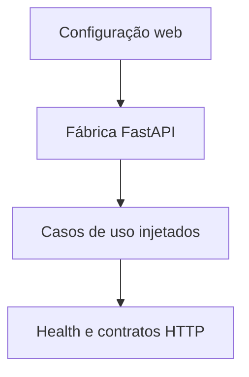

# Desenho — 009: Fundação web e compatibilidade Linux

**Executor: Luna 6, esforço High. Estado: planejada, não implementada.**
Data: 17/10/2026. Dependências: **008 como referência histórica; planejamento consolidado**.
Decisões rotineiras aprovadas internamente. As instruções de segurança e autorização
do [contrato comum](../WEB-CONTRATO-EXECUCAO.md) fazem parte deste pacote.
Especificação: [planejamento web](../../docs/PLANEJAMENTO-FUTURO-PRESENCA-WEB.md)
e [arquitetura](../../docs/FACEDIFF-WEB-ARQUITETURA-OPERACAO.md).

## Escopo e decisões

Adicionar FastAPI/Uvicorn como apresentação sobre os casos de uso existentes. Não substituir CLI nem ORM. Criar aplicação por fábrica sem importar DeepFace/MediaPipe na API; modelos pertencem ao futuro worker. Endpoints somente de saúde e contrato, sem interface visual, páginas de produto ou login ainda.

Python 3.12 e Ubuntu 24.04 x86_64 são candidatos a validar em ambiente descartável, não compatibilidade presumida. Resolver pins atuais com TensorFlow/tf-keras, PyTorch CPU, NumPy e OpenCV. Se pacote headless for necessário, isolar a imagem web e evitar distribuições cv2 sobrepostas; justificar qualquer mudança. MediaPipe mantém isolamento até prova de compatibilidade. Não baixar datasets ou usar webcam. Download de pesos exige autorização específica de rede/artefatos; ausência dessa prova é pendência registrada.

Criar bootstrap de configuração exclusivamente web: valores obrigatórios de banco, segredos e retenção não podem herdar silenciosamente defaults da CLI. Definir tipo de ambiente e guardas para banco descartável. Modelo de erros HTTP não contém mensagens brutas de biblioteca ou credenciais. Documentar rotas futuras no contrato compartilhado, sem implementá-las antecipadamente.

## Fluxo de responsabilidade

## Contratos obrigatórios da entrega

create_app(settings, services) -> FastAPI; injeção de serviços fakes em testes.
GET /health/live -> {status}; GET /health/ready -> {status, componentes}, sem detalhes internos.
Relógio injetável retorna datetime UTC aware. Configuração de produção nunca aponta implicitamente ao banco local.
Erro público padrão: {codigo, mensagem, request_id}; nenhum traceback.
Novas rotas usarão prefixo /api/v1 e a mesma origem.

Nomes de classes e caminhos novos são propostas deste pacote. Antes de criar,
buscar equivalente no repositório e reutilizá-lo; documentar equivalência sem
introduzir duas implementações do mesmo contrato. URLs e estados consumidos
por tarefas posteriores devem permanecer coerentes ou ter atualização coordenada
dos documentos dependentes. Tipos/payloads são formalizados no código e OpenAPI
da tarefa responsável, sem adiantar funcionalidades de outra entrega.

## Arquivos previstos

- `requirements-web.txt (novo, isolado dos ambientes existentes)`
- `src/web_main.py (novo composition root)`
- `src/presentation/web/app.py (novo, sem templates)`
- `src/presentation/web/schemas.py (novo)`
- `tests/unit/test_web_fundacao.py`
- `tests/integration/test_web_runtime.py`

Acrescentar a próxima revisão Alembic somente quando o modelo desta tarefa
exigir. Conferir head real e seguir [transição de schema](../WEB-MIGRACOES.md).
Não escolher número de revisão antes de inspecionar as entregas anteriores.

## Casos de aceite

- API factory importa sem carregar modelos ou abrir banco/câmera.
- Configuração incompleta falha explicitamente; live não revela segredo; ready distingue componente indisponível.
- Regressões de main/Settings/CLI permanecem; ambiente web não contamina .venv-app/.venv-landmarks.

## Condição de conclusão

Fábrica web testável e runtime documentado, sem UI. Compatibilidade Linux executada ou pendência bloqueadora explícita para gate019; não marcar ambiente validado com testes mockados.

Sem implementar outra task para preencher resultado desta. Ao executar, criar
`RESULTADO.md` com evidências reais, requisitos satisfeitos e gates pendentes.
O pacote não contém resultado antecipado ou teste ficticiamente aprovado.
