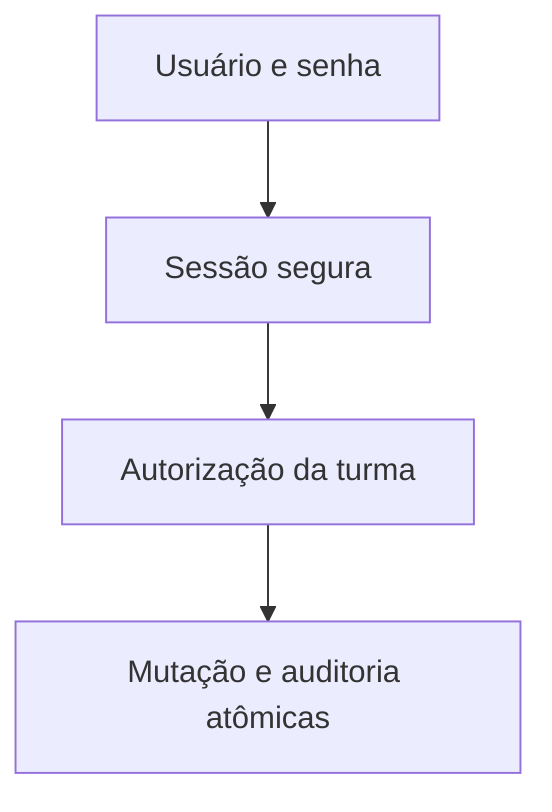

# Desenho — 010: Contas, autenticação, professor responsável e auditoria

**Executor: Luna 6, esforço High. Estado: planejada, não implementada.**
Data: 17/10/2026. Dependências: **009**.
Decisões rotineiras aprovadas internamente. As instruções de segurança e autorização
do [contrato comum](../WEB-CONTRATO-EXECUCAO.md) fazem parte deste pacote.
Especificação: [planejamento web](../../docs/PLANEJAMENTO-FUTURO-PRESENCA-WEB.md)
e [arquitetura](../../docs/FACEDIFF-WEB-ARQUITETURA-OPERACAO.md).

## Escopo e decisões

Criar contas com papel professor/admin, usuário normalizado único, senha Argon2id, conta ativa, troca obrigatória e versão de credencial. Professor é entidade/perfil associado à conta; turma web exige exatamente um responsável. Turmas legadas sem responsável permanecem inacessíveis pela web até atribuição administrativa explícita. Não criar professor fictício em migration.

Sessão de autenticação opaca com hash no banco, cookie Secure/HttpOnly/SameSite; proposta adotada para execução: 30 minutos de inatividade e 8h absolutas. Rotacionar no login, invalidar em logout/reset/desativação. CSRF obrigatório em mutações autenticadas; validar Origin. Login limitado por conta/IP, sem enumerar usuário. Hash não é reversível.

Bootstrap administrativo é comando explícito sem endpoint público, senha padrão, argumento de linha de comando com senha ou log de segredo. Reset por admin após verificação independente, credencial temporária de uso único com 30 minutos de validade, troca obrigatória e auditoria. Transferir turma é operação administrativa auditada.

Criar auditoria genérica append-only com evento mínimo (ator, ação, alvo, instante, justificativa, antes/depois permitidos). Auditoria de sucesso e mutação precisam da mesma transação. Não tornar toda operação uma segunda conexão que possa confirmar antes do registro auditado.

## Fluxo de responsabilidade

## Contratos obrigatórios da entrega

AutenticarProfessor.executar(usuario, senha, contexto_cliente) -> SessaoAutenticacao.
AutorizarTurma.exigir(ator, turma_id, acao) -> ContextoTurma; sempre lookup no servidor.
POST /api/v1/auth/login, /logout, /trocar-senha; POST /api/v1/admin/contas; POST /api/v1/admin/contas/{id}/redefinir-senha.
GET /api/v1/me retorna somente id/papel/estado necessário.
Auditoria.registrar(transacao, evento) compartilha unidade de trabalho; erro de auditoria reverte mutação.

Nomes de classes e caminhos novos são propostas deste pacote. Antes de criar,
buscar equivalente no repositório e reutilizá-lo; documentar equivalência sem
introduzir duas implementações do mesmo contrato. URLs e estados consumidos
por tarefas posteriores devem permanecer coerentes ou ter atualização coordenada
dos documentos dependentes. Tipos/payloads são formalizados no código e OpenAPI
da tarefa responsável, sem adiantar funcionalidades de outra entrega.

## Arquivos previstos

- `src/application/use_cases/autenticar_professor.py (novo)`
- `src/application/use_cases/administrar_contas.py (novo)`
- `src/domain/services/autorizacao.py (novo)`
- `src/infrastructure/database/models.py`
- `src/infrastructure/repositories/postgres_conta_repository.py (novo)`
- `src/presentation/web/routes/auth.py (novo)`
- `scripts/criar_admin_web.py (novo, não executar em ambiente real)`
- `tests/unit/test_web_auth.py`
- `tests/integration/test_web_auth_postgresql.py`

Acrescentar a próxima revisão Alembic somente quando o modelo desta tarefa
exigir. Conferir head real e seguir [transição de schema](../WEB-MIGRACOES.md).
Não escolher número de revisão antes de inspecionar as entregas anteriores.

## Casos de aceite

- Professor A não obtém nem altera turma B; admin é explícito; conta desativada perde sessões.
- Expiração em 30min idle/8h absoluta e reset revogam; credencial temporária não reutiliza.
- Falha de auditoria reverte; cookie/CSRF/Origin incorretos negam; senha/token não aparecem em logs.
- Bootstrap repetido não cria admin público nem substitui senha silenciosamente.

## Condição de conclusão

Autenticação e autorização exercitadas por HTTP/testes, sem interface. Migração preparada com transição legada documentada e nenhuma conta real criada.

Sem implementar outra task para preencher resultado desta. Ao executar, criar
`RESULTADO.md` com evidências reais, requisitos satisfeitos e gates pendentes.
O pacote não contém resultado antecipado ou teste ficticiamente aprovado.
