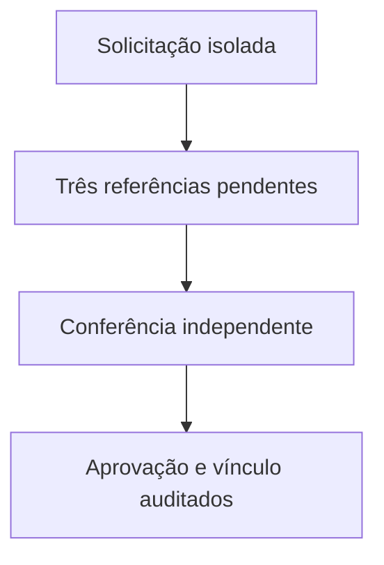

# Desenho — 011: Três referências, cadastro pendente e versionamento biométrico

**Executor: Luna 6, esforço High. Estado: planejada, não implementada.**
Data: 17/10/2026. Dependências: **010**.
Decisões rotineiras aprovadas internamente. As instruções de segurança e autorização
do [contrato comum](../WEB-CONTRATO-EXECUCAO.md) fazem parte deste pacote.
Especificação: [planejamento web](../../docs/PLANEJAMENTO-FUTURO-PRESENCA-WEB.md)
e [arquitetura](../../docs/FACEDIFF-WEB-ARQUITETURA-OPERACAO.md).

## Escopo e decisões

Criar solicitação separada do aluno ativo, conjunto versionado e três referências de ordinais 1–3. Cada referência possui recorte privado relativo, embedding float32 normalizado, modelo/dimensão, versão e consentimento. Conjunto pode pertencer a solicitação pendente ou aluno aprovado, com integridade explícita; somente um conjunto ativo por aluno. Não replicar uma foto antiga três vezes.

Estados: em_coleta, em_validacao, pendente_aprovacao, aprovada, rejeitada, cancelada, expirada. Receber três preparações técnicas não aprova identidade nem vínculo. Aprovação requer método de conferência independente, professor responsável, consentimento e revalidação atômica de matrícula UK global/turma.

Matrícula existente nunca tem nome, foto ou embedding sobrescrito pelo link. Aprovação gera só vínculo após identidade verificada, preservando N:N. Em corrida de aprovações, a segunda solicitação deve ser reavaliada como vínculo existente. Não reservar matrícula indefinidamente por solicitação pública.

Troca de biometria: professor responsável/admin solicita, titular autoriza nova coleta e admin aprova novo conjunto com auditoria. Referências antigas não entram em novas verificações. Revogar/inutilizar trabalhos pendentes que dependiam do conjunto substituído. Dados provisórios rejeitados/expirados são removidos por limpeza rastreável; falha de arquivo não vira sucesso silencioso.

## Fluxo de responsabilidade

## Contratos obrigatórios da entrega

SolicitarCadastroWeb.criar(dados, contexto_convite, consentimento) -> Solicitacao.
AnexarReferencias.executar(solicitacao_id, preparacoes[3], contexto_job) -> estado.
AprovarCadastroWeb.executar(ator, solicitacao_id, metodo_identidade, justificativa) -> ResultadoAprovacao.
SolicitarAtualizacaoBiometrica e AprovarAtualizacaoBiometrica são operações distintas.
DTOs de professor não contêm imagem, embedding, caminho ou URL biométrica; preparação pode usar provider fake até012/013.

Nomes de classes e caminhos novos são propostas deste pacote. Antes de criar,
buscar equivalente no repositório e reutilizá-lo; documentar equivalência sem
introduzir duas implementações do mesmo contrato. URLs e estados consumidos
por tarefas posteriores devem permanecer coerentes ou ter atualização coordenada
dos documentos dependentes. Tipos/payloads são formalizados no código e OpenAPI
da tarefa responsável, sem adiantar funcionalidades de outra entrega.

## Arquivos previstos

- `src/domain/entities/referencia_facial.py (novo)`
- `src/domain/entities/solicitacao_cadastro.py (novo)`
- `src/application/use_cases/solicitar_cadastro_web.py (novo)`
- `src/application/use_cases/aprovar_cadastro_web.py (novo)`
- `src/infrastructure/database/models.py`
- `src/infrastructure/storage/local_image_storage.py (somente adaptação necessária)`
- `src/infrastructure/repositories/postgres_solicitacao_repository.py (novo)`
- `tests/unit/test_cadastro_web_pendente.py`
- `tests/integration/test_referencias_web_postgresql.py`

Acrescentar a próxima revisão Alembic somente quando o modelo desta tarefa
exigir. Conferir head real e seguir [transição de schema](../WEB-MIGRACOES.md).
Não escolher número de revisão antes de inspecionar as entregas anteriores.

## Casos de aceite

- Duas referências não ativam; ordinal duplicado ou modelos incompatíveis recusam.
- Matrícula existente e corrida de aprovações não sobrescrevem cadastro global.
- Professor não lê biometria; tentativa de aprovar turma alheia falha.
- Falha SQL remove somente arquivos da própria solicitação; conjunto antigo permanece em falha de troca.

## Condição de conclusão

Modelo e casos de uso de cadastro pendente completos com fakes, sem formulário/câmera e sem alunos reais. Ativação exige três referências e aprovação independente.

Sem implementar outra task para preencher resultado desta. Ao executar, criar
`RESULTADO.md` com evidências reais, requisitos satisfeitos e gates pendentes.
O pacote não contém resultado antecipado ou teste ficticiamente aprovado.
