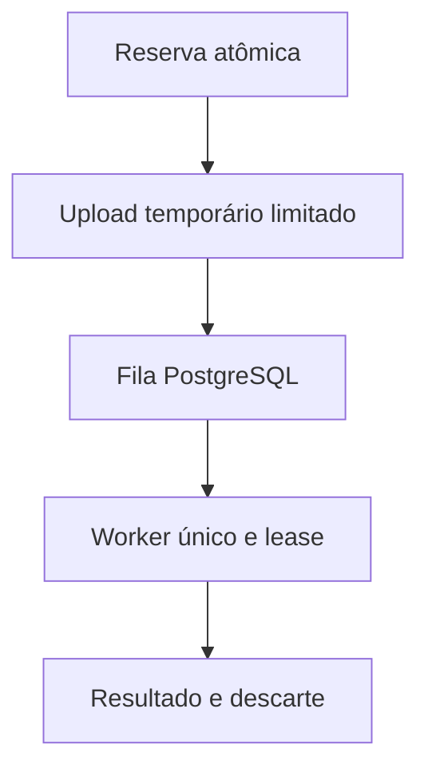

# Desenho — 012: Worker facial único, fila limitada e temporários

**Executor: Luna 6, esforço High. Estado: implementada no workspace em 18/10/2026; veja [RESULTADO.md](RESULTADO.md).**
Data: 17/10/2026. Dependências: **011 e runtime009 validado para a parte executada**.
Decisões rotineiras aprovadas internamente. As instruções de segurança e autorização
do [contrato comum](../WEB-CONTRATO-EXECUCAO.md) fazem parte deste pacote.
Especificação: [planejamento web](../../docs/PLANEJAMENTO-FUTURO-PRESENCA-WEB.md)
e [arquitetura](../../docs/FACEDIFF-WEB-ARQUITETURA-OPERACAO.md).

## Escopo e decisões

API não carrega modelos. Um processo worker, mesma base de código e VPS, aquece FaceNet512 e MiniFASNet e executa um trabalho facial por vez. Job guarda ID, proprietário/tipo, estado, lease, prazos, referência de mídia temporária; não embedding/frame em logs. Cadastro processa suas três capturas sequencialmente num job limitado.

Fila PostgreSQL FIFO, até dez aguardando incluindo reservas de upload; um ativo adicional. Limite verificado atomicamente por lock apropriado, não SELECT count fora de transação. Um job ativo permanece contabilizado até término efetivo do modelo; timeout do request não autoriza segunda inferência. Watchdog invalida lease antes de aceitar trabalho substituto e impede resultado tardio. Não implementar Redis/Celery.

Temporários privados em memória compartilhada app/worker com quota; limpeza em sucesso/falha/cancelamento/expiração e órfãos. Não backup nem rota pública. Reinício sem mídia produz falha técnica registrada, não confirmação nem replay automático. Propor parâmetros iniciais de limite de bytes/frames como configuração de laboratório, registrar que limites de produção dependem019.

Corrigir para o caminho web ausência de is_real/resultado esperado como falha fechada e sanitizar erros do adaptador. Preservar comportamento CLI por contrato documentado e regressões; qualquer endurecimento comum deve ser testado e relatado, sem desligar proteção.

## Fluxo de responsabilidade

## Contratos obrigatórios da entrega

FilaFacial.reservar(tipo, dono_id, idempotencia, prazo) -> Reserva | FilaCheia.
FilaFacial.submeter(reserva_id, manifesto_temporario) -> Job; claim/heartbeat/finalizar exigem lease.
GET /api/v1/operacoes/{id} exige credencial opaca do proprietário ou ator autorizado.
503 + Retry-After para capacidade; 429 para abuso; estados recebida/enfileirada/processando/concluida/rejeitada.
Worker despacha tipos conhecidos; cadastro/presença serão ligados em014/015, sem aceitar código arbitrário.

Nomes de classes e caminhos novos são propostas deste pacote. Antes de criar,
buscar equivalente no repositório e reutilizá-lo; documentar equivalência sem
introduzir duas implementações do mesmo contrato. URLs e estados consumidos
por tarefas posteriores devem permanecer coerentes ou ter atualização coordenada
dos documentos dependentes. Tipos/payloads são formalizados no código e OpenAPI
da tarefa responsável, sem adiantar funcionalidades de outra entrega.

## Arquivos previstos

- `src/application/services/fila_facial.py (novo)`
- `src/infrastructure/repositories/postgres_job_repository.py (novo)`
- `src/face_worker_main.py (novo)`
- `src/infrastructure/storage/temporary_capture_storage.py (novo)`
- `src/infrastructure/face_recognition/deepface_adapter.py`
- `tests/unit/test_fila_facial.py`
- `tests/integration/test_fila_facial_postgresql.py`

Acrescentar a próxima revisão Alembic somente quando o modelo desta tarefa
exigir. Conferir head real e seguir [transição de schema](../WEB-MIGRACOES.md).
Não escolher número de revisão antes de inspecionar as entregas anteriores.

## Casos de aceite

- Uma execução ativa e no máximo dez aguardando/reservadas sob corrida.
- Timeout/restart/resultado tardio não duplicam inferência válida nem persistência.
- Job de proprietário alheio não é consultável; payload excessivo falha antes de decodificar.
- Arquivo ausente, modelo indisponível ou is_real ausente falham fechado; temporários removidos.

## Condição de conclusão

Fila/worker/temporários funcionais com testes de lógica e integração preparada; limites e estados públicos definidos. Sem UI e sem falsa prova de capacidade da VPS.

Sem implementar outra task para preencher resultado desta. Ao executar, criar
`RESULTADO.md` com evidências reais, requisitos satisfeitos e gates pendentes.
O pacote não contém resultado antecipado ou teste ficticiamente aprovado.
