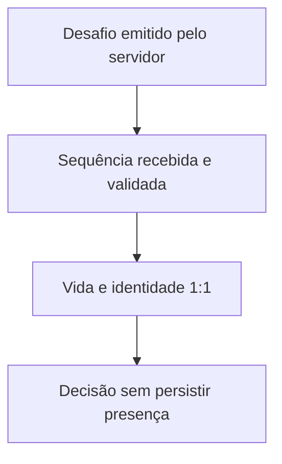

# Desenho — 013: Desafio facial no servidor e verificação 1:1

**Executor: Luna 6, esforço High. Estado: implementada e publicada na `main` nesta execução.**
Data: 17/10/2026. Dependências: **012**.
Decisões rotineiras aprovadas internamente. As instruções de segurança e autorização
do [contrato comum](../WEB-CONTRATO-EXECUCAO.md) fazem parte deste pacote.
Especificação: [planejamento web](../../docs/PLANEJAMENTO-FUTURO-PRESENCA-WEB.md)
e [arquitetura](../../docs/FACEDIFF-WEB-ARQUITETURA-OPERACAO.md).

## Escopo e decisões

Verificação usa somente três referências ativas da matrícula declarada. Reutilizar FaceEmbedding e distância cosseno normalizada, sem chamar reconhecimento 1:N ou buscar outra matrícula quando houver falha. Política inicial recomendada: mediana das três distâncias <=0,30. Validar FaceNet512/512D, finitude e versão; registrar política como não calibrada. A decisão final exige também desafio, qualidade e antispoofing.

Desafio curto: frente, movimento leve em direção aleatória e retorno; backend emite nonce/etapas e analisa evidências, nunca aceita booleano desafio_ok ou landmarks calculados pelo cliente como prova. Receber sequência limitada de frames. Cada próxima orientação depende do recebimento/validação da etapa anterior. Amplitude/duração e amostragem precisam de medição; declarar parametrização e não fabricar valores de eficácia.

Backend de pose exige prova técnica Linux: adaptar contrato MediaPipe isolado quando adequado, não considerar overlay atual suficiente. Guardar estado/nonce no servidor com prazo curto, ordenar etapas e verificar continuidade da mesma pessoa e uma face em frames relevantes. Para cadastro, consistência entre três referências exige política explícita testável, sem afirmar validade biométrica por sintéticos.

Toda inferência/pose/antispoofing usa o worker012, preservando uma execução ativa. Etapas intermediárias recebem prioridade dentro do mesmo trabalho apenas com timeout e sem manter slot enquanto aguarda câmera; reservar capacidade por tentativa para não prometer continuação sem vaga. Não criar segunda fila oculta.

Alternativa acessível é motivo de revisão manual; não há fallback de aprovação. A emissão de movimento não comprova instante físico da câmera e não elimina deepfake/replay sofisticado.

## Fluxo de responsabilidade

## Contratos obrigatórios da entrega

VerificarIdentidade.executar(consulta, referencias[3], politica) -> DecisaoIdentidade.
DesafioCaptura.emitir(contexto, agora) -> Desafio; validar_etapa(desafio_id, sequencia, evidencias, agora) -> EstadoDesafio.
ResultadoFacial: identidade_ok, desafio_ok, antispoofing_ok, qualidade_ok, motivo_tecnico, versao_referencia/politica; detalhes restritos ao backend.
Nenhum serviço facial grava presença por conta própria. O contrato recebe prazos do caso de uso015 e não os amplia.

Nomes de classes e caminhos novos são propostas deste pacote. Antes de criar,
buscar equivalente no repositório e reutilizá-lo; documentar equivalência sem
introduzir duas implementações do mesmo contrato. URLs e estados consumidos
por tarefas posteriores devem permanecer coerentes ou ter atualização coordenada
dos documentos dependentes. Tipos/payloads são formalizados no código e OpenAPI
da tarefa responsável, sem adiantar funcionalidades de outra entrega.

## Arquivos previstos

- `src/domain/services/verificacao_identidade.py (novo)`
- `src/domain/services/desafio_captura.py (novo)`
- `src/infrastructure/face_recognition/desafio_movimento_adapter.py (novo)`
- `src/infrastructure/face_recognition/mediapipe_landmarks_worker.py (apenas se necessário)`
- `src/domain/services/face_recognition.py`
- `tests/unit/test_verificacao_identidade.py`
- `tests/unit/test_desafio_captura.py`
- `tests/integration/test_desafio_worker.py`

Acrescentar a próxima revisão Alembic somente quando o modelo desta tarefa
exigir. Conferir head real e seguir [transição de schema](../WEB-MIGRACOES.md).
Não escolher número de revisão antes de inspecionar as entregas anteriores.

## Casos de aceite

- Distâncias [0,20;0,29;0,80] aceitam identidade; [0,20;0,31;0,80] recusam; igualdade0,30 aceita conforme política.
- Frame estático, sequência invertida, nonce errado, etapa antiga e cliente declarando sucesso não aprovam.
- Frames de duas identidades/múltiplas faces recusam; ausência de evidência de vida não aprova.
- Serviço não retorna foto/embedding ao professor e não registra presença; risco residual documentado.

## Condição de conclusão

Verificador1:1 e desafio com protocolo implementado/testado funcionalmente, sem threshold alterado nem promessa de acurácia. Validação biométrica real pendente bloqueia liberação pública, não é substituída por mocks.

Sem implementar outra task para preencher resultado desta. Ao executar, criar
`RESULTADO.md` com evidências reais, requisitos satisfeitos e gates pendentes.
O pacote não contém resultado antecipado ou teste ficticiamente aprovado.
