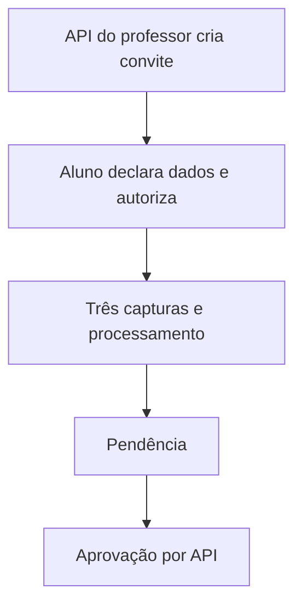

# Desenho — 014: API de cadastro por link e aprovação

**Executor: Luna 6, esforço High. Estado: implementada e validada no workspace; não implantada.**
Data do desenho: 17/10/2026. Execução: 18/10/2026. Dependências: **010–013**.
Decisões rotineiras aprovadas internamente. As instruções de segurança e autorização
do [contrato comum](../WEB-CONTRATO-EXECUCAO.md) fazem parte deste pacote.
Especificação: [planejamento web](../../docs/PLANEJAMENTO-FUTURO-PRESENCA-WEB.md)
e [arquitetura](../../docs/FACEDIFF-WEB-ARQUITETURA-OPERACAO.md).

## Escopo e decisões

Expor API completa de cadastro, sem páginas, CSS, JavaScript ou câmera no navegador. Cliente HTTP de teste representa aluno e professor. Link compartilhado de cadastro tem 256 bits aleatórios, hash no banco, escopo turma, finalidade, validade7dias e revogação. Trocar token por credencial efêmera, não registrar URL/segredo em logs.

Nome/matrícula e aviso versionado/consentimento antecedem upload. O backend solicita três capturas guiadas via protocolo013, processa pelo worker012 e deixa solicitação pendente. Professor confirma identidade por procedimento independente e aprova com método/justificativa; matrícula existente gera só vínculo autorizado.

Endpoint público não enumera nomes/vínculos ou informa se matrícula global existe. Retorno de status exige credencial da solicitação. Expiração natural do convite bloqueia novas submissões; pendência recebida tem próprio prazo min(7dias da submissão, fim da finalidade). Revogação cancela coletas e pendências vinculadas conforme recomendação consolidada, auditando efeito. Não efetivar cadastro após revogação concorrente.

Atualização de referência tem endpoints administrativos separados e autorização de solicitação pelo professor responsável; reutiliza casos011 sem acesso visual à biometria. Não tratar pedido de atualização como permissão de substituir imediatamente.

## Fluxo de responsabilidade

## Contratos obrigatórios da entrega

POST /api/v1/turmas/{id}/links-cadastro -> link opaco (professor responsável).
POST /api/v1/acessos-link -> credencial efêmera e finalidade; POST /api/v1/cadastros -> solicitacao_id/estado.
POST /api/v1/cadastros/{id}/capturas aceita protocolo de013 e reserva012.
GET /api/v1/cadastros/{id}; POST /api/v1/cadastros/{id}/aprovar ou /rejeitar.
POST /api/v1/links/{id}/revogar; atualização biométrica usa /solicitacoes-biometria, com aprovação admin.
Todas as respostas derivam estado persistido, sem blobs biométricos.

Para a coleta em lote do cadastro, a API emite um nonce aleatório de 256 bits,
persiste somente seu SHA-256, escolhe esquerda/direita e aceita três frames na
ordem frente/virada/retorno por até 120 segundos. O worker 014 reutiliza a
análise de pose 013 junto de qualidade, anti-spoofing e continuidade. Esse
contrato não cria uma identidade de presença nem constitui prova biométrica
isolada de vivacidade.

Nomes de classes e caminhos novos são propostas deste pacote. Antes de criar,
buscar equivalente no repositório e reutilizá-lo; documentar equivalência sem
introduzir duas implementações do mesmo contrato. URLs e estados consumidos
por tarefas posteriores devem permanecer coerentes ou ter atualização coordenada
dos documentos dependentes. Tipos/payloads são formalizados no código e OpenAPI
da tarefa responsável, sem adiantar funcionalidades de outra entrega.

## Arquivos previstos

- `src/application/use_cases/gerenciar_links.py (novo)`
- `src/presentation/web/routes/cadastros.py (novo)`
- `src/presentation/web/routes/links.py (novo)`
- `src/infrastructure/repositories/postgres_link_repository.py (novo)`
- `tests/unit/test_api_cadastro_web.py`
- `tests/integration/test_cadastro_web_api.py`

Acrescentar a próxima revisão Alembic somente quando o modelo desta tarefa
exigir. Conferir head real e seguir [transição de schema](../WEB-MIGRACOES.md).
Não escolher número de revisão antes de inspecionar as entregas anteriores.

## Casos de aceite

- Cadastro pendente não permite presença; matrícula existente nunca sobrescreve dados.
- Convite expirado/revogado ou de outra finalidade rejeita; revogação durante processamento impede aprovação.
- Três capturas necessárias; recusa de consentimento não grava biometria.
- Professor alheio não aprova nem consulta; professor legítimo não recebe fotos/embedding/caminho.

## Condição de conclusão

Cadastro integral e aprovação exercitáveis por API/testes, incluindo matrícula existente, sem interface de usuário.

Sem implementar outra task para preencher resultado desta. Ao executar, criar
`RESULTADO.md` com evidências reais, requisitos satisfeitos e gates pendentes.
O pacote não contém resultado antecipado ou teste ficticiamente aprovado.
