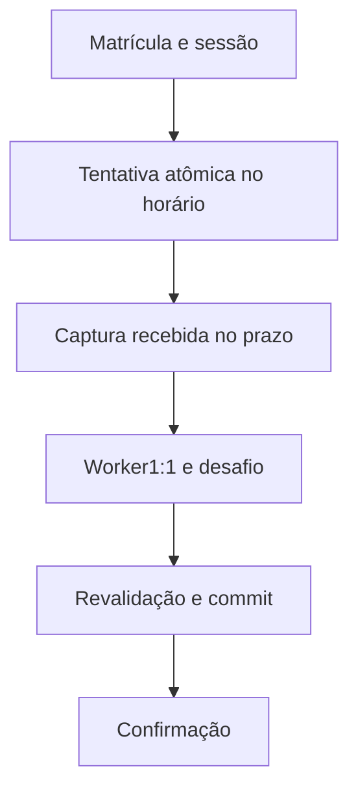

# Desenho — 015: Sessões, tentativas e presença por API

**Executor: Luna 6, esforço High. Estado: implementada; ver [RESULTADO.md](RESULTADO.md).**
Data: 17/10/2026. Dependências: **014**.
Decisões rotineiras aprovadas internamente. As instruções de segurança e autorização
do [contrato comum](../WEB-CONTRATO-EXECUCAO.md) fazem parte deste pacote.
Especificação: [planejamento web](../../docs/PLANEJAMENTO-FUTURO-PRESENCA-WEB.md)
e [arquitetura](../../docs/FACEDIFF-WEB-ARQUITETURA-OPERACAO.md).

## Escopo e decisões

Criar sessão com turma/professor responsável, início/fim awareUTC, título, revogação e versão. Link compartilhado por turma/sessão reutiliza serviço014 com finalidade presença. Matrícula informada determina única identidade; cadastro deve estar aprovado e vínculo ativo.

Início de tentativa: inicio<=agora<fim. Prazo recomendado do plano: min(iniciada_em+120s, fim+120s); tratar como validade curta explícita, mantendo teto autorizado após encerramento. Horário de recepção é corpo integral recebido pelo servidor; cliente/EXIF não autorizam prazo. A tentativa tem estados iniciada, recebida, enfileirada, processando, concluída, expirada, rejeitada; motivo técnico separado. Processamento tempestivamente recebido pode terminar depois do prazo, sob timeout próprio medido019.

Reservar ordinal1–3 atomically por aluno/sessão, uma tentativa ativa. Cancelar/abandonar/falha biométrica/expirar consomem emissão; câmera recusada antes de emissão e sobrecarga antes de reserva não consomem. Falha técnica posterior não devolve quota automaticamente; revisão/admin auditado controla restauração. Rate limits mitigam consumo malicioso de quota por matrícula alheia, sem fingir que matrícula autentica.

Commit final revalida dono/escopo, sessão não revogada, turma/vínculo, conjunto ativo, lease e terminalidade. UNIQUE(aluno_id,sessao_id), resultado idempotente e persistência antes de sucesso. Não sobrescrever presença/correção existente. Preparar migração com sessao_id e índices parciais preservando legado diário; atualizar on_conflict nos caminhos afetados, importador e testes sem executar importação.

Não inventar sessão para registros antigos nem desativar CLI; web exige sessão, ramo legado explícito mantém semântica anterior. Downgrade recusa perda de dados novos; documentar coordenação de versões e escritores.

## Fluxo de responsabilidade

## Contratos obrigatórios da entrega

CriarSessao.executar(ator,turma_id,inicio,fim,titulo) -> Sessao.
IniciarTentativa.executar(acesso_link,matricula,chave_idempotente,agora) -> Tentativa/desafio.
ReceberCaptura.executar(tentativa_id,credencial,payload,recebida_em_servidor) -> Job.
ConcluirPresenca.executar(job,decisao,agora) -> ResultadoPersistido; única entrada de persistência biométrica.
POST /api/v1/turmas/{id}/sessoes; POST /api/v1/sessoes/{id}/tentativas; POST /api/v1/tentativas/{id}/capturas; GET /api/v1/tentativas/{id}; revogação por professor.

Nomes de classes e caminhos novos são propostas deste pacote. Antes de criar,
buscar equivalente no repositório e reutilizá-lo; documentar equivalência sem
introduzir duas implementações do mesmo contrato. URLs e estados consumidos
por tarefas posteriores devem permanecer coerentes ou ter atualização coordenada
dos documentos dependentes. Tipos/payloads são formalizados no código e OpenAPI
da tarefa responsável, sem adiantar funcionalidades de outra entrega.

## Arquivos previstos

- `src/domain/entities/sessao_presenca.py (novo)`
- `src/domain/entities/tentativa_presenca.py (novo)`
- `src/application/use_cases/gerenciar_sessoes.py (novo)`
- `src/application/use_cases/verificar_presenca_web.py (novo)`
- `src/infrastructure/repositories/postgres_presenca_repository.py`
- `src/infrastructure/database/models.py`
- `src/presentation/web/routes/presencas.py (novo)`
- `tests/unit/test_sessoes_tentativas_web.py`
- `tests/integration/test_presenca_sessao_postgresql.py`

Acrescentar a próxima revisão Alembic somente quando o modelo desta tarefa
exigir. Conferir head real e seguir [transição de schema](../WEB-MIGRACOES.md).
Não escolher número de revisão antes de inspecionar as entregas anteriores.

## Casos de aceite

- Início exato aceita; fim exato não cria tentativa; corpo recebido no prazo aceita e1ms depois rejeita.
- Envio no prazo pode concluir depois; revogação impede commit tardio.
- Duas sessões no dia geram duas presenças; mesmo aluno/sessão duplica só retorno, não linha.
- Duas emissões simultâneas não criam tentativa4; upload repetido com payload diferente não passa.
- Falha banco não retorna sucesso; fallback1:N e timestamp cliente nunca autorizam.

## Condição de conclusão

Fluxo de presença completo por API/testes e persistência preparada, com schema legado preservado e integração concorrente registrada ou bloqueada por autorização.

Sem implementar outra task para preencher resultado desta. Ao executar, criar
`RESULTADO.md` com evidências reais, requisitos satisfeitos e gates pendentes.
O pacote não contém resultado antecipado ou teste ficticiamente aprovado.
