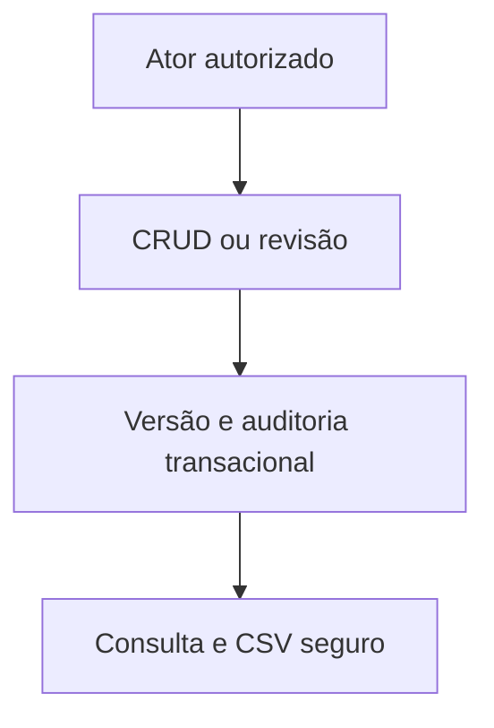

# Desenho — 016: CRUD autorizado, revisão manual, auditoria e CSV

**Executor: Luna 6, esforço High. Estado: planejada, não implementada.**
Data: 17/10/2026. Dependências: **015**.
Decisões rotineiras aprovadas internamente. As instruções de segurança e autorização
do [contrato comum](../WEB-CONTRATO-EXECUCAO.md) fazem parte deste pacote.
Especificação: [planejamento web](../../docs/PLANEJAMENTO-FUTURO-PRESENCA-WEB.md)
e [arquitetura](../../docs/FACEDIFF-WEB-ARQUITETURA-OPERACAO.md).

## Escopo e decisões

Completar endpoints de CRUD sem UI. Turma exige matéria/período e um responsável; não adicionar nome obrigatório nem substituir diurno por vespertino. Professor gerencia suas turmas e vínculos; exclusão global/alterações globais que afetem outras turmas passam por admin, com confirmação e justificativa. Exclusão lógica de turma/desvínculo preservam histórico; exclusão global elimina dados conforme política revisada, com auditoria mínima que não guarde biometria.

Após três tentativas, aluno pode pedir revisão com justificativa; caminho acessível pode antecipar pedido. Professor verifica identidade por procedimento independente e registra presente manualmente ou anula, sempre com justificativa e auditoria antes/depois. Falha biométrica nunca aprova presença. Requisição de revisão não revela dados de terceiros; limitar uma revisão aberta por aluno/sessão.

Controle de versão/locks impede worker tardio de sobrescrever correção. Pedido de reativação de quota exige evento auditado, sem criar retry ilimitado silencioso. Sucesso de mutação depende do commit conjunto da auditoria.

CSV UTF8 por turma/dia/intervalo inclusivo/mês em America/Sao_Paulo: turma, matéria, período, sessão, data, horário rotulado, matrícula, nome, status e indicação manual. Não fotos, tokens, embeddings, scores ou justificativas sensíveis. Escape/neutralização de fórmulas; gerar sob demanda. Não deduzir faltas sem roster histórico.

Endpoint agregado do painel será usado no polling15s da020; aqui testar API e autorização, não criar painel.

## Fluxo de responsabilidade

## Contratos obrigatórios da entrega

RevisarPresenca.executar(ator,revisao_id,decisao,justificativa,versao_esperada) -> Presenca.
POST /api/v1/revisoes; GET /api/v1/turmas/{id}/revisoes; POST /api/v1/revisoes/{id}/decidir.
GET/POST/PATCH/DELETE /api/v1/turmas e /turmas/{id}; vínculos via /turmas/{id}/alunos.
GET /api/v1/turmas/{id}/painel -> estados mínimos e atualizado_em.
GET /api/v1/turmas/{id}/presencas.csv?inicio=...&fim=...; cabeçalhos explícitos, autorização por dono.

Nomes de classes e caminhos novos são propostas deste pacote. Antes de criar,
buscar equivalente no repositório e reutilizá-lo; documentar equivalência sem
introduzir duas implementações do mesmo contrato. URLs e estados consumidos
por tarefas posteriores devem permanecer coerentes ou ter atualização coordenada
dos documentos dependentes. Tipos/payloads são formalizados no código e OpenAPI
da tarefa responsável, sem adiantar funcionalidades de outra entrega.

## Arquivos previstos

- `src/application/use_cases/revisar_presenca.py (novo)`
- `src/application/use_cases/exportar_presencas.py (novo)`
- `src/application/use_cases/gerenciar_turmas.py`
- `src/application/use_cases/consultar.py`
- `src/application/use_cases/excluir_aluno.py (reutilização protegida)`
- `src/presentation/web/routes/gestao.py (novo)`
- `tests/unit/test_gestao_web.py`
- `tests/integration/test_revisao_csv_web.py`

Acrescentar a próxima revisão Alembic somente quando o modelo desta tarefa
exigir. Conferir head real e seguir [transição de schema](../WEB-MIGRACOES.md).
Não escolher número de revisão antes de inspecionar as entregas anteriores.

## Casos de aceite

- Justificativa vazia ou professor alheio não corrige; revisão não aprova automaticamente.
- Worker tardio não altera revisão; conflito de versão devolve erro explícito.
- Desvincular não apaga outras turmas; globaldelete é administrativo e audita sem biometria.
- CSV não vaza outra turma/biometria; trata fórmula, Unicode, vírgula e meia-noite/filtros.

## Condição de conclusão

Todas as funcionalidades de gestão, presença e relatório disponíveis por API e cobertas por testes, sem interface visual.

Sem implementar outra task para preencher resultado desta. Ao executar, criar
`RESULTADO.md` com evidências reais, requisitos satisfeitos e gates pendentes.
O pacote não contém resultado antecipado ou teste ficticiamente aprovado.
