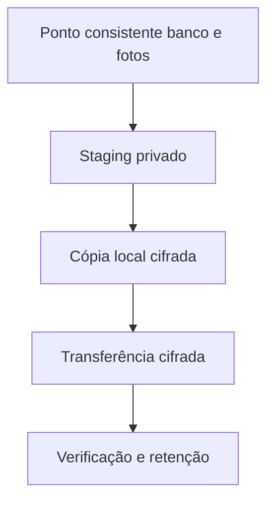

# Desenho — 017: Backup cifrado, retenção e restauração

**Executor: Luna 6, esforço High. Estado: planejada, não implementada.**
Data: 17/10/2026. Dependências: **016**.
Decisões rotineiras aprovadas internamente. As instruções de segurança e autorização
do [contrato comum](../WEB-CONTRATO-EXECUCAO.md) fazem parte deste pacote.
Especificação: [planejamento web](../../docs/PLANEJAMENTO-FUTURO-PRESENCA-WEB.md)
e [arquitetura](../../docs/FACEDIFF-WEB-ARQUITETURA-OPERACAO.md).

## Escopo e decisões

Implementar ferramentas e testes locais, sem conexão ao Google Drive do usuário nem dados pessoais. Duas cópias planejadas: local cifrada e externa cifrada. Usar rclone crypt para cifrar antes de enviar, com segredos fora do repo/logs e custódia independente. O backend remoto em testes é filesystem temporário fake; não confundir teste local com restore externo realizado.

Backup diário e manual pré-apresentação: lock único, pausar escritas, aguardar jobs/transações, dump lógico compatível PostgreSQL+referências do mesmo ponto, manifesto/hashes/versão schema/app. Staging privado temporário, cifrar local, verificar cryptcheck, limpar staging e liberar manutenção em finally. Cópia externa transfere bytes já cifrados; marcar completa só após verificação/download de amostra. Credenciais nunca no pacote.

Retenção recomendada: três gerações completas e logs3dias, limitada pela data final autorizada da demonstração~10dias. Data final prevalece mesmo se convite7dias ainda válido. Pendentes expiram em min(submissão+7dias,data_final), imagens de verificação só temporárias; rotinas de limpeza idempotentes com dry-run padrão e apply explícito. Não inferir que apagar FK anonimiza fotos.

Planejar OAuth próprio drive.file em conta/pasta dedicada; root_folder_id não limita privilégios OAuth. Nada de login agora. Simular token expirado, quota, upload interrompido, arquivo corrompido. Não contratar backup adicional Hostinger.

Restore em base descartável identificada, reaplicar exclusões posteriores ao backup e invalidar tokens/sessões restaurados. Relatório só contém evidência técnica sem dados. Documentar encerramento incluindo lixeira/revisões/cópias do provedor e cobrança; não executar encerramento real nesta task.

## Fluxo de responsabilidade

## Contratos obrigatórios da entrega

GerarBackup.executar(destino_local,agora,modo) -> ManifestoBackup.
TransportarBackup.executar(geracao,destino_adapter) -> ResultadoVerificado.
RestaurarEnsaio.executar(geracao,banco_descartavel,autorizacao) -> EvidenciaRestore.
ExpurgarWeb.planejar(agora) -> PlanoExpurgo; aplicar exige confirmação explícita do ambiente/alvos.
Scripts sem parâmetros de segredo; adaptadores de subprocesso evitam exposição e shell interpolation.

Nomes de classes e caminhos novos são propostas deste pacote. Antes de criar,
buscar equivalente no repositório e reutilizá-lo; documentar equivalência sem
introduzir duas implementações do mesmo contrato. URLs e estados consumidos
por tarefas posteriores devem permanecer coerentes ou ter atualização coordenada
dos documentos dependentes. Tipos/payloads são formalizados no código e OpenAPI
da tarefa responsável, sem adiantar funcionalidades de outra entrega.

## Arquivos previstos

- `scripts/web_backup.py (novo)`
- `scripts/web_restore_check.py (novo)`
- `scripts/web_retencao.py (novo)`
- `docs/FACEDIFF-WEB-ARQUITETURA-OPERACAO.md (evidências futuras)`
- `tests/unit/test_web_backup_retencao.py`
- `tests/integration/test_web_restore_local.py`

Acrescentar a próxima revisão Alembic somente quando o modelo desta tarefa
exigir. Conferir head real e seguir [transição de schema](../WEB-MIGRACOES.md).
Não escolher número de revisão antes de inspecionar as entregas anteriores.

## Casos de aceite

- Dump/fotos consistentes; erro libera manutenção e remove plaintext temporário.
- Upload falho não marca geração completa nem apaga última íntegra; hash divergente falha.
- Restore sem chave falha explicitamente; restore reaplica exclusões e revoga tokens.
- Prazo final interrompe coleta/retencão; dry-run não remove arquivo; escopo de exclusão não escapa do diretório.

## Condição de conclusão

Ferramentas de backup/retencão e restore sintético local testadas ou dependência de banco explicitamente pendente. Drive real não conectado e restore remoto não alegado.

Sem implementar outra task para preencher resultado desta. Ao executar, criar
`RESULTADO.md` com evidências reais, requisitos satisfeitos e gates pendentes.
O pacote não contém resultado antecipado ou teste ficticiamente aprovado.
