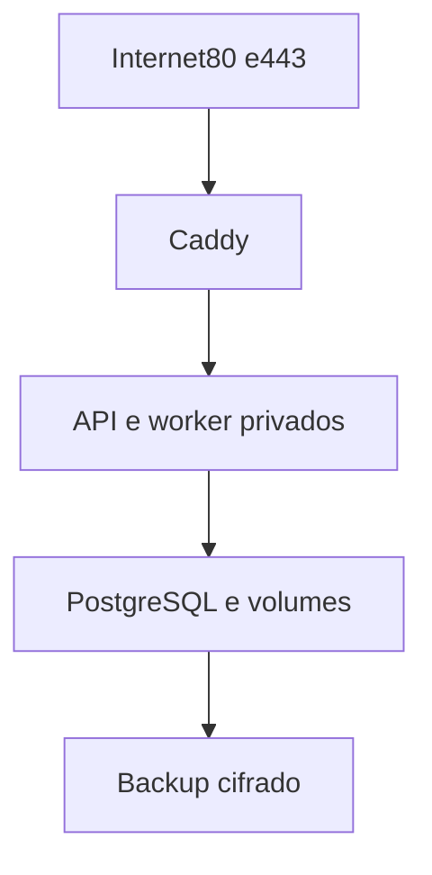

# Desenho — 018: Artefatos de implantação Ubuntu, Compose e Caddy

**Executor: Luna 6, esforço High. Estado: artefatos implementados; validação operacional parcial.**
Data: 17/10/2026. Dependências: **017**.
Decisões rotineiras aprovadas internamente. As instruções de segurança e autorização
do [contrato comum](../WEB-CONTRATO-EXECUCAO.md) fazem parte deste pacote.
Especificação: [planejamento web](../../docs/PLANEJAMENTO-FUTURO-PRESENCA-WEB.md)
e [arquitetura](../../docs/FACEDIFF-WEB-ARQUITETURA-OPERACAO.md).

## Escopo e decisões

Criar artefatos revisáveis para KVM2, não contratar/provisionar/deploy. Serviços: Caddy, appAPI sem modelos, worker facial único, PostgreSQL e backup agendado. Redes web e dados interna; somente TCP80/443 publicados, SSH22 no host restrito; PostgreSQL5432 e app8000 sem host binding. Backup tem saída HTTPS separada para destino futuro. Nenhum docker.sock na aplicação.

Volumes persistentes para PostgreSQL, referências privadas, modelos, Caddy e backups cifrados. Temporários compartilhados via tmpfs do host com bind limitado entre app/worker, não dois tmpfs independentes. Limitar tamanho e documentar swap/core dumps. Caddy não monta biometria. Contêineres sem privilégios desnecessários, secrets por arquivo restrito e imagem fixada.

Nenhuma migration no boot. Script/runbook explícito de banco/migração, base demonstrativa nova recomendada. Health/readiness separados, restart seguro de worker/leases. Limites de CPU/memória iniciais precisam de019, não números garantidos. Reserva para SO/banco/API.

Domínio Hostinger depende da elegibilidade real do contrato de1mês. Alternativa: subdomínio autorizado existente ou compra separada autorizada; nunca HTTPIP para câmera. Registrar renovação/preço verificado como histórico, sem contratar. Plano de rollback app/schema com backup e recusa de downgrade destrutivo.

Neste estágio não servir página provisória de produto: readiness/rotasAPI bastam para validar transporte. UI será020.

## Fluxo de responsabilidade

## Contratos obrigatórios da entrega

Compose usa serviços caddy/app/face-worker/postgres/backup; nomes internos e diretórios constam no README de deploy.
Variáveis: ambiente, domínio, timezone, fim_operacao, limites, caminhos de secrets; não credenciais no YAML.
Bootstrap/migration/backup são ações explícitas documentadas, não entrypoint automático.
Configuração suporta ligar frontend020 posteriormente na mesma origem sem segundo servidor.

Nomes de classes e caminhos novos são propostas deste pacote. Antes de criar,
buscar equivalente no repositório e reutilizá-lo; documentar equivalência sem
introduzir duas implementações do mesmo contrato. URLs e estados consumidos
por tarefas posteriores devem permanecer coerentes ou ter atualização coordenada
dos documentos dependentes. Tipos/payloads são formalizados no código e OpenAPI
da tarefa responsável, sem adiantar funcionalidades de outra entrega.

## Arquivos previstos

- `deploy/web/compose.yaml (novo, não subir automaticamente)`
- `deploy/web/Dockerfile (novo)`
- `deploy/web/Caddyfile (novo)`
- `deploy/web/.env.example (novo, sem segredo)`
- `deploy/web/README.md (novo)`
- `tests/unit/test_web_deploy_config.py`

Acrescentar a próxima revisão Alembic somente quando o modelo desta tarefa
exigir. Conferir head real e seguir [transição de schema](../WEB-MIGRACOES.md).
Não escolher número de revisão antes de inspecionar as entregas anteriores.

## Casos de aceite

- Nenhuma porta5432/8000 publicada; somente app conecta às dependências necessárias.
- Referências não montadas no proxy; secrets não embutidos em imagem/compose.
- Migrations não rodam no boot; tmpfs compartilhado documentado e volume persistente sobrevive recreação em teste autorizado.
- Caddy config válida com placeholders sintéticos; ausência de UI não impede saúdeAPI.

## Condição de conclusão

Artefatos de infraestrutura revisados e prontos para ensaio autorizado; nenhum recurso contratado ou deploy realizado.

Sem implementar outra task para preencher resultado desta. Ao executar, criar
`RESULTADO.md` com evidências reais, requisitos satisfeitos e gates pendentes.
O pacote não contém resultado antecipado ou teste ficticiamente aprovado.
