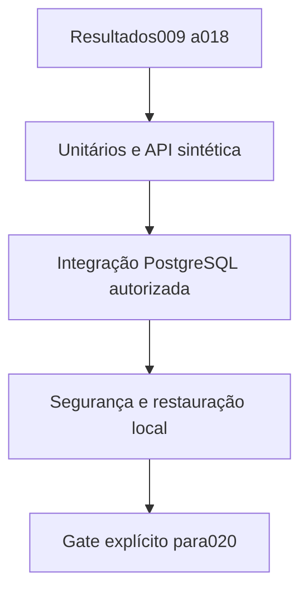

# Desenho — 019: Validação integrada do backend e gate para a interface

**Executor: Luna 6, esforço High. Estado: implementação e validação parcial concluídas; gate do backend bloqueado por ambiente.**
Desenho: 17/10/2026; execução: 19/10/2026. Dependências: **009–018 implementadas; não basta existirem seus documentos**.
Decisões rotineiras aprovadas internamente. As instruções de segurança e autorização
do [contrato comum](../WEB-CONTRATO-EXECUCAO.md) fazem parte deste pacote.
Especificação: [planejamento web](../../docs/PLANEJAMENTO-FUTURO-PRESENCA-WEB.md)
e [arquitetura](../../docs/FACEDIFF-WEB-ARQUITETURA-OPERACAO.md).

## Escopo e decisões

Esta é a última entrega de funcionalidades/infraestrutura antes da interface. Executar aceitação integrada do backend usando clientes HTTP, fakes deML e dados sintéticos em banco PostgreSQL descartável expressamente autorizado. Sem HTML/CSS/JS de produto. Corrigir defeitos funcionais encontrados dentro de seu escopo, sem esconder falha com skip, desativação de segurança ou mocks substituindo provaSQL.

Duas conclusões separadas: GATE_BACKEND_PARA_INTERFACE e GATE_OPERACIONAL_DADOS_REAIS. O primeiro exige unitários/regressões, API ponta a ponta sintética, PostgreSQL real descartável com constraints/concorrência, validação de artefatos e roundtrip local cifrado. O segundo exige VPS medida, restoreDrive real autorizado, consentimento/identidade e prova com pessoas/dispositivos; normalmente permanece pendente até ensaio posterior à UI020. Não chamar gate funcional de validação biométrica.

Benchmark instrumentado: CPU/RAM/RSS/PSS, cold/warm, inferência/fila, p50/p95 e erros, taxa de chegada e limites1/2/5/10/excesso; distinguir fake throughput de inferência real. Rodar naKVM2 somente se provisionamento e uso autorizados separadamente; não contratar para cumprir benchmark. Definir timeout e recursos de produção só após evidência real. Ferramenta não ingere pasta real ou dataset por default.

A interface020 só começa se GATE_BACKEND_PARA_INTERFACE=APROVADO com evidências. Se banco descartável autorizado não estiver disponível, preparar testes e marcar BLOQUEADO_POR_AMBIENTE, sem declarar funcionalidades integralmente testadas. Concluir tarefas independentes antes de pedir autorização concreta para o ambiente. Não conectar ao banco local existente por conveniência.

## Fluxo de responsabilidade

## Contratos obrigatórios da entrega

RESULTADO.md deve conter duas linhas inequívocas:
GATE_BACKEND_PARA_INTERFACE: APROVADO | REPROVADO | BLOQUEADO_POR_AMBIENTE
GATE_OPERACIONAL_DADOS_REAIS: APROVADO | PENDENTE
Cada status aponta comandos, contagens, ambiente e artefatos. Gate operacional não pode ser APROVADO antes de ensaio móvel/restore externo.
Benchmark exporta JSON agregado sem frames/embeddings/matrículas/tokens e informa tipo de carga fake ou inferência autorizada.

Nomes de classes e caminhos novos são propostas deste pacote. Antes de criar,
buscar equivalente no repositório e reutilizá-lo; documentar equivalência sem
introduzir duas implementações do mesmo contrato. URLs e estados consumidos
por tarefas posteriores devem permanecer coerentes ou ter atualização coordenada
dos documentos dependentes. Tipos/payloads são formalizados no código e OpenAPI
da tarefa responsável, sem adiantar funcionalidades de outra entrega.

## Arquivos previstos

- `tests/integration/test_web_fluxo_completo.py (novo)`
- `tests/integration/test_web_concorrencia.py (novo)`
- `tests/security/test_web_autorizacao.py (novo diretório se necessário)`
- `scripts/benchmark_web.py (novo, sem dados pessoais)`
- `tasks/019-web-validacao-backend/RESULTADO.md (criar só ao executar)`
- `tasks/019-web-validacao-backend/evidencias/ (somente resultados sem dados sensíveis)`

Acrescentar a próxima revisão Alembic somente quando o modelo desta tarefa
exigir. Conferir head real e seguir [transição de schema](../WEB-MIGRACOES.md).
Não escolher número de revisão antes de inspecionar as entregas anteriores.

## Casos de aceite

- ProfessorA/B, matrícula existente, três referências e ausência de aprovação cobertos no fluxo integrado.
- Duas sessões mesmo dia, duplicidade concorrente, tentativa4, envio tardio, revogação em fila e correção manual concorrente.
- Restore sintético local recompõe banco/fotos e reaplica exclusões; erro de upload/semchave explícito.
- CSV seguro, logs sem dados, artefatos sem porta pública de banco/biometria; nenhuma presença em falha técnica.

## Condição de conclusão

Gate de backend só aprovado com todos os checks obrigatórios efetivamente executados. UI não inicia em gate reprovado/bloqueado. Operação real permanece separada e sem simulação de aprovação.

Sem implementar outra task para preencher resultado desta. Ao executar, criar
`RESULTADO.md` com evidências reais, requisitos satisfeitos e gates pendentes.
O pacote não contém resultado antecipado ou teste ficticiamente aprovado.
