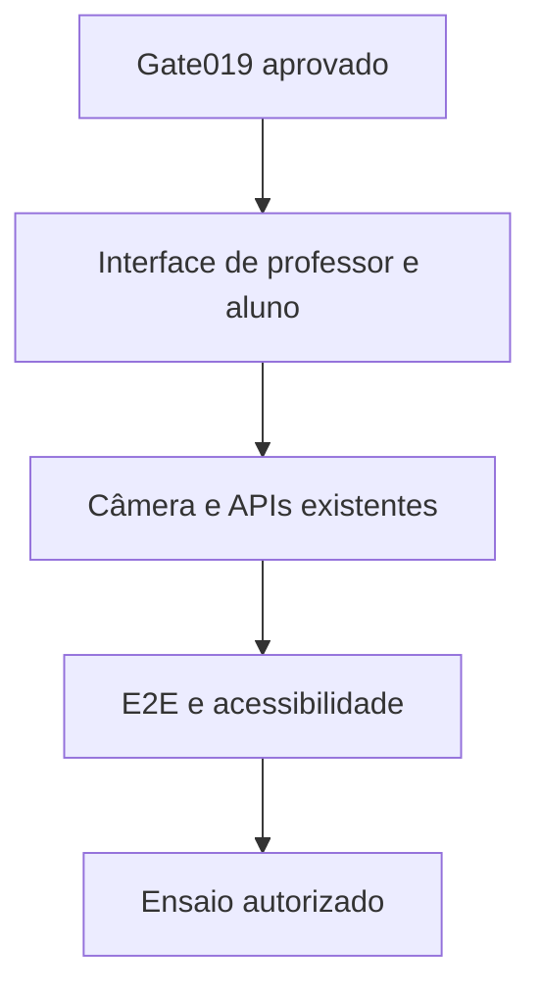

# Desenho — 020: Interface web responsiva e validação ponta a ponta

**Executor: Luna 6, esforço High. Estado: planejada, não implementada.**
Data: 17/10/2026. Dependências: **019 com GATE_BACKEND_PARA_INTERFACE=APROVADO; todas as funcionalidades009–018 prontas e testadas**.
Decisões rotineiras aprovadas internamente. As instruções de segurança e autorização
do [contrato comum](../WEB-CONTRATO-EXECUCAO.md) fazem parte deste pacote.
Especificação: [planejamento web](../../docs/PLANEJAMENTO-FUTURO-PRESENCA-WEB.md)
e [arquitetura](../../docs/FACEDIFF-WEB-ARQUITETURA-OPERACAO.md).

## Escopo e decisões

Única task de interface do pacote, deliberadamente por último. Consumir APIs já validadas, sem criar regras de negócio em JavaScript nem resolver funcionalidades faltantes escondidas naUI. Se um backend não cumprir contrato, registrar regressão, corrigir na camada responsável e repetir gate019 antes da aceitação. Não iniciar020 em status 'testes preparados'.

Frontend simples mesma origem, responsivo, sem necessidade de React/SPA/build adicional. Telas: login/troca de senha; painel/CRUD turmas e vínculos; convites; solicitações/aprovação sem biometria; sessão/presenças/revisões; CSV; administração segura. Professor vê estado e metadados necessários, nunca fotografia/embedding. Polling15s sem sobreposição, último horário e erro de atualização.

Aluno cadastro: link, explicação/consentimento, nome/matrícula, permissão de câmera, três capturas guiadas, processamento, pendência e resultado. Aluno presença: matrícula, câmera, desafio orientado013, captura automática, feedback fila/validação e confirmação só após persistência. A captura deve respeitar etapas backend; não basta temporizador no cliente. Evitar esconder controles de acessibilidade; oferecer revisão quando movimento não for possível.

Usar getUserMedia em HTTPS, tratar câmera negada/ocupada/ausente, orientação/espelhamento e troca de dispositivo; parar tracks no fim/cancelamento. Texto/indicador acessíveis, teclado, foco, contraste e leitor de tela. Não exibir score como probabilidade de identidade ou promessa de segurança. Não salvar frames no storage do navegador nem enviar analytics.

Testes browser sintéticos primeiro, com câmera fake, e ensaio nos celulares/notebooks reais somente com autorização. Configurar staging/HTTPS ou VPS permanece ação separadamente autorizada, não implícita por existir task020. Finalizar roteiro de apresentação/contingência e encerramento sem executar eliminação real.

## Fluxo de responsabilidade

## Contratos obrigatórios da entrega

Consumir OpenAPI/DTOs009–019, sem chamadas diretas ao banco/modelos.
Cliente de câmera implementa upload limitado e ordens do desafio; não decide horário/vida/identidade.
Painel usa GET /api/v1/turmas/{id}/painel a cada15s; status de operação usa endpoint próprio com backoff.
CSV usa endpoint autorizado, sem regenerar relatório biométrico no browser.
Estado final 'presença confirmada' depende de resultado persistido daAPI, nunca de sucesso local da câmera.

Nomes de classes e caminhos novos são propostas deste pacote. Antes de criar,
buscar equivalente no repositório e reutilizá-lo; documentar equivalência sem
introduzir duas implementações do mesmo contrato. URLs e estados consumidos
por tarefas posteriores devem permanecer coerentes ou ter atualização coordenada
dos documentos dependentes. Tipos/payloads são formalizados no código e OpenAPI
da tarefa responsável, sem adiantar funcionalidades de outra entrega.

## Arquivos previstos

- `src/presentation/web/templates/ (novo)`
- `src/presentation/web/static/ (novo)`
- `src/presentation/web/routes/ (somente integração de apresentação)`
- `tests/e2e/web/ (novo)`
- `tests/unit/test_web_apresentacao.py (novo)`
- `docs/FACEDIFF-WEB-APRESENTACAO.md (novo roteiro ao executar)`

Acrescentar a próxima revisão Alembic somente quando o modelo desta tarefa
exigir. Conferir head real e seguir [transição de schema](../WEB-MIGRACOES.md).
Não escolher número de revisão antes de inspecionar as entregas anteriores.

## Casos de aceite

- Fluxo completo no navegador com backend testado; matrícula existente não permite assumir identidade.
- Professor não acessa fotos/embeddings; usuário de outra turma negado mesmo alterandoURL.
- Captura automática após permissão e condições, três referências no cadastro, replay/erro nunca exibem sucesso.
- Polling15s sem duplicar requests; reload consulta tentativa em vez de consumir quota; CSV correto.
- Android/Chrome, iOS/Safari e notebook planejados/ensaiados com evidência; falhas de câmera/rede e revisão acessível cobertas.

## Condição de conclusão

Interface completa sobre funcionalidades comprovadas, E2E aprovado com evidências; nenhuma decisão biométrica no cliente. Prontidão para dados reais/deploy só se gates operacionais adicionais forem efetivamente cumpridos.

Sem implementar outra task para preencher resultado desta. Ao executar, criar
`RESULTADO.md` com evidências reais, requisitos satisfeitos e gates pendentes.
O pacote não contém resultado antecipado ou teste ficticiamente aprovado.
