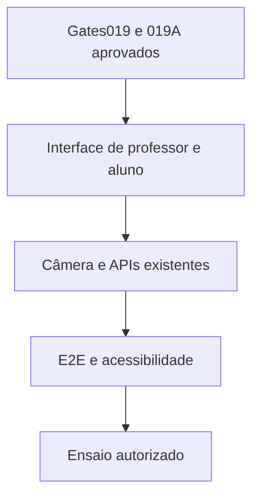

# Desenho — 020: Interface web responsiva e validação ponta a ponta

**Executor: Luna 6, esforço High. Estado: implementação parcial no workspace; validação visual/E2E em navegador pendente.**
Data: 17/10/2026. Dependências: **019 e 019A com GATE_BACKEND_PARA_INTERFACE=APROVADO; todas as funcionalidades009–019A prontas e testadas**.
Decisões rotineiras aprovadas internamente. As instruções de segurança e autorização
do [contrato comum](../WEB-CONTRATO-EXECUCAO.md) fazem parte deste pacote.
Especificação: [planejamento web](../../docs/PLANEJAMENTO-FUTURO-PRESENCA-WEB.md)
e [arquitetura](../../docs/FACEDIFF-WEB-ARQUITETURA-OPERACAO.md).

## Escopo e decisões

Única task de interface do pacote, deliberadamente por último. Consumir APIs já validadas, sem criar regras de negócio em JavaScript nem resolver funcionalidades faltantes escondidas naUI. Se um backend não cumprir contrato, registrar regressão, corrigir na camada responsável e repetir gates019/019A antes da aceitação. Não iniciar020 em status 'testes preparados'.

Frontend simples mesma origem, responsivo, sem necessidade de React/SPA/build adicional. Telas: login/troca de senha; painel/CRUD turmas e vínculos; convites; solicitações/aprovação sem biometria; sessão/presenças/revisões; CSV; administração segura. Professor vê estado e metadados necessários, nunca fotografia/embedding. Polling15s sem sobreposição, último horário e erro de atualização.

Aluno cadastro: link, explicação/consentimento, nome/matrícula, permissão de câmera, três capturas guiadas, processamento, pendência e resultado. Aluno presença: matrícula, câmera, desafio orientado013, captura automática, feedback fila/validação e confirmação só após persistência. A captura deve respeitar etapas backend; não basta temporizador no cliente. Evitar esconder controles de acessibilidade; oferecer revisão quando movimento não for possível.

Usar getUserMedia em HTTPS, tratar câmera negada/ocupada/ausente, orientação/espelhamento e troca de dispositivo; parar tracks no fim/cancelamento. Texto/indicador acessíveis, teclado, foco, contraste e leitor de tela. Não exibir score como probabilidade de identidade ou promessa de segurança. Não salvar frames no storage do navegador nem enviar analytics.

Testes browser sintéticos primeiro, com câmera fake, e ensaio nos celulares/notebooks reais somente com autorização. Configurar staging/HTTPS ou VPS permanece ação separadamente autorizada, não implícita por existir task020. Finalizar roteiro de apresentação/contingência e encerramento sem executar eliminação real.

## Fluxo de responsabilidade

## Contratos obrigatórios da entrega

Consumir OpenAPI/DTOs009–019, sem chamadas diretas ao banco/modelos.
Cliente de câmera implementa upload limitado e ordens do desafio; não decide horário/vida/identidade.
Painel usa GET /api/v1/turmas/{id}/painel a cada15s; status de operação usa endpoint próprio com backoff.
CSV usa endpoint autorizado, sem regenerar relatório biométrico no browser.
Estado final 'presença confirmada' depende de resultado persistido daAPI, nunca de sucesso local da câmera.

Nomes de classes e caminhos novos são propostas deste pacote. Antes de criar,
buscar equivalente no repositório e reutilizá-lo; documentar equivalência sem
introduzir duas implementações do mesmo contrato. URLs e estados consumidos
por tarefas posteriores devem permanecer coerentes ou ter atualização coordenada
dos documentos dependentes. Tipos/payloads são formalizados no código e OpenAPI
da tarefa responsável, sem adiantar funcionalidades de outra entrega.

## Arquivos previstos

- `src/presentation/web/templates/ (novo)`
- `src/presentation/web/static/ (novo)`
- `src/presentation/web/routes/ (somente integração de apresentação)`
- `tests/e2e/web/ (novo)`
- `tests/unit/test_web_apresentacao.py (novo)`
- `docs/FACEDIFF-WEB-APRESENTACAO.md (novo roteiro ao executar)`

Acrescentar a próxima revisão Alembic somente quando o modelo desta tarefa
exigir. Conferir head real e seguir [transição de schema](../WEB-MIGRACOES.md).
Não escolher número de revisão antes de inspecionar as entregas anteriores.

## Casos de aceite

- Fluxo completo no navegador com backend testado; matrícula existente não permite assumir identidade.
- Professor não acessa fotos/embeddings; usuário de outra turma negado mesmo alterandoURL.
- Captura automática após permissão e condições, três referências no cadastro, replay/erro nunca exibem sucesso.
- Polling15s sem duplicar requests; reload consulta tentativa em vez de consumir quota; CSV correto.
- Android/Chrome, iOS/Safari e notebook planejados/ensaiados com evidência; falhas de câmera/rede e revisão acessível cobertas.

## Condição de conclusão

Interface completa sobre funcionalidades comprovadas, E2E aprovado com evidências; nenhuma decisão biométrica no cliente. Prontidão para dados reais/deploy só se gates operacionais adicionais forem efetivamente cumpridos.

Sem implementar outra task para preencher resultado desta. Ao executar, criar
`RESULTADO.md` com evidências reais, requisitos satisfeitos e gates pendentes.
O pacote não contém resultado antecipado ou teste ficticiamente aprovado.

## Direção visual consolidada — 20/10/2026

- **Preferências confirmadas pelo usuário:** predominância de `#000000` e `#FFFFFF`; Helvetica Now Display nos pesos 400 e 700; referências de hero Aether Flow, FAQ accordion e cursor magnético; interface responsiva, animações modernas e minimalistas, com aparência própria e sem padrões genéricos de AI slop.
- **Decisões de aplicação:** linguagem editorial monocromática, hierarquia tipográfica clara, linhas finas, espaços consistentes e conteúdo real do FaceDiff. Usar motivos discretos de enquadramento facial; não simular reconhecimento nem métricas biométricas.
- **Implementação visual:** templates, CSS e JavaScript próprios em `src/presentation/web/`; nenhuma dependência frontend, fonte externa ou componente copiado foi adicionado. A inspeção visual por navegador continua pendente.

### Paleta, tipografia e componentes básicos

- Tokens: fundo `#FFFFFF`, texto `#000000`, hero preto com texto branco, superfície secundária `#F5F5F5`, texto auxiliar `#595959` em fundo claro e `#B3B3B3` em fundo preto, divisórias `#D9D9D9` e `#333333`.
- Sucesso, erro e espera sempre terão texto e ícone/indicador; nunca dependerão apenas da cor.
- Helvetica Now Display 400 para corpo e 700 para títulos/ações. Usar WOFF2 somente com autorização/licença apropriada; não baixar fontes de origem desconhecida. Sem arquivos autorizados, adotar `"Helvetica Neue", Helvetica, Arial, sans-serif` e registrar a substituição.
- Corpo 16px e entrelinha 1.5; títulos fluidos com `clamp()`, hero entre 40px e 88px e entrelinha aproximada de 1.05. Não reduzir labels/formulários para caber na tela.
- Espaçamento em escala 4/8/12/16/24/32/48/64px; controles com cantos de 6–8px, foco visível e área de toque de pelo menos 44×44px. Evitar converter todo o conteúdo em cards.
- Evitar gradientes roxos, glow neon, glassmorphism generalizado, badges repetidos, números/depoimentos fictícios e grades idênticas de cards. A composição e o conteúdo devem ser específicos do FaceDiff.

### Página inicial e referências

- **Cabeçalho:** marca textual FaceDiff, âncoras “Como funciona” e “Dúvidas”, ação “Entrar como professor” e menu compacto móvel acessível por teclado.
- **Hero:** adaptar [Aether Flow Hero](https://21st.dev/@dhileepkumargm/components/aether-flow-hero): fundo preto e partículas conectadas em cinza/branco; remover copy de engine/framework, gradiente no título e badge genérico.
  - Título: “Presença, no seu tempo de aula.” Texto: “O professor compartilha o link. O aluno acessa a câmera e verifica sua presença durante a sessão.” Não prometer aprovação instantânea nem segurança absoluta.
  - Ação principal “Entrar como professor”; secundária “Como funciona”. Alunos entram pelo link recebido, sem catálogo público de turmas ou formulário de token desnecessário.
  - Em desktop, texto à esquerda e área livre para as partículas; em telas pequenas, uma coluna e título fluido. Não impor `height: 100vh`; o conteúdo cresce em paisagem e com zoom.
- **Como funciona:** sequência editorial em três passos — professor cria sessão; aluno acessa o link e segue as orientações; resultado fica disponível no painel. Usar texto e divisórias, sem cards genéricos obrigatórios.
- **FAQ:** adaptar o accordion de [FAQs 01](https://21st.dev/@ln-dev7/components/faqs-01), com fundo branco, título à esquerda, largura confortável e divisórias finas.
  - Perguntas: instalação; permissão de câmera; presença remota; falha de verificação; aprovação do cadastro; tratamento de dados.
  - Respostas coerentes com o backend: navegador, permissão explícita, regras definidas pela sessão, tentativas e revisão, cadastro sujeito à aprovação e retenção conforme aviso vigente. Não inventar garantias, canais de suporte ou prazos.
  - Remover referência comercial a Blockus, planos, reembolsos e suporte em quatro horas. Preferir HTML nativo para acessibilidade por teclado e anúncio do estado.
- **Rodapé:** identificação acadêmica, informação sobre tratamento de dados e acesso do professor, sem links vazios ou seções comerciais artificiais.

### Painel e fluxos do aluno

- **Professor:** fundo claro, navegação lateral em desktop e compacta em celular; turma/sessão, ação principal e lista/tabela como centro. Usar dados reais da API, sem gráficos ou KPIs decorativos.
- **Tabelas:** preservar cabeçalhos e relações; priorizar nome/matrícula/estado no celular e deixar campos complementares em detalhes expansíveis. Se houver rolagem horizontal, mantê-la no contêiner e sinalizá-la; evitar overflow global.
- **Aluno por link:** acesso direto a cadastro/presença, sem passar pela landing. Cabeçalho compacto com contexto, etapa atual, câmera, orientação e processamento em destaque.
- **Câmera:** enquadramento simples com cantos-guia e instrução curta. Sem partículas, cursor customizado ou animação decorativa. O progresso reflete etapas da API; sem percentuais inventados ou sucesso antecipado.
- **Estados:** inicial, carregamento, vazio, erro, acesso negado, link expirado/revogado, câmera indisponível, fila cheia, limite de requisições, revisão, pendência de aprovação e sucesso persistido. Mensagens indicam o próximo passo sem detalhes internos.

### Movimento e cursor magnético

- Referência [Magnetic Cursor](https://21st.dev/@jahed/components/magnetic-cursor): o trecho fornecido não é a implementação completa. Não presumir dependências nem copiar código não inspecionado.
- Cursor magnético apenas como aprimoramento da landing, em `(hover: hover) and (pointer: fine)` e sem preferência por movimento reduzido. Limitar o deslocamento a ações selecionadas; não alterar hitbox, ocultar foco nem bloquear clique/seleção.
- Manter cursor nativo como padrão. Desativar o efeito em formulários, painel, câmera, toque e movimento reduzido. Não instalar GSAP/React Three Fiber apenas por aparecerem nas referências.
- Microinterações de 120–180ms; transições de conteúdo de 200–300ms; entrada do hero de até 500ms e deslocamento máximo de 12px. Conteúdo e ações ficam disponíveis sem esperar animação.
- Preferir `opacity`/`transform`. Sem scroll hijacking, parallax obrigatório, splash ou animação em loop nas tarefas operacionais. `prefers-reduced-motion: reduce` remove deslocamentos, magnetismo e partículas; preservar indicadores textuais de espera.
- Canvas somente no hero: dimensionar pelo contêiner, DPR até 2, 60 partículas em desktop e 24 em mobile, pausar fora da viewport/aba oculta e liberar listeners/requestAnimationFrame ao desmontar.
- Proteger distância zero no repelir do ponteiro, iniciar pares em `a + 1`, limitar opacidade a 0–1 e usar coordenadas relativas ao canvas. Reduzir/desativar se custo quadrático prejudicar a interação; o fundo estático deve ser suficiente.

### Stack e critérios responsivos

- Manter templates e assets locais na mesma origem, CSS e JavaScript modular. React, Framer Motion, Tailwind, shadcn/ui e lucide-react das referências não são dependências aprovadas automaticamente.
- Não executar `npx @21st-dev/cli add ln-dev7/faqs-01` automaticamente. Antes de reutilização literal, verificar origem, licença, dependências e atribuições. Se indisponível, implementar o comportamento com HTML/CSS/JS próprio.
- Layout fluido de 320px a monitores largos, com largura máxima e margens adaptativas. Breakpoints orientativos: 640/960/1280px; não detectar modelo de dispositivo.
- Matriz de revisão visual: 320, 360, 390, 768, 1024, 1440, 1920 e 2560px; paisagem curta, zoom 200%, reflow equivalente a 320px com zoom 400%, teclado virtual e safe areas. A amostragem não prova todas as resoluções.
- Validar teclado, foco/diálogos, leitor de tela, contraste WCAG AA, ausência de dependência de hover e alternativa a movimento. Não afirmar conformidade integral apenas por auditoria automatizada.
- Registrar capturas sintéticas e revisão manual da landing, painel e câmera nos tamanhos principais. Rostos reais não são necessários para avaliar layout.
